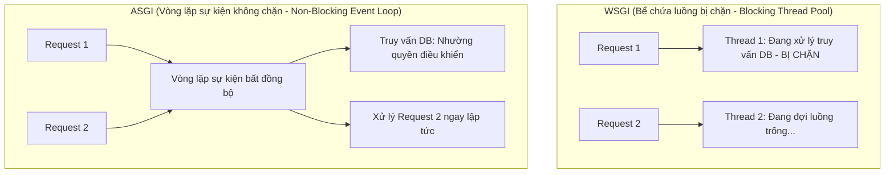
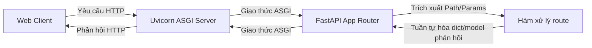

### 🎯 Mục tiêu học tập
- Phân biệt giữa đặc tả máy chủ web WSGI và ASGI, hiểu tại sao các framework hiện đại ưu tiên ASGI.
- Cài đặt và cấu hình FastAPI cùng Uvicorn để chạy một server phát triển (development server).
- Tạo một instance ứng dụng FastAPI cơ bản và đăng ký các route handler bằng cách sử dụng decorator path operation.
- Truy cập tài liệu tương tác tự động Swagger UI và ReDoc.
- Viết các bài viết unit test cho các endpoint FastAPI sử dụng `TestClient` để thực hiện các request HTTP ảo.

### 🧩 Khái niệm cốt lõi (Tại sao)
Các framework web Python truyền thống như Flask và Django (trước đây) dựa trên đặc tả **WSGI (Web Server Gateway Interface)**. Được thiết kế vào năm 2003, WSGI được xây dựng cho việc thực thi đồng bộ và chặn (blocking): một request ánh xạ trực tiếp đến một luồng (thread) hoặc tiến trình của hệ điều hành. Khi ứng dụng đợi truy vấn cơ sở dữ liệu hoặc gọi API bên ngoài, toàn bộ luồng đó sẽ bị chặn. Mô hình này gặp khó khăn khi mở rộng dưới hàng nghìn kết nối đồng thời và không thể xử lý nguyên bản các giao thức không đồng bộ hiện đại như WebSockets hoặc HTTP/2.

Để giải quyết vấn đề này, cộng đồng Python đã phát triển **ASGI (Asynchronous Server Gateway Interface)**. ASGI là sự kế thừa tinh thần của WSGI, cung cấp một giao diện chuẩn cho các máy chủ web, framework và ứng dụng Python có khả năng bất đồng bộ. Dưới ASGI, máy chủ web chạy một vòng lặp sự kiện bất đồng bộ đơn luồng (ví dụ: sử dụng `asyncio`), cho phép xử lý hàng nghìn yêu cầu đồng thời mà không bị chặn trên một luồng duy nhất.

**Uvicorn** là một triển khai máy chủ ASGI cực nhanh, được xây dựng trên `uvloop` (một sự thay thế nhanh chóng cho vòng lặp sự kiện asyncio tiêu chuẩn) và `httptools` (một thư viện Python liên kết với bộ phân tích cú pháp HTTP của nodejs).

**FastAPI** là một framework web hiện đại, hiệu năng cao để xây dựng các API với Python 3.8+ dựa trên các type hint tiêu chuẩn của Python. Bằng cách tận dụng ASGI và Pydantic (để kiểm định dữ liệu), FastAPI là một trong những framework Python nhanh nhất hiện nay, có thể cạnh tranh với NodeJS và Go. Nó cũng tự động tạo tài liệu Swagger UI tương tác tại `/docs` ngay khi cài đặt, giúp tăng tốc độ tích hợp giữa frontend và backend.

### 🔁 Logic và hoạt động

Dưới đây là thiết kế kiến trúc và luồng thực thi vòng đời của một request trong FastAPI:

#### 1. Xử lý Request ASGI so với WSGI


#### 2. Vòng đời Request-Response trong FastAPI


- **Định tuyến bất đồng bộ (Asynchronous Routing)**: FastAPI hỗ trợ cả handler route `def` và `async def`. Nếu bạn sử dụng `async def`, FastAPI sẽ chạy nó trực tiếp trong vòng lặp sự kiện chính. Nếu bạn sử dụng `def`, FastAPI sẽ chạy nó trong một luồng ngoài (external thread pool) để tránh chặn vòng lặp sự kiện chính.
- **Request ảo với TestClient**: Trong quá trình test, việc khởi động một máy chủ Uvicorn thực trên một cổng TCP là rất chậm và tốn tài nguyên. `TestClient` của FastAPI sử dụng client ảo của `Starlette` để mô phỏng Uvicorn. Nó truyền trực tiếp các dictionary ASGI scope tới ứng dụng FastAPI, mô phỏng toàn bộ vòng đời HTTP hoàn toàn trong bộ nhớ.

### 📝 Ví dụ minh họa có chú thích

#### 1. Thiết kế Máy chủ FastAPI đầu tiên của bạn
Hãy xem cách khai báo một máy chủ FastAPI cơ bản và định nghĩa các route.

```python
# main.py
from fastapi import FastAPI

# 1. Khởi tạo đối tượng ứng dụng chính
# Đối tượng app này là điểm đầu vào trung tâm cho Uvicorn
app = FastAPI(
    title="API Đầu Tiên Của Tôi",
    description="Giới thiệu FastAPI đơn giản",
    version="1.0.0"
)

# 2. Định nghĩa một Path Operation Decorator
# @app.get("/") khai báo rằng hàm bên dưới sẽ xử lý các yêu cầu GET đến đường dẫn gốc
@app.get("/")
def read_root():
    # FastAPI tự động chuyển đổi (serialize) dictionary trả về thành định dạng JSON
    # Nó cũng thiết lập header Content-Type thành application/json
    return {"message": "Hello World"}

# 3. Path Parameters và Query Parameters
@app.get("/items/{item_id}")
def read_item(item_id: int, q: str = None):
    # FastAPI tự động phân tích cú pháp item_id thành một số nguyên dựa trên gợi ý kiểu dữ liệu (type hint).
    # Nếu người dùng yêu cầu /items/abc, FastAPI trả về lỗi 422 Unprocessable Entity.
    # 'q' là một query parameter vì nó không được khai báo trong mô hình đường dẫn (path pattern).
    return {"item_id": item_id, "query": q}
```

Để chạy ứng dụng này ở môi trường cục bộ:
```bash
uvicorn main:app --reload
```
- `main:app` đề cập đến module `main.py` và instance `app`.
- `--reload` kích hoạt tính năng tự động tải lại, giúp khởi động lại server mỗi khi code thay đổi.

#### 2. Viết các bài kiểm thử tích hợp ảo (Virtual Integration Tests)
Sử dụng `TestClient` cho phép chúng ta xác thực các route của mình mà không cần chạy một server thực sự.

```python
# test_main.py
from fastapi.testclient import TestClient
from main import app

# Tạo một instance TestClient bằng cách bọc ứng dụng FastAPI của chúng ta
client = TestClient(app)

def test_read_root():
    # Gửi một yêu cầu GET ảo đến URL gốc
    response = client.get("/")
    
    # Assertions (Kiểm tra kết quả)
    assert response.status_code == 200
    assert response.json() == {"message": "Hello World"}

def test_read_item_valid():
    # Kiểm tra path parameter và query parameter hợp lệ
    response = client.get("/items/42?q=searchterm")
    assert response.status_code == 200
    assert response.json() == {"item_id": 42, "query": "searchterm"}

def test_read_item_invalid():
    # Kiểm tra sai kiểu dữ liệu của path parameter (truyền chuỗi "abc" thay vì số nguyên)
    response = client.get("/items/abc")
    assert response.status_code == 422  # Lỗi Validation Error
```

### ❌ Các lỗi thường gặp

**Lỗi 1: Chặn vòng lặp sự kiện (event loop) trong một path operation `async def`**
```python
import time
from fastapi import FastAPI

app = FastAPI()

@app.get("/slow")
async def slow_route():
    # hàm đồng bộ gây chặn bên trong async def
    time.sleep(3)
    return {"status": "slept"}
```
```text
(Không có lỗi traceback nào được sinh ra trực tiếp, nhưng toàn bộ vòng lặp sự kiện của máy chủ bị đóng băng, chặn tất cả các request đồng thời khác trong 3 giây)
```
```python
import asyncio
from fastapi import FastAPI

app = FastAPI()

@app.get("/slow")
async def slow_route():
    # Đúng: Sử dụng hàm ngủ không chặn (non-blocking) async sleep
    await asyncio.sleep(3)
    return {"status": "slept"}
```
> Khi bạn khai báo một route handler bằng `async def`, bạn đang yêu cầu FastAPI thực thi nó trực tiếp trên vòng lặp sự kiện đơn luồng. Nếu bạn thực hiện một cuộc gọi đồng bộ chặn (như `time.sleep()`, các truy vấn cơ sở dữ liệu đồng bộ hoặc các request HTTP chặn) bên trong nó, bạn sẽ làm dừng toàn bộ vòng lặp. Nếu bắt buộc phải sử dụng các thư viện đồng bộ chặn, hãy khai báo route handler bằng `def` thay vì `async def`; FastAPI sau đó sẽ tự động chạy nó trong một thread pool riêng biệt.

**Lỗi 2: Truyền trực tiếp instance app vào uvicorn.run() khi thiết lập reload=True**
```python
import uvicorn
from fastapi import FastAPI
app = FastAPI()
uvicorn.run(app, reload=True)
```
```text
RuntimeError: You must pass the application as an import string to enable 'reload' or 'workers'.
```
```python
import uvicorn
uvicorn.run("main:app", reload=True)
```
> Khi kích hoạt chế độ tự động tải lại `reload=True` hoặc thiết lập nhiều tiến trình con `workers` trong `uvicorn.run()`, bạn không thể truyền trực tiếp đối tượng instance app. Bạn bắt buộc phải truyền nó dưới dạng một chuỗi import (ví dụ: `"main:app"`) để Uvicorn có thể import và tải lại module một cách linh động khi phát hiện thay đổi trong mã nguồn.

### 💡 Mẹo & Cách viết tối ưu
- **Tài liệu tương tác tự động**: Luôn truy cập `http://127.0.0.1:8000/docs` trong khi server Uvicorn của bạn đang chạy. FastAPI tự động biên dịch các route, query parameter, path parameter và các schema của bạn thành một trang OpenAPI/Swagger tương tác hoàn chỉnh.
- **Lựa chọn giữa Bất đồng bộ (Asynchronous) và Đồng bộ (Synchronous)**: Chỉ sử dụng `async def` khi bạn sử dụng các thư viện hỗ trợ `async/await` (ví dụ: `httpx`, `tortoise-orm`, `motor`). Nếu bạn đang sử dụng các thư viện chặn tiêu chuẩn (ví dụ: `requests`, `psycopg2`, `sqlite3`), hãy sử dụng `def` để FastAPI xử lý lập lịch luồng một cách an toàn.

### 🧠 Đi sâu phân tích (Cơ chế bên dưới)
<details><summary>Giao thức ASGI và Cơ chế định tuyến Request của Starlette</summary>

FastAPI không trực tiếp xử lý việc phân tích cú pháp HTTP thô hoặc các cổng kết nối socket. Thực chất bên dưới, FastAPI được xây dựng trên **Starlette**, một bộ công cụ ASGI gọn nhẹ.

Khi Uvicorn nhận được một kết nối, nó sẽ gọi ứng dụng ASGI bằng một chữ ký (signature) gồm 3 đối số:
```python
async def app(scope, receive, send):
    ...
```
1. **`scope`**: Một dictionary chứa siêu dữ liệu (metadata) về request đang đến (ví dụ: type là `"http"` hoặc `"websocket"`, IP của client, các HTTP header, đường dẫn request).
2. **`receive`**: Một hàm bất đồng bộ có thể gọi (callable) để nhận các phần (chunk) của body request HTTP đang truyền vào.
3. **`send`**: Một hàm bất đồng bộ có thể gọi để gửi các HTTP response header và các phần của body phản hồi lại cho client.

Starlette phân tích cú pháp các payload ASGI thô này thành đối tượng `Request` có cấu trúc, so khớp đường dẫn với cây định tuyến đã đăng ký, thực hiện phân tích cú pháp truy vấn và chuyển quyền kiểm soát cho các trình bọc route của FastAPI. FastAPI sau đó kiểm tra chữ ký hàm của bạn, thực hiện xác thực bằng cách sử dụng Pydantic, gọi handler của bạn và tuần tự hóa giá trị trả về thành phản hồi JSON được gửi lại qua kênh `send`.
</details>

### 🏋️ Bài tập thực hành
Tạo một ứng dụng FastAPI cung cấp một route GET tại `/` trả về `{"message": "Hello World"}`.

```python
from fastapi import FastAPI

# Tạo một instance FastAPI và định nghĩa route GET / trả về {"message": "Hello World"}
app = None
```

### ✅ Tự kiểm tra
1. Điều gì xảy ra nếu bạn gửi yêu cầu đến một route được định nghĩa với path parameter `{item_id: int}` bằng đường dẫn `/items/hello`?
2. `TestClient` có khởi động một server thực tế trên cổng cục bộ như `8000` khi chạy các bộ kiểm thử không?
3. Làm thế nào để xem tài liệu OpenAPI tương tác tự động?
<details><summary>Đáp án</summary>

1. FastAPI tự động cố gắng phân tích cú pháp chuỗi `"hello"` thành một số nguyên. Khi thất bại, nó sẽ trả về HTTP status code `422 Unprocessable Entity` với một body JSON có cấu trúc chi tiết về lỗi kiểm định.
2. Không, `TestClient` sử dụng lớp vận chuyển mock ASGI để chuyển trực tiếp các request đến ứng dụng trong bộ nhớ. Điều này làm cho việc unit test cực kỳ nhanh chóng.
3. Bạn có thể xem tài liệu OpenAPI Swagger bằng cách chạy ứng dụng của bạn bằng Uvicorn và truy cập `http://127.0.0.1:8000/docs` (hoặc `/redoc` đối với giao diện ReDoc).
</details>

### 📌 Tóm tắt
- **WSGI** là một giao diện cổng đồng bộ ánh xạ các yêu cầu tới các luồng, trong khi **ASGI** là một giao diện cổng bất đồng bộ hỗ trợ xử lý đồng thời không chặn.
- **Uvicorn** là một máy chủ ASGI hiệu năng cao được sử dụng để tải và chạy các ứng dụng FastAPI.
- **FastAPI** cung cấp tài liệu tương tác Swagger và ReDoc tự động mà không cần bất kỳ cấu hình thủ công nào.
- **TestClient** cho phép kiểm thử nhanh chóng và tiết kiệm bộ nhớ cho các route ASGI mà không cần khởi chạy máy chủ web thực tế.
