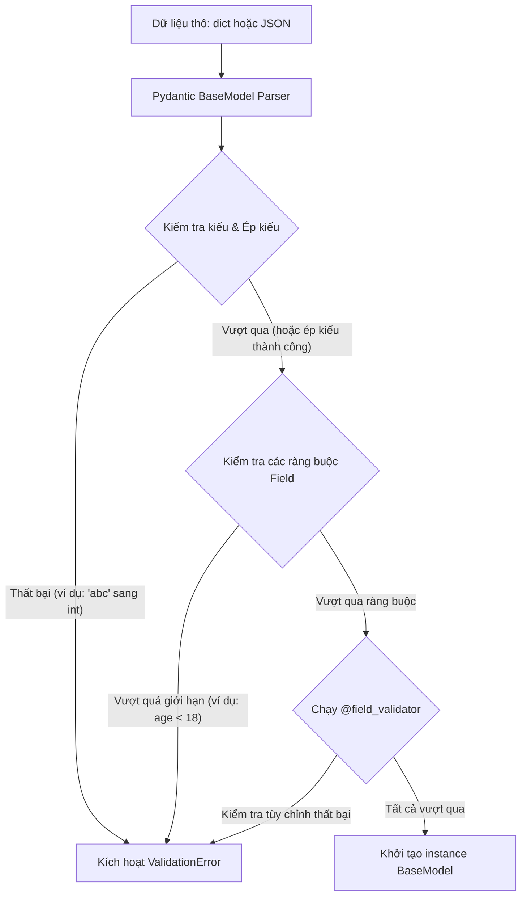

### 🎯 Mục tiêu học tập
- Khai báo các schema có cấu trúc bằng cách kế thừa từ lớp `BaseModel` của Pydantic.
- Áp dụng các ràng buộc dữ liệu (như `ge`, `le`, `min_length` và các mẫu regex) bằng cách sử dụng `Field` của Pydantic.
- Triển khai logic kiểm định tùy chỉnh ở mức trường (field-level validation) bằng cách sử dụng decorator `@field_validator` trong Pydantic v2.
- Hiểu cơ chế ép kiểu (type coercion) và cách Pydantic phân tích cú pháp và kiểm định kiểu dữ liệu một cách linh động.
- Xử lý các ngoại lệ `ValidationError` và kiểm tra cấu trúc lỗi chi tiết bằng lập trình.

### 🧩 Khái niệm cốt lõi (Tại sao)
Trong các ứng dụng web, dữ liệu đầu vào đến từ các nguồn không đáng tin cậy (JSON request body, query parameter, payload API bên ngoài). Việc xác thực dữ liệu này theo cách thủ công bằng các câu lệnh `if/else` lồng nhau rất dễ xảy ra lỗi, tẻ nhạt và khó bảo trì.

**Pydantic** là thư viện xác thực dữ liệu và quản lý cài đặt hàng đầu cho Python. Thay vì viết code phân tích cú pháp tùy chỉnh, bạn khai báo cấu trúc dữ liệu của mình bằng cách sử dụng gợi ý kiểu dữ liệu (type hint) của Python. Pydantic đảm bảo dữ liệu đầu ra khớp với các kiểu dữ liệu đã định nghĩa.

Pydantic v2 được viết lại bằng **Rust**, giúp quá trình xác thực nhanh hơn tới 50 lần so với Pydantic v1. Các điểm nổi bật chính của Pydantic là:
1. **Thực thi xác thực, không chỉ dừng ở Type Hinting**: Không giống như các công cụ kiểm tra kiểu tĩnh chỉ hoạt động trên IDE (như mypy), Pydantic bắt buộc thực thi các kiểu dữ liệu tại thời điểm chạy (runtime).
2. **Ép kiểu dữ liệu (Type Coercion/Parsing)**: Pydantic không chỉ đơn giản là từ chối các kiểu dữ liệu không chính xác; nó cố gắng chuyển đổi (ép kiểu) các giá trị sang kiểu dữ liệu chính xác. Ví dụ: nếu một trường yêu cầu kiểu `int` và nhận được chuỗi `"42"`, Pydantic sẽ chuyển đổi nó thành số nguyên `42`.
3. **Pydantic trong FastAPI**: FastAPI sử dụng các schema Pydantic bên dưới để phân tích cú pháp request body, xác thực các query parameter, định dạng phản hồi JSON và tự động tạo OpenAPI schema.

### 🔁 Logic và hoạt động

Dưới đây là luồng kiểm định schema và phân tích cú pháp từng bước của Pydantic:

#### 1. Vòng đời kiểm định dữ liệu (Validation Lifecycle)


- **Thứ tự thực thi**: Pydantic xác thực dữ liệu đầu vào qua ba giai đoạn chính:
  1. **Kiểm tra & ép kiểu (Type Checking & Parsing)**: Đảm bảo các trường khớp với gợi ý kiểu dữ liệu của chúng (ép kiểu như chuỗi thành số nguyên hoặc boolean nếu có thể).
  2. **Các ràng buộc của trường (Field Constraints)**: Xác thực các giới hạn được xác định trong `Field` (ví dụ: giá trị tối thiểu, độ dài chuỗi).
  3. **Hàm kiểm định tùy chỉnh (Custom Validators)**: Thực thi logic tùy chỉnh được viết bằng `@field_validator`.
- **Xác thực toàn diện (Atomic Validation)**: Pydantic xác thực toàn bộ đầu vào trước khi trả về. Nếu nhiều trường không vượt qua kiểm định, nó sẽ thu thập tất cả các lỗi thành một ngoại lệ `ValidationError` duy nhất để người gọi nhận được báo cáo đầy đủ, thay vì dừng lại ngay ở lỗi đầu tiên.

### 📝 Ví dụ minh họa có chú thích

#### 1. Định nghĩa một Schema với các ràng buộc của Field
Hãy thiết kế một schema đại diện cho hồ sơ người dùng với các điều kiện biên nghiêm ngặt.

```python
from pydantic import BaseModel, Field, EmailStr

class UserProfile(BaseModel):
    # 'name' phải là một chuỗi và có ít nhất 2 ký tự và tối đa 50 ký tự
    name: str = Field(min_length=2, max_length=50)
    
    # EmailStr xác thực rằng giá trị là một địa chỉ email đúng cú pháp
    # (Yêu cầu cài đặt: pip install email-validator)
    email: EmailStr
    
    # 'age' là tùy chọn (mặc định là None) nhưng nếu được cung cấp, phải >= 18 và <= 120
    age: int | None = Field(default=None, ge=18, le=120)
    
    # 'tags' có một default factory để tránh lỗi dùng chung list mặc định (mutable default)
    tags: list[str] = Field(default_factory=list)

# Thử nghiệm phân tích cú pháp đầu vào hợp lệ:
data = {
    "name": "Alex",
    "email": "alex@example.com",
    "age": "25",  # Chuỗi "25" sẽ được ép kiểu thành số nguyên 25
    "tags": ["developer", "pythonist"]
}

user = UserProfile(**data)
print(user.name)  # Output: Alex
print(user.age)   # Output: 25 (kiểu: int)
print(user.model_dump()) # Output: đại diện dictionary của model
```

#### 2. Thêm hàm kiểm định tùy chỉnh (Custom Validators) trong Pydantic v2
Chúng ta sử dụng decorator `@field_validator` để viết các logic xác thực nghiệp vụ tùy chỉnh (ví dụ: độ mạnh mật khẩu, tiền tố của trường).

```python
from pydantic import BaseModel, Field, field_validator

class SignupForm(BaseModel):
    username: str = Field(min_length=3)
    password: str = Field(min_length=8)
    
    # Hàm kiểm định tùy chỉnh cho độ mạnh mật khẩu
    # Trong Pydantic v2, các hàm kiểm định tùy chỉnh phải được trang trí bằng cả:
    # @field_validator và @classmethod (với @field_validator ở ngoài cùng)
    @field_validator("password")
    @classmethod
    def check_password_complexity(cls, v: str) -> str:
        # 'v' là giá trị của trường đang được xác thực
        if not any(char.isdigit() for char in v):
            raise ValueError("Mật khẩu phải chứa ít nhất một chữ số.")
        return v # Luôn trả về giá trị đã xác thực (hoặc đã chỉnh sửa)

# Hãy xem cách Pydantic xử lý các lỗi xác thực:
from pydantic import ValidationError

try:
    SignupForm(username="bob", password="nopassword")
except ValidationError as e:
    # In ra mô tả lỗi có cấu trúc định dạng JSON rõ ràng
    print(e.json(indent=2))
```

**Đầu ra lỗi dạng JSON:**
```json
[
  {
    "type": "value_error",
    "loc": [
      "password"
    ],
    "msg": "Value error, Mật khẩu phải chứa ít nhất một chữ số.",
    "input": "nopassword",
    "ctx": {
      "error": {}
    }
  }
]
```

### ❌ Các lỗi thường gặp

**Lỗi 1: Quên khai báo decorator `@classmethod` cho `@field_validator` trong Pydantic v2**
```python
from pydantic import BaseModel, field_validator

class User(BaseModel):
    username: str
    
    @field_validator("username")
    def validate_user(self, value):  # Thiếu @classmethod
        if value.lower() == "admin":
            raise ValueError("Tên người dùng không được là 'admin'")
        return value
```
```text
PydanticUserError: `@field_validator` must be decorated with `@classmethod`.
```
```python
from pydantic import BaseModel, field_validator

class User(BaseModel):
    username: str
    
    @field_validator("username")
    @classmethod  # Đúng: Được trang trí bằng @classmethod
    def validate_user(cls, value):  # Nhận 'cls' làm đối số đầu tiên
        if value.lower() == "admin":
            raise ValueError("Tên người dùng không được là 'admin'")
        return value
```
> Trong Pydantic v2, các hàm kiểm định trường chạy dưới dạng các phương thức lớp (class method) trước khi thực thể thực tế của lớp được khởi tạo. Do đó, chúng phải được đánh dấu bằng `@classmethod` và sử dụng `cls` thay vì `self`.

**Lỗi 2: Thiếu thư viện `email-validator` khi sử dụng kiểu dữ liệu `EmailStr`**
```python
from pydantic import BaseModel, EmailStr

class Account(BaseModel):
    email: EmailStr
```
```text
PydanticImportError: `pydantic-extra-types` or `email-validator` is not installed. Run `pip install email-validator` to use `EmailStr`.
```
```python
# Đầu tiên, chạy lệnh `pip install email-validator` trong terminal của bạn,
# sau đó import và định nghĩa schema của bạn như bình thường:
from pydantic import BaseModel, EmailStr

class Account(BaseModel):
    email: EmailStr
```
> Pydantic ủy quyền xác thực email cho gói thư viện bên thứ ba `email-validator`. Việc cố gắng chạy một model chứa các trường `EmailStr` mà không có dependency này sẽ gây ra ngoại lệ `PydanticImportError` tại thời điểm định nghĩa model.

### 💡 Mẹo & Cách viết tối ưu
- **Xác thực khi gán (Validate Assignment)**: Theo mặc định, Pydantic chỉ xác thực dữ liệu khi model được khởi tạo. Nếu bạn thực hiện gán `user.age = 10`, việc xác thực sẽ không diễn ra. Để kích hoạt xác thực runtime khi gán thuộc tính, hãy thêm cấu hình `ConfigDict` bên trong class:
  ```python
  from pydantic import BaseModel, ConfigDict
  
  class User(BaseModel):
      model_config = ConfigDict(validate_assignment=True)
      age: int
  ```
- **Loại bỏ các giá trị mặc định / giá trị None**: Khi chuyển đổi (serialize) các model thông qua `model_dump()`, bạn có thể loại bỏ các giá trị mặc định hoặc các giá trị `None` bằng cách sử dụng:
  - `user.model_dump(exclude_unset=True)` (chỉ xuất các giá trị được truyền rõ ràng trong quá trình khởi tạo).
  - `user.model_dump(exclude_none=True)` (loại bỏ bất kỳ trường nào chứa giá trị `None`).

### 🧠 Đi sâu phân tích (Cơ chế bên dưới)
<details><summary>Ép kiểu dữ liệu và Engine xác thực cốt lõi (Rust Core)</summary>

Trong Pydantic v2, tất cả các quy tắc phân tích cú pháp và xác thực được biên dịch xuống một engine bằng Rust có tên là `pydantic-core`.

Khi bạn khởi tạo một lớp `BaseModel`:
1. Pydantic chuyển dictionary đầu vào cho validator đã biên dịch bằng Rust.
2. Engine Rust so khớp các key với schema. Nếu gặp phải trường hợp kiểu dữ liệu không khớp, nó sẽ cố gắng **ép kiểu (coercion)** dựa trên các đường phân tích cú pháp chuẩn:
   - Đối với kiểu `int`: Nó cố gắng phân tích cú pháp các dạng biểu diễn chuỗi (ví dụ: `"100"` -> `100`), kiểu số thực (float) (ví dụ: `100.0` -> `100`), hoặc kiểu boolean (`True` -> `1`, `False` -> `0`).
   - Đối với kiểu `bool`: Các giá trị chuỗi như `"true"`, `"yes"`, `"1"`, `"on"` sẽ được ép kiểu thành `True`. Các giá trị như `"false"`, `"no"`, `"0"`, `"off"` sẽ được ép kiểu thành `False`.
3. Nếu ép kiểu thành công, validator sẽ kiểm tra tiếp các ràng buộc (các ràng buộc này cũng được biên dịch để chạy ở tốc độ của Rust).
4. Chỉ khi tất cả các kiểm tra xác thực của Rust vượt qua thành công, engine mới quay lại môi trường Python để khởi tạo đối tượng Python `BaseModel`. Kiến trúc này tránh được chi phí cuộc gọi ngăn xếp (call stack) của Python trong quá trình kiểm tra dữ liệu, mang lại hiệu suất vượt trội cho Pydantic.
</details>

### 🏋️ Bài tập thực hành
Định nghĩa một schema có tên `UserSchema` kế thừa từ `BaseModel` của Pydantic. Schema phải chứa:
- `name` (chuỗi)
- `email` (sử dụng `EmailStr`)
- `age` (số nguyên, với ràng buộc phải lớn hơn hoặc bằng 18)

```python
from pydantic import BaseModel, Field, EmailStr

# Định nghĩa UserSchema với name, email, và age (age phải >= 18)
```

### ✅ Tự kiểm tra
1. Pydantic có chấp nhận một số thực như `25.0` cho một trường được chú thích kiểu `int` không?
2. Sự khác biệt giữa `model_dump()` và `model_dump_json()` là gì?
3. Làm thế nào để tự kích hoạt (raise) các lỗi xác thực bên trong một `@field_validator`?
<details><summary>Đáp án</summary>

1. Có, Pydantic sẽ ép kiểu `25.0` thành số nguyên `25` mà không gây ra lỗi, vì số thực này không có phần thập phân. Tuy nhiên, `25.5` sẽ gây ra lỗi xác thực (validation error).
2. `model_dump()` trả về một dictionary đại diện cho model chứa các kiểu dữ liệu Python tiêu chuẩn, trong khi `model_dump_json()` trả về một chuỗi JSON đã được tuần tự hóa.
3. Bên trong một hàm `@field_validator`, bạn có thể trực tiếp raise một lỗi `ValueError` hoặc `AssertionError`. Pydantic sẽ tự động bắt lấy các lỗi này và gói chúng vào payload lỗi `ValidationError` đã định dạng.
</details>

### 📌 Tóm tắt
- **Pydantic** xác thực và phân tích cú pháp các cấu trúc dữ liệu đầu vào một cách động bằng cách sử dụng các type hint tiêu chuẩn của Python.
- **BaseModel** là lớp cơ sở để khai báo các data schema trong Pydantic.
- **Field** cho phép cấu hình các ràng buộc chi tiết như giới hạn phạm vi (`ge`, `le`), độ dài của chuỗi và cấu hình giá trị mặc định.
- **@field_validator** cho phép tạo các class method tùy chỉnh để thực thi các quy tắc xác thực nghiệp vụ đặc thù.
- **ValidationError** được kích hoạt khi quá trình xác thực dữ liệu thất bại, thu thập tất cả lỗi kiểm định vào một payload schema có cấu trúc thống nhất.
