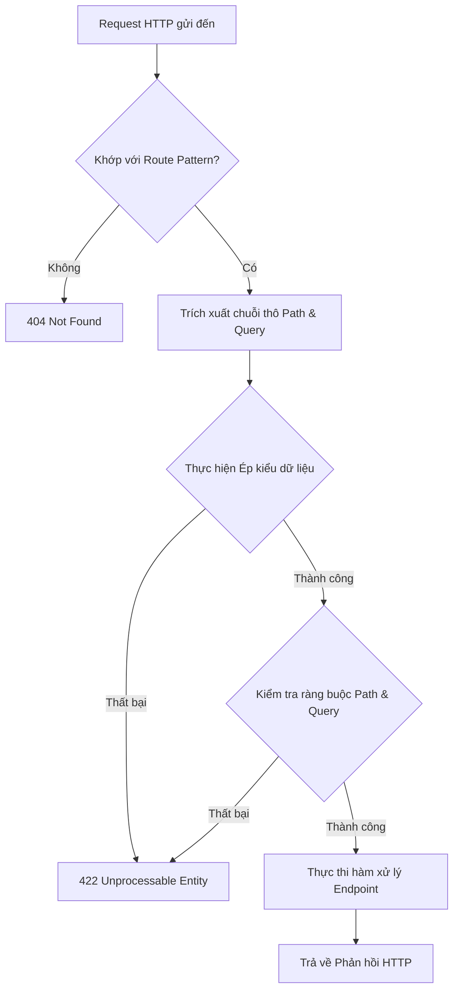

### 🎯 Mục tiêu học tập
- Định nghĩa và trích xuất các tham số path động bằng cách sử dụng các route template của FastAPI.
- Khai báo các tham số query cho các đầu vào tùy chọn, lọc và sắp xếp dữ liệu.
- Áp dụng các quy tắc kiểm định và siêu dữ liệu (metadata) cho các tham số path và query bằng các helper `Path` và `Query`.
- Hiểu cơ chế tự động ép kiểu (type coercion) và engine kiểm định dữ liệu.
- Xử lý các lỗi không khớp kiểu dữ liệu và phản hồi các lỗi HTTP 422 phù hợp.

### 🧩 Khái niệm cốt lõi (Tại sao)
Trong các API web RESTful, các endpoint cần nhận dữ liệu đầu vào từ phía client. Hai cách phổ biến nhất để truyền các kiểu dữ liệu đơn giản (như số, chuỗi và kiểu logic/boolean) là:
1. **Tham số Path (Path Parameter)**: Được sử dụng để xác định một tài nguyên cụ thể. Chúng tạo thành một phần cố định của đường dẫn URL (ví dụ: `/items/42` trong đó `42` là ID của item).
2. **Tham số Query (Query Parameter)**: Được sử dụng để lọc, sắp xếp, phân trang hoặc tùy biến phản hồi dữ liệu. Chúng xuất hiện sau dấu `?` trong URL (ví dụ: `/items?limit=10&sort=desc`).

FastAPI đơn giản hóa việc xử lý các tham số bằng cách sử dụng tính năng gợi ý kiểu (type hint) nguyên bản của Python. Bằng cách khai báo các type hint trong hàm xử lý route, FastAPI tự động:
- Phân tích cú pháp các tham số từ URL của request.
- Ép các giá trị chuỗi thô thành kiểu dữ liệu Python tương ứng (ví dụ: chuỗi `"42"` thành số nguyên `42`).
- Kiểm định các giá trị dựa trên các ràng buộc cơ bản (ví dụ: giá trị tối thiểu/tối đa, độ dài chuỗi, các mẫu regex).
- Tự động tài liệu hóa các tham số trong giao diện OpenAPI/Swagger.

Việc sử dụng các hàm `Path` và `Query` từ `fastapi` cho phép bạn thêm các ràng buộc xác thực bổ sung và siêu dữ liệu mô tả cho các tham số của mình.

### 🔁 Logic và hoạt động

#### Vòng đời phân tích và kiểm định tham số
Khi một request được gửi đến, FastAPI sẽ xử lý các tham số path và query qua vòng đời sau:



### 📝 Ví dụ minh họa có chú thích

#### 1. Tham số Path & Query cơ bản với tính năng tự động ép kiểu
FastAPI tự động phân biệt tham số path và tham số query dựa trên việc tham số đó có được định nghĩa trong mẫu đường dẫn route hay không.
```python
from fastapi import FastAPI

app = FastAPI()

# 'item_id' được khai báo trong đường dẫn route, vì vậy nó là tham số path.
# 'q' và 'short' không có trong đường dẫn route, vì vậy chúng là các tham số query.
@app.get("/items/{item_id}")
def read_item(item_id: int, q: str | None = None, short: bool = False):
    # FastAPI tự động ép kiểu item_id sang int, và short sang bool.
    # Request: GET /items/42?q=hello&short=true
    # Kết quả: {"item_id": 42, "q": "hello", "short": True}
    return {"item_id": item_id, "q": q, "short": short}
```

#### 2. Kiểm định nâng cao bằng cách sử dụng Path và Query
Bạn có thể import `Path` và `Query` từ `fastapi` để áp dụng các ràng buộc như giới hạn số hoặc độ dài chuỗi ký tự.
```python
from typing import Annotated
from fastapi import FastAPI, Query, Path

app = FastAPI()

@app.get("/products/{product_id}")
def get_product(
    # product_id phải là một số nguyên lớn hơn hoặc bằng 1 (ge=1)
    product_id: int = Path(..., title="The ID of the product", ge=1),
    
    # search là tham số tùy chọn có độ dài tối thiểu là 3 ký tự và tối đa 50 ký tự
    search: str | None = Query(None, min_length=3, max_length=50),
    
    # limit phải nằm trong khoảng từ 1 đến 100
    limit: int = Query(20, ge=1, le=100)
):
    return {"product_id": product_id, "search": search, "limit": limit}
```

*Lưu ý: Trong Python hiện đại, bạn có thể sử dụng `Annotated` (từ `typing` hoặc `typing_extensions`) để cú pháp sạch sẽ hơn:*
```python
product_id: Annotated[int, Path(ge=1)]
```

### ❌ Các lỗi thường gặp

**Lỗi 1: Khai báo tham số path kèm theo giá trị mặc định**
```python
from fastapi import FastAPI, Path

app = FastAPI()

@app.get("/users/{user_id}")
def get_user(user_id: int = Path(10)):  # Sai: Tham số path không được phép có giá trị mặc định.
    return {"user_id": user_id}
```
```text
AssertionError: Path parameters cannot have default values
```
```python
from fastapi import FastAPI, Path

app = FastAPI()

@app.get("/users/{user_id}")
def get_user(user_id: int = Path(...)):  # Đúng: Sử dụng Ellipsis (...) để biểu thị tham số này là bắt buộc.
    return {"user_id": user_id}
```
> Các tham số path là một phần không thể thiếu của đường dẫn URL, có nghĩa là request không thể khớp với route nếu thiếu chúng. Do đó, việc khai báo một giá trị mặc định cho tham số path là không hợp lệ về mặt logic và FastAPI sẽ kích hoạt một lỗi assertion error.

**Lỗi 2: Trộn lẫn tham số mặc định trước các tham số bắt buộc trong signature của hàm**
```python
from fastapi import FastAPI, Query

app = FastAPI()

# SyntaxError: non-default argument follows default argument
@app.get("/items/")
def read_items(q: str = Query(None), limit: int): 
    return {"q": q, "limit": limit}
```
```text
SyntaxError: non-default argument follows default argument
```
```python
from fastapi import FastAPI, Query

app = FastAPI()

@app.get("/items/")
def read_items(limit: int, q: str = Query(None)):  # Đúng: Di chuyển các đối số bắt buộc lên trước
    return {"q": q, "limit": limit}
```
> Quy tắc cú pháp của Python yêu cầu tất cả các đối số không có giá trị mặc định (đối số bắt buộc) phải được khai báo trước các đối số có giá trị mặc định. Để khắc phục lỗi này, hãy luôn đặt các tham số query bắt buộc lên trước hoặc sử dụng ký tự `*` trong signature của hàm để biểu thị các đối số keyword-only.

### 💡 Mẹo & Cách viết tối ưu
- **Sử dụng `Annotated`**: Cách viết hiện đại theo chuẩn Python để định nghĩa metadata và các ràng buộc kiểm định là sử dụng `typing.Annotated`. Nó giúp code hàm trông gọn gàng hơn và hỗ trợ phân tích code tĩnh tốt hơn.
  ```python
  from typing import Annotated
  from fastapi import Query
  
  @app.get("/items/")
  def read(q: Annotated[str | None, Query(max_length=50)] = None):
      return {"q": q}
  ```
- **Danh sách tham số Query**: Bạn có thể nhận nhiều giá trị cho cùng một tham số query bằng cách khai báo kiểu dữ liệu của chúng là `list[str]` hoặc `list[int]`.
  ```python
  @app.get("/items/")
  def read(tags: list[str] = Query(None)):
      # GET /items/?tags=foo&tags=bar -> tags = ["foo", "bar"]
      return {"tags": tags}
  ```

### 🧠 Đi sâu phân tích (Cơ chế bên dưới)
<details><summary>Cơ chế Tự kiểm tra Signature & Ép kiểu của FastAPI</summary>

FastAPI sử dụng module tiêu chuẩn `inspect` của Python khi khởi chạy ứng dụng để phân tích signature của hàm xử lý route. Nó xây dựng một cấu hình nội bộ ánh xạ tên, type hint và giá trị mặc định của từng tham số.

1. **Ép kiểu dữ liệu (Type Coercion)**: Khi client truy cập `/items/42?short=true`, FastAPI lấy các chuỗi thô từ URL và query string rồi chuyển cho engine Pydantic để thực hiện ép kiểu:
   - Chuỗi `"42"` được ép kiểu thành số nguyên `42`.
   - Chuỗi `"true"`, `"1"`, hoặc `"on"` được ép kiểu thành giá trị boolean `True`.
2. **Thu thập lỗi**: Nếu quá trình kiểm định thất bại (ví dụ: `/items/invalid_id`), Pydantic sẽ tạo ra danh sách chi tiết các lỗi validation. FastAPI bắt lấy ngoại lệ này và đóng gói nó trong một `HTTPException(status_code=422)`, trả về cho client phản hồi JSON chi tiết về vị trí lỗi (`loc`), kiểu dữ liệu đầu vào và ràng buộc mong muốn.
3. **OpenAPI Schema**: Vì FastAPI đăng ký các ràng buộc thông qua metadata của `Path` và `Query`, các thông tin này được xuất trực tiếp sang đặc tả OpenAPI JSON. Từ đó, các công cụ tương tác như Swagger UI có thể kiểm tra ràng buộc ở phía client trước khi gửi request thực tế lên server.
</details>

### 🏋️ Bài tập thực hành
Định nghĩa một endpoint GET `/items/{item_id}` đáp ứng:
- Tham số path `item_id` (kiểu số nguyên).
- Tham số query tùy chọn `q` (kiểu chuỗi, mặc định là `None`).

```python
from fastapi import FastAPI, Query, Path

app = FastAPI()

# Triển khai GET /items/{item_id} nhận tham số path item_id: int 
# và tham số query tùy chọn q: str = None
```

### ✅ Tự kiểm tra
1. Làm thế nào FastAPI xác định được một đối số của hàm là tham số path hay tham số query?
2. Ký tự ellipsis `...` trong hàm định nghĩa `Path(...)` có ý nghĩa gì?
3. Làm thế nào để bắt buộc một tham số query phải có độ dài chính xác là 8 ký tự bằng cách sử dụng các ràng buộc của `Query`?
<details><summary>Đáp án</summary>

1. Nếu tên tham số khớp với tên biến được định nghĩa trong route decorator (ví dụ: `"/items/{item_id}"`), FastAPI sẽ xử lý nó như một tham số path. Ngược lại, tham số đó sẽ được coi là tham số query.
2. Ellipsis `...` biểu thị rằng tham số này là bắt buộc (required) và không có giá trị mặc định. Vì tham số path luôn luôn bắt buộc phải có, đây là cách viết tiêu chuẩn khi bạn muốn áp dụng thêm các quy tắc kiểm định cho nó.
3. Bạn có thể sử dụng đồng thời các đối số `min_length=8` và `max_length=8` (hoặc mẫu biểu thức chính quy `pattern=r"^.{8}$"`) bên trong hàm `Query`: `q: str = Query(..., min_length=8, max_length=8)`.
</details>

### 📌 Tóm tắt
- **Tham số Path** nằm trực tiếp trên cấu trúc đường dẫn URL để định danh các tài nguyên cụ thể.
- **Tham số Query** được nối thêm vào URL sau dấu hỏi chấm `?` để cấu hình phân trang, bộ lọc hoặc các từ khóa tìm kiếm tùy chọn.
- FastAPI tự động ép kiểu dữ liệu và thực thi xác thực dựa trên gợi ý kiểu (type hint) chuẩn của Python.
- Các helper `Path` và `Query` giúp các nhà phát triển khai báo các quy tắc xác thực (như giá trị tối thiểu `ge` hoặc giới hạn độ dài chuỗi) cùng tài liệu đặc tả OpenAPI trực tiếp trong signature của hàm xử lý route.
