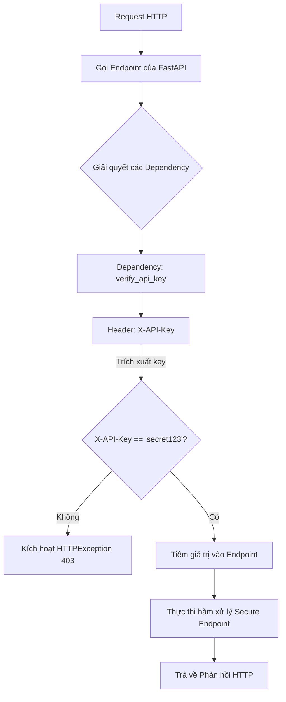

### 🎯 Mục tiêu học tập
- Giải thích mẫu thiết kế Dependency Injection (Tiêm phụ thuộc) và lợi ích của nó trong các web framework.
- Tạo và đăng ký các dependency bằng cách sử dụng hàm `Depends` của FastAPI.
- Thiết kế các chuỗi dependency phân cấp (dependency gọi dependency khác).
- Xác thực các HTTP header và bảo vệ các endpoint API sử dụng các dependency.
- Thay thế (override) các dependency phục vụ cho việc unit test và viết mock value.

### 🧩 Khái niệm cốt lõi (Tại sao)
Trong kỹ nghệ phần mềm, **Dependency Injection (DI)** hay **Tiêm phụ thuộc** là một mẫu thiết kế (design pattern) trong đó một đối tượng hoặc một hàm nhận các dịch vụ hoặc đối tượng khác mà nó phụ thuộc vào từ bên ngoài, thay vì tự khởi tạo chúng một cách nội bộ.

Trong phát triển web, các hàm xử lý endpoint thường xuyên chia sẻ các tác vụ lặp đi lặp lại:
- Thiết lập một kết nối hoặc phiên làm việc với cơ sở dữ liệu (database session).
- Trích xuất và xác thực token hoặc thông tin đăng nhập của người dùng.
- Xác thực các HTTP header tùy chỉnh (chẳng hạn như API key).
- Triển khai các tham số phân trang hoặc các chính sách bộ lọc.

Nếu không có dependency injection, bạn sẽ phải viết logic này một cách thủ công bên trong từng hàm xử lý route. Điều này dẫn đến trùng lặp mã nguồn, tăng sự phụ thuộc chặt chẽ (tight coupling) và khiến việc viết kiểm thử (ví dụ như tạo mock kết nối database) trở nên vô cùng khó khăn.

FastAPI tích hợp sẵn một framework dependency injection cực kỳ mạnh mẽ. Bạn khai báo các dependency bằng cách sử dụng hàm `Depends`. FastAPI sẽ xử lý việc giải quyết các dependency, tiêm kết quả đầu ra vào hàm xử lý route, quản lý vòng đời kết nối (chẳng hạn như tự động đóng database session) và cache các giá trị khi nhiều thành phần chia sẻ cùng một cây dependency.

### 🔁 Logic và hoạt động

#### Giải quyết cây Dependency và Thực thi
FastAPI phân tích signature của hàm xử lý route và xây dựng một Đồ thị có hướng không chu trình (DAG) đại diện cho các dependency của endpoint. Khi một request HTTP được gửi đến:



### 📝 Ví dụ minh họa có chú thích

#### 1. Dependency tham số chung cơ bản (Phân trang)
Thay vì khai báo các tham số query giống nhau cho nhiều endpoint khác nhau, chúng ta có thể định nghĩa một hàm dependency duy nhất.
```python
from fastapi import FastAPI, Depends

app = FastAPI()

# Đây là hàm dependency
def common_parameters(q: str | None = None, skip: int = 0, limit: int = 100):
    return {"q": q, "skip": skip, "limit": limit}

@app.get("/items/")
def read_items(commons: dict = Depends(common_parameters)):
    # FastAPI thực thi common_parameters, phân tích các tham số query,
    # và tiêm dictionary trả về vào biến 'commons'.
    return commons

@app.get("/users/")
def read_users(commons: dict = Depends(common_parameters)):
    return commons
```

#### 2. Bảo mật Route với Dependency Injection
Các dependency có thể kích hoạt ngoại lệ `HTTPException` để ngắt quá trình thực thi trước khi hàm xử lý endpoint được gọi.
```python
from fastapi import FastAPI, Depends, Header, HTTPException, status

app = FastAPI()

# Dependency kiểm tra tính hợp lệ của header API key tùy chỉnh
def verify_api_key(x_api_key: str = Header(..., description="API Key for route security")):
    if x_api_key != "secret123":
        raise HTTPException(
            status_code=status.HTTP_403_FORBIDDEN, 
            detail="Forbidden: Invalid API Key"
        )
    return x_api_key

# Endpoint được bảo vệ bởi verify_api_key
@app.get("/secure")
def secure_endpoint(api_key: str = Depends(verify_api_key)):
    # Hàm này chỉ chạy nếu verify_api_key trả về thành công
    return {"status": "authenticated", "key_used": api_key}
```

### ❌ Các lỗi thường gặp

**Lỗi 1: Gọi hàm dependency thay vì truyền tham chiếu của nó vào bên trong `Depends`**
```python
from fastapi import FastAPI, Depends

app = FastAPI()

def get_db():
    return "DatabaseConnection"

@app.get("/data")
def read_data(db = Depends(get_db())):  # Sai: Không thực thi hàm bằng cách thêm cặp ngoặc tròn.
    return {"db": db}
```
```text
TypeError: 'str' object is not callable
```
```python
from fastapi import FastAPI, Depends

app = FastAPI()

def get_db():
    return "DatabaseConnection"

@app.get("/data")
def read_data(db = Depends(get_db)):  # Đúng: Truyền tham chiếu của chính hàm đó.
    return {"db": db}
```
> `Depends` yêu cầu một đối tượng có thể gọi được (callable) như một hàm hoặc một lớp làm đối số của nó. FastAPI sẽ tự chịu trách nhiệm thực thi callable đó trên mỗi request gửi đến. Nếu bạn viết `Depends(get_db())`, bạn đang thực thi hàm ngay khi khởi chạy ứng dụng và truyền giá trị trả về tĩnh của nó vào `Depends`, điều này sẽ gây ra lỗi.

**Lỗi 2: Giả định các giá trị dependency được chia sẻ cố định trên các request khác nhau**
```python
from fastapi import FastAPI, Depends

app = FastAPI()

counter = 0

def increment_counter():
    global counter
    counter += 1
    return counter

@app.get("/count")
def get_count(current_count: int = Depends(increment_counter)):
    # Sai: Phụ thuộc vào các side-effect bên trong dependency để quản lý state toàn cục
    return {"count": current_count}
```
```text
# Không có lỗi trực tiếp, nhưng làm hỏng khả năng xử lý đồng thời và gây ra race condition khi chạy production.
```
```python
# Các dependency nên ở dạng stateless hoặc quản lý các kết nối riêng biệt (như DB session).
# Nếu bạn cần trạng thái dùng chung (shared state), hãy dùng dependency yield ra database session hoặc một connection pool an toàn luồng (thread-safe).
```
> Các dependency của FastAPI được giải quyết động trên mỗi request HTTP gửi đến. Việc lưu trữ trạng thái có thể thay đổi (mutable state) hoặc phụ thuộc vào các side-effect toàn cục bên trong một hàm dependency là một thực hành tồi, dễ dẫn đến xung đột luồng (race condition), rò rỉ bộ nhớ và hành vi thất thường của hệ thống khi tải cao.

### 💡 Mẹo & Cách viết tối ưu
- **Sử dụng `Annotated`**: Sử dụng `Annotated` để khai báo các dependency giúp cải thiện khả năng đọc hiểu code và tránh việc trộn lẫn các giá trị mặc định trong signature của Python.
  ```python
  from typing import Annotated
  from fastapi import Depends
  
  # Rõ ràng, tường minh và dễ đọc
  @app.get("/items/")
  def read(commons: Annotated[dict, Depends(common_parameters)]):
      return commons
  ```
- **Dependency dạng Class (Class-based Dependency)**: Đôi khi bạn cần các dependency lưu trạng thái hoặc các tham số cấu hình. Bạn có thể sử dụng một lớp Python làm một dependency:
  ```python
  class Pagination:
      def __init__(self, limit: int = 10, skip: int = 0):
          self.limit = limit
          self.skip = skip
  
  # FastAPI tự động khởi tạo Pagination(limit, skip)
  @app.get("/users/")
  def read_users(pagination: Pagination = Depends()):
      return {"limit": pagination.limit, "skip": pagination.skip}
  ```
- **Dependency lồng nhau (Sub-dependency)**: Các dependency có thể gọi các dependency khác, cho phép bạn xây dựng các lớp phân quyền, kiểm tra bảo mật và kết nối theo cấu trúc module nhỏ gọn, dễ tái sử dụng.

### 🧠 Đi sâu phân tích (Cơ chế bên dưới)
<details><summary>Giải quyết đồ thị Dependency, Cơ chế Yield và Caching</summary>

Hệ thống dependency injection của FastAPI sử dụng một thuật toán giải quyết đồ thị hoạt động tương tự như một bước biên dịch:

1. **Xây dựng đồ thị Dependency**: Khi server khởi động, FastAPI xây dựng một cây dependency cho mỗi route. Nó xác thực để đảm bảo rằng không có bất kỳ dependency vòng lặp (circular dependency) nào.
2. **Cơ chế Cache mặc định (`use_cache=True`)**: Nếu nhiều dependency trong cây yêu cầu cùng một sub-dependency (ví dụ: hai kiểm tra khác nhau đều cần session của cơ sở dữ liệu), FastAPI sẽ thực thi sub-dependency đó **chỉ một lần duy nhất** trong suốt request. Nó lưu cache giá trị trả về và tái sử dụng nó cho các dependency khác trong cùng request đó, ngăn chặn việc kết nối hoặc truy vấn trùng lặp vào cơ sở dữ liệu. Bạn có thể tắt tính năng này bằng cách thiết lập `Depends(your_dependency, use_cache=False)`.
3. **Quản lý Database Session với `yield`**: FastAPI hỗ trợ các dependency sử dụng từ khóa `yield` thay vì `return`. Điều này cho phép bạn thực hiện logic thiết lập kết nối, chuyển giao tài nguyên cho endpoint xử lý, và sau đó thực hiện logic dọn dẹp/ngắt kết nối sau khi phản hồi đã được gửi đi cho client:
   ```python
   def get_db_session():
       db = SessionLocal()
       try:
           yield db  # Tài nguyên được tiêm tại đây
       finally:
           db.close()  # Được thực thi sau khi phản hồi HTTP đã được gửi đi
   ```
   Cơ chế này đảm bảo rằng các kết nối luôn được đóng một cách chính xác ngay cả khi có ngoại lệ xảy ra bên trong hàm xử lý endpoint.
</details>

### 🏋️ Bài tập thực hành
Triển khai một hàm dependency `verify_api_key` kiểm tra xem request có chứa HTTP header `X-API-Key` với giá trị bằng `"secret123"` hay không. Nếu key không chính xác hoặc bị thiếu, hãy raise một ngoại lệ `HTTPException` với status code `403` (Forbidden).

```python
from fastapi import FastAPI, Depends, Header, HTTPException, status

app = FastAPI()

# Triển khai dependency verify_api_key kiểm tra X-API-Key == "secret123"
```

### ✅ Tự kiểm tra
1. Sự khác biệt giữa việc sử dụng `yield` và `return` bên trong một hàm dependency của FastAPI là gì?
2. Nếu hai dependency riêng biệt trong cùng một endpoint đều phụ thuộc vào một sub-dependency chung là `get_settings()`, thì theo mặc định `get_settings()` sẽ được thực thi bao nhiêu lần?
3. Làm thế nào bạn có thể override các dependency trong FastAPI để viết các unit test với các mock value?
<details><summary>Đáp án</summary>

1. Một dependency sử dụng `return` sẽ trả về giá trị ngay lập tức và kết thúc. Một dependency sử dụng `yield` có thể trả về giá trị và tạm dừng thực thi; sau khi phản hồi được gửi đi, mã nguồn sau câu lệnh `yield` sẽ tiếp tục chạy để thực hiện các thao tác giải phóng tài nguyên (dọn dẹp, ngắt kết nối).
2. Theo mặc định, nó sẽ chỉ được thực thi **một lần duy nhất**. FastAPI lưu cache kết quả của dependency trong suốt thời gian tồn tại của request đó.
3. Bạn có thể override các dependency bằng cách sử dụng dictionary `app.dependency_overrides`:
   ```python
   app.dependency_overrides[verify_api_key] = mock_verify_api_key
   ```
   Điều này giúp dễ dàng bỏ qua các bước kiểm tra xác thực hoặc kết nối database thật trong quá trình chạy unit test.
</details>

### 📌 Tóm tắt
- **Dependency Injection** giúp tách biệt các hàm xử lý endpoint khỏi các yêu cầu bên ngoài, giúp mã nguồn có tính module cao và dễ viết test hơn.
- Hàm `Depends` của FastAPI đăng ký một dependency callback để giải quyết trong quá trình thực thi route.
- Các dependency có thể thực hiện kiểm định dữ liệu, kích hoạt các lỗi `HTTPException` và quản lý vòng đời của các kết nối tài nguyên.
- Việc sử dụng `yield` cho phép các dependency thực hiện các hành động dọn dẹp sau khi phản hồi đã được gửi đi (chẳng hạn như đóng các kết nối hoặc transaction cơ sở dữ liệu).
