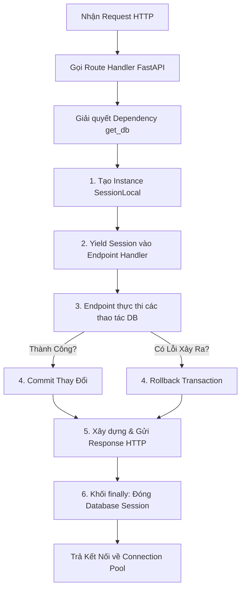

### 🎯 Mục tiêu học tập
- Giải thích vai trò của Object-Relational Mapping (ORM) trong phát triển web hiện đại.
- Cấu hình database engine, session factory và base model bằng cách sử dụng SQLAlchemy.
- Thiết kế database schema bằng cách định nghĩa các declarative SQLAlchemy model.
- Viết các request-scoped session dependency bằng hệ thống dependency injection của FastAPI và `yield`.
- Triển khai các endpoint CRUD mạnh mẽ có cơ chế tự động dọn dẹp kết nối.

### 🧩 Khái niệm cốt lõi (Tại sao)
Trong các ứng dụng web sơ khai, các nhà phát triển tương tác với cơ sở dữ liệu bằng cách viết các câu lệnh SQL thuần trực tiếp bên trong logic ứng dụng. Mặc dù vẫn hoạt động, phương pháp này gặp phải các vấn đề nghiêm trọng: lỗi cú pháp SQL chỉ có thể được phát hiện khi chạy ứng dụng (runtime), trùng lặp mã nguồn cao, và các lập trình viên phải ánh xạ thủ công các dòng cơ sở dữ liệu thành các đối tượng ứng dụng.

Một bộ **Object-Relational Mapper (ORM)** đóng vai trò như chiếc cầu nối giữa lập trình hướng đối tượng (các class trong Python) và cơ sở dữ liệu quan hệ (các bảng SQL).
- **Class Python** tương ứng với **Bảng Cơ sở Dữ liệu** (Database Table).
- **Thuộc tính Class** tương ứng với **Cột của Bảng** (Table Column).
- **Thể hiện của Class (Instance)** tương ứng với **Dòng của Bảng** (Table Row).

FastAPI không đi kèm với lớp cơ sở dữ liệu tích hợp sẵn. Thay vào đó, nó thường được kết hợp với **SQLAlchemy**, thư viện ORM phổ biến và giàu tính năng nhất của Python.

Để tích hợp SQLAlchemy với FastAPI, chúng ta kết hợp ba thành phần chính sau:
1. **Engine**: Giao diện cốt lõi quản lý các kết nối, dịch các truy vấn SQLAlchemy thành cú pháp SQL cụ thể của cơ sở dữ liệu được chọn và duy trì một bể kết nối (connection pool).
2. **SessionLocal**: Một session factory được cấu hình cho các database transaction có vòng đời tương ứng với request (request-scoped). Mỗi request nhận được session riêng, cho phép thực thi transaction độc lập.
3. **Declarative Base**: Một class cơ sở lưu giữ siêu dữ liệu của schema (schema metadata). Tất cả các model kế thừa từ class này để SQLAlchemy có thể theo dõi và khởi tạo schema của chúng.

### 🔁 Logic và hoạt động

Khi một request HTTP được gửi đến endpoint FastAPI cần kết nối cơ sở dữ liệu, vòng đời của session được quản lý chặt chẽ thông qua dependency injection:



Việc sử dụng `yield` trong dependency là rất quan trọng. Nó đảm bảo khối `finally` luôn luôn chạy sau khi endpoint hoàn thành và phản hồi được gửi đi, giúp ngăn chặn rò rỉ kết nối (connection leaks).

### 📝 Ví dụ minh họa có chú thích

Dưới đây là một triển khai hoàn chỉnh cho thấy cách cấu hình database, model cơ sở dữ liệu và tích hợp route FastAPI.

#### 1. Thiết lập Database (`database.py`)
```python
from sqlalchemy import create_engine
from sqlalchemy.orm import sessionmaker, declarative_base

# Định nghĩa URL cơ sở dữ liệu (sử dụng SQLite in-memory để minh họa)
DATABASE_URL = "sqlite:///./app.db"

# 1. Tạo engine. 'connect_args={"check_same_thread": False}' chỉ cần thiết cho SQLite
engine = create_engine(DATABASE_URL, connect_args={"check_same_thread": False})

# 2. Tạo factory SessionLocal. Vô hiệu hóa autocommit và autoflush để kiểm soát transaction
SessionLocal = sessionmaker(autocommit=False, autoflush=False, bind=engine)

# 3. Tạo base class declarative cho các model
Base = declarative_base()
```

#### 2. Định nghĩa Model Declarative (`models.py`)
```python
from sqlalchemy import Column, Integer, String, Boolean
from database import Base

class Product(Base):
    __tablename__ = "products"  # Tên bảng vật lý trong DB

    # Định nghĩa các cột tương ứng với các kiểu dữ liệu SQLAlchemy
    id = Column(Integer, primary_key=True, index=True)
    name = Column(String, nullable=False, index=True)
    price = Column(Integer, nullable=False)
    in_stock = Column(Boolean, default=True)
```

#### 3. Tích hợp Route FastAPI (`main.py`)
```python
from fastapi import FastAPI, Depends, HTTPException, status
from sqlalchemy.orm import Session
from typing import Annotated

from database import engine, Base, SessionLocal
import models

# Tự động tạo các bảng trong cơ sở dữ liệu (chỉ dùng cho môi trường phát triển)
Base.metadata.create_all(bind=engine)

app = FastAPI()

# Database session dependency generator sử dụng yield
def get_db():
    db = SessionLocal()
    try:
        yield db  # Inject session vào tham số endpoint
    finally:
        db.close()  # Tự động chạy sau khi response đã được gửi đi

# Định nghĩa alias Annotated để code sạch hơn
DbSession = Annotated[Session, Depends(get_db)]

@app.post("/products/", status_code=status.HTTP_201_CREATED)
def create_product(name: str, price: int, db: DbSession):
    # Khởi tạo instance cho database model
    db_product = models.Product(name=name, price=price)
    
    db.add(db_product)      # Đưa đối tượng vào trạng thái stage
    db.commit()             # Lưu các thay đổi vào cơ sở dữ liệu
    db.refresh(db_product)  # Cập nhật các thuộc tính từ DB (như id tự tăng)
    return db_product

@app.get("/products/{product_id}")
def read_product(product_id: int, db: DbSession):
    # Truy vấn cơ sở dữ liệu bằng SQLAlchemy ORM
    product = db.query(models.Product).filter(models.Product.id == product_id).first()
    if not product:
        raise HTTPException(
            status_code=status.HTTP_404_NOT_FOUND, 
            detail="Product not found"
        )
    return product
```

### ❌ Các lỗi thường gặp

**Lỗi 1: Chia sẻ một session database toàn cục (global) duy nhất giữa nhiều request**
```python
from fastapi import FastAPI
from database import SessionLocal

app = FastAPI()
db = SessionLocal()  # Sai: Chia sẻ một instance session duy nhất toàn cục

@app.get("/items")
def get_items():
    return db.query(Item).all()
```
```text
StateError: Object deleted or session closed.
ResourceClosedError: This transaction has already been closed.
```
```python
from fastapi import FastAPI, Depends
from sqlalchemy.orm import Session
from database import SessionLocal

app = FastAPI()

def get_db():
    db = SessionLocal()
    try:
        yield db
    finally:
        db.close()

@app.get("/items")
def get_items(db: Session = Depends(get_db)):  # Đúng: Sử dụng request-scoped session
    return db.query(Item).all()
```
> Việc chia sẻ một SQLAlchemy session toàn cục duy nhất giữa các request đồng thời sẽ dẫn đến xung đột đa luồng (multi-threading race conditions), lẫn lộn dữ liệu giữa các request của người dùng khác nhau, lỗi khóa cơ sở dữ liệu (lock), và rò rỉ bộ nhớ. Đối tượng session vốn không an toàn với luồng (thread-safe) và bắt buộc phải được tạo mới và đóng lại theo từng request riêng biệt.

**Lỗi 2: Quên commit các thao tác ghi (write) dữ liệu vào database**
```python
@app.post("/users")
def create_user(name: str, db: Session = Depends(get_db)):
    user = User(name=name)
    db.add(user)
    # Sai: Thiếu db.commit(). Các thay đổi chỉ mới ở dạng staged chứ chưa được lưu.
    return user
```
```text
# Không có lỗi nào được ném ra, nhưng các thay đổi sẽ không bao giờ được lưu vào cơ sở dữ liệu vật lý.
```
```python
@app.post("/users")
def create_user(name: str, db: Session = Depends(get_db)):
    user = User(name=name)
    db.add(user)
    db.commit()  # Đúng: Commit các thay đổi để lưu transaction
    db.refresh(user)
    return user
```
> Việc gọi `db.add()` chỉ mới chuẩn bị (stage) các thay đổi trong bộ nhớ cục bộ của SQLAlchemy. Nếu không gọi `db.commit()`, transaction sẽ tự động bị rollback khi session đóng lại ở cuối request, dẫn đến mất dữ liệu vừa thay đổi.

**Lỗi 3: Truy cập vào các thuộc tính lazy-loaded sau khi session đã đóng**
```python
def get_user_items_bad():
    db = SessionLocal()
    user = db.query(User).first()
    db.close()
    # Sai: Truy cập mối quan hệ lazy 'items' sau khi session đã đóng
    return user.items 
```
```text
sqlalchemy.orm.exc.DetachedInstanceError: Parent instance <User at 0x7f8> is not bound to a Session; lazy load operation of attribute 'items' cannot proceed
```
```python
# Cách 1: Truy cập các thuộc tính trước khi đóng session
# Cách 2: Sử dụng eager loading khi truy vấn
from sqlalchemy.orm import joinedload

def get_user_items_good():
    db = SessionLocal()
    try:
        user = db.query(User).options(joinedload(User.items)).first()
        return user.items
    finally:
        db.close()
```
> Theo mặc định, các mối quan hệ (relationships) trong SQLAlchemy được tải theo cơ chế lười biếng (lazy-loaded). Khi bạn truy cập `user.items`, SQLAlchemy sẽ cố gắng thực thi một câu lệnh SQL để lấy chúng. Nếu session đã đóng, SQLAlchemy không còn kết nối DB nào hoạt động để chạy câu lệnh, dẫn đến lỗi `DetachedInstanceError`.

### 💡 Mẹo & Cách viết tối ưu
- **Sử dụng `Annotated` Dependency**: Tránh việc lặp lại `Depends(get_db)` ở hàng chục route khác nhau. Hãy tạo một alias kiểu (ví dụ: `DbSession = Annotated[Session, Depends(get_db)]`) để làm mã nguồn gọn gàng hơn.
- **Context Manager cho Script**: Nếu bạn cần tương tác cơ sở dữ liệu ngoài route FastAPI (như trong lệnh CLI, background script, hoặc thiết lập test), hãy viết một context manager để tự động dọn dẹp session:
  ```python
  from contextlib import contextmanager

  @contextmanager
  def db_session():
      db = SessionLocal()
      try:
          yield db
          db.commit()
      except Exception:
          db.rollback()
          raise
      finally:
          db.close()
  ```
- **Relationship Eager Loading**: Tránh lỗi truy vấn "N+1 query problem" bằng cách sử dụng `joinedload` (cho quan hệ một-nhiều/nhiều-một) hoặc `selectinload` (cho quan hệ nhiều-nhiều) khi truy vấn các model có liên kết.

### 🧠 Đi sâu phân tích (Cơ chế bên dưới)
<details><summary>Unit of Work, Identity Map, và Session của SQLAlchemy</summary>

Lớp session của SQLAlchemy triển khai hai mẫu thiết kế phần mềm kinh điển: **Unit of Work** và **Identity Map**.

#### 1. Mẫu thiết kế Identity Map
Khi bạn tải một bản ghi từ cơ sở dữ liệu, SQLAlchemy theo dõi bản ghi đó trong một registry nội bộ thông qua khóa chính (primary key). Nếu bạn thực hiện hai truy vấn cho cùng một đối tượng trong cùng một session:
```python
user1 = db.query(User).filter_by(id=1).first()
user2 = db.query(User).filter_by(id=1).first()
assert user1 is user2  # True! Trỏ cùng vào một vùng nhớ đối tượng Python
```
Điều này đảm bảo mọi thay đổi trên `user1` sẽ lập tức được phản ánh trên `user2`, duy trì tính nhất quán dữ liệu giữa các phần mã khác nhau chạy trong cùng một request.

#### 2. Mẫu thiết kế Unit of Work
Session duy trì danh sách các transaction đang chờ xử lý. Khi bạn gọi `db.add()`, chưa có lệnh SQL nào được gửi đến cơ sở dữ liệu ngay lập tức. Trong quá trình gọi `db.commit()` hoặc khi việc truy vấn ép buộc một lệnh flush, SQLAlchemy sẽ phân tích tất cả các thay đổi (thêm, sửa, xóa), sắp xếp chúng hợp lý để tránh vi phạm ràng buộc khóa ngoại (foreign key constraints), và thực thi chúng dưới dạng một batch duy nhất.

#### Các trạng thái của Object trong Session
Một đối tượng ORM tồn tại ở một trong bốn trạng thái riêng biệt trong vòng đời của session:
1. **Transient**: Đối tượng được tạo ra (`user = User()`) nhưng chưa được gắn với session nào. Chưa tồn tại biểu diễn tương ứng dưới cơ sở dữ liệu.
2. **Pending**: Đối tượng đã được thêm vào session (`db.add(user)`). Nó sẽ được ghi vào cơ sở dữ liệu ở lần flush hoặc commit tiếp theo.
3. **Persistent**: Đối tượng đã được lưu vào cơ sở dữ liệu và được session theo dõi. Các thay đổi thuộc tính sẽ được ghi nhận.
4. **Detached**: Session đã đóng (`db.close()`). Đối tượng vẫn tồn tại trong bộ nhớ nhưng không còn kết nối với session database nào.
</details>

### 🏋️ Bài tập thực hành
Triển khai thiết lập kết nối cơ sở dữ liệu SQLite in-memory và tạo model `User` bao gồm:
1. Một khóa chính kiểu số nguyên `id`.
2. Một cột kiểu chuỗi `name`.

Tiếp theo, viết một hàm dependency generator session database chuẩn cho FastAPI tên là `get_db`. Generator này sẽ khởi tạo session cơ sở dữ liệu, yield nó, và đảm bảo nó được đóng đúng cách trong khối finalizer.

```python
from sqlalchemy import create_engine, Column, Integer, String
from sqlalchemy.orm import sessionmaker, declarative_base

# Thiết lập cơ sở dữ liệu sqlite in-memory và tạo model User với id và name.
# Viết generator get_db session yield session local.
```

### ✅ Tự kiểm tra
1. Tại sao việc tự tạo session database trong endpoint handler và tự đóng thủ công lại là phản mẫu (bad practice) thay vì dùng dependency injection của FastAPI?
2. Sự khác biệt giữa `db.commit()` và `db.flush()` trong SQLAlchemy là gì?
3. Việc cấu hình `connect_args={"check_same_thread": False}` giúp tránh lỗi như thế nào đối với các kết nối cơ sở dữ liệu SQLite khi sử dụng FastAPI?
<details><summary>Đáp án tự kiểm tra</summary>

1. Việc tự quản lý tạo/đóng session thủ công trong route handler dẫn đến trùng lặp mã lặp đi lặp lại. Nó cũng làm tăng nguy cơ rò rỉ kết nối nếu một ngoại lệ (exception) xảy ra trước khi lệnh đóng được thực thi. Dependency injection sử dụng `yield` đảm bảo quá trình dọn dẹp được thực thi bất chấp lỗi xảy ra trong route.
2. `db.flush()` gửi các lệnh SQL đang chờ xử lý (insert, update, delete) đến bộ đệm transaction của database server để gán ID cho bản ghi mới, nhưng chưa hoàn tất transaction. `db.commit()` ghi lưu vĩnh viễn các thay đổi này và đóng transaction lại.
3. Theo mặc định, SQLite ngăn nhiều thread truy cập cùng một connection để tránh lỗi hỏng dữ liệu. Do các route FastAPI có thể chạy đồng thời trên các thread khác nhau, kiểm tra an toàn mặc định này sẽ ném ra lỗi. Việc tắt kiểm tra này là an toàn miễn là mỗi request sử dụng một connection cô lập riêng của nó.
</details>

### 📌 Tóm tắt
- **ORMs** ánh xạ các class hướng đối tượng thành bảng cơ sở dữ liệu quan hệ, giúp đơn giản hóa các thao tác SQL.
- **SQLAlchemy Engine** thiết lập kết nối, trong khi **SessionLocal** cung cấp các instance transaction.
- Sử dụng dependency injection (`Depends`) của FastAPI kết hợp với `yield` sẽ tự động quản lý vòng đời kết nối.
- Các bản ghi đối tượng được theo dõi bên trong session thông qua mẫu thiết kế **Identity Map** và **Unit of Work**.
- Luôn commit các thay đổi (`db.commit()`) để hoàn tất chỉnh sửa cơ sở dữ liệu, và đảm bảo các session luôn được đóng lại.
