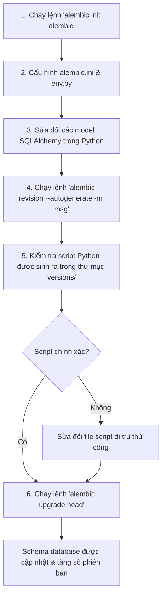

### 🎯 Mục tiêu học tập
- Giải thích vai trò của di trú cơ sở dữ liệu (database migrations) trong vòng đời của ứng dụng thực tế.
- Khởi tạo và cấu hình Alembic trong môi trường Python/FastAPI.
- Chỉnh sửa `env.py` để trỏ vào metadata của database hỗ trợ tính năng tự động tạo bản di trú (autogenerate).
- Tự động tạo các script di trú (revision) từ các model SQLAlchemy.
- Thực thi nâng cấp (upgrade) và hạ cấp (downgrade) cấu trúc cơ sở dữ liệu bằng các lệnh command-line.

### 🧩 Khái niệm cốt lõi (Tại sao)
Trong các giai đoạn phát triển ban đầu, bạn có thể tạo lại cơ sở dữ liệu mỗi khi khởi động ứng dụng bằng `Base.metadata.create_all(bind=engine)`. Tuy nhiên, trong môi trường production (thực tế), cách tiếp cận này sẽ thất bại hoàn toàn vì việc xóa bảng (drop table) đồng nghĩa với việc xóa sạch dữ liệu của khách hàng và ứng dụng.

Hơn thế nữa, phương thức `create_all()` của SQLAlchemy bị giới hạn về mặt thiết kế: nó chỉ tạo các bảng chưa tồn tại. Nếu bạn thêm một cột mới vào một model đã có sẵn trong Python, `create_all()` sẽ không làm gì cả, khiến cho code ứng dụng của bạn không còn đồng nhất với cấu trúc bảng thực tế.

**Di trú Cơ sở Dữ liệu (Database Migrations)** giải quyết vấn đề này bằng cách quản lý schema cơ sở dữ liệu của bạn dưới dạng mã nguồn được kiểm soát phiên bản (version-controlled).
- Mỗi thay đổi về schema (như thêm bảng, xóa cột) được biểu diễn bằng một mã lệnh tăng dần (increment script hay revision).
- Các script di trú có thể được chạy tuần tự để nâng cấp schema, hoặc chạy ngược lại để hạ cấp về phiên bản cũ.

**Alembic** là công cụ di trú cơ sở dữ liệu chính thức dành cho SQLAlchemy. Nó hoạt động giống như Git dành cho database schema.
- Nó theo dõi phiên bản cơ sở dữ liệu hiện tại bằng một bảng chuyên dụng nằm bên trong chính cơ sở dữ liệu đó.
- Nó cung cấp giao diện command-line để tự động phát hiện thay đổi của model và sinh ra các câu lệnh SQL tương ứng.

Để cấu hình Alembic, chúng ta làm việc với ba thành phần:
1. `alembic.ini`: File cấu hình chứa chuỗi kết nối cơ sở dữ liệu và cấu hình logging.
2. `env.py`: Một script Python mà Alembic sẽ thực thi mỗi khi chạy lệnh. Nó kết nối với database engine và ánh xạ lớp transaction của Alembic tới các model SQLAlchemy của bạn.
3. `versions/`: Thư mục chứa các file Python di trú được tự động tạo ra kèm timestamp, đại diện cho từng bước thay đổi cơ sở dữ liệu.

### 🔁 Logic và hoạt động

Quy trình phát triển chuẩn khi thay đổi schema cơ sở dữ liệu bao gồm các bước sau:



Khi bạn chạy lệnh `alembic revision --autogenerate`, Alembic sẽ kiểm tra cấu trúc cơ sở dữ liệu thực tế hiện tại và so sánh nó với cấu trúc được định nghĩa trong các file Python (`Base.metadata`). Sau đó, nó tự động tạo ra các khối mã `upgrade()` và `downgrade()` cần thiết để đồng bộ chúng.

### 📝 Ví dụ minh họa có chú thích

#### 1. Khởi tạo Alembic
Tại thư mục gốc của dự án, chạy lệnh khởi tạo sau:
```bash
alembic init alembic
```
Lệnh này tạo ra cấu trúc file như sau:
- `alembic.ini` (cấu hình toàn cục)
- `alembic/` (thư mục môi trường di trú)
  - `env.py` (script chạy thực thi chính)
  - `script.py.mako` (template cho script di trú)
  - `versions/` (kho chứa các script di trú)

#### 2. Cấu hình `alembic.ini`
Mở file `alembic.ini` và cấu hình URL kết nối cơ sở dữ liệu:
```ini
# alembic.ini
sqlalchemy.url = sqlite:///./app.db
```

#### 3. Kết nối các Model trong `alembic/env.py`
Để kích hoạt tính năng tự động tạo (autogenerate), hãy mở file `alembic/env.py` và sửa đổi để import metadata của model của bạn:
```python
# alembic/env.py
from logging.config import fileConfig
from sqlalchemy import engine_from_config
from sqlalchemy import pool

from alembic import context

# 1. Import class Base SQLAlchemy và các model của bạn
from database import Base
import models  # Bắt buộc phải import model để đăng ký các bảng vào Base metadata

config = context.config
if config.config_file_name is not None:
    fileConfig(config.config_file_name)

# 2. Gán target metadata để kích hoạt tính năng so sánh schema
target_metadata = Base.metadata
```

#### 4. Tạo file Script Di trú
Tạo file di trú bằng cách chỉ định một thông điệp mô tả:
```bash
alembic revision --autogenerate -m "create user table"
```
Alembic sẽ tạo một file trong thư mục `alembic/versions/` (ví dụ: `4a52b31f79e2_create_user_table.py`):
```python
# alembic/versions/4a52b31f79e2_create_user_table.py
"""create user table

Revision ID: 4a52b31f79e2
Revises: 
Create Date: 2026-06-27 12:00:00.000000
"""
from alembic import op
import sqlalchemy as sa

# Định danh Revision
revision = '4a52b31f79e2'
down_revision = None
branch_labels = None
depends_on = None

def upgrade() -> None:
    # 1. Các câu lệnh tự động sinh ra để cập nhật database
    op.create_table(
        'users',
        sa.Column('id', sa.Integer(), nullable=False),
        sa.Column('name', sa.String(), nullable=True),
        sa.PrimaryKeyConstraint('id')
    )

def downgrade() -> None:
    # 2. Các câu lệnh để đảo ngược quá trình di trú
    op.drop_table('users')
```

#### 5. Thực thi Di trú
Áp dụng các thay đổi đã tạo vào cơ sở dữ liệu thực tế:
```bash
alembic upgrade head
```
Lệnh này cập nhật cấu trúc cơ sở dữ liệu và ghi mã phiên bản `4a52b31f79e2` vào bảng theo dõi phiên bản.

### ❌ Các lỗi thường gặp

**Lỗi 1: Quên import các model đích bên trong `env.py`**
```python
# alembic/env.py
from database import Base
# Sai: Thiếu dòng 'import models' (Base metadata sẽ bị trống)
target_metadata = Base.metadata
```
```text
INFO  [alembic.runtime.migration] Context class SQLiteContext.
INFO  [alembic.autogenerate.compare] Detected removed table 'users'
```
```python
# alembic/env.py
from database import Base
import models  # Đúng: Import models để SQLAlchemy đăng ký các bảng tương ứng
target_metadata = Base.metadata
```
> Alembic phụ thuộc vào việc Python import các model của bạn để đăng ký các bảng vào registry `Base.metadata`. Nếu bạn chỉ import `Base` mà không import các file model trong `env.py`, `Base.metadata` sẽ trống rỗng. Alembic sẽ hiểu lầm rằng bạn đã xóa toàn bộ các model và tạo ra một bản revision drop sạch toàn bộ các bảng đang có trong database của bạn.

**Lỗi 2: Chỉ định sai tên bảng hoặc tên cột trong file di trú thủ công**
```python
# Trong script revision của alembic
def upgrade() -> None:
    # Sai: Chỉ định cột 'user_name' không tồn tại
    op.drop_column('users', 'user_name')
```
```text
sqlalchemy.exc.OperationalError: (sqlite3.OperationalError) no such column: users.user_name
```
```python
def upgrade() -> None:
    # Đúng: Sử dụng đúng tên cột đã đăng ký 'username'
    op.drop_column('users', 'username')
```
> Các bản di trú tự động đôi khi có thể không chính xác, nhưng việc sửa đổi thủ công các lệnh trong script di trú phải được thực hiện cẩn thận. Việc chỉ định sai tên bảng hoặc cột bên trong các hàm như `op.drop_column()` hoặc `op.alter_column()` sẽ bỏ qua các kiểm tra lúc biên dịch và gây lỗi thực thi cơ sở dữ liệu khi chạy (runtime).

**Lỗi 3: Thiết lập động URL cơ sở dữ liệu trong env.py mà không có giá trị mặc định dự phòng**
```python
# alembic/env.py
import os
# Sai: Thiết lập trực tiếp tùy chọn thành URL cơ sở dữ liệu vốn có thể là None
config.set_main_option("sqlalchemy.url", os.getenv("DATABASE_URL"))
```
```text
sqlalchemy.exc.ArgumentError: String connection URL or an URL object is required, got None
```
```python
# alembic/env.py
import os
db_url = os.getenv("DATABASE_URL", "sqlite:///dev.db")  # Đúng: Cung cấp một giá trị mặc định dự phòng
config.set_main_option("sqlalchemy.url", db_url)
```
> Khi ghi đè các cấu hình của Alembic trong `env.py` một cách động bằng `os.getenv`, bạn phải đảm bảo rằng một giá trị mặc định dự phòng hợp lệ đã được cung cấp (ví dụ: SQLite cục bộ cho môi trường phát triển). Nếu không, nếu biến môi trường không được định nghĩa, SQLAlchemy sẽ nhận về URL là `None`, dẫn đến lỗi `ArgumentError` trong quá trình khởi tạo engine.

### 💡 Mẹo & Cách viết tối ưu
- **Tải URL Database một cách động**: Không lưu cứng (hardcode) thông tin tài khoản mật khẩu database của môi trường production vào file `alembic.ini`. Thay vào đó, hãy đọc chuỗi kết nối động từ các biến môi trường trong file `env.py`:
  ```python
  # alembic/env.py
  import os
  
  # Ghi đè cấu hình url bằng biến môi trường của hệ thống
  config.set_main_option("sqlalchemy.url", os.getenv("DATABASE_URL"))
  ```
- **Chạy `alembic current`**: Sử dụng lệnh này để xem chính xác ID revision hiện tại đang được áp dụng trên database đang hoạt động.
- **Chạy `alembic history --verbose`**: Sử dụng lệnh này để liệt kê toàn bộ lịch sử di trú database theo trình tự thời gian, kèm theo các ID revision và mối liên kết của chúng.

### 🧠 Đi sâu phân tích (Cơ chế bên dưới)
<details><summary>Bảng alembic_version và Cơ chế bên dưới của Autogenerate</summary>

#### Bảng `alembic_version`
Khi bạn thực thi di trú, Alembic duy trì một bảng theo dõi phiên bản bên trong cơ sở dữ liệu đích:
```sql
CREATE TABLE alembic_version (
    version_num VARCHAR(32) NOT NULL,
    CONSTRAINT alembic_version_pkc PRIMARY KEY (version_num)
);
```
Bảng này chứa đúng một dòng lưu trữ một chuỗi duy nhất (mã revision của head hiện tại). Khi bạn chạy `alembic upgrade head`, Alembic sẽ:
1. Truy vấn bảng này để đọc ID revision hiện tại.
2. Xác định tất cả các file script di trú trong `versions/` có `down_revision` tương ứng tiếp theo theo chuỗi liên kết.
3. Thực thi các hàm `upgrade()` của các file đó bên trong một transaction.
4. Cập nhật giá trị `version_num` thành ID head đích mới.

#### Cách thức hoạt động của Autogenerate
Khi kích hoạt `--autogenerate`, Alembic sẽ kết nối với cơ sở dữ liệu, khởi chạy quá trình kiểm tra (inspect) cấu trúc thực tế và đọc siêu dữ liệu của database. Sau đó, nó đối chiếu các cột, index, và ràng buộc (constraint) của database thực tế với các khai báo trong `target_metadata`.

Alembic phát hiện được:
- Việc thêm và xóa bảng.
- Việc thêm, xóa cột và thay đổi kiểu dữ liệu của cột.
- Việc thêm và xóa các index.

Alembic **KHÔNG** tự phát hiện được:
- Việc thay đổi tên cột hoặc tên bảng (hiểu nhầm là xóa/thêm mới).
- Các ràng buộc tùy chỉnh hoặc thay đổi khóa ngoại (trừ khi được cấu hình chi tiết).
- Phân mảnh bảng (table partitions).
</details>

### 🏋️ Bài tập thực hành
Viết một bộ xác thực văn bản cấu hình tên là `validate_alembic_config` để phân tích các file cấu hình giả lập của `alembic.ini`. Bộ xác thực sẽ chia văn bản cấu hình theo từng dòng và kiểm tra xem nó có chứa một định nghĩa gán `script_location` bằng `"alembic"` hay không.

```python
# Viết một bộ phân tích cấu hình để xác thực các cấu hình văn bản alembic.ini giả lập.
# Cấu hình phải chứa một định nghĩa "script_location = alembic".
def validate_alembic_config(config_text):
    pass
```

### ✅ Tự kiểm tra
1. Tại sao `Base.metadata.create_all()` lại không thể cập nhật cấu trúc schema trên các bảng đã tồn tại?
2. Điều gì xảy ra với cơ sở dữ liệu nếu bạn thực thi một file di trú bị lỗi ở giữa chừng?
3. Alembic theo dõi thứ tự di trú như thế nào khi có nhiều file cùng tồn tại trong thư mục `versions/`?
<details><summary>Đáp án tự kiểm tra</summary>

1. `Base.metadata.create_all()` được thiết kế để chỉ kiểm tra sự tồn tại của tên bảng trong cơ sở dữ liệu. Nếu bảng đã tồn tại, nó sẽ bỏ qua hoàn toàn việc chạy lệnh SQL trên bảng đó, đồng nghĩa các cột mới, index mới hay ràng buộc mới sẽ không được thêm vào.
2. Trên các cơ sở dữ liệu hỗ trợ transaction DDL (như PostgreSQL), quá trình rollback của di trú sẽ hoàn trả lại toàn bộ trạng thái trước khi bị lỗi, giữ nguyên tính toàn vẹn của schema. Trên các cơ sở dữ liệu không hỗ trợ transaction DDL (như MySQL hay SQLite), các thay đổi trước điểm lỗi có thể đã được lưu lại, yêu cầu lập trình viên phải can thiệp thủ công để khôi phục.
3. Các script di trú của Alembic chứa các metadata `revision` (ID của chính nó) và `down_revision` (ID của di trú ngay trước nó). Điều này tạo ra cấu trúc danh sách liên kết (linked list) biểu diễn trình tự lịch sử tuyến tính.
</details>

### 📌 Tóm tắt
- **Di trú cơ sở dữ liệu** theo dõi các thay đổi schema dưới dạng mã nguồn được kiểm soát phiên bản, bảo vệ an toàn dữ liệu của ứng dụng.
- **Alembic** quản lý các bản di trú này bằng cách đọc metadata model của bạn và cung cấp các công cụ dòng lệnh.
- Luôn cấu hình `env.py` để import các file model và chỉ định `Base.metadata` làm đích để hỗ trợ autogenerate.
- Luôn kiểm tra thủ công các file di trú được sinh ra trước khi chạy để tránh các lỗi mất dữ liệu ngoài ý muốn.
- Sử dụng lệnh `alembic upgrade head` để chạy di trú và cập nhật phiên bản cơ sở dữ liệu một cách động.
