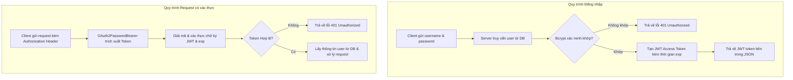

### 🎯 Mục tiêu học tập
- Giải thích vai trò của việc băm mật khẩu (password hashing - bcrypt) trong việc bảo vệ thông tin xác thực của người dùng.
- Mô tả cấu trúc của JSON Web Token (JWT) bao gồm Header, Payload, và Signature.
- Tạo và xác thực access token JWT với thời gian hết hạn (expiration time) phù hợp trong Python.
- Tích hợp dependency bảo mật `OAuth2PasswordBearer` của FastAPI để trích xuất thông tin xác thực.
- Triển khai một quy trình xác thực (authentication workflow) hoàn chỉnh để bảo vệ các endpoint API.

### 🧩 Khái niệm cốt lõi (Tại sao)
Khi xây dựng các ứng dụng web API hiện đại, bảo mật luôn là yếu tố quan trọng hàng đầu. Việc lưu trữ mật khẩu dưới dạng văn bản thuần túy (plain-text) trong cơ sở dữ liệu là một lỗ hổng bảo mật cực kỳ nghiêm trọng; nếu cơ sở dữ liệu bị lộ, tất cả tài khoản người dùng sẽ bị phơi bày. Do đó, mật khẩu phải được mã hóa bằng thuật toán băm mật mã (như **bcrypt**). Băm (hashing) là một hàm một chiều—bạn có thể tính toán mã băm từ mật khẩu, nhưng không thể đảo ngược mã băm đó để lấy lại mật khẩu ban đầu.

Một khi danh tính của người dùng đã được xác minh, máy chủ cần có cách để xác định các yêu cầu tiếp theo từ người dùng đó. Các ứng dụng web truyền thống sử dụng session (phiên làm việc), lưu trữ session ID trên server và cookie trên client. Tuy nhiên, đối với các REST API phi trạng thái (stateless), **JSON Web Tokens (JWT)** đã trở thành tiêu chuẩn công nghiệp.

JWT là một token nhỏ gọn, tự chứa thông tin và an toàn khi truyền qua URL (URL-safe), đại diện cho các yêu cầu thông tin giữa hai bên.
- **Nhỏ gọn (Compact)**: Token đủ nhỏ để gửi qua URL, tham số POST, hoặc bên trong HTTP header.
- **Tự chứa (Self-contained)**: Token chứa tất cả các thông tin cần thiết của người dùng (payload), tránh việc phải liên tục truy vấn cơ sở dữ liệu trên mỗi request.

Một JWT gồm ba phần được phân tách bằng dấu chấm (`.`):
1. **Header**: Chứa loại token (JWT) và thuật toán ký (ví dụ: HS256).
2. **Payload**: Chứa các thông tin khai báo (claims - như user ID, thời gian hết hạn, phạm vi quyền truy cập).
3. **Signature (Chữ ký)**: Được tạo ra bằng cách kết hợp header đã mã hóa, payload đã mã hóa và một secret key phía server bằng thuật toán chỉ định. Điều này đảm bảo token không thể bị sửa đổi bởi phía client.

FastAPI cung cấp các công cụ tích hợp sẵn như `OAuth2PasswordBearer` để tự động hóa việc trích xuất token từ header `Authorization: Bearer <token>`, giúp dễ dàng viết các dependency bảo mật có thể tái sử dụng.

### 🔁 Logic và hoạt động

Dưới đây là sơ đồ quy trình xác thực token:



### 📝 Ví dụ minh họa có chú thích

#### 1. Băm mật khẩu với Bcrypt
Để bảo vệ thông tin mật khẩu người dùng, chúng ta băm mật khẩu bằng thư viện `passlib` với backend `bcrypt`.
```python
from passlib.context import CryptContext

# Tạo CryptContext quản lý việc băm và xác thực mật khẩu
pwd_context = CryptContext(schemes=["bcrypt"], deprecated="auto")

def hash_password(password: str) -> str:
    # Tự động tạo một salt ngẫu nhiên và băm mật khẩu
    return pwd_context.hash(password)

def verify_password(plain_password: str, hashed_password: str) -> bool:
    # Xác minh mật khẩu thô so với mã băm đã lưu trữ
    return pwd_context.verify(plain_password, hashed_password)
```

#### 2. Cấp phát và Giải mã JWT
Chúng ta sử dụng `PyJWT` để tạo và phân tích JSON Web Tokens với một secret key cục bộ.
```python
import datetime
import jwt
from fastapi import HTTPException, status

SECRET_KEY = "your-extremely-secure-secret-key"
ALGORITHM = "HS256"

def create_access_token(data: dict, expires_delta: datetime.timedelta):
    to_encode = data.copy()
    expire = datetime.datetime.utcnow() + expires_delta
    # Thêm thông tin thời gian hết hạn ('exp') vào payload
    to_encode.update({"exp": expire})
    encoded_jwt = jwt.encode(to_encode, SECRET_KEY, algorithm=ALGORITHM)
    return encoded_jwt

def decode_access_token(token: str):
    try:
        # Giải mã và tự động xác thực chữ ký cũng như hạn sử dụng
        payload = jwt.decode(token, SECRET_KEY, algorithms=[ALGORITHM])
        return payload
    except jwt.ExpiredSignatureError:
        raise HTTPException(
            status_code=status.HTTP_401_UNAUTHORIZED,
            detail="Token has expired",
            headers={"WWW-Authenticate": "Bearer"},
        )
    except jwt.InvalidTokenError:
        raise HTTPException(
            status_code=status.HTTP_401_UNAUTHORIZED,
            detail="Invalid token credentials",
            headers={"WWW-Authenticate": "Bearer"},
        )
```

#### 3. Bảo vệ các Route bằng OAuth2PasswordBearer
FastAPI sử dụng các dependency để trích xuất các tham số bảo mật. Class `OAuth2PasswordBearer` trích xuất token từ header authorization của request.
```python
from fastapi import FastAPI, Depends, HTTPException, status
from fastapi.security import OAuth2PasswordBearer

app = FastAPI()

# Định nghĩa URL endpoint lấy token cho luồng OAuth2
oauth2_scheme = OAuth2PasswordBearer(tokenUrl="token")

# Dependency lấy thông tin user hiện tại từ token
async def get_current_user(token: str = Depends(oauth2_scheme)):
    payload = decode_access_token(token)
    username: str = payload.get("sub")
    if username is None:
        raise HTTPException(
            status_code=status.HTTP_401_UNAUTHORIZED,
            detail="Could not validate credentials"
        )
    return {"username": username}

# Route được bảo vệ sử dụng dependency get_current_user
@app.get("/users/me")
def read_users_me(current_user: dict = Depends(get_current_user)):
    return current_user
```

### ❌ Các lỗi thường gặp

**Lỗi 1: Giải mã JWT mà không khai báo tham số algorithms rõ ràng**
```python
# Sai: Bỏ qua danh sách algorithms khi giải mã token
payload = jwt.decode(token, SECRET_KEY)
```
```text
TypeError: decode() missing 1 required keyword-only argument: 'algorithms'
```
```python
# Đúng: Định nghĩa rõ ràng thuật toán xác thực được phép sử dụng
payload = jwt.decode(token, SECRET_KEY, algorithms=["HS256"])
```
> Thư viện PyJWT yêu cầu tham số `algorithms` phải được chỉ định rõ ràng khi gọi `jwt.decode()`. Yêu cầu này nhằm ngăn chặn các cuộc tấn công tráo đổi thuật toán (algorithm-confusion attacks), nơi kẻ tấn công thay đổi header của token từ thuật toán bất đối xứng (RS256) sang đối xứng (HS256) hòng vượt qua cơ chế xác thực chữ ký.

**Lỗi 2: Giải mã JWT mà không bắt các lỗi Hết hạn (Expiration)**
```python
# Sai: Truy cập trực tiếp payload của JWT mà không có khối xử lý try-except
def get_user_from_token(token: str):
    payload = jwt.decode(token, SECRET_KEY, algorithms=["HS256"])
    return payload["sub"]
```
```text
jwt.exceptions.ExpiredSignatureError: Signature has expired
```
```python
# Đúng: Bắt lỗi ExpiredSignatureError và ném ra một HTTP exception tương ứng
def get_user_from_token(token: str):
    try:
        payload = jwt.decode(token, SECRET_KEY, algorithms=["HS256"])
        return payload["sub"]
    except jwt.ExpiredSignatureError:
        raise HTTPException(status_code=401, detail="Token expired")
    except jwt.InvalidTokenError:
        raise HTTPException(status_code=401, detail="Invalid token")
```
> Hạn sử dụng của JWT được kiểm tra trong quá trình giải mã. Nếu token đã hết hạn, `jwt.decode` sẽ ném ra lỗi `ExpiredSignatureError`. Nếu lỗi này không được bắt và xử lý, server sẽ phản hồi lỗi hệ thống (500 Internal Server Error) thay vì trả về mã lỗi không có quyền truy cập rõ ràng (401 Unauthorized) cho client.

### 💡 Mẹo & Cách viết tối ưu
- **Giữ SECRET_KEY luôn bảo mật**: Không bao giờ lưu cứng `SECRET_KEY` của bạn trong mã nguồn production. Hãy sử dụng biến môi trường hệ thống và tải chúng qua cấu hình cài đặt (ví dụ: `os.getenv("SECRET_KEY")`).
- **Hạn dùng Token ngắn**: Hãy giữ thời gian sống của access token ở mức ngắn (ví dụ: 15–30 phút) nhằm giảm thiểu rủi ro bảo mật nếu token bị đánh cắp. Sử dụng refresh token để gia hạn phiên làm việc.
- **Khai báo "sub"**: Luôn lưu trữ định danh duy nhất của người dùng (như ID trong database hoặc username) vào claim chuẩn subject `"sub"` của payload JWT.

### 🧠 Đi sâu phân tích (Cơ chế bên dưới)
<details><summary>Cơ chế hoạt động của JWT và quá trình thêm muối (Salting) của Bcrypt</summary>

#### Bcrypt ngăn chặn các cuộc tấn công Rainbow Table như thế nào
Khi bạn chạy một hàm băm chuẩn như SHA256 trên một mật khẩu, cùng một mật khẩu đó sẽ luôn tạo ra cùng một mã băm duy nhất. Nếu kẻ tấn công có được cơ sở dữ liệu của bạn, chúng có thể tính toán sẵn mã băm cho hàng triệu mật khẩu phổ biến trước đó (gọi là **Rainbow Table**) và nhanh chóng đối chiếu chúng với mã băm của bạn.

Bcrypt giảm thiểu điều này bằng cách thêm một lượng dữ liệu ngẫu nhiên gọi là **Salt (Muối)** trong quá trình băm.
- Ngay cả khi hai người dùng có cùng mật khẩu là `"password123"`, mã băm của họ sẽ hoàn toàn khác nhau vì các chuỗi salt ngẫu nhiên khác nhau.
- Bcrypt nhúng trực tiếp chuỗi salt vào bên trong chuỗi hash kết quả cuối cùng (ví dụ: `$2b$12$R9h/cIPz...`), cho phép hàm verify giải trích xuất nó, áp dụng vào mật khẩu thô và so sánh kết quả.
- Bcrypt được thiết kế để tốn tài nguyên và chạy chậm (thông qua cost factor), làm cho các nỗ lực bẻ khóa brute-force (dò mật khẩu) trở nên vô cùng tốn kém và bất khả thi.

#### Tính bảo mật của Payload JWT
Một điều cực kỳ quan trọng cần nhớ là payload của JWT **không hề được mã hóa**; nó chỉ được ký số (signed). Payload được mã hóa bằng Base64URL, có thể dễ dàng giải mã ngược lại bởi bất kỳ ai chặn được token.
- Bạn có thể kiểm tra nội dung bất kỳ token JWT nào bằng cách dán nó vào trang [jwt.io](https://jwt.io).
- Vì vậy, tuyệt đối không được lưu trữ thông tin nhạy cảm như mật khẩu chưa băm, API token bí mật hoặc dữ liệu cá nhân riêng tư bên trong payload.
- Phần **Signature (Chữ ký)** chỉ đảm bảo rằng dữ liệu không bị thay đổi kể từ khi nó được phát hành bởi server, vì nếu payload bị sửa đổi, signature sẽ không còn khớp khi server kiểm tra lại bằng secret key.
</details>

### 🏋️ Bài tập thực hành
Viết hai hàm tiện ích `generate_token(username, expires_delta_mins)` và `decode_token(token)`. Hàm `generate_token` phải tạo ra một JWT chứa username trong claim subject (`sub`) và hết hạn sau số phút được truyền vào. Hàm `decode_token` sẽ xác thực token và trả về username.

```python
import jwt
import datetime

SECRET_KEY = "supersecret"

# Triển khai generate_token(username, expires_delta_mins) trả về JWT token
# Triển khai decode_token(token) trả về username
```

### ✅ Tự kiểm tra
1. Điều gì tạo nên tính an toàn của JWT nếu payload của nó có thể bị đọc bởi bất kỳ ai?
2. Tên HTTP header chuẩn và định dạng dùng để gửi token JWT từ client lên server là gì?
3. Thư viện PyJWT tự động xử lý token hết hạn như thế nào trong quá trình xác thực?
<details><summary>Đáp án tự kiểm tra</summary>

1. JWT được bảo mật nhờ vào **signature (chữ ký số)** của nó. Mặc dù bất kỳ ai cũng có thể giải mã và đọc payload, họ không thể thay đổi nội dung của nó mà không làm chữ ký trở nên vô hiệu. Chữ ký chỉ có thể được tạo ra và xác minh chính xác bằng secret key nằm ở phía server.
2. Client truyền token trong HTTP header `Authorization` với tiền tố `Bearer `, ví dụ: `Authorization: Bearer <chuoi_token>`.
3. Hàm `jwt.decode()` của PyJWT tự động kiểm tra claim `"exp"` trong token đối chiếu với thời gian UTC hiện tại. Nếu thời gian hiện tại đã vượt quá hạn sử dụng, nó sẽ ném ra lỗi `ExpiredSignatureError`.
</details>

### 📌 Tóm tắt
- **Băm mật khẩu** với bcrypt đảm bảo mật khẩu thô của người dùng không bao giờ bị lưu trực tiếp trong cơ sở dữ liệu.
- **JWT** đại diện cho các claim bảo mật tự chứa, gồm header, payload và chữ ký mật mã.
- **Chữ ký của token** giúp xác minh tính toàn vẹn trên máy chủ bằng secret key bảo mật, trong khi payload có thể đọc được ở phía client.
- **Các dependency bảo mật của FastAPI** tự động hóa việc phân tích header và trích xuất token, hỗ trợ bảo vệ endpoint an toàn.
