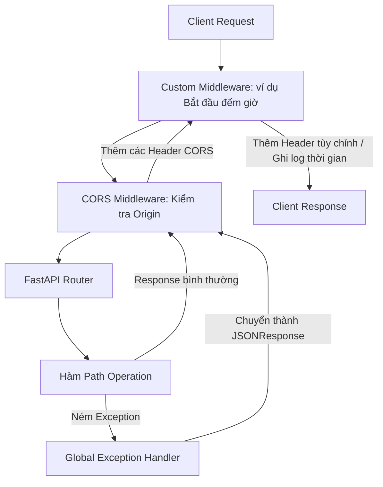

### 🎯 Mục tiêu học tập
- Giải thích vai trò của middleware trong vòng đời request-response của HTTP.
- Can thiệp (intercept) và sửa đổi request gửi đến và response gửi đi bằng middleware tùy chỉnh.
- Cấu hình các header CORS (Cross-Origin Resource Sharing) để bảo mật và cho phép các request cross-domain.
- Định nghĩa các exception Python tùy chỉnh để đại diện cho các lỗi nghiệp vụ hoặc xác thực của ứng dụng.
- Đăng ký các exception handler toàn cục trong FastAPI để trả về các response JSON có cấu trúc và thân thiện với người dùng.

### 🧩 Khái niệm cốt lõi (Tại sao)
Các ứng dụng web thường cần thực thi một logic nhất quán trên tất cả các request gửi đến và response gửi đi. Ví dụ: bạn có thể muốn ghi lại (log) thời gian thực thi của mỗi request, xác thực header hoặc nén response. Việc viết logic này bên trong từng hàm path operation riêng lẻ sẽ dẫn đến trùng lặp code. **Middleware** giải quyết vấn đề này bằng cách can thiệp vào request trước khi chúng đến các route của bạn, và sửa đổi response trước khi chúng được trả về cho client.

Một chức năng quan trọng khác của middleware là quản lý **CORS (Cross-Origin Resource Sharing - Chia sẻ tài nguyên giữa các nguồn khác nhau)**. Vì lý do bảo mật, các trình duyệt web hiện đại thực thi chính sách cùng nguồn gốc (same-origin policy), ngăn một ứng dụng frontend chạy ở tên miền này (ví dụ: `https://frontend.com`) gửi request AJAX đến API chạy ở tên miền khác (ví dụ: `https://api.com`). Các header CORS thông báo cho trình duyệt biết rằng server hoàn toàn tin tưởng các nguồn (origins) cụ thể, cho phép giao tiếp an toàn giữa các domain khác nhau.

Cuối cùng, trong quá trình thực thi request, mọi thứ có thể đi chệch hướng—một truy vấn database bị lỗi, hoặc tài nguyên được yêu cầu không tồn tại. Nếu ứng dụng của bạn ném ra một exception Python tiêu chuẩn mà không được bắt, FastAPI sẽ làm gián đoạn pipeline request và trả về lỗi chung chung 500 Internal Server Error. Bằng cách định nghĩa các **exception tùy chỉnh** và đăng ký các **exception handler** toàn cục, bạn có thể bắt được các lỗi cụ thể này và chuyển đổi chúng thành các response JSON rõ ràng, có cấu trúc (ví dụ: phản hồi 404 Not Found kèm thông tin mô tả lỗi), nâng cao tính hữu dụng và khả năng debug của API.

### 🔁 Logic và hoạt động

Dưới đây là vòng đời request-response minh họa sự tương tác giữa Middleware, Router và Exception Handler:



Khi một exception xuất hiện, router sẽ bỏ qua quy trình xử lý thông thường và tìm kiếm một exception handler đã đăng ký khớp với class exception đó. Handler sẽ định dạng một response HTTP chuẩn, response này vẫn đi qua các lớp middleware trước khi được trả về client.

### 📝 Ví dụ minh họa có chú thích

#### 1. Custom HTTP Middleware
Chúng ta có thể tạo một middleware tùy chỉnh bằng cách sử dụng `@app.middleware("http")` để tính thời gian xử lý request.
```python
import time
from fastapi import FastAPI, Request

app = FastAPI()

@app.middleware("http")
async def add_process_time_header(request: Request, call_next):
    # 1. Logic thực thi trước khi request đi đến path operation
    start_time = time.time()
    
    # 2. Chuyển tiếp request đi xuống phía dưới để lấy response
    response = await call_next(request)
    
    # 3. Logic thực thi sau khi route hoàn tất, dùng để sửa đổi response
    process_time = time.time() - start_time
    response.headers["X-Process-Time"] = str(process_time)
    
    return response
```

#### 2. Cấu hình CORS Middleware
FastAPI cung cấp sẵn `CORSMiddleware` để quản lý các header cross-origin một cách dễ dàng.
```python
from fastapi.middleware.cors import CORSMiddleware

# Định nghĩa danh sách các origin được phép gửi request cross-site
origins = [
    "http://localhost:3000",
    "https://myfrontendapp.com",
]

app.add_middleware(
    CORSMiddleware,
    allow_origins=origins,            # Cho phép các request từ các nguồn này
    allow_credentials=True,           # Cho phép gửi kèm cookie trong request
    allow_methods=["*"],              # Cho phép tất cả các phương thức HTTP (GET, POST, v.v.)
    allow_headers=["*"],              # Cho phép tất cả các header HTTP
)
```

#### 3. Custom Exceptions và Global Handlers
Chúng ta định nghĩa các exception nghiệp vụ tùy chỉnh và bắt chúng trên toàn cục bằng exception handler.
```python
from fastapi import FastAPI, Request
from fastapi.responses import JSONResponse

# 1. Định nghĩa class exception Python tùy chỉnh
class ItemLimitExceededError(Exception):
    def __init__(self, limit: int):
        self.limit = limit

app = FastAPI()

# 2. Đăng ký exception handler bằng decorator tương ứng
@app.exception_handler(ItemLimitExceededError)
async def item_limit_exception_handler(request: Request, exc: ItemLimitExceededError):
    # 3. Trả về một JSONResponse có cấu trúc với status code phù hợp
    return JSONResponse(
        status_code=400,
        content={"error": "Invalid request", "detail": f"Cannot add more than {exc.limit} items."}
    )

@app.get("/items/add")
def add_item(count: int):
    if count > 10:
        # Kích hoạt exception tùy chỉnh
        raise ItemLimitExceededError(limit=10)
    return {"message": "Items added successfully"}
```

### ❌ Các lỗi thường gặp

**Lỗi 1: Quên await `call_next(request)` trong middleware tùy chỉnh**
```python
# Sai: Gọi call_next mà không dùng await
@app.middleware("http")
async def process_time_middleware(request: Request, call_next):
    response = call_next(request)
    response.headers["X-Process-Time"] = "0.01"
    return response
```
```text
AttributeError: 'coroutine' object has no attribute 'headers'
```
```python
# Đúng: Sử dụng await với call_next để lấy được đối tượng response
@app.middleware("http")
async def process_time_middleware(request: Request, call_next):
    response = await call_next(request)
    response.headers["X-Process-Time"] = "0.01"
    return response
```
> `call_next` là một coroutine bất đồng bộ đại diện cho pipeline thực thi request ở phía sau. Nếu không dùng `await`, Python sẽ trả về một đối tượng coroutine thay vì một instance `Response` thực tế. Việc cố gắng thiết lập header trên đối tượng coroutine đó sẽ gây ra lỗi `AttributeError` và làm sập ứng dụng.

**Lỗi 2: Trả về một dictionary thay vì một Response instance trong exception handler**
```python
# Sai: Trả về một dict thông thường từ handler
@app.exception_handler(ItemLimitExceededError)
def exception_handler_wrong(request: Request, exc: ItemLimitExceededError):
    return {"error": "Limit exceeded"}
```
```text
AssertionError: The response returned by the exception handler must be an instance of starlette.responses.Response
```
```python
# Đúng: Trả về một đối tượng JSONResponse rõ ràng
@app.exception_handler(ItemLimitExceededError)
def exception_handler_correct(request: Request, exc: ItemLimitExceededError):
    return JSONResponse(status_code=400, content={"error": "Limit exceeded"})
```
> Cơ chế exception handler của FastAPI (xây dựng trên nền Starlette) yêu cầu các handler phải trả về một thực thể hợp lệ của subclass `Response` (chẳng hạn như `JSONResponse`, `HTMLResponse`, hoặc `PlainTextResponse`). Việc trả về một dictionary thô hoặc một chuỗi vi phạm quy tắc này và kích hoạt lỗi runtime assertion.

### 💡 Mẹo & Cách viết tối ưu
- **Thứ tự đăng ký CORS Middleware**: Luôn thêm `CORSMiddleware` ở gần đầu danh sách stack middleware của bạn để đảm bảo nó can thiệp được vào các request preflight của trình duyệt trước khi các middleware ghi log hoặc xác thực tùy chỉnh khác chạy.
- **Pattern Base App Exception**: Nếu bạn có nhiều class exception tự định nghĩa, hãy kế thừa chúng từ một class cơ sở chung (ví dụ: `class BaseAppException(Exception)`). Khi đó, bạn có thể đăng ký duy nhất một handler cho `BaseAppException` để bắt và định dạng tất cả các lỗi tùy chỉnh này theo một chuẩn thống nhất:
  ```python
  @app.exception_handler(BaseAppException)
  def base_exception_handler(request: Request, exc: BaseAppException):
      return JSONResponse(status_code=400, content={"error": str(exc)})
  ```
- **Truyền context thông qua `request.state`**: Bạn có thể gắn dữ liệu tùy chỉnh vào request state trong middleware (ví dụ: `request.state.user_role = "admin"`) và đọc lại thông tin này sau đó bên trong các hàm path operation của bạn.

### 🧠 Đi sâu phân tích (Cơ chế bên dưới)
<details><summary>Thứ tự thực thi Middleware và CORS Preflight</summary>

#### Mô hình ASGI Middleware Onion (Củ hành)
Các ứng dụng FastAPI chạy trên đặc tả Asynchronous Server Gateway Interface (ASGI). Các middleware trong ASGI hoạt động giống như các lớp của một củ hành:
- Các request đi vào sẽ đi từ lớp ngoài cùng vào các lớp bên trong.
- Các response đi ra sẽ đi từ lớp trong cùng ra các lớp bên ngoài.

Khi bạn gọi `app.add_middleware(MiddlewareClass)`, FastAPI sẽ đăng ký chúng tuần tự. Do mô hình củ hành, **middleware nào được thêm sau cùng sẽ là middleware đầu tiên nhận request đi vào (lớp ngoài cùng), và middleware nào được thêm đầu tiên sẽ nằm gần router nhất (lớp trong cùng)**. Hãy ghi nhớ điều này nếu các middleware của bạn phụ thuộc vào hành động của nhau.

#### CORS Preflight và Request OPTIONS
Khi một ứng dụng frontend chạy ở địa chỉ `http://localhost:3000` cố gắng gửi một request `POST` kèm payload JSON đến `http://localhost:8000/api`, trước hết trình duyệt sẽ tự động gửi một request HTTP `OPTIONS`. Đây được gọi là **Preflight Request**.
- Request preflight dùng để kiểm tra xem server có cho phép origin `http://localhost:3000` và header `Content-Type` hoạt động hay không.
- Nếu server phản hồi với các header như `Access-Control-Allow-Origin: http://localhost:3000` và `Access-Control-Allow-Methods: POST`, trình duyệt mới tiếp tục gửi request `POST` thực tế.
- `CORSMiddleware` của FastAPI tự động can thiệp vào các request preflight `OPTIONS` gửi đến này và trả về các header cấu hình tương ứng ngay lập tức, ngăn các request này đi sâu vào router của bạn giúp tiết kiệm tài nguyên xử lý của ứng dụng.
</details>

### 🏋️ Bài tập thực hành
Tạo một exception tùy chỉnh `ResourceNotFoundError` nhận vào đối số là tên tài nguyên (`name`). Sau đó, hãy triển khai một exception handler đăng ký exception này trong ứng dụng FastAPI, trả về HTTP status code 404 và JSON payload có định dạng `{"error": "<name> not found"}`.

```python
from fastapi import FastAPI, Request
from fastapi.responses import JSONResponse

class ResourceNotFoundError(Exception):
    def __init__(self, name: str):
        self.name = name

app = FastAPI()

# Triển khai custom exception handler cho ResourceNotFoundError
```

### ✅ Tự kiểm tra
1. Làm thế nào một middleware có thể chặn một request không cho đến router nếu việc kiểm tra validation bị thất bại?
2. Tại sao việc xác thực CORS lại được thực hiện bởi trình duyệt web thay vì backend FastAPI?
3. Sự khác biệt giữa `HTTPException` của Starlette và các exception Python chuẩn khi được xử lý bởi FastAPI là gì?
<details><summary>Đáp án tự kiểm tra</summary>

1. Một middleware có thể trực tiếp trả về một `JSONResponse` (ví dụ: trả về response 401 Unauthorized) thay vì gọi `await call_next(request)`. Việc này sẽ ngắt mạch (short-circuit) quy trình và request sẽ không bao giờ đi tới router.
2. CORS là cơ chế bảo mật của trình duyệt web nhằm bảo vệ người dùng khỏi các script độc hại chạy từ một origin gửi các request trái phép đến origin khác. Backend chỉ đóng vai trò cung cấp header xác nhận; trình duyệt mới là thực thể chặn hoặc cho phép request hoàn tất.
3. FastAPI tích hợp sẵn handler cho `HTTPException` của Starlette để tự động chuyển nó thành response JSON tương ứng. Các exception Python thông thường, trừ khi được chỉ định rõ ràng qua một exception handler tùy chỉnh, sẽ không được bắt bởi handler mặc định này và sẽ trả về lỗi hệ thống 500 Internal Server Error.
</details>

### 📌 Tóm tắt
- **Middleware** can thiệp vào toàn bộ vòng đời request-response, cho phép xử lý toàn cục đối với request và response.
- **Header CORS** đóng vai trò cực kỳ quan trọng để cấp quyền cho các request cross-domain từ trình duyệt, đảm bảo kết nối ổn định giữa frontend và backend.
- **Exception tùy chỉnh** đóng gói các lỗi nghiệp vụ cụ thể và ngăn các exception chưa được xử lý làm rò rỉ thông tin chi tiết của hệ thống.
- **Exception handler toàn cục** ánh xạ các lỗi Python thành các response HTTP chuẩn hóa và rõ ràng như `JSONResponse`.
