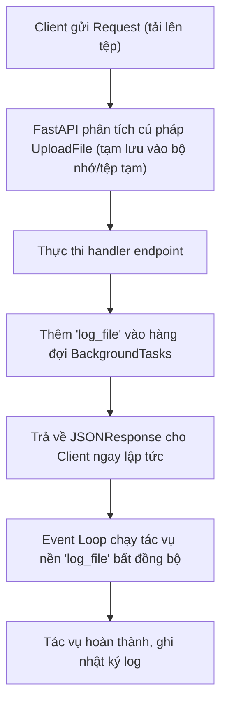

### 🎯 Mục tiêu học tập
- Phân biệt giữa việc tải lên tệp bằng `bytes` và `UploadFile` trong FastAPI.
- Triển khai các route tải lên tệp sử dụng các component `UploadFile` và `File`.
- Giải thích vòng đời request-response khi ủy thác công việc cho `BackgroundTasks`.
- Cấu hình tác vụ nền để thực thi các công việc tốn thời gian mà không chặn phản hồi HTTP của client.
- Viết các test tích hợp end-to-end cho các route xử lý tải lên tệp và kích hoạt tác vụ nền.

### 🧩 Khái niệm cốt lõi (Tại sao)
Các ứng dụng web thường xuyên cần nhận tệp từ phía client (như ảnh đại diện, tài liệu, hoặc bảng dữ liệu) và thực hiện các tác vụ mất vài giây đến vài phút để hoàn thành (như gửi email xác nhận, xử lý dữ liệu tải lên, hoặc tạo báo cáo). 

Trong các framework web đồng bộ truyền thống, nếu một client tải lên một tệp và máy chủ xử lý nó ngay lập tức bên trong request handler, kết nối sẽ được giữ mở và client phải chờ toàn bộ quá trình kết thúc trước khi nhận được phản hồi. Nếu có nhiều client thực hiện các tác vụ chậm này cùng một lúc, các tiến trình worker của máy chủ sẽ bị chặn (block), dẫn đến tình trạng quá thời gian chờ (timeout) và trải nghiệm người dùng bị giảm sút nghiêm trọng.

FastAPI giải quyết những thách thức này bằng hai tính năng mạnh mẽ:
1. **`UploadFile`**: Được hỗ trợ bởi Starlette, class này xử lý các tệp tải lên hiệu quả bằng cách truyền phát (stream) dữ liệu đến. Không giống như việc đọc dữ liệu thô `bytes` (vốn sẽ tải toàn bộ tệp vào RAM của máy chủ), `UploadFile` chỉ lưu trữ tệp trong bộ nhớ tối đa là 1MB. Nếu tệp vượt quá giới hạn này, nó sẽ tự động được ghi vào một tệp tạm thời trên đĩa (spooled), ngăn ngừa việc cạn kiệt bộ nhớ (lỗi Out-of-Memory).
2. **`BackgroundTasks`**: Class này cho phép bạn ủy thác các hoạt động sẽ được thực thi *sau khi* trả về phản hồi HTTP. Bằng cách thêm một tác vụ vào `BackgroundTasks`, FastAPI phản hồi lại client ngay lập tức (ví dụ: trả về `{"status": "queued"}`), sau đó thực thi hàm được chỉ định một cách bất đồng bộ trong một thread nền hoặc event loop, giúp ứng dụng luôn phản hồi nhanh chóng.

### 🔁 Logic và hoạt động

Sơ đồ khối sau đây minh họa vòng đời của một yêu cầu tải lên tệp kích hoạt một tác vụ nền:



Khi một yêu cầu chứa tác vụ nền hoàn thành, FastAPI sẽ lấy tác vụ đã đăng ký, trả về nội dung phản hồi cùng với header cho client, và ngay lập tức chạy hàm đã đăng ký. Nếu hàm nền được định nghĩa là một hàm đồng bộ tiêu chuẩn (`def`), FastAPI sẽ chạy nó trong một thread pool bên ngoài. Nếu nó được định nghĩa là `async def`, FastAPI sẽ lập lịch chạy trực tiếp trên ASGI event loop chính.

### 📝 Ví dụ minh họa có chú thích

#### 1. Tải lên tệp với `UploadFile`
Dưới đây là một route nhận một tệp tải lên, lấy siêu dữ liệu (metadata) và đọc nội dung của nó.
```python
from fastapi import FastAPI, File, UploadFile

app = FastAPI()

@app.post("/upload-metadata")
async def get_file_metadata(file: UploadFile = File(...)):
    # 1. Truy cập các thuộc tính siêu dữ liệu
    filename = file.filename
    content_type = file.content_type
    
    # 2. Đọc nội dung tệp một cách bất đồng bộ
    content = await file.read()
    
    # 3. Luôn đóng tệp để giải phóng tài nguyên hệ thống
    await file.close()
    
    return {
        "filename": filename,
        "content_type": content_type,
        "size_bytes": len(content)
    }
```

#### 2. Chạy tác vụ dưới nền
Sử dụng `BackgroundTasks` để ghi nhật ký tin nhắn hoặc xử lý dữ liệu sau khi gửi phản hồi.
```python
from fastapi import FastAPI, BackgroundTasks

app = FastAPI()

def write_notification(email: str, message: str):
    # Giả lập một hoạt động gửi email chậm chạp
    with open("log.txt", mode="a") as log:
        log.write(f"Notification to {email}: {message}\n")

@app.post("/send-notification/{email}")
def send_notification(email: str, background_tasks: BackgroundTasks):
    # Thêm hàm và các đối số của nó vào hàng đợi
    background_tasks.add_task(write_notification, email, message="Welcome to our platform!")
    
    # Trả về phản hồi cho client ngay lập tức
    return {"message": "Notification is being sent in the background"}
```

#### 3. Kết hợp Tải lên tệp và Tác vụ Nền
Một route nhận tệp, trả về trạng thái "processing", và ghi nhật ký tên tệp dưới nền.
```python
from fastapi import FastAPI, BackgroundTasks, UploadFile, File

app = FastAPI()
PROCESSED_FILES = []

def log_file(filename: str):
    # Giả lập hoạt động tác vụ nền
    PROCESSED_FILES.append(filename)

@app.post("/upload")
def upload_file(background_tasks: BackgroundTasks, file: UploadFile = File(...)):
    # Thêm tác vụ ghi log để chạy sau khi phản hồi được gửi đi
    background_tasks.add_task(log_file, file.filename)
    
    # Trả về kết quả ngay lập tức cho client
    return {"status": "queued"}
```

### ❌ Các lỗi thường gặp

**Lỗi 1: Đọc nội dung `UploadFile` một cách đồng bộ mà không có `await` bên trong một hàm `async def`**
```python
# Sai: Đọc tệp trong route async mà không có await
@app.post("/upload")
async def upload(file: UploadFile = File(...)):
    content = file.read()
    return {"size": len(content)}
```
```text
RuntimeWarning: coroutine 'UploadFile.read' was never awaited
TypeError: object coroutine can't be used in 'len()'
```
```python
# Đúng: Sử dụng await cho các phương thức async của UploadFile
@app.post("/upload")
async def upload(file: UploadFile = File(...)):
    content = await file.read()
    return {"size": len(content)}
```
> `UploadFile.read()` là một phương thức bất đồng bộ vì nó thực hiện các thao tác I/O đĩa không chặn ở bên dưới. Trong các route `async def`, bạn phải thêm tiền tố `await` để lấy được nội dung bytes thực tế. Nếu không, nó sẽ trả về một đối tượng coroutine, điều này sẽ kích hoạt cảnh báo và gây lỗi `TypeError` khi bạn cố gắng truy cập độ dài hoặc nội dung của nó.

**Lỗi 2: Quên khai báo `File(...)` trong tham số route, khiến FastAPI mong đợi một tham số query**
```python
# Sai: Thiếu giá trị mặc định File()
@app.post("/upload")
def upload(file: UploadFile):
    return {"filename": file.filename}
```
```text
pydantic_core._pydantic_core.ValidationError: 1 validation error for Request
query -> file
  Field required [type=missing, input_value={}, input_type=dict]
```
```python
# Đúng: Chỉ định File(...) để hướng dẫn FastAPI phân tích cú pháp dưới dạng dữ liệu form multipart
@app.post("/upload")
def upload(file: UploadFile = File(...)):
    return {"filename": file.filename}
```
> Theo mặc định, FastAPI coi các tham số không thuộc body schema (như các kiểu dữ liệu đơn giản hoặc các class đơn lẻ) là các tham số query hoặc JSON body. Nếu bạn không gán rõ ràng `File(...)` hoặc `File(None)` cho đối số `UploadFile`, FastAPI sẽ tìm kiếm tệp trong tham số query hoặc JSON request body, dẫn đến lỗi validation khi client tải tệp lên dưới dạng payload multipart/form-data.

### 💡 Mẹo & Cách viết tối ưu
- **Stream so với Bộ nhớ**: Nếu bạn chỉ cần kiểm tra các header hoặc siêu dữ liệu của tệp, đừng đọc toàn bộ nội dung của nó bằng `file.read()`. Hãy kiểm tra trực tiếp `file.filename` và `file.content_type` để tiết kiệm bộ nhớ RAM.
- **Luôn đóng các tệp Spooled**: Nếu bạn đọc nội dung bằng `await file.read()`, hãy gọi `await file.close()` để đảm bảo tệp tạm thời trên đĩa được xóa và không làm rò rỉ tài nguyên lưu trữ.
- **Sự khác biệt giữa Def và Async Def cho Tác vụ Nền**: 
  - Nếu tác vụ nền của bạn liên quan đến thao tác I/O đồng bộ, gây chặn (ví dụ: ghi tệp tiêu chuẩn, gọi database đồng bộ, hoặc tính toán nặng CPU), hãy khai báo nó bằng hàm đồng bộ `def`. FastAPI sẽ chạy nó trong một thread pool riêng biệt.
  - Nếu nó thực hiện I/O bất đồng bộ (ví dụ: thực hiện request HTTP bằng `httpx.AsyncClient`), hãy khai báo nó bằng `async def` để nó chạy trực tiếp trên event loop chính mà không cần sinh thêm thread mới.

### 🧠 Đi sâu phân tích (Cơ chế bên dưới)
<details><summary>Mô hình Threading của BackgroundTasks trong FastAPI</summary>

`BackgroundTasks` của FastAPI được kế thừa từ Starlette. Khi một tác vụ được thêm vào, máy chủ sẽ lập lịch để chạy nó sau khi phản hồi đã được gửi đi qua mạng. Cách thức Starlette chạy các tác vụ này phụ thuộc vào cách hàm nền được định nghĩa:

1. **Các hàm đồng bộ (`def`)**:
   Nếu bạn định nghĩa `def task_func()`, Starlette sẽ thực thi hàm này bên trong một thread pool riêng biệt được quản lý bởi `anyio` (thư viện chạy bất đồng bộ bên dưới). Điều này đảm bảo rằng các hoạt động gây nghẽn (như gọi database đồng bộ hoặc ghi tệp thông thường) không chặn event loop đơn luồng chính, cho phép máy chủ tiếp tục xử lý các yêu cầu đồng thời khác.
   
2. **Các hàm bất đồng bộ (`async def`)**:
   Nếu bạn định nghĩa `async def task_func()`, Starlette sẽ thực thi hàm trực tiếp trên luồng event loop chính bằng cách sử dụng `await`. Nếu hàm bất đồng bộ của bạn chứa mã tính toán nặng CPU hoặc các hoạt động gây chặn đồng bộ (như `time.sleep()`), nó sẽ chặn toàn bộ event loop, làm đóng băng ứng dụng đối với tất cả người dùng khác. Hãy luôn đảm bảo rằng các tác vụ nền dạng `async def` chỉ sử dụng các lệnh gọi bất đồng bộ không gây nghẽn.
</details>

### 🏋️ Bài tập thực hành
Triển khai ứng dụng FastAPI cung cấp endpoint `POST /upload`. Endpoint này phải nhận tệp tải lên (dữ liệu form multipart) và sử dụng `BackgroundTasks` để thêm tên tệp (`filename`) vào một danh sách toàn cục có tên là `PROCESSED_FILES`. Client sẽ nhận được phản hồi ngay lập tức là `{"status": "queued"}`.

```python
from fastapi import FastAPI, BackgroundTasks, UploadFile, File

app = FastAPI()
PROCESSED_FILES = []

def log_file(filename: str):
    PROCESSED_FILES.append(filename)

# Triển khai route POST /upload nhận vào UploadFile và thêm tên tệp vào PROCESSED_FILES ở chế độ nền
```

### ✅ Tự kiểm tra
1. Lợi thế chính về bộ nhớ của việc sử dụng `UploadFile` so với `bytes` thô khi tải tệp lên là gì?
2. Điều gì xảy ra nếu một hàm tác vụ nền được khai báo bằng `async def` nhưng lại chứa một lệnh gọi gây nghẽn `time.sleep(10)`?
3. Làm thế nào bạn có thể kiểm thử (test) các tác vụ nền bằng `TestClient` của FastAPI?
<details><summary>Đáp án tự kiểm tra</summary>

1. `UploadFile` chỉ lưu trữ các tệp trong bộ nhớ tối đa là 1MB. Nếu tệp lớn hơn, nó tự động ghi vào một tệp tạm thời trên đĩa. Còn `bytes` thô sẽ đọc toàn bộ tệp trực tiếp vào RAM, điều này có thể làm sập máy chủ nếu người dùng tải lên một tệp cực kỳ lớn.
2. Vì tác vụ được khai báo bằng `async def`, nó sẽ thực thi trực tiếp trên event loop chính. Nếu nó chứa một lệnh gọi gây nghẽn như `time.sleep(10)`, event loop sẽ bị đóng băng trong 10 giây và máy chủ hoàn toàn không phản hồi với bất kỳ yêu cầu nào khác trong khoảng thời gian đó.
3. `TestClient` của FastAPI chạy các tác vụ nền một cách đồng bộ. Khi bạn thực hiện một request bằng `client.post()`, test client sẽ chờ phản hồi và thực thi ngay lập tức tác vụ nền trước khi lệnh gọi trả về, cho phép bạn kiểm tra các hiệu ứng phụ (side-effects) của tác vụ nền (như kiểm tra xem tên tệp đã được thêm vào danh sách chưa) ngay sau khi gửi yêu cầu.
</details>

### 📌 Tóm tắt
- **Tải lên Tệp**: `UploadFile` của FastAPI cung cấp một giao diện hiện đại, hỗ trợ stream và ghi tệp tạm thời trên đĩa khi quá giới hạn bộ nhớ, giúp tránh việc tiêu thụ quá nhiều RAM trên máy chủ.
- **BackgroundTasks**: Tính năng tích hợp sẵn này cho phép bạn chạy mã sau khi gửi phản hồi, rất lý tưởng cho các tác vụ như gửi email hoặc ghi nhật ký.
- **Mô hình luồng**: Các tác vụ nền dạng `def` thông thường được chạy trong một thread pool bên ngoài, trong khi các tác vụ nền dạng `async def` chạy trực tiếp trên event loop chính.
- **Kiểm thử**: Khi sử dụng `TestClient`, các tác vụ nền sẽ chạy đồng bộ trong quá trình kiểm thử, làm cho việc kiểm tra và khẳng định (assertion) trở nên dễ dàng và trực quan.
