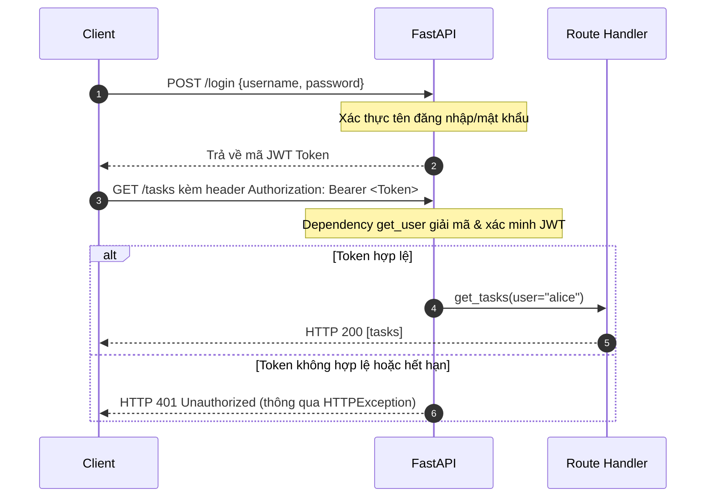

### 🎯 Mục tiêu học tập
- Tích hợp nhiều thành phần của FastAPI (xác thực dữ liệu, bảo mật, dependency injection, xử lý ngoại lệ) vào một hệ thống duy nhất.
- Bảo mật các endpoint API bằng phương thức xác thực JSON Web Token (JWT).
- Tạo các schema Pydantic tùy chỉnh để xác thực request body gửi từ phía client.
- Xây dựng các dependency có thể tái sử dụng để trích xuất, giải mã và xác minh các token xác thực.
- Thiết kế các kiểm thử tích hợp toàn diện để kiểm tra quy trình xác thực và các endpoint CRUD.

### 🧩 Khái niệm cốt lõi (Tại sao)
Trong phát triển phần mềm thực tế, bạn hiếm khi xây dựng các tính năng một cách cô lập. Một API sẵn sàng cho môi trường production đòi hỏi nhiều lớp xử lý đan xen hoạt động cùng nhau một cách trơn tru:
1. **Xác thực dữ liệu yêu cầu (Request Validation)**: Đảm bảo dữ liệu đầu vào của client có cấu trúc chính xác trước khi bất kỳ logic nghiệp vụ nào chạy (sử dụng **Pydantic**).
2. **Bảo mật & Xác thực (Security & Authentication)**: Xác minh danh tính của client và bắt buộc chỉ những người dùng được ủy quyền mới có thể truy cập các route cụ thể (sử dụng **JWT** và **OAuth2PasswordBearer**).
3. **Dependency Injection**: Tách biệt logic xác thực và kiểm tra dữ liệu ra khỏi các hàm path operation, cho phép bạn bảo mật các route chỉ bằng các khai báo đơn giản (sử dụng **`Depends`**).
4. **Xử lý lỗi có cấu trúc (Exception Handling)**: Trả về chính xác các HTTP status code và thông tin mô tả chi tiết khi xác thực thất bại, dữ liệu không hợp lệ hoặc tài nguyên không tồn tại (sử dụng **`HTTPException`**).

Bài tập lớn này sẽ kéo các thành phần cốt lõi này lại với nhau để xây dựng một REST API bảo mật quản lý công việc (tasks). Người dùng phải xác thực thông qua endpoint `/login` để nhận một token. Token này sau đó phải được gửi kèm trong header `Authorization` của các yêu cầu tiếp theo. Hệ thống backend tự động trích xuất và xác minh token, xử lý các lỗi giải mã một cách an toàn, và chỉ trả về tài nguyên được yêu cầu khi xác minh thành công.

### 🔁 Logic và hoạt động

Sơ đồ tuần tự sau đây minh họa vòng đời request-response của API bảo mật:



Khi client gửi yêu cầu đến một endpoint được bảo vệ như `GET /tasks`:
1. Yêu cầu đi qua dependency `OAuth2PasswordBearer`, dependency này sẽ tìm kiếm header `Authorization: Bearer <token>`. Nếu thiếu header này, nó sẽ tự động ném ra lỗi 401 Unauthorized.
2. Token trích xuất được sẽ được chuyển tiếp đến dependency tùy chỉnh `get_user`.
3. Dependency giải mã token bằng cách sử dụng signature secret key và thuật toán của ứng dụng.
4. Nếu hợp lệ, danh tính người dùng được trích xuất và truyền vào hàm route handler như một đối số.
5. Nếu giải mã thất bại (do token hết hạn, bị thay đổi chữ ký, hoặc định dạng không hợp lệ), dependency sẽ ném ra lỗi `HTTPException(status_code=401)`.

### 📝 Ví dụ minh họa có chú thích

Dưới đây là triển khai hoàn chỉnh của một REST API bảo mật tích hợp kiểm tra Pydantic, ký mã token JWT và dependency injection:

```python
import jwt
from fastapi import FastAPI, Depends, HTTPException, status
from fastapi.security import OAuth2PasswordBearer
from pydantic import BaseModel

# 1. Định nghĩa khóa bí mật (secret key) và thuật toán ký
SECRET = "capstone-secret-key"
ALGORITHM = "HS256"

app = FastAPI()

# 2. Định nghĩa cơ chế bảo mật OAuth2 trỏ đến endpoint login
oauth2_scheme = OAuth2PasswordBearer(tokenUrl="login")

# 3. Định nghĩa các model request Pydantic
class LoginRequest(BaseModel):
    username: str
    password: str

class TaskCreate(BaseModel):
    title: str

class Task(BaseModel):
    id: int
    title: str

# Giả lập cơ sở dữ liệu lưu trong bộ nhớ RAM
tasks_db = []
task_id_counter = 1

# 4. Triển khai endpoint Login tạo token JWT
@app.post("/login")
def login(req: LoginRequest):
    # Kiểm tra thông tin đăng nhập giả lập
    if req.username == "alice" and req.password == "password123":
        # Mã hóa danh tính người dùng vào payload JWT
        token = jwt.encode({"sub": req.username}, SECRET, algorithm=ALGORITHM)
        return {"token": token, "token_type": "bearer"}
    
    raise HTTPException(
        status_code=status.HTTP_401_UNAUTHORIZED,
        detail="Incorrect username or password"
    )

# 5. Tạo hàm dependency xác minh JWT và trích xuất user
def get_user(token: str = Depends(oauth2_scheme)):
    try:
        # Giải mã và xác minh chữ ký token
        payload = jwt.decode(token, SECRET, algorithms=[ALGORITHM])
        user = payload.get("sub")
        if user is None:
            raise HTTPException(status_code=401, detail="Invalid token payload")
        return user
    except jwt.InvalidTokenError:
        raise HTTPException(
            status_code=status.HTTP_401_UNAUTHORIZED,
            detail="Invalid or expired token"
        )

# 6. Triển khai các endpoint được bảo vệ sử dụng Depends(get_user)
@app.get("/tasks")
def get_tasks(user: str = Depends(get_user)):
    # Trả về cơ sở dữ liệu các task (chỉ truy cập được khi người dùng đã xác thực)
    return tasks_db

@app.post("/tasks")
def create_task(task_in: TaskCreate, user: str = Depends(get_user)):
    global task_id_counter
    new_task = Task(id=task_id_counter, title=task_in.title)
    tasks_db.append(new_task.model_dump())
    task_id_counter += 1
    return new_task
```

### ❌ Các lỗi thường gặp

**Lỗi 1: Hardcode các khóa bảo mật nhạy cảm trực tiếp trong mã nguồn ở môi trường sản xuất**
```python
# Sai: Lưu trữ trực tiếp mã bí mật trong code
SECRET = "capstone"
```
```text
(Security vulnerability warning: hardcoded secrets detected in source file)
```
```python
# Đúng: Đọc cấu hình khóa bí mật từ biến môi trường
import os
SECRET = os.getenv("JWT_SECRET_KEY", "default-fallback-insecure-dev-key")
```
> Việc hardcode các secret key trực tiếp trong mã nguồn khiến chúng dễ bị lộ nếu mã nguồn được đẩy lên các hệ thống quản lý phiên bản công khai (như GitHub). Bất cứ ai có được secret key đều có thể giả mạo các token JWT hợp lệ và vượt qua hệ thống xác thực. Hãy luôn đọc các thông tin nhạy cảm từ biến môi trường (environment variables).

**Lỗi 2: Không bắt các ngoại lệ giải mã token do thư viện JWT ném ra**
```python
# Sai: Giải mã token mà không bắt lỗi InvalidTokenError
def get_user(token: str = Depends(oauth2_scheme)):
    payload = jwt.decode(token, SECRET, algorithms=["HS256"])
    return payload["sub"]
```
```text
jwt.exceptions.DecodeError: Signature verification failed
```
```python
# Đúng: Bao bọc việc giải mã trong khối try-except và ném ra HTTPException
def get_user(token: str = Depends(oauth2_scheme)):
    try:
        payload = jwt.decode(token, SECRET, algorithms=["HS256"])
        return payload["sub"]
    except jwt.InvalidTokenError:
        raise HTTPException(status_code=401, detail="Invalid token")
```
> Hàm `jwt.decode` sẽ ném ra các exception khác nhau (như `DecodeError` hoặc `ExpiredSignatureError`) nếu chữ ký sai, định dạng không đúng, hoặc token đã hết hạn. Nếu bạn không bắt các ngoại lệ này trong hàm dependency của mình, chúng sẽ lan truyền lên ASGI server, làm hỏng pipeline request và trả về lỗi 500 Internal Server Error thay vì phản hồi 401 Unauthorized thân thiện cho client.

### 💡 Mẹo & Cách viết tối ưu
- **Token không trạng thái (Stateless)**: JWT có tính chất stateless, nghĩa là máy chủ không cần truy vấn cơ sở dữ liệu phiên làm việc (session database) để xác thực danh tính người dùng. Tất cả các thông tin cần xác minh (danh tính, quyền hạn, thời gian hết hạn) đã nằm sẵn bên trong payload được ký mã hóa.
- **Khả năng tái sử dụng của Dependency**: Bạn có thể định nghĩa nhiều dependency phân quyền khác nhau (ví dụ: `get_active_user`, `get_admin_user`) dựa trên dependency cơ sở `get_user` để dễ dàng áp đặt các phân quyền người dùng khác nhau trên ứng dụng của mình.
- **Tiền tố Header khi Test**: Khi truy vấn các endpoint được bảo vệ bằng `TestClient`, hãy luôn bao gồm header `Authorization` với tiền tố `Bearer ` chính xác (ví dụ: `{"Authorization": f"Bearer {token}"}`).

### 🧠 Đi sâu phân tích (Cơ chế bên dưới)
<details><summary>Xác minh Chữ ký JWT & Bảo mật Thuật toán</summary>

Một JSON Web Token bao gồm ba phần được ngăn cách bởi dấu chấm (`.`):
1. **Header**: Chứa loại token (JWT) và thuật toán ký (ví dụ: HS256).
2. **Payload**: Chứa các thông tin khẳng định (claims) (ví dụ: `sub` cho chủ thể, `exp` cho thời gian hết hạn).
3. **Signature (Chữ ký)**: Xác thực tính xác thực của token.

Chữ ký được tính toán bằng cách sử dụng thuật toán giả lập sau:
```text
Signature = HMAC-SHA256(base64UrlEncode(Header) + "." + base64UrlEncode(Payload), SECRET_KEY)
```
Khi client gửi JWT đến máy chủ:
- Máy chủ tách token thành ba phần riêng biệt.
- Máy chủ tính toán lại chữ ký mới bằng cách sử dụng Header nhận được, Payload nhận được và khóa bí mật `SECRET_KEY` riêng của máy chủ.
- Máy chủ so sánh chữ ký tự tính toán với phần Signature được cung cấp trong token gửi kèm.
- Nếu chúng trùng khớp, máy chủ biết payload không bị sửa đổi bởi client hoặc bất kỳ trung gian nào, và token được tạo bởi một người sở hữu `SECRET_KEY`.
- Nếu tham số thuật toán `algorithms` không được chỉ định hoặc được đọc động từ header (ví dụ: cho phép thuật toán "none"), các client độc hại có thể vượt qua việc xác minh chữ ký hoàn toàn. Hãy luôn chỉ định rõ ràng các thuật toán được cho phép (ví dụ: `algorithms=["HS256"]`) khi giải mã token.
</details>

### 🏋️ Bài tập thực hành
Xây dựng một REST API hoàn chỉnh tích hợp xác thực Pydantic, thao tác cơ sở dữ liệu giả lập (sử dụng danh sách list) và bảo mật JWT. Bạn cần triển khai endpoint `/login` để xác thực người dùng (`alice` / `password123`) và trả về token JWT, một hàm dependency `get_user` để trích xuất và xác thực danh tính người dùng, và một endpoint `GET /tasks` được bảo vệ.

```python
import jwt
from fastapi import FastAPI, Depends, HTTPException, status
from fastapi.security import OAuth2PasswordBearer
from pydantic import BaseModel

# Triển khai hệ thống xác thực JWT đầy đủ, xác thực schema Pydantic và các endpoint CRUD REST API giả lập.
```

### ✅ Tự kiểm tra
1. Làm thế nào máy chủ xác minh rằng client không giả mạo hoặc chỉnh sửa dữ liệu payload bên trong token JWT?
2. Vai trò của `OAuth2PasswordBearer` trong dependency injection của FastAPI là gì?
3. Tại sao API trả về lỗi 500 thay vì 401 nếu bạn không bắt ngoại lệ `jwt.InvalidTokenError`?
<details><summary>Đáp án tự kiểm tra</summary>

1. Máy chủ tính toán lại chữ ký bằng Header, Payload nhận được và secret key của chính nó. Nếu chữ ký trùng khớp với chữ ký được gửi kèm trong token, điều đó chứng minh dữ liệu payload không hề bị thay đổi.
2. `OAuth2PasswordBearer` là class khai báo cho FastAPI biết rằng có một cơ chế bảo mật đang được áp dụng. Nó tự động tìm kiếm header `Authorization` chứa giá trị `Bearer <token>`, trích xuất token này và chuyển nó cho dependency xử lý tiếp.
3. Nếu một ngoại lệ Python được ném ra và không được bao bọc bởi khối `try-except`, nó sẽ tiếp tục lan truyền lên. Các ngoại lệ không được xử lý sẽ bị bắt bởi root handler của framework FastAPI/Starlette, lúc này framework coi đây là một vụ sập máy chủ ngoài ý muốn và trả về phản hồi lỗi chung 500 Internal Server Error.
</details>

### 📌 Tóm tắt
- **Tích hợp Capstone**: Việc bảo mật một API thực tế đòi hỏi sự phối hợp nhịp nhàng giữa các schema Pydantic, dependency injection và xác minh chữ ký JWT.
- **Xác thực JWT**: Được giải mã bằng khóa bí mật trên server để kiểm tra các thông tin client một cách mã hóa mà không cần phải truy vấn database, giúp hệ thống hoạt động stateless và nhanh chóng.
- **Xử lý Lỗi**: Xử lý ngoại lệ thích hợp trong các dependency đảm bảo các lỗi của client trả về mã 401 đúng chuẩn thay vì làm sập máy chủ (500).
- **Kiểm thử**: Việc sử dụng `TestClient` cho phép gửi các header Authorization tùy chỉnh để xác nhận logic phân quyền hoạt động đúng đắn.
