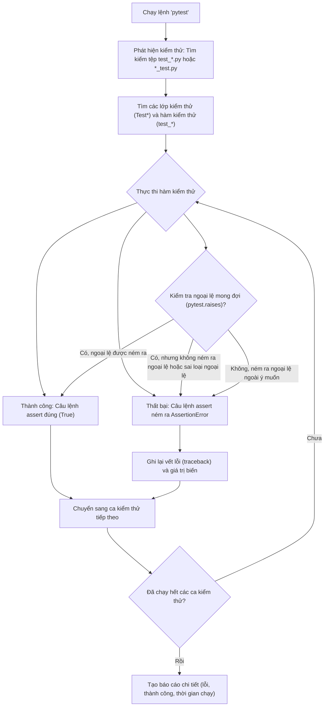

### 🎯 Mục tiêu học tập
- Hiểu được lợi ích của kiểm thử tự động (automated testing) và lý do tại sao thư viện `pytest` lại được ưu tiên lựa chọn hơn so với module `unittest` tích hợp sẵn của Python.
- Chạy các ca kiểm thử (tests) thông qua giao diện dòng lệnh `pytest` và hiểu rõ các quy tắc tự động phát hiện mã kiểm thử.
- Viết các hàm kiểm thử chuẩn và sử dụng các câu lệnh `assert` tiêu chuẩn của Python để xác minh hành vi của mã nguồn.
- Áp dụng `@pytest.mark.parametrize` để chạy một hàm kiểm thử duy nhất với nhiều bộ dữ liệu đầu vào và đầu ra khác nhau.
- Kiểm thử các trường hợp lỗi và xác nhận các ngoại lệ (exceptions) cụ thể được ném ra bằng cách sử dụng context manager `pytest.raises`.

### 🧩 Khái niệm cốt lõi (Tại sao)
Kiểm thử (testing) là một quy trình bắt buộc và thiết yếu trong phát triển phần mềm chuyên nghiệp. Kiểm thử tự động giúp xác minh ứng dụng hoạt động chính xác, ngăn chặn lỗi cũ xuất hiện trở lại (regressions) và cung cấp một tấm lưới bảo hiểm an toàn khi bạn tái cấu trúc (refactoring) hoặc mở rộng mã nguồn.

Mặc dù thư viện tiêu chuẩn của Python đã đi kèm framework `unittest`, thư viện mã nguồn mở **`pytest`** vẫn trở thành tiêu chuẩn thực tế trong ngành công nghiệp phần mềm. `pytest` được ưa chuộng nhờ các đặc điểm sau:
1. **Câu lệnh khẳng định đơn giản (Simple Assertions)**: Thay vì phải ghi nhớ các phương thức khẳng định phức tạp của framework cũ như `self.assertEqual(a, b)` hay `self.assertRaises(ValueError)`, bạn chỉ cần viết câu lệnh `assert a == b` chuẩn của Python. `pytest` sẽ chặn các lệnh gọi này và viết lại chúng ở bên dưới để cung cấp thông báo chi tiết khi kiểm thử thất bại.
2. **Tự động phát hiện kiểm thử (Automatic Test Discovery)**: Bạn không cần phải đăng ký các ca kiểm thử thủ công. Chỉ cần chạy lệnh `pytest`, hệ thống sẽ tự động quét thư mục dự án, thu thập tất cả các tệp kiểm thử và thực thi chúng.
3. **Tham số hóa hướng dữ liệu (Parameterization)**: Rút gọn các đoạn mã trùng lặp bằng cách truyền trực tiếp danh sách tham số vào một hàm kiểm thử duy nhất để kiểm thử nhiều kịch bản (kịch bản thành công, giá trị biên, giá trị lỗi).
4. **Kiểm tra ngoại lệ trực quan (Exception Checking)**: Cung cấp các context manager sạch sẽ (`with pytest.raises(...)`) để khẳng định ứng dụng ném ra đúng lỗi khi nhận đầu vào không hợp lệ.

### 🔁 Logic và hoạt động

Sơ đồ dưới đây minh họa cách `pytest` quét mã nguồn để phát hiện kiểm thử, thực thi các kiểm tra khẳng định (assertions) và tạo báo cáo kết quả cuối cùng:



Khi bạn thực thi lệnh `pytest`:
1. Thư viện sẽ quét đệ quy qua các thư mục trong dự án của bạn.
2. Xác định các tệp có tên khớp với mẫu `test_*.py` hoặc `*_test.py`.
3. Bên trong các tệp đó, thư viện thu thập các hàm có tiền tố `test_` và các lớp có tiền tố `Test`.
4. Thực thi từng hàm. Nếu xảy ra lỗi `AssertionError` hoặc một ngoại lệ chưa được xử lý, ca kiểm thử sẽ được đánh dấu là thất bại (failed) và hiển thị thông tin so sánh chi tiết. Nếu không có ngoại lệ nào xảy ra, ca kiểm thử thành công (passed).

### 📝 Ví dụ minh họa có chú thích

Dưới đây là một module Python đơn giản `calculator.py` và tệp kiểm thử tương ứng `test_calculator.py`.

**`calculator.py`**
```python
def add(a, b):
    return a + b

def divide_numbers(a, b):
    if b == 0:
        raise ValueError("Cannot divide by zero.")
    return a / b
```

**`test_calculator.py`**
```python
import pytest
from calculator import add, divide_numbers

# 1. Ca kiểm thử đơn vị tiêu chuẩn để xác minh kịch bản thành công
def test_addition_simple():
    # Chỉ cần sử dụng câu lệnh assert chuẩn của Python
    assert add(2, 3) == 5
    assert add(-1, 1) == 0

# 2. Kiểm thử luồng lỗi sử dụng pytest.raises
def test_divide_by_zero_raises_error():
    # Báo cho pytest biết khối mã này bắt buộc phải ném ra ValueError
    with pytest.raises(ValueError) as exc_info:
        divide_numbers(10, 0)
    
    # Chúng ta cũng có thể kiểm tra nội dung chuỗi tin nhắn của ngoại lệ
    assert str(exc_info.value) == "Cannot divide by zero."

# 3. Sử dụng kiểm thử tham số hóa để kiểm tra nhiều kịch bản một cách ngắn gọn, sạch sẽ
@pytest.mark.parametrize(
    "a, b, expected",
    [
        (6, 2, 3.0),
        (5, 2, 2.5),
        (-10, 2, -5.0),
        (0, 5, 0.0)
    ]
)
def test_divide_numbers_parameterized(a, b, expected):
    # Hàm này sẽ được chạy 4 lần, lần lượt thay thế a, b, và expected từ danh sách trên
    assert divide_numbers(a, b) == expected
```

### ❌ Các lỗi thường gặp

**Lỗi 1: Đặt tên tệp kiểm thử hoặc hàm kiểm thử sai quy tắc khiến pytest bỏ qua**
```python
# Sai: Tên tệp là run_tests.py và hàm kiểm thử không bắt đầu bằng test_
def check_addition():
    assert add(2, 3) == 5
```
```text
collected 0 items

============================= no tests ran in 0.01s =============================
```
```python
# Đúng: Tên tệp là test_calculator.py và hàm kiểm thử bắt đầu bằng test_
def test_addition():
    assert add(2, 3) == 5
```
> Pytest dựa vào các quy tắc đặt tên nghiêm ngặt để tự động phát hiện mã kiểm thử. Tệp kiểm thử phải có tên dạng `test_*.py` hoặc `*_test.py`, lớp kiểm thử phải có tên dạng `Test*` (không có hàm khởi tạo `__init__`), và hàm kiểm thử phải bắt đầu bằng tiền tố `test_`.

**Lỗi 2: Quên đặt khối mã ném ra ngoại lệ bên trong context block `pytest.raises`**
```python
# Sai: Gọi trực tiếp hàm ném ngoại lệ khiến chương trình kiểm thử bị sập
def test_divide_by_zero_crash():
    divide_numbers(5, 0)  # Lệnh này ném ra ValueError, làm hỏng ca kiểm thử
```
```text
calculator.py:6: in divide_numbers
    raise ValueError("Cannot divide by zero.")
E   ValueError: Cannot divide by zero.

=========================== FAILURES ===========================
___________________________ test_divide_by_zero_crash ___________________________
...
```
```python
# Đúng: Sử dụng context manager pytest.raises để bắt ngoại lệ mong đợi
def test_divide_by_zero_handled():
    with pytest.raises(ValueError):
        divide_numbers(5, 0)
```
> Nếu một hàm ném ra một ngoại lệ đã được dự báo trước nhưng bạn không bọc nó trong khối lệnh `with pytest.raises(LoạiNgoạiLệ):`, Python sẽ coi đó là một lỗi chưa được xử lý (unhandled error). Điều này làm gián đoạn hàm kiểm thử ngay lập tức và đánh dấu ca kiểm thử đó là thất bại.

### 💡 Mẹo & Cách viết tối ưu
- **Chạy ca kiểm thử cụ thể**: Bạn có thể chạy một hàm kiểm thử duy nhất bằng cách chỉ định rõ đường dẫn và tên hàm: `pytest test_calculator.py::test_addition_simple`.
- **Lọc theo chuỗi ký tự**: Chạy tất cả các bài kiểm thử có tên chứa một chuỗi ký tự cụ thể bằng tùy chọn `-k`: `pytest -k "divide"`.
- **Thông tin chi tiết khi thất bại**: Khi một câu lệnh assert thất bại, `pytest` sẽ hiển thị giá trị của tất cả các biến liên quan. Bạn không cần phải chèn các lệnh `print` để xem giá trị biến nữa.
- **Dừng ngay khi có lỗi**: Sử dụng cờ `-x` để dừng thực thi toàn bộ bộ kiểm thử ngay lập tức khi phát hiện lỗi đầu tiên.

### 🧠 Đi sâu phân tích (Cơ chế bên dưới)
<details><summary>Cơ chế viết lại câu lệnh khẳng định (Assertion Rewriting) của Pytest</summary>

Các câu lệnh `assert` tiêu chuẩn của Python chỉ ném ra một lỗi `AssertionError` chung chung mà không đi kèm bất kỳ thông tin ngữ cảnh nào khi thất bại. Vậy làm thế nào để `pytest` có thể hiển thị giá trị của từng biến trong một câu lệnh assert bị lỗi?

Pytest đạt được điều này thông qua kỹ thuật **Viết lại câu lệnh khẳng định (Assertion Rewriting)**. Trước khi chạy các tệp kiểm thử của bạn, `pytest` sẽ can thiệp vào hệ thống import của Python thông qua một import hook. Khi một tệp kiểm thử được tải vào bộ nhớ, `pytest` sẽ phân tích cú pháp mã nguồn của nó thành một Cây Cú Pháp Trừu Tượng (AST - Abstract Syntax Tree).

Sau đó, thư viện duyệt qua AST này để tìm tất cả các nút (nodes) `assert`. Nó viết lại các nút này trong bộ nhớ thành các câu lệnh bytecode phức tạp hơn, có chức năng kiểm tra và lưu tạm thời giá trị của các biến cục bộ tại thời điểm so sánh.

Ví dụ, một câu lệnh đơn giản như:
```python
assert x == y
```
sẽ được viết lại bên dưới cấu trúc logic tương tự như:
```python
if not (x == y):
    explanation = f"assert {x} == {y}"
    raise AssertionError(explanation)
```
Quá trình thao tác AST này diễn ra hoàn toàn tự động ở chế độ nền và chỉ ảnh hưởng đến các tệp kiểm thử khớp với các quy tắc phát hiện của pytest, đảm bảo hiệu năng của mã chạy chính không bị ảnh hưởng.
</details>

### 🏋️ Bài tập thực hành
Triển khai hàm có tên `divide(a, b)` nhận hai tham số và trả về kết quả `a / b`. Nếu số chia `b` bằng `0`, hãy ném ra ngoại lệ `ValueError` kèm theo thông điệp phù hợp. Hãy viết mã của bạn bên dưới.

```python
import pytest

# Triển khai hàm divide(a, b) trả về a / b, ném ra ValueError nếu b == 0.
```

### ✅ Tự kiểm tra
1. Quy tắc đặt tên nào bắt buộc phải tuân theo để `pytest` tự động tìm và chạy các ca kiểm thử của bạn?
2. Lợi ích lớn nhất của việc sử dụng `@pytest.mark.parametrize` là gì?
3. Làm thế nào để khẳng định rằng mã nguồn của bạn ném ra một ngoại lệ mong đợi?
<details><summary>Đáp án tự kiểm tra</summary>

1. Tệp kiểm thử phải có tên dạng `test_*.py` hoặc `*_test.py`. Hàm kiểm thử phải bắt đầu bằng tiền tố `test_`, và lớp kiểm thử phải được đặt tên dạng `Test*` (không chứa hàm khởi tạo `__init__`).
2. Cho phép chạy cùng một logic kiểm thử nhiều lần với các bộ tham số đầu vào và đầu ra mong đợi khác nhau mà không cần viết lặp lại mã khai báo hàm.
3. Bọc phần mã thực thi ném ngoại lệ bên trong context manager `with pytest.raises(LoạiNgoạiLệ):`.
</details>

### 📌 Tóm tắt
- **Kiểm thử tự động**: Cực kỳ quan trọng để bảo vệ tính đúng đắn của mã nguồn, phát hiện lỗi thoái hóa và giúp việc tái cấu trúc mã diễn ra an toàn.
- **Câu lệnh khẳng định đơn giản**: Pytest tối ưu hóa câu lệnh `assert` tiêu chuẩn của Python thay vì các phương thức khẳng định rườm rà của các framework cũ, giúp tăng độ đọc hiểu cho mã kiểm thử.
- **Tự động quét kiểm thử**: Quét toàn bộ thư mục để tìm các tệp dạng `test_*.py` hoặc `*_test.py` và chạy tất cả các hàm bắt đầu bằng `test_`.
- **Tham số hóa**: `@pytest.mark.parametrize` giúp viết kiểm thử theo hướng dữ liệu (data-driven), giữ cho mã kiểm thử ngắn gọn và tuân thủ nguyên lý DRY.
- **Kiểm tra ngoại lệ**: Sử dụng `pytest.raises` để bắt các lỗi mong đợi một cách an toàn và ngăn các lỗi này làm hỏng tiến trình chạy kiểm thử.
