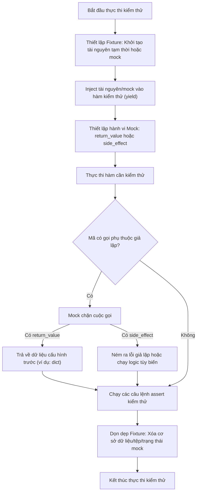

### 🎯 Mục tiêu học tập
- Viết các fixture trong `pytest` có khả năng tái sử dụng bằng câu lệnh `yield` để quản lý các tác vụ thiết lập (setup) và dọn dẹp (teardown).
- Quản lý vòng đời (scopes) của fixture (như `function`, `module`, v.v.) nhằm tối ưu hóa tốc độ chạy kiểm thử nhưng vẫn đảm bảo tính độc lập giữa các ca kiểm thử.
- Sử dụng `unittest.mock.MagicMock` để cách ly các thành phần được kiểm thử khỏi các cuộc gọi API bên ngoài và các tác động phụ ngoài ý muốn (side-effects).
- Cấu hình hành vi của đối tượng giả lập (mock) bằng `return_value` và `side_effect` nhằm kiểm thử cả các luồng chạy thành công lẫn thất bại.
- Áp dụng fixture `monkeypatch` của pytest và context manager `unittest.mock.patch` để thay thế động các thuộc tính và môi trường cấu hình trong lúc kiểm thử.

### 🧩 Khái niệm cốt lõi (Tại sao)
Khi ứng dụng của bạn phát triển lớn hơn, các đoạn mã hiếm khi hoạt động độc lập. Chúng thường tương tác với cơ sở dữ liệu, đọc ghi tệp, hoặc giao tiếp với các API bên ngoài. Việc chạy kiểm thử phụ thuộc vào các tác động bên ngoài này sẽ làm cho các ca kiểm thử đơn vị (unit tests) trở nên chậm chạp, phức tạp và không thể dự đoán trước.

Để giải quyết những vấn đề này, kiểm thử nâng cao dựa trên hai khái niệm cốt lõi:
1. **Fixture**: Cơ chế cung cấp một trạng thái tài nguyên cố định và có thể dự đoán được (chẳng hạn như kết nối database, thư mục tạm thời, hoặc các mock cấu hình sẵn) trước khi một ca kiểm thử chạy, và tự động thu dọn chúng sau khi ca kiểm thử kết thúc. Bằng cách tách biệt logic thiết lập/dọn dẹp ra khỏi các câu lệnh assert, fixture giúp mã nguồn kiểm thử tuân thủ nguyên lý DRY (Don't Repeat Yourself).
2. **Mock**: Các đối tượng giả lập mô phỏng hành vi của các phụ thuộc thực tế theo cách có thể kiểm soát được. Bằng cách thay thế các phụ thuộc bên ngoài chậm chạp hoặc không ổn định (ví dụ: một HTTP client gọi API thời tiết của bên thứ ba) bằng một Mock, bạn có thể kiểm tra cách mã của mình phản hồi với các dữ liệu cụ thể (như phản hồi JSON thành công hoặc lỗi timeout mạng) ngay lập tức và đáng tin cậy.

`unittest.mock.MagicMock` là một lớp con của `Mock` tự động hỗ trợ các phương thức ma thuật (magic methods) trong Python (như đo độ dài `len()`, truy cập phần tử qua khóa `obj['key']`, hoặc sử dụng context manager `with`), làm cho nó trở thành lựa chọn mặc định để mô phỏng các giao tiếp trong Python.

### 🔁 Logic và hoạt động

Sơ đồ dưới đây minh họa vòng đời thực thi của một ca kiểm thử kết hợp giữa pytest fixture (với hai giai đoạn thiết lập và dọn dẹp) và một phụ thuộc được giả lập (Mock):



Quy trình thực thi một ca kiểm thử sử dụng fixture và mock như sau:
1. `pytest` xác định các fixture được yêu cầu trong danh sách đối số của hàm kiểm thử.
2. Các dòng mã bên trong fixture sẽ chạy cho đến khi gặp câu lệnh `yield` (Giai đoạn Thiết lập - Setup).
3. Tài nguyên được trả về qua lệnh yield (có thể là đối tượng mock) sẽ được chèn vào hàm kiểm thử.
4. Ca kiểm thử cấu hình giá trị trả về mong đợi (`return_value`) hoặc lỗi cần ném ra (`side_effect`) cho đối tượng mock.
5. Hàm cần kiểm thử được thực thi, gọi đến mock thay vì gọi tới các hệ thống thực tế bên ngoài.
6. Ca kiểm thử thực hiện assert kết quả.
7. Khi ca kiểm thử kết thúc, fixture tiếp tục chạy các dòng mã phía sau lệnh `yield` để giải phóng tài nguyên (Giai đoạn Dọn dẹp - Teardown).

### 📝 Ví dụ minh họa có chú thích

Dưới đây là module `service.py` phụ thuộc vào kết nối cơ sở dữ liệu và client gửi email, cùng tệp kiểm thử tương ứng `test_service.py` minh họa cách sử dụng fixture, mock và monkeypatch.

**`service.py`**
```python
import os

class UserProcessor:
    def __init__(self, db_client, email_client):
        self.db = db_client
        self.email = email_client

    def process_user_registration(self, user_id, email_address):
        # 1. Kiểm tra xem người dùng có hoạt động trong DB không
        user = self.db.find_user(user_id)
        if not user or not user.get("active"):
            return "User Not Eligible"
        
        # 2. Đọc cấu hình môi trường qua biến môi trường
        env = os.getenv("APP_ENV", "development")
        
        # 3. Gửi email chào mừng và trả về trạng thái
        try:
            status = self.email.send(email_address, f"Welcome! Env: {env}")
            return "Success" if status else "Email Failed"
        except Exception:
            return "Notification System Error"
```

**`test_service.py`**
```python
import pytest
from unittest.mock import MagicMock, patch
from service import UserProcessor

# 1. Định nghĩa một fixture để khởi tạo đối tượng xử lý với các phụ thuộc giả lập
@pytest.fixture
def mock_dependencies():
    # Giai đoạn thiết lập: Khởi tạo các MagicMock cho DB và Email client
    db_mock = MagicMock()
    email_mock = MagicMock()
    
    # Trả về các mock dưới dạng một dictionary cho hàm kiểm thử
    yield {
        "db": db_mock,
        "email": email_mock
    }
    
    # Giai đoạn dọn dẹp: Reset trạng thái của các mock sau mỗi ca kiểm thử
    db_mock.reset_mock()
    email_mock.reset_mock()

# 2. Ca kiểm thử xác minh luồng đăng ký thành công bằng return_value của mock
def test_registration_success(mock_dependencies):
    db = mock_dependencies["db"]
    email = mock_dependencies["email"]
    
    # Cấu hình giá trị trả về cho mock
    db.find_user.return_value = {"id": 101, "active": True}
    email.send.return_value = True
    
    processor = UserProcessor(db, email)
    result = processor.process_user_registration(101, "test@example.com")
    
    assert result == "Success"
    # Xác minh rằng phương thức find_user được gọi đúng 1 lần với tham số 101
    db.find_user.assert_called_once_with(101)

# 3. Ca kiểm thử xác minh luồng xử lý lỗi email bằng side_effect của mock
def test_registration_email_throws_exception(mock_dependencies):
    db = mock_dependencies["db"]
    email = mock_dependencies["email"]
    
    db.find_user.return_value = {"id": 101, "active": True}
    
    # Cấu hình mock ném ra ngoại lệ bằng side_effect
    email.send.side_effect = Exception("SMTP server down")
    
    processor = UserProcessor(db, email)
    result = processor.process_user_registration(101, "test@example.com")
    
    assert result == "Notification System Error"

# 4. Sử dụng fixture monkeypatch để giả lập biến môi trường
def test_registration_with_monkeypatch(mock_dependencies, monkeypatch):
    db = mock_dependencies["db"]
    email = mock_dependencies["email"]
    
    db.find_user.return_value = {"id": 102, "active": True}
    email.send.return_value = True
    
    # Thay đổi động biến môi trường APP_ENV thành "production" trong suốt bài kiểm thử này
    monkeypatch.setenv("APP_ENV", "production")
    
    processor = UserProcessor(db, email)
    processor.process_user_registration(102, "prod@example.com")
    
    # Khẳng định client gửi email đã nhận được chuỗi thông báo chứa chữ "production"
    email.send.assert_called_once_with("prod@example.com", "Welcome! Env: production")
```

### ❌ Các lỗi thường gặp

**Lỗi 1: Chia sẻ các trạng thái có khả năng thay đổi giữa các kiểm thử do khai báo sai phạm vi (scope) của fixture**
```python
# Sai: Đặt phạm vi fixture là module khiến danh sách bị dùng chung xuyên suốt các bài test
@pytest.fixture(scope="module")
def shared_list():
    yield []
```
```text
test_service.py:12: AssertionError: assert [1, 2] == [2]
```
```python
# Đúng: Giữ phạm vi mặc định là "function" để mỗi bài test nhận một danh sách mới độc lập
@pytest.fixture(scope="function")
def clean_list():
    yield []
```
> Nếu bạn thiết lập phạm vi của fixture là `module` hoặc `session`, fixture đó chỉ chạy một lần duy nhất cho toàn bộ tệp hoặc phiên chạy kiểm thử. Nếu một hàm kiểm thử thay đổi trạng thái của tài nguyên được trả về (như thêm bản ghi vào database hoặc thêm phần tử vào danh sách), các bài kiểm thử tiếp theo sẽ kế thừa trạng thái bị ô nhiễm đó, gây ra lỗi kiểm thử phụ thuộc vào thứ tự chạy (flaky tests).

**Lỗi 2: Gán đối tượng ngoại lệ Exception vào `return_value` thay vì `side_effect` khi muốn mô phỏng lỗi**
```python
# Sai: Đối tượng mock sẽ trả về ngoại lệ như một giá trị thông thường thay vì ném ra lỗi
mock_email.send.return_value = Exception("SMTP Connection Failed")
```
```text
E   AssertionError: assert 'Success' == 'Notification System Error'
E     - Success
E     + Notification System Error
```
```python
# Đúng: Sử dụng side_effect để yêu cầu mock ném ra lỗi ngoại lệ
mock_email.send.side_effect = Exception("SMTP Connection Failed")
```
> Việc gán `return_value = Exception()` khiến Python hiểu đây là một giá trị trả về thông thường. Hàm gọi sẽ nhận được đối tượng ngoại lệ dưới dạng một biến thông thường (được đánh giá là Truthy), điều đó đồng nghĩa với việc không có khối `try-except` nào kích hoạt để bắt lỗi. Để mô phỏng hành vi ném lỗi, bạn bắt buộc phải dùng `side_effect`.

### 💡 Mẹo & Cách viết tối ưu
- **Kiểm tra tham số gọi mock**: Sử dụng `mock_obj.assert_called_once()` hoặc `mock_obj.assert_called_with(*args, **kwargs)` để kiểm tra hàm của bạn có tương tác với các phụ thuộc bằng đúng chữ ký hàm hay không.
- **Giả lập tuân thủ đặc tả (autospec)**: Sử dụng tùy chọn `autospec=True` khi patch. Việc này đảm bảo mock sẽ ném ra lỗi `AttributeError` nếu kiểm thử cố tình gọi một phương thức không tồn tại trên đối tượng thực tế, giúp mock không bị lệch nhịp khi code thực tế cập nhật.
- **Không gian tên khi Patching**: Khi sử dụng `unittest.mock.patch`, hãy patch đối tượng ở *nơi nó được import*, chứ không phải *nơi nó được định nghĩa*. Nếu tệp `service.py` import lớp Client thông qua `from database import Client`, hãy viết `patch('service.Client')` thay vì `patch('database.Client')`.

### 🧠 Đi sâu phân tích (Cơ chế bên dưới)
<details><summary>Cách pytest phân giải và thực thi kỹ thuật chèn phụ thuộc (Dependency Injection) của Fixture</summary>

Pytest phân giải các phụ thuộc kiểm thử bằng cách sử dụng thuật toán dựng Đồ Thị Có Hướng Không Chu Trình (DAG - Directed Acyclic Graph).

Khi một hàm kiểm thử được tải vào:
1. Pytest phân tích chữ ký hàm (signature) và trích xuất tên của các đối số truyền vào.
2. Nó tìm kiếm các fixture đã đăng ký có tên trùng khớp với các đối số này.
3. Nếu bản thân một fixture lại yêu cầu các fixture khác (phụ thuộc lồng nhau), pytest sẽ đệ quy duyệt qua các phụ thuộc đó để dựng thành một đồ thị DAG hoàn chỉnh mô tả thứ tự thực thi của các fixture.
4. Nó kiểm tra xem đồ thị có bị lặp vòng hay không (ví dụ: Fixture A phụ thuộc vào B, và B lại phụ thuộc vào A). Nếu có vòng lặp, pytest sẽ dừng chương trình và ném ra lỗi `FixtureLookupError`.
5. Hệ thống thực thi tuần tự các fixture theo đồ thị. Đối với mỗi fixture:
   - Chạy các dòng mã trước từ khóa `yield`.
   - Lưu trữ tạm thời (cache) giá trị được trả về bởi lệnh `yield`.
   - Truyền giá trị lưu tạm này vào fixture phụ thuộc tiếp theo hoặc hàm kiểm thử.
6. Sau khi hàm kiểm thử chạy xong (hoặc thất bại), pytest sẽ đi ngược lại con đường thực thi đồ thị. Đối với mỗi fixture có lệnh yield, nó chạy tiếp phần mã sau từ khóa `yield` theo thứ tự ngược lại so với lúc khởi tạo để đảm bảo tài nguyên được giải phóng an toàn.
</details>

### 🏋️ Bài tập thực hành
Viết hàm `fetch_data(api_client)` thực hiện cuộc gọi `api_client.get()` và trả về trường `"data"` từ dictionary JSON nhận được. Nếu `api_client.get()` ném ra một ngoại lệ bất kỳ, hãy bắt ngoại lệ đó và trả về chuỗi ký tự `"fallback"`.

```python
from unittest.mock import MagicMock

# Viết hàm fetch_data(api_client) gọi api_client.get() và trả về trường "data" từ json phản hồi.
# Xử lý các ngoại lệ bằng cách trả về "fallback".
```

### ✅ Tự kiểm tra
1. Vòng đời của một fixture xử lý việc thiết lập (setup) và dọn dẹp (teardown) như thế nào bằng từ khóa `yield`?
2. Sự khác biệt giữa `return_value` và `side_effect` khi cấu hình cho một đối tượng mock là gì?
3. Nguy cơ nào xảy ra khi áp dụng phạm vi `module` cho một fixture chứa trạng thái có thể biến đổi (mutable state)?
<details><summary>Đáp án tự kiểm tra</summary>

1. Các câu lệnh trước lệnh `yield` sẽ chạy trong giai đoạn thiết lập (setup) trước khi bài test thực thi. Đối tượng trả về sau `yield` sẽ được truyền vào bài test. Các câu lệnh sau `yield` sẽ chạy trong giai đoạn dọn dẹp (teardown) sau khi bài test hoàn tất.
2. `return_value` trả về một giá trị tĩnh cố định khi mock được gọi. `side_effect` cho phép ném ra ngoại lệ, trả về các giá trị khác nhau ở mỗi lần gọi liên tiếp, hoặc thực thi một hàm logic tùy biến.
3. Tài nguyên của fixture sẽ bị thay đổi bởi một bài test và rò rỉ sang bài test tiếp theo cùng module. Điều này tạo ra sự liên đới trạng thái giữa các bài test, gây ra lỗi flaky test phụ thuộc vào thứ tự chạy.
</details>

### 📌 Tóm tắt
- **Fixture**: Đơn giản hóa việc thiết lập và giải phóng tài nguyên, tạo ra môi trường kiểm thử sạch sẽ, nhất quán và tránh lặp mã.
- **Phạm vi của Fixture (Scopes)**: Trải dài từ `function` đến `session`, giúp cân bằng giữa hiệu suất chạy kiểm thử và tính độc lập tài nguyên.
- **Giả lập (Mocking)**: Thay thế các phụ thuộc bên ngoài chậm chạp hoặc không ổn định bằng đối tượng giả lập, giữ cho kiểm thử chạy cực nhanh và có tính quyết định (deterministic).
- **MagicMock**: Công cụ mô phỏng giao tiếp mạnh mẽ trong Python, tự động hỗ trợ các phương thức ma thuật bao gồm context manager và chỉ mục.
- **Công cụ thay thế động**: Lệnh `monkeypatch` của pytest và `patch` của unittest cho phép chèn mock hoặc chỉnh sửa biến môi trường trực tiếp trong thời gian chạy kiểm thử mà không làm thay đổi vĩnh viễn cấu trúc mã nguồn.
