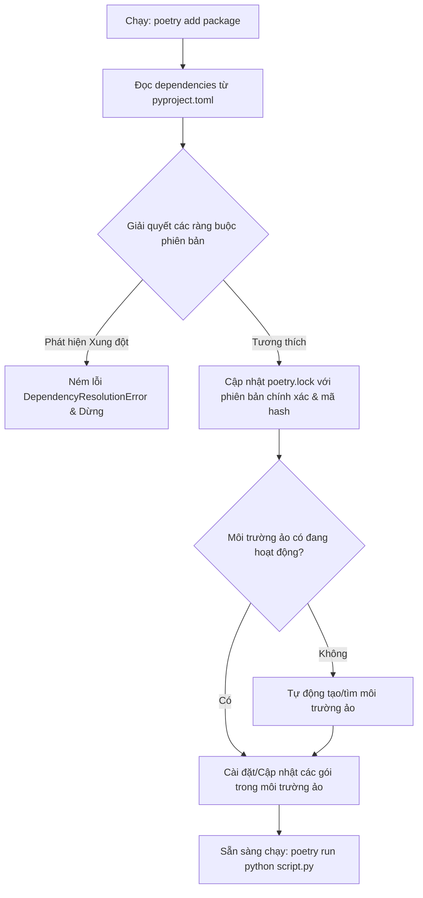

### 🎯 Mục tiêu học tập
- Giải thích các hạn chế về mặt cấu trúc của việc cài đặt pip toàn cục và danh sách `requirements.txt` thông thường.
- Mô tả cách môi trường ảo (virtual environment) cô lập các thư viện của dự án và tránh gây ô nhiễm môi trường hệ thống.
- Viết, cấu hình và duy trì file siêu dữ liệu `pyproject.toml` để định nghĩa phạm vi của gói.
- Áp dụng các lệnh Poetry CLI (`init`, `add`, `install`, `run`, `build`) để quản lý vòng đời dự án.
- Quản lý các nhóm phụ thuộc (`main` so với `dev`) để phân biệt môi trường chạy thực tế (production) và môi trường phát triển cục bộ (development).
- Giải thích cơ chế khóa của `poetry.lock` và cách nó đảm bảo khả năng tái tạo bản build (reproducible builds) giống nhau trên nhiều máy khác nhau.

### 🧩 Khái niệm cốt lõi (Tại sao)
Trong phát triển phần mềm hiện đại, các ứng dụng phụ thuộc rất nhiều vào thư viện của bên thứ ba. Quản lý các thư viện này một cách hiệu quả là yếu tố sống còn đối với sự ổn định của dự án và năng suất của lập trình viên.

#### 1. Hạn chế của Pip và Môi trường Toàn cục
Theo mặc định, trình quản lý gói của Python (`pip`) cài đặt các gói trên toàn cục hoặc cho toàn bộ người dùng của hệ thống. Nếu hai dự án yêu cầu các phiên bản khác nhau của cùng một gói (ví dụ: Dự án A cần `Django==3.2` và Dự án B cần `Django==4.2`), chúng không thể cùng tồn tại trên một môi trường. Việc cài đặt phiên bản này sẽ ghi đè lên phiên bản kia.

Để giải quyết vấn đề này, các lập trình viên trước đây thường dùng file `requirements.txt` cùng với các môi trường ảo được tạo thủ công. Tuy nhiên, `requirements.txt` có những nhược điểm nghiêm trọng:
- **Không có file khóa (Lockfile)**: Nó chỉ liệt kê các thư viện cấp cao nhất mà không khóa các thư viện phụ thuộc bắc cầu (transitive dependencies - thư viện của thư viện). Nếu một thư viện con cập nhật một phiên bản mới gây lỗi, bản build của bạn sẽ bị hỏng.
- **Không gian tên phẳng (Flat Namespace)**: Nó trộn lẫn các thư viện bạn chủ động chọn với các thư viện được cài đặt tự động làm thư viện con.
- **Không có xác thực tính toàn vẹn**: Nó không ghi lại mã hash của gói, khiến các bản build dễ bị tấn công sửa đổi mã nguồn.

#### 2. Môi trường Ảo (Virtual Environments)
Môi trường ảo là một cây thư mục tự chứa một bản cài đặt Python cụ thể, cùng với một số gói bổ sung. Nó giúp cô lập các thư viện dự án của bạn khỏi các dự án khác và khỏi Python của toàn hệ thống.

#### 3. Những gì Poetry giải quyết
Poetry là một công cụ hiện đại để quản lý thư viện và đóng gói trong Python. Nó thay thế hoàn toàn cho `pip`, `virtualenv`, `setup.py`, và `requirements.txt` bằng một quy trình làm việc thống nhất.
- **Giải quyết xung đột tất định (Deterministic Resolution)**: Nó sử dụng một bộ giải quyết xung đột tiên tiến để tìm ra các phiên bản tương thích cho tất cả các thư viện.
- **Khóa phiên bản nghiêm ngặt**: Nó tạo ra file `poetry.lock` chứa chính xác các phiên bản và mã hash mật mã của tất cả các gói.
- **Nguồn thông tin duy nhất (Single Source of Truth)**: Mọi cấu hình, siêu dữ liệu, thư viện phụ thuộc và script build đều được lưu trữ trong một file chuẩn duy nhất mang tên `pyproject.toml`.

### 🔁 Logic và hoạt động

Sơ đồ dưới đây minh họa quy trình thêm một thư viện phụ thuộc bằng Poetry và cách quản lý môi trường:



Khi bạn sử dụng Poetry:
1. Bạn chạy một lệnh (ví dụ: `poetry add fastapi`).
2. Poetry phân tích các yêu cầu phiên bản từ `pyproject.toml` và kiểm tra xung đột trên toàn bộ cây thư mục phụ thuộc.
3. Nếu hợp lệ, Poetry tải các file về, tính toán mã hash của chúng và lưu thông tin chi tiết vào `poetry.lock`.
4. Nó kiểm tra xem môi trường ảo đã tồn tại chưa. Nếu chưa, Poetry tự động tạo một cái trong thư mục cache của nó (hoặc trong thư mục dự án của bạn nếu được cấu hình).
5. Nó cài đặt chính xác các phiên bản được ghi lại trong file lock vào môi trường ảo.

### 📝 Ví dụ minh họa có chú thích

#### 1. Cấu trúc tiêu chuẩn của `pyproject.toml`
Dưới đây là một ví dụ có chú thích về file cấu hình Poetry hiện đại:

```toml
[tool.poetry]
name = "my-awesome-app"
version = "0.1.0"
description = "Ứng dụng FastAPI với quản lý thư viện phụ thuộc"
authors = ["Tên của bạn <you@example.com>"]
readme = "README.md"
packages = [{include = "my_awesome_app"}] # Định nghĩa gói sẽ được phân phối

[tool.poetry.dependencies]
python = "^3.10" # Yêu cầu phiên bản Python >= 3.10 và < 4.0
fastapi = "^0.100.0" # Cài đặt FastAPI >=0.100.0 và <0.101.0 (semantic versioning)
uvicorn = {extras = ["standard"], version = "^0.22.0"} # Thư viện phụ thuộc với các tính năng tùy chọn

[tool.poetry.group.dev.dependencies]
# Các thư viện chỉ yêu cầu trong quá trình phát triển hoặc kiểm thử
pytest = "^7.4.0"
black = "^23.7.0"
httpx = "^0.24.1"

[build-system]
# Khai báo build backend theo PEP 517 (cách Python cài đặt gói này)
requires = ["poetry-core"]
build-backend = "poetry.core.masonry.api"
```

#### 2. Các lệnh CLI thiết yếu

Để tạo một cấu trúc dự án mới:
```bash
poetry new my-project
```

Để khởi tạo Poetry bên trong một dự án hiện có:
```bash
poetry init
```
*Lệnh này sẽ bắt đầu một dấu nhắc tương tác hướng dẫn bạn tạo file `pyproject.toml`.*

Để thêm một thư viện chạy thực tế (production dependency):
```bash
poetry add requests
```

Để thêm một thư viện chỉ dùng cho phát triển (development dependency):
```bash
poetry add pytest --group dev
```

Để thực thi một script trong ngữ cảnh của môi trường ảo (không cần kích hoạt thủ công):
```bash
poetry run python main.py
```

Để mở một shell trong môi trường ảo theo cách thủ công:
```bash
poetry shell
```

Để cài đặt tất cả các gói phụ thuộc được khai báo trong `poetry.lock` (rất hữu ích khi clone repo sang máy mới):
```bash
poetry install
```

Để đóng gói dự án của bạn thành các file phân phối wheel và source archive:
```bash
poetry build
```

### ❌ Các lỗi thường gặp

**Lỗi 1: Sử dụng các mẹo hack đường dẫn tương đối từ `__file__` để đọc tài nguyên gói trong một gói Poetry được phân phối**
```python
# my_package/reader.py
import os
def read_config():
    # Thất bại khi được cài đặt dưới dạng file wheel trong một số môi trường hoặc zip import
    config_path = os.path.join(os.path.dirname(__file__), "data/config.json")
    with open(config_path, "r") as f:
        return f.read()
```
```text
Traceback (most recent call last):
  File "reader.py", line 5, in read_config
FileNotFoundError: [Errno 2] No such file or directory: '/usr/local/lib/python3.10/site-packages/my_package/data/config.json'
```
```python
# my_package/reader.py
from importlib import resources
def read_config():
    # Truy cập chính xác file tài nguyên gói trên tất cả các loại phân phối
    return resources.files("my_package").joinpath("data/config.json").read_text()
```
> Việc sử dụng đường dẫn hệ thống tệp như `__file__` giả định rằng gói được cài đặt dưới dạng một thư mục đã được giải nén trên đĩa. Khi các gói được biên dịch thành các file wheel hoặc phân phối dạng zip, hoặc chạy trong một số sandbox, quyền truy cập hệ thống tệp trực tiếp sẽ bị lỗi. Thư viện `importlib.resources` là cách chuẩn hóa hiện đại của Python để đọc các tệp dữ liệu gói một cách an toàn.

**Lỗi 2: Sử dụng các mẹo hack thủ công `sys.path.append` để import các file gói cục bộ trong quá trình kiểm thử**
```python
# tests/test_core.py
import sys
import os
# Hack để import mã nguồn cục bộ
sys.path.append(os.path.abspath("../src"))
import my_package
```
```text
Traceback (most recent call last):
  File "test_core.py", line 5, in <module>
    import my_package
ModuleNotFoundError: No module named 'my_package'
```
```python
# tests/test_core.py
# Không cần hack sys.path. Chạy `poetry install` để cài đặt ở chế độ editable.
import my_package
```
> Việc viết cứng các đoạn hack `sys.path.append` làm cho cơ sở mã nguồn của bạn trở nên mỏng manh và phụ thuộc vào môi trường. Poetry giải quyết vấn đề này bằng cách cài đặt gói ở chế độ có thể chỉnh sửa (editable mode - `poetry install`), cho phép bạn import gói và các mô-đun của mình một cách liền mạch trong quá trình phát triển và kiểm thử từ bất kỳ thư mục nào.

### 💡 Mẹo & Cách viết tối ưu
- **Môi trường ảo ngay trong dự án**: Yêu cầu Poetry tạo môi trường ảo bên trong thư mục dự án của bạn dưới tên `.venv` thay vì thư mục cache trung tâm. Điều này giúp các IDE (như VS Code) dễ dàng tự động phát hiện trình thông dịch.
  ```bash
  poetry config virtualenvs.in-project true
  ```
- **Commit file khóa của bạn**: Luôn luôn commit `poetry.lock` vào git. Điều này đảm bảo rằng các lập trình viên khác trong nhóm, các runner CI/CD và máy chủ deploy sẽ cài đặt chính xác cùng một cây phụ thuộc.
- **Xuất danh sách thư viện**: Nếu bạn cần tạo file `requirements.txt` cho các nền tảng không hỗ trợ Poetry trực tiếp (như Elastic Beanstalk cũ), hãy xuất nó bằng lệnh:
  ```bash
  poetry export -f requirements.txt --output requirements.txt
  ```

### 🧠 Đi sâu phân tích (Cơ chế bên dưới)
<details><summary>Cách Thuật toán PubGrub của Poetry Giải quyết Phiên bản Thư viện Phụ thuộc</summary>

Poetry sử dụng một phiên bản của thuật toán **PubGrub** để giải quyết các gói phụ thuộc. Khác với các bộ giải quyết đơn giản chỉ tra cứu đệ quy các gói và thất bại ngay khi có sự không khớp phiên bản đầu tiên, PubGrub hoạt động dựa trên khái niệm **giải quyết xung đột thông qua tìm kiếm không quay lui (backtrack-free search)** và **suy diễn (derivation)**.

Khi bạn yêu cầu cài đặt các gói:
1. **Biên dịch ràng buộc (Constraint Compilation)**: Poetry đọc các ràng buộc từ `pyproject.toml` và truy vấn các kho lưu trữ gói (như PyPI) để lấy sơ đồ các gói, phiên bản của chúng và các thư viện phụ thuộc của chúng.
2. **Ra quyết định**: Nó ra quyết định bằng cách chọn một gói, chọn phiên bản tương thích mới nhất của nó và đưa các thư viện phụ thuộc của nó vào hàng đợi.
3. **Phát hiện xung đột**: Nếu xảy ra mâu thuẫn (ví dụ: gói A yêu cầu `urllib3 >= 2.0` nhưng gói B lại yêu cầu `urllib3 < 2.0`), PubGrub không chỉ đơn thuần đưa ra lỗi.
4. **Suy diễn**: Nó lần theo chuỗi các lựa chọn dẫn đến xung đột. Nó suy ra một "nguyên nhân" (một chứng minh logic chỉ ra tại sao tập hợp các quyết định hiện tại là không hợp lệ).
5. **Quay lui (Backtracking)**: Nó chỉ hoàn tác các quyết định liên quan đến nguyên nhân đó và đăng ký nguyên nhân xung đột làm ràng buộc mới. Điều này ngăn bộ giải quyết đánh giá lại các ngõ cụt giống nhau một lần nữa, giúp tăng tốc đáng kể thời gian giải quyết và đưa ra các thông báo lỗi rõ ràng, dễ hiểu khi việc giải quyết xung đột thất bại.
</details>

### 🏋️ Bài tập thực hành
Viết một hàm `validate_poetry_config(config_text)` để phân tích cú pháp văn bản cấu hình `pyproject.toml`. Trả về `True` nếu nó chứa phần khai báo dependencies `[tool.poetry.dependencies]` và khai báo phiên bản `python`, ngược lại trả về `False`.

```python
# Viết một bộ phân tích cú pháp để kiểm tra văn bản cấu hình pyproject.toml.
# Trả về True nếu [tool.poetry.dependencies] tồn tại và chứa khai báo phiên bản "python".
def validate_poetry_config(config_text):
    pass
```

### ✅ Tự kiểm tra
1. Tại sao bạn nên luôn luôn commit `poetry.lock` vào hệ thống quản lý phiên bản?
2. Lệnh nào cho phép bạn thực thi các lệnh trong môi trường ảo mà không cần chạy `poetry shell`?
3. Làm thế nào để bạn khai báo một gói là thư viện chỉ dùng cho phát triển trong `pyproject.toml`?
<details><summary>Đáp án tự kiểm tra</summary>

1. Việc commit `poetry.lock` đảm bảo mọi lập trình viên, bộ kiểm thử và môi trường triển khai đều cài đặt chính xác cùng một gói, bảo vệ dự án khỏi sự trôi dạt phiên bản và các cập nhật không mong muốn từ thư viện phụ thuộc bắc cầu.
2. Bạn có thể sử dụng cú pháp `poetry run <lệnh>` (ví dụ: `poetry run python main.py` hoặc `poetry run pytest`).
3. Bạn thêm nó dưới phần `[tool.poetry.group.dev.dependencies]`, hoặc chạy lệnh CLI `poetry add <gói> --group dev`.
</details>

### 📌 Tóm tắt
- **Hạn chế của Pip**: Cài đặt toàn cục gây ra xung đột phiên bản. `requirements.txt` không khóa được thư viện phụ thuộc phụ.
- **Poetry**: Công cụ quản lý thư viện phụ thuộc và đóng gói toàn diện, hợp nhất siêu dữ liệu của gói, tính năng cô lập môi trường và xuất bản gói.
- **pyproject.toml**: Định dạng file cấu hình duy nhất được xác định bởi PEP 518/621 chứa siêu dữ liệu và thư viện phụ thuộc.
- **poetry.lock**: Khóa sơ đồ phụ thuộc bằng mật mã để đảm bảo các bản build có thể tái tạo giống nhau trên mọi môi trường.
- **Các lệnh cơ bản**: `poetry init` cấu hình dự án; `poetry add` sửa đổi dependencies; `poetry install` phục hồi chúng; `poetry run` thực thi mã trong ngữ cảnh của môi trường.
