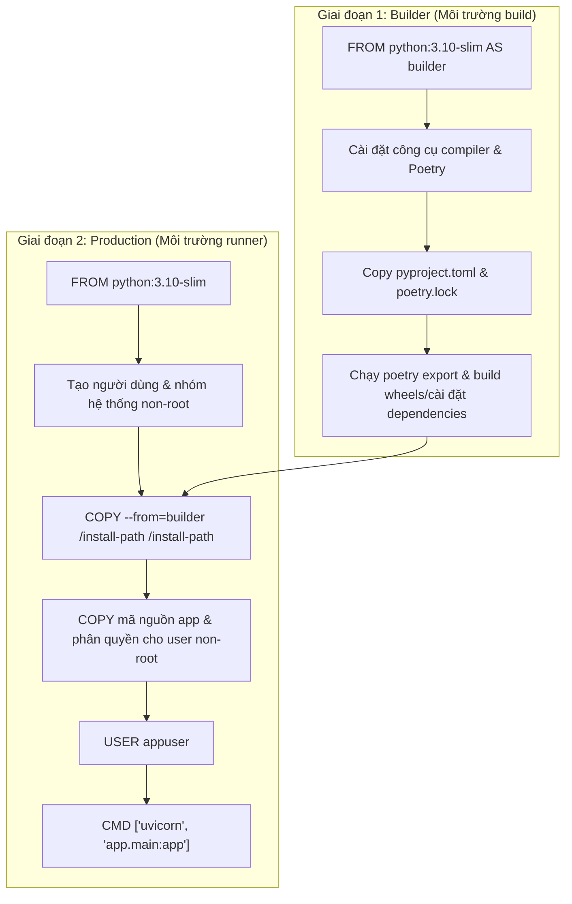

### 🎯 Mục tiêu học tập
- Giải thích sự khác biệt về mặt kiến trúc giữa máy ảo (Virtual Machines) và container.
- Đánh giá và lựa chọn hình ảnh cơ sở Python (base image) phù hợp (default, slim, alpine) dựa trên nhu cầu dự án.
- Viết các file script `Dockerfile` an toàn, đạt chuẩn production cho các dịch vụ web Python.
- Áp dụng multi-stage build để tối ưu hóa kích thước image và giảm thiểu các lỗ hổng bảo mật khi chạy thực tế.
- Cấu hình container chạy an toàn dưới ngữ cảnh người dùng không phải root bằng câu lệnh `USER`.
- Phối hợp kiến trúc đa container (Web app Python + Database) bằng cách sử dụng `docker-compose.yml`.

### 🧩 Khái niệm cốt lõi (Tại sao)
Khi các hệ thống phần mềm ngày càng phức tạp, cụm từ "nó chạy tốt trên máy của tôi" trở thành một nút thắt cổ chai lớn trong quá trình phát triển. Sự khác biệt về hệ điều hành, thư viện hệ thống và cấu hình cục bộ gây ra những lỗi ngầm rất khó chịu. Container hóa giải quyết vấn đề này bằng cách đóng gói ứng dụng cùng tất cả các thư viện phụ thuộc của nó vào một đơn vị chuẩn hóa duy nhất.

#### 1. Container so với Máy ảo (Virtual Machines)
- **Máy ảo (VMs)**: Đóng gói ứng dụng, các file nhị phân cần thiết và **toàn bộ một hệ điều hành khách (guest OS)**. Chúng chạy trên một lớp hypervisor để mô phỏng phần cứng. Do đó, các máy ảo rất nặng (kích thước tính bằng gigabyte), khởi động chậm (vài phút) và tiêu tốn nhiều tài nguyên CPU, RAM của máy chủ.
- **Containers**: Chia sẻ chung nhân (kernel) của hệ điều hành máy chủ. Chúng sử dụng các tính năng của nhân Linux gọi là **namespaces** (để cô lập cây tiến trình, card mạng, điểm gắn kết file, v.v.) và **control groups (cgroups)** (để giới hạn tài nguyên như CPU và bộ nhớ). Container cực kỳ nhẹ (kích thước tính bằng megabyte), khởi động gần như ngay lập tức (vài giây) và hầu như không gây hao hụt hiệu năng.

#### 2. Chiến lược Chọn Image Cơ sở (Base Image)
Khi viết `Dockerfile` cho Python, lựa chọn image cơ sở của bạn sẽ quyết định hiệu năng, kích thước và tính tương thích khi biên dịch:
- `python:3.10`: Xây dựng trên hệ điều hành Debian. Bao gồm đầy đủ các công cụ build, trình biên dịch (như GCC) và các file header phát triển. Kích thước rất lớn (~900MB), làm tăng thời gian deploy.
- `python:3.10-slim`: Xây dựng trên Debian nhưng đã được lược bỏ các công cụ build-essential và các gói không cần thiết. Nó rất nhẹ (~120MB) và được khuyến nghị mạnh mẽ cho các ứng dụng chạy thực tế không yêu cầu biên dịch C trực tiếp.
- `python:3.10-alpine`: Xây dựng trên hệ điều hành Alpine Linux. Kích thước siêu nhỏ (~50MB) và sử dụng thư viện `musl libc` thay vì GNU C Library (`glibc`). Dù có vẻ hấp dẫn, Alpine có thể khiến việc cài đặt các gói có phần mở rộng C (như `numpy`, `pandas`, hoặc `cryptography`) cực kỳ chậm vì các file wheel Python được xây dựng sẵn thường dành cho `glibc`. Alpine bắt buộc phải biên dịch các gói này từ mã nguồn, yêu cầu bạn phải cài đặt thêm các công cụ biên dịch rất nặng.

#### 3. Multi-Stage Builds
Trong các bản build thông thường, bạn cần trình biên dịch (như GCC) và trình quản lý gói (như Poetry) để tải và xây dựng các thư viện phụ thuộc. Nếu bạn giữ các công cụ build này trong image cuối cùng của mình, bạn sẽ làm phình kích thước image và tạo ra các lỗ hổng bảo mật tiềm ẩn (trình biên dịch giúp kẻ tấn công dễ dàng thực thi exploit hơn nếu container bị xâm nhập).

**Multi-stage build** sử dụng nhiều câu lệnh `FROM` trong một `Dockerfile` duy nhất. Bạn biên dịch ứng dụng của mình trong giai đoạn đầu tiên ("builder"), sau đó chỉ sao chép các thành phần đã được biên dịch (wheels, libraries, site-packages) vào giai đoạn thứ hai ("runner"). Các công cụ biên dịch được để lại phía sau, tạo ra một image production nhỏ gọn và an toàn cao.

#### 4. Thực thi với Quyền Non-Root (Không phải Root)
Theo mặc định, các tiến trình trong container Docker chạy dưới quyền user `root` (quản trị viên). Nếu kẻ tấn công khai thác được lỗ hổng thực thi mã từ xa trong ứng dụng của bạn, họ sẽ có quyền root *bên trong* container, làm tăng khả năng thoát khỏi container và xâm nhập vào hệ thống máy chủ vật lý. Khai báo một `USER` không có đặc quyền sẽ giới hạn tối đa thiệt hại.

### 🔁 Logic và hoạt động

Sơ đồ dưới đây minh họa quy trình của một bản build Docker multi-stage, tách biệt các công cụ phát triển/biên dịch ra khỏi môi trường chạy thực tế sạch sẽ:



Trong một bản build multi-stage:
1. Docker bắt đầu Giai đoạn 1, cài đặt các thư viện phục vụ cho quá trình build (ví dụ: trình biên dịch và trình quản lý gói).
2. Các thư viện phụ thuộc được biên dịch hoặc xây dựng vào một thư mục cục bộ (ví dụ: Python site-packages).
3. Docker bắt đầu Giai đoạn 2 bằng cách sử dụng một image cơ sở mới và sạch sẽ.
4. Một người dùng và nhóm hệ thống không có quyền root được tạo ra bên trong Giai đoạn 2.
5. Các thư viện phụ thuộc đã biên dịch (và chỉ các thư viện này) được sao chép từ Giai đoạn 1 sang Giai đoạn 2.
6. Mã nguồn ứng dụng được sao chép vào, điều chỉnh quyền sở hữu thư mục và ngữ cảnh người dùng được chuyển sang người dùng non-root.
7. Container chạy thực thi một cách an toàn và gọn nhẹ.

### 📝 Ví dụ minh họa có chú thích

#### 1. File `Dockerfile` Multi-Stage An toàn sử dụng Poetry
Dưới đây là một file `Dockerfile` chuẩn production áp dụng mô hình multi-stage và chạy dưới quyền non-root:

```dockerfile
# --- Giai đoạn 1: Xây dựng & Biên dịch thư viện phụ thuộc ---
FROM python:3.10-slim AS builder

WORKDIR /app

# Cài đặt các công cụ build cần thiết để biên dịch các C-extensions
RUN apt-get update && apt-get install -y --no-install-recommends \
    build-essential \
    && rm -rf /var/lib/apt/lists/*

# Cài đặt Poetry để quản lý thư viện phụ thuộc
RUN pip install --no-cache-dir poetry

COPY pyproject.toml poetry.lock ./

# Xuất ra file requirements.txt tiêu chuẩn và cài đặt thư viện vào không gian người dùng
RUN poetry export --without-hashes -f requirements.txt --output requirements.txt \
    && pip install --no-cache-dir --user -r requirements.txt

# --- Giai đoạn 2: Image chạy thực tế gọn nhẹ cuối cùng ---
FROM python:3.10-slim AS runner

WORKDIR /app

# Tạo một nhóm hệ thống và người dùng để chạy ứng dụng an toàn
RUN groupadd -r appgroup && useradd -r -g appgroup -d /home/appuser -m appuser

# Chỉ sao chép các gói người dùng đã được biên dịch sẵn từ giai đoạn builder
COPY --from=builder /root/.local /home/appuser/.local
COPY . .

# Điều chỉnh quyền thư mục để người dùng non-root có thể đọc file
RUN chown -R appuser:appgroup /app

# Thêm các gói cục bộ vào biến PATH
ENV PATH=/home/appuser/.local/bin:$PATH
ENV PYTHONUNBUFFERED=1

# Chuyển ngữ cảnh bảo mật sang người dùng non-root
USER appuser

EXPOSE 8080

CMD ["uvicorn", "main:app", "--host", "0.0.0.0", "--port", "8080"]
```

#### 2. Điều phối với `docker-compose.yml`
Dưới đây là cấu hình file `docker-compose.yml` đi kèm để ánh xạ ứng dụng web với cơ sở dữ liệu PostgreSQL trên một mạng cầu (bridge network) cô lập:

```yaml
version: '3.8'

services:
  web:
    build: 
      context: .
      dockerfile: Dockerfile
    ports:
      - "8080:8080" # Ánh xạ cổng 8080 trên máy host tới cổng 8080 trong container
    environment:
      - DB_HOST=db # Kết nối tới container PostgreSQL bằng DNS nội bộ của Docker
      - DB_PORT=5432
      - DB_USER=postgres
      - DB_PASSWORD=secret
    depends_on:
      - db # Đảm bảo container DB khởi động trước khi container ứng dụng web bắt đầu

  db:
    image: postgres:15-alpine
    environment:
      - POSTGRES_DB=mydb
      - POSTGRES_USER=postgres
      - POSTGRES_PASSWORD=secret
    volumes:
      - pgdata:/var/lib/postgresql/data # Lưu trữ dữ liệu cơ sở dữ liệu trên máy host

volumes:
  pgdata: # Khai báo một volume bền vững để bảo toàn dữ liệu qua các vòng đời container
```

### ❌ Các lỗi thường gặp

**Lỗi 1: Chạy một máy chủ web bên trong container Docker trên cổng 80 dưới quyền người dùng non-root**
```python
# app.py
# Chạy dưới quyền USER không phải root trong Dockerfile
from http.server import HTTPServer, SimpleHTTPRequestHandler
server = HTTPServer(("0.0.0.0", 80), SimpleHTTPRequestHandler)
server.serve_forever()
```
```text
Traceback (most recent call last):
  File "app.py", line 4, in <module>
    server = HTTPServer(("0.0.0.0", 80), SimpleHTTPRequestHandler)
PermissionError: [Errno 13] Permission denied
```
```python
# app.py
# Chạy dưới quyền USER non-root trên một cổng không có đặc quyền (8080)
from http.server import HTTPServer, SimpleHTTPRequestHandler
server = HTTPServer(("0.0.0.0", 8080), SimpleHTTPRequestHandler)
server.serve_forever()
```
> Trong Linux, việc liên kết (bind) với các cổng dưới 1024 (cổng đặc quyền) yêu cầu quyền root. Khi tuân thủ các thực hành bảo mật tốt nhất bằng cách chạy container dưới quyền một người dùng không phải root (ví dụ: sử dụng `USER appuser`), ứng dụng phải liên kết với một cổng không có đặc quyền như 8080, sau đó được ánh xạ sang cổng 80 ở cấp độ máy host.

**Lỗi 2: Viết cứng IP loopback cục bộ 127.0.0.1 cho các kết nối cơ sở dữ liệu bên trong container**
```python
# db.py
import psycopg2
# Viết cứng IP loopback cục bộ sẽ trỏ tới chính container đó, chứ không phải database trên máy host
conn = psycopg2.connect(host="127.0.0.1", database="mydb", user="postgres")
```
```text
Traceback (most recent call last):
  File "db.py", line 4, in <module>
    conn = psycopg2.connect(host="127.0.0.1", ...)
psycopg2.OperationalError: connection to server at "127.0.0.1", port 5432 failed: Connection refused
```
```python
# db.py
import os
import psycopg2
# Tải tên host cơ sở dữ liệu từ biến môi trường hoặc tên dịch vụ docker-compose
db_host = os.getenv("DB_HOST", "db")
conn = psycopg2.connect(host=db_host, database="mydb", user="postgres")
```
> Bên trong một container, `127.0.0.1` đề cập đến chính container đó, không phải máy host hoặc container khác chạy cơ sở dữ liệu. Trong mạng cầu Docker, các container phải kết nối với nhau bằng tên dịch vụ được phân giải bởi DNS tích hợp sẵn của Docker (ví dụ: `db`), hoặc cấu hình mạng để lấy host chính xác từ biến môi trường.

### 💡 Mẹo & Cách viết tối ưu
- **Tối ưu hóa các lớp Cache của Docker**: Docker lưu trữ cache các lớp build image. Hãy sắp xếp các câu lệnh từ *ít thay đổi nhất* đến *thường xuyên thay đổi nhất*.
  - *Không tốt*: Sao chép mã nguồn (`COPY . .`) *trước khi* cài đặt dependencies (`pip install`). Bất kỳ thay đổi mã nguồn nào cũng làm mất hiệu lực cache của các bước sau, buộc dependencies phải cài đặt lại từ đầu.
  - *Tốt*: Sao chép danh sách dependencies, cài đặt các gói, sau đó mới sao chép mã nguồn ứng dụng.
- **Sử dụng `.dockerignore`**: Tạo file `.dockerignore` ở thư mục gốc để ngăn việc tải các thư mục lớn hoặc nhạy cảm (như `.venv/`, `.git/`, `__pycache__/`, và các file `.env`) vào ngữ cảnh build của Docker.
- **Ghim phiên bản Image cơ sở**: Không bao giờ xây dựng container production bằng cách sử dụng `FROM python:latest` hoặc `FROM python:3.10`. Thay đổi phiên bản nhỏ có thể làm hỏng cấu hình. Hãy luôn ghim phiên bản cụ thể (ví dụ: `FROM python:3.10.12-slim`).

### 🧠 Đi sâu phân tích (Cơ chế bên dưới)
<details><summary>Cách Linux Namespaces và Control Groups (Cgroups) Cô lập Container</summary>

Khác với các máy ảo phụ thuộc vào lớp hypervisor để mô phỏng phần cứng vật lý, các container Docker chạy trực tiếp trên nhân (kernel) Linux của máy host. Sự cô lập đạt được ở cấp độ hệ điều hành bằng cách sử dụng hai tính năng chính của nhân Linux:

#### 1. Linux Namespaces (Ảo hóa tài nguyên)
Namespaces bọc một tài nguyên hệ thống toàn cục trong một lớp trừu tượng, làm cho các tiến trình bên trong namespace thấy rằng chúng đang có một phiên bản cô lập riêng của tài nguyên đó.
- **PID Namespace**: Cô lập mã định danh tiến trình (Process ID). Ứng dụng chạy trong container nghĩ rằng nó là Tiến trình số 1 (PID 1), trong khi trên máy host, nó chỉ là một tiến trình bình thường có ID cao (ví dụ: PID 48210).
- **NET Namespace**: Cô lập các bộ điều khiển mạng, bảng định tuyến và cổng. Mỗi container có giao diện loopback ảo và địa chỉ IP riêng.
- **MNT Namespace**: Cô lập các điểm gắn kết hệ thống tệp (mount points). Container chỉ thấy hệ thống tệp được gắn kết của riêng nó và hoàn toàn không biết gì về hệ thống root của máy host.
- **UTS Namespace**: Cô lập hostname và tên miền NIS.
- **IPC Namespace**: Cô lập tài nguyên giao tiếp giữa các tiến trình (Inter-Process Communication).
- **USER Namespace**: Ánh xạ ID người dùng. User ID 0 (root) bên trong container có thể được ánh xạ tới một ID người dùng không có đặc quyền trên máy host, ngăn chặn việc chiếm quyền root của máy host ngay cả khi xảy ra lỗi bảo mật thoát container (container escape).

#### 2. Control Groups / Cgroups (Giới hạn tài nguyên)
Trong khi namespaces ngăn các container *nhìn thấy* nhau, **cgroups** ngăn các container *làm cạn kiệt* tài nguyên của máy host. Cgroups phân bổ và giám sát mức tiêu thụ tài nguyên phần cứng:
- Giới hạn phân bổ bộ nhớ tối đa (ví dụ: dừng một container bị rò rỉ bộ nhớ trước khi nó kích hoạt tính năng Out-Of-Memory killer của máy host).
- Hạn chế hiệu suất sử dụng nhân CPU và chu kỳ thực thi.
- Giới hạn tốc độ đọc/ghi dữ liệu ổ đĩa (I/O).
- Đo lường và giám sát lưu lượng mạng trên mỗi container.
</details>

### 🏋️ Bài tập thực hành
Viết một script xác thực để phân tích cú pháp chuỗi `Dockerfile`. Đảm bảo `Dockerfile` chứa câu lệnh `USER` để thực thi các tiến trình dưới dạng người dùng không phải root (bảo vệ bảo mật). Trả về `True` nếu nó chứa câu lệnh `USER`, ngược lại trả về `False`.

```python
# Viết một script xác thực phân tích cú pháp chuỗi Dockerfile.
# Đảm bảo Dockerfile có câu lệnh USER để thực thi dưới dạng người dùng không phải root (bảo mật).
def validate_dockerfile(dockerfile_text):
    pass
```

### ✅ Tự kiểm tra
1. Tại sao việc chạy một máy chủ web bên trong container trên cổng 80 lại bị lỗi khi Dockerfile chỉ định một người dùng non-root như `USER appuser`?
2. Những ưu điểm và nhược điểm của việc sử dụng image `python:3.10-alpine` so với `python:3.10-slim` là gì?
3. Làm thế nào để ngăn các thư mục phát triển cục bộ như `__pycache__` và `.git` được gửi đến Docker daemon trong quá trình build?
<details><summary>Đáp án tự kiểm tra</summary>

1. Trong hệ điều hành dựa trên Linux, chỉ người dùng root mới có thể liên kết với các cổng đặc quyền dưới 1024. Chạy dưới quyền người dùng non-root yêu cầu liên kết với một cổng không có đặc quyền (ví dụ: 8080) và ánh xạ nó sang cổng 80 ở cấp độ máy host bằng Docker.
2. `alpine` nhỏ hơn (50MB so với 120MB), nhưng nó sử dụng `musl libc` thay vì `glibc`. Các gói yêu cầu biên dịch C (như `numpy` hoặc `cryptography`) không thể sử dụng các file wheel được dựng sẵn và phải biên dịch từ mã nguồn, mất rất nhiều thời gian và yêu cầu cài đặt thêm các công cụ biên dịch. `slim` có tính tương thích cao và cài đặt nhanh hơn.
3. Bạn viết tên các thư mục đó vào file `.dockerignore` nằm cùng thư mục với `Dockerfile`.
</details>

### 📌 Tóm tắt
- **Containers**: Chia sẻ nhân của hệ điều hành máy host, sử dụng namespaces và cgroups để cô lập nhẹ nhàng, không giống như máy ảo chạy toàn bộ hệ điều hành khách.
- **Base Images**: Ưu tiên chọn `slim` thay vì `default` (vì dung lượng) và `alpine` (vì tính tương thích với các bánh xe C đã dựng sẵn).
- **Multi-Stage Builds**: Tối ưu hóa kích thước và bảo mật bằng cách xây dựng thư viện trong giai đoạn build và chỉ sao chép các thành phần cần thiết sang giai đoạn chạy thực tế.
- **USER Non-Root**: Thực thi ranh giới bảo mật bằng cách ngăn chặn các lỗ hổng container truy cập trực tiếp vào nhân hệ điều hành host dưới quyền root.
- **Docker Compose**: Đơn giản hóa việc thiết lập đa container bằng cách khai báo các ứng dụng, mạng và cơ sở dữ liệu trong một file YAML duy nhất.
