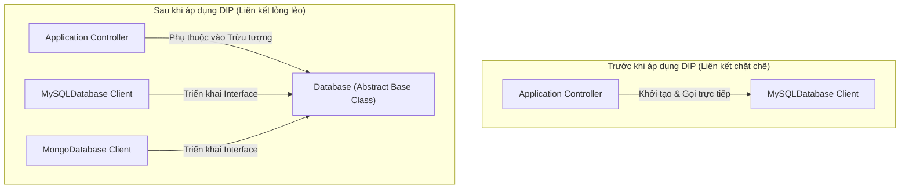

### 🎯 Mục tiêu học tập
- Định nghĩa 5 nguyên lý thiết kế phần mềm SOLID và giải thích tác động của chúng đối với tính dễ bảo trì của mã nguồn.
- Áp dụng Nguyên lý Đơn nhiệm (SRP) để phân rã các lớp lớn thành các lớp nhỏ có tính gắn kết cao.
- Thiết kế hệ thống mở để mở rộng nhưng đóng để sửa đổi (OCP) bằng cách sử dụng Abstract Base Classes (ABC) trong Python.
- Kiểm chứng hệ thống phân cấp lớp theo Nguyên lý Thay thế Liskov (LSP) để ngăn ngừa lỗi kiểu dữ liệu lúc runtime.
- Phân tách các interface cồng kềnh thành các contract nhỏ, chuyên biệt (ISP) sử dụng kỹ thuật đa kế thừa.
- Tách biệt các hệ thống phụ thuộc chặt chẽ thành kiến trúc lỏng lẻo bằng cách áp dụng Nguyên lý Đảo ngược Phụ thuộc (DIP).

### 🧩 Khái niệm cốt lõi (Tại sao)
Viết code chạy được chỉ là bước đầu tiên. Khi hệ thống phát triển, mã nguồn cần phải dễ đọc, dễ bảo trì và dễ thích ứng với các thay đổi. Nếu thiếu các hướng dẫn cấu trúc rõ ràng, mã nguồn sẽ dễ rơi vào tình trạng **cứng nhắc** (khó thay đổi), **mong manh** (thay đổi một chỗ làm hỏng chỗ khác không liên quan) và **bất động** (khó tái sử dụng).

Các nguyên lý **SOLID**, được giới thiệu bởi Robert C. Martin (Uncle Bob), là 5 hướng dẫn thiết kế giúp giải quyết các vấn đề trên:

#### 1. Nguyên lý Đơn nhiệm (Single Responsibility Principle - SRP)
*Một lớp chỉ nên có một, và chỉ một, lý do để thay đổi.*
- **Ví dụ thực tế**: Một đầu bếp chuyên nghiệp chỉ nấu ăn. Họ không lau bàn, không thu tiền hay làm bảo vệ. Nếu cần thay đổi cách quản lý an ninh, công việc của đầu bếp không hề bị ảnh hưởng.
- **Ngữ cảnh trong Python**: Thay vì viết một "Lớp Thần thánh" (God Class) vừa kết nối cơ sở dữ liệu, vừa định dạng dữ liệu và gửi email, hãy viết 3 lớp chuyên biệt khác nhau.

#### 2. Nguyên lý Mở/Đóng (Open/Closed Principle - OCP)
*Các thực thể phần mềm (lớp, mô-đun, hàm) nên mở để mở rộng, nhưng đóng để sửa đổi.*
- **Ví dụ thực tế**: Ổ cắm trên tường. Bạn có thể cắm bất kỳ thiết bị điện nào (mở rộng) mà không cần phải đục tường để đi lại đường dây điện của tòa nhà (sửa đổi).
- **Ngữ cảnh trong Python**: Thay vì dùng các chuỗi `if/elif` dài dằng dặc để kiểm tra kiểu dữ liệu và thay đổi hành vi, hãy sử dụng tính đa hình (polymorphism) và Abstract Base Classes (ABCs).

#### 3. Nguyên lý Thay thế Liskov (Liskov Substitution Principle - LSP)
*Các lớp con phải có thể thay thế hoàn toàn cho các lớp cha của chúng mà không làm hỏng chương trình.*
- **Ví dụ thực tế**: Một chú vịt đồ chơi. Nếu nó trông giống vịt và kêu "cáp cáp" giống vịt, nhưng cần pin để chạy, nó không thể thay thế hoàn toàn cho một chú vịt thật trong hệ sinh thái tự nhiên mà không gây lỗi.
- **Ngữ cảnh trong Python**: Lớp con không được thu hẹp kiểu tham số, không được mở rộng kiểu trả về, và không được ném ra các exception không được định nghĩa ở lớp cha.

#### 4. Nguyên lý Phân tách Interface (Interface Segregation Principle - ISP)
*Client không nên bị ép buộc phải phụ thuộc vào các interface mà chúng không sử dụng.*
- **Ví dụ thực tế**: Một máy in đa năng có chức năng in, scan và fax. Một người dùng chỉ muốn in thì không nên bị bắt phải cấu hình hay tìm hiểu các mô-đun scan.
- **Ngữ cảnh trong Python**: Vì Python không có từ khóa `interface` riêng, chúng ta sử dụng các lớp base class trừu tượng nhỏ và chuyên biệt. Một lớp có thể kế thừa từ nhiều lớp ABC khác nhau thay vì một lớp interface cồng kềnh.

#### 5. Nguyên lý Đảo ngược Phụ thuộc (Dependency Inversion Principle - DIP)
*Các mô-đun cấp cao không nên phụ thuộc vào các mô-đun cấp thấp. Cả hai nên phụ thuộc vào sự trừu tượng (abstraction).*
- **Ví dụ thực tế**: Cổng USB trên máy tính của bạn. Bo mạch chủ (cấp cao) không cần biết chi tiết về cách hoạt động của USB flash drive hay bàn phím (cấp thấp). Cả hai bên đều tuân theo giao thức USB (trừu tượng).
- **Ngữ cảnh trong Python**: Inject (truyền) các phụ thuộc trừu tượng vào constructor của lớp thay vì khởi tạo trực tiếp các database client hoặc API client cụ thể bên trong lớp đó.

### 🔁 Logic và hoạt động

Sơ đồ dưới đây minh họa sự khác biệt về độ liên kết của hệ thống trước và sau khi áp dụng Nguyên lý Đảo ngược Phụ thuộc:



Trong thiết kế lỏng lẻo này:
1. `Application Controller` chỉ phụ thuộc vào contract (giao kèo) được định nghĩa bởi `Database (ABC)`.
2. Các công cụ cơ sở dữ liệu khác nhau (MySQL, MongoDB) sẽ triển khai contract này.
3. Việc thay đổi công nghệ database sẽ không yêu cầu bất kỳ thay đổi nào trong code của `Application Controller`.

### 📝 Ví dụ minh họa có chú thích

Dưới đây là một hệ thống quản lý người dùng và gửi thông báo được thiết kế tuân theo các nguyên lý SOLID:

```python
from abc import ABC, abstractmethod

# --- 1. Nguyên lý Phân tách Interface (ISP) ---
# Chúng ta định nghĩa các interface riêng biệt, đơn mục tiêu thay vì một interface nguyên khối.

class Sender(ABC):
    @abstractmethod
    def send(self, recipient: str, message: str) -> None:
        pass

class Logger(ABC):
    @abstractmethod
    def log_status(self, message: str) -> None:
        pass

# --- 2. Nguyên lý Mở/Đóng (OCP) & Đảo ngược Phụ thuộc (DIP) ---
# Các hệ thống thông báo cụ thể sẽ triển khai lớp trừu tượng Sender.

class EmailSender(Sender):
    def send(self, recipient: str, message: str) -> None:
        # Giả lập gửi email
        print(f"Email sent to {recipient}: {message}")

class SMSSender(Sender):
    def send(self, recipient: str, message: str) -> None:
        # Giả lập gửi tin nhắn SMS
        print(f"SMS sent to {recipient}: {message}")

# --- 3. Nguyên lý Đơn nhiệm (SRP) ---
# Mỗi lớp đảm nhận một nhiệm vụ duy nhất: User giữ dữ liệu, UserNotifier gửi tin nhắn, ConsoleLogger ghi log.

class User:
    def __init__(self, username: str, email: str, phone: str):
        self.username = username
        self.email = email
        self.phone = phone

class ConsoleLogger(Logger):
    def log_status(self, message: str) -> None:
        print(f"[LOG]: {message}")

class UserNotifier:
    # DIP: Chúng ta inject các lớp trừu tượng (Sender và Logger) thay vì các lớp triển khai cụ thể.
    def __init__(self, sender: Sender, logger: Logger):
        self.sender = sender
        self.logger = logger

    def notify_user(self, user: User, message: str) -> None:
        # LSP: Chúng ta có thể thay thế EmailSender hoặc SMSSender một cách an toàn.
        self.logger.log_status(f"Attempting notification to {user.username}")
        
        # Quyết định chọn kênh truyền thông dựa trên thông tin liên lạc của user
        if "@" in user.email:
            self.sender.send(user.email, message)
        else:
            self.sender.send(user.phone, message)
            
        self.logger.log_status("Notification process complete")

# --- Xác thực chạy thử ---
if __name__ == "__main__":
    # Cấu hình các phụ thuộc
    email_channel = EmailSender()
    logger_service = ConsoleLogger()
    
    # Inject các phụ thuộc vào bộ điều phối cấp cao
    notifier = UserNotifier(sender=email_channel, logger=logger_service)
    
    user = User("alice_dev", "alice@example.com", "+1234567890")
    notifier.notify_user(user, "Welcome to SOLID Python design!")
```

### ❌ Các lỗi thường gặp

**Lỗi 1: Gọi trực tiếp phương thức riêng của lớp con thay vì phụ thuộc vào interface trừu tượng**
```python
# Sai: Gọi trực tiếp phương thức riêng của lớp con thay vì sử dụng interface trừu tượng
class PaymentManager:
    def process_payment(self, processor, amount):
        # Giả định rằng processor luôn luôn là PaypalProcessor
        processor.make_paypal_charge(amount)
```
```text
Traceback (most recent call last):
  File "main.py", line 4, in process_payment
    processor.make_paypal_charge(amount)
AttributeError: 'StripeProcessor' object has no attribute 'make_paypal_charge'
```
```python
# Đúng: Sử dụng phương thức trừu tượng được định nghĩa trong interface PaymentProcessor
class PaymentManager:
    def process_payment(self, processor: PaymentProcessor, amount: float):
        processor.process(amount)
```
> Bằng cách gọi trực tiếp phương thức riêng của lớp con (`make_paypal_charge`) thay vì phụ thuộc vào interface trừu tượng (`process`), lớp gọi sẽ trở nên liên kết cực kỳ chặt chẽ với các lớp con cụ thể. Khi một cổng thanh toán mới được thêm vào, nó sẽ ném ra lỗi `AttributeError` lúc runtime, vi phạm Nguyên lý Đảo ngược Phụ thuộc (DIP) và Nguyên lý Mở/Đóng (OCP).

**Lỗi 2: Vi phạm LSP khi thay đổi chữ ký (signature) của phương thức trong lớp con**
```python
class BasicStorage:
    def save(self, data: str) -> None:
        print(f"Saved: {data}")

class SecureFileStorage(BasicStorage):
    # Vi phạm LSP: Thay đổi chữ ký phương thức bằng cách thêm một tham số bắt buộc
    def save(self, data: str, encryption_key: str) -> None:
        print(f"Encrypted and saved with {encryption_key}: {data}")
```
```text
Traceback (most recent call last):
  File "main.py", line 8, in <module>
    storage.save("Confidential Data")
TypeError: save() missing 1 required positional argument: 'encryption_key'
```
```python
class BasicStorage:
    def save(self, data: str) -> None:
        print(f"Saved: {data}")

class SecureFileStorage(BasicStorage):
    def __init__(self, encryption_key: str):
        self.encryption_key = encryption_key

    # Giữ nguyên chữ ký phương thức của lớp cha
    def save(self, data: str) -> None:
        print(f"Encrypted and saved with {self.encryption_key}: {data}")
```
> Việc thay đổi các tham số của phương thức trong lớp con làm hỏng code client đang mong đợi interface của lớp cha hoạt động bình thường. Tất cả các phụ thuộc riêng của lớp con (như keys, files, hay connections) nên được inject thông qua constructor (`__init__`), để lại phương thức override khớp hoàn toàn với chữ ký lớp cha.

### 💡 Mẹo & Cách viết tối ưu
- **Giữ cho lớp ABC ở mức tối thiểu**: Đừng cố nhét hàng tá phương thức vào một lớp Abstract Base Class duy nhất. Thiết kế các lớp ABC chỉ có một phương thức duy nhất (ví dụ: `Renderable`, `Serializable`) sẽ tuân thủ tốt nhất cả ISP và SRP.
- **Duck Typing so với ABCs**: Mặc dù Python không bắt buộc triển khai interface lúc runtime trừ khi dùng ABCs, bạn vẫn nên kế thừa rõ ràng từ `abc.ABC` trong các dự án lớn để bật tính năng phân tích tĩnh mạnh mẽ với `mypy` và làm rõ ý đồ thiết kế cho các developer khác.
- **Tránh tối ưu hóa sớm**: Đừng cố áp dụng các mẫu thiết kế SOLID cho mã nguồn quá đơn giản. Tái cấu trúc (refactoring) chỉ nên diễn ra khi mã nguồn phình to ra. Chỉ trừu tượng hóa khi bạn dự kiến sẽ viết nhiều lớp triển khai cụ thể cho một phân hệ.

### 🧠 Đi sâu phân tích (Cơ chế bên dưới)
<details><summary>Metaclass Interception: Cách CPython thực thi các Lớp Trừu tượng (Abstract Base Classes)</summary>

Trong Python, các lớp trừu tượng không phải là các từ khóa tích hợp sẵn như trong Java hay C#. Thay vào đó, chúng được triển khai động bằng hệ thống metaclass của Python.

Khi bạn định nghĩa một lớp kế thừa từ `abc.ABC`, nó sẽ thiết lập `ABCMeta` làm metaclass của nó:

```python
class ABC(metaclass=ABCMeta):
    __slots__ = ()
```

Trong quá trình tạo lớp (class creation), metaclass `ABCMeta` sẽ quét dictionary của lớp để tìm các hàm được trang trí (decorate) bằng `@abstractmethod`. Nó sẽ đăng ký các tên phương thức này bên trong một tập hợp (set) nội bộ có tên là `__abstractmethods__`.

Khi client cố gắng khởi tạo lớp đó:
1. Python sẽ gọi phương thức phân bổ bộ nhớ `__new__` của lớp.
2. Trình triển khai tạo đối tượng nội bộ của CPython sẽ kiểm tra xem lớp đó có thuộc tính `__abstractmethods__` không rỗng hay không.
3. Nếu nó chứa dù chỉ một tên phương thức trừu tượng chưa được định nghĩa lại (override), Python sẽ chặn việc phân bổ bộ nhớ và ném ra một lỗi `TypeError`.

```python
# Mô phỏng cơ chế hoạt động bên dưới
class ConcreteSubclass(ParentABC):
    def my_method(self):
        return "Implemented"

# Nếu lớp con không triển khai đầy đủ các phương thức trừu tượng:
# ConcreteSubclass.__abstractmethods__ vẫn chứa các phương thức còn thiếu,
# ngăn chặn việc khởi tạo đối tượng (instantiation).
```
</details>

### 🏋️ Bài tập thực hành
Tạo một lớp trừu tượng `PaymentProcessor` định nghĩa phương thức trừu tượng `process(amount: float) -> str`. Sau đó, viết một lớp con cụ thể `PaypalProcessor` triển khai phương thức `process`, trả về chuỗi có định dạng `"Processed {amount} via Paypal"`.

```python
from abc import ABC, abstractmethod

# Định nghĩa Lớp Trừu tượng PaymentProcessor với phương thức trừu tượng process(amount: float) -> str.
# Triển khai lớp cụ thể PaypalProcessor kế thừa từ PaymentProcessor.
```

### ✅ Tự kiểm tra
1. Sự khác biệt giữa SRP (Nguyên lý Đơn nhiệm) và OCP (Nguyên lý Mở/Đóng) là gì?
2. Nếu một lớp con ném ra một `NotImplementedError` cho một trong các phương thức public của lớp cha, nguyên lý nào bị vi phạm?
3. Làm thế nào để kết hợp nhiều interface trừu tượng trong Python một cách an toàn?
<details><summary>Đáp án tự kiểm tra</summary>

1. SRP tập trung vào việc giảm độ phức tạp của lớp và đảm bảo một lớp chỉ có một lý do để thay đổi. OCP tập trung vào khả năng mở rộng kiến trúc, đảm bảo bạn có thể thêm các tính năng mới qua kế thừa/đa hình mà không làm thay đổi mã nguồn đã được kiểm thử trước đó.
2. Nguyên lý Thay thế Liskov (LSP). Nếu code client mong đợi lớp cha, nó sẽ mong đợi tất cả các phương thức public thực thi bình thường. Việc ném ra `NotImplementedError` làm hỏng giao ước (contract) đó.
3. Vì Python hỗ trợ đa kế thừa (multiple inheritance), bạn có thể định nghĩa các lớp trừu tượng nhỏ, chuyên biệt và kế thừa từ nhiều lớp ABC đó cùng một lúc (ví dụ: `class ModernPrinter(Printer, Scanner):`).
</details>

### 📌 Tóm tắt
- **Đơn nhiệm (SRP)**: Giữ các lớp nhỏ gọn và chỉ tập trung vào một nhiệm vụ duy nhất để giảm thiểu tính mong manh của mã nguồn.
- **Mở/Đóng (OCP)**: Viết code cho phép mở rộng qua kế thừa/đa hình mà không cần sửa đổi code cũ đang hoạt động ổn định.
- **Thay thế Liskov (LSP)**: Đảm bảo lớp con tuân thủ chính xác chữ ký phương thức và các kỳ vọng hành vi của lớp cha.
- **Phân tách Interface (ISP)**: Tạo các interface nhỏ, có tính mô-đun thay vì một interface lớn, cồng kềnh.
- **Đảo ngược Phụ thuộc (DIP)**: Phụ thuộc vào các trừu tượng hóa (ABCs) thay vì các triển khai cụ thể để đạt được cấu trúc liên kết lỏng lẻo.
