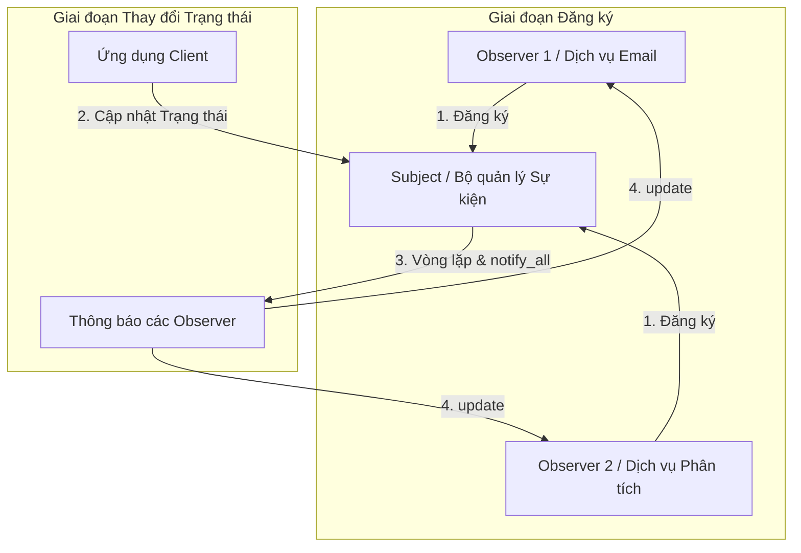

### 🎯 Mục tiêu học tập
- Phân loại các mẫu thiết kế (design patterns) tiêu chuẩn thành ba nhóm: Khởi tạo (Creational), Cấu trúc (Structural) và Hành vi (Behavioral).
- Triển khai mẫu thiết kế **Singleton** an toàn với luồng (thread-safe) sử dụng metaclass trong Python.
- Xây dựng lớp khởi tạo linh hoạt, độc lập bằng cách áp dụng mẫu thiết kế **Factory Method**.
- Thiết kế hệ thống thuật toán động, có thể hoán đổi dễ dàng bằng mẫu thiết kế **Strategy**.
- Xây dựng cấu trúc phát thông báo hướng sự kiện bằng mẫu thiết kế **Observer**.
- Tận dụng các tính năng đặc thù của Python (first-class functions, decorators, closures) để viết các design pattern tối giản và sạch sẽ.

### 🧩 Khái niệm cốt lõi (Tại sao)
Một **mẫu thiết kế (design pattern)** là một khuôn mẫu cấu trúc có thể tái sử dụng để giải quyết các vấn đề thường gặp trong kỹ thuật phần mềm. Thay vì tự phát minh ra các giải pháp từ đầu, việc sử dụng các mẫu thiết kế đã được kiểm chứng giúp mã nguồn dễ đọc hơn và dễ mở rộng hơn.

Chúng ta phân loại các mẫu thiết kế thành 3 nhóm chính:
1. **Khởi tạo (Creational)**: Tập trung vào cơ chế tạo đối tượng (ví dụ: Singleton, Factory).
2. **Cấu trúc (Structural)**: Tập trung vào việc lắp ráp các lớp và đối tượng thành các cấu trúc lớn hơn (ví dụ: Decorator, Adapter).
3. **Hành vi (Behavioral)**: Tập trung vào việc điều phối thuật toán và phân bổ trách nhiệm giữa các đối tượng (ví dụ: Strategy, Observer).

Mặc dù các mẫu thiết kế cổ điển bắt nguồn từ các ngôn ngữ lập trình tĩnh như C++ và Java, sự linh hoạt của Python cùng tính năng first-class functions (coi hàm như một đối tượng thông thường) cho phép chúng ta triển khai các mẫu này với ít mã nguồn rườm rà (boilerplate) hơn nhiều.

#### Các mẫu thiết kế chính trong Python
- **Singleton**: Đảm bảo một lớp chỉ có duy nhất một đối tượng (instance) trên phạm vi toàn cục và cung cấp một điểm truy cập chung cho nó. (Ví dụ: Database connection pools, logging systems, global configurations).
- **Factory Method**: Định nghĩa một interface để tạo đối tượng nhưng cho phép các lớp con hoặc tham số quyết định lớp cụ thể nào sẽ được khởi tạo. (Ví dụ: Trình đọc file CSV/JSON, bộ khởi tạo database clients).
- **Strategy**: Đóng gói một nhóm các thuật toán, giúp chúng có thể hoán đổi cho nhau lúc runtime. Trong Python, chúng ta có thể truyền trực tiếp các hàm vào làm tham số, loại bỏ sự cần thiết của các lớp Strategy OOP cổ điển.
- **Observer**: Định nghĩa mối quan hệ một-nhiều trong đó nhiều đối tượng "observers" theo dõi một "subject" và tự động nhận cập nhật mỗi khi subject thay đổi trạng thái. (Ví dụ: Hệ thống sự kiện, kiến trúc pub/sub).

### 🔁 Logic và hoạt động

Sơ đồ dưới đây minh họa cơ chế hoạt động hướng sự kiện của **Mẫu thiết kế Observer**:



Trong hệ thống này:
1. Các Observer đăng ký bản thân với Subject để nhận thông báo.
2. Khi trạng thái của Subject thay đổi, nó lặp qua danh sách các observer đã đăng ký.
3. Subject gọi phương thức hook tiêu chuẩn (như `update()`) trên mỗi observer, truyền kèm thông tin trạng thái mới.

### 📝 Ví dụ minh họa có chú thích

Dưới đây là đoạn mã Python minh họa các mẫu thiết kế: **Singleton** (sử dụng Metaclass), **Factory Method**, **Strategy** (dạng functional) và **Observer**:

```python
from abc import ABC, abstractmethod
from typing import Callable, List, Dict

# ==========================================
# 1. KHỞI TẠO: Mẫu thiết kế Singleton (Metaclass)
# ==========================================
class SingletonMeta(type):
    # Dictionary dùng để cache đối tượng duy nhất của lớp
    _instances: Dict = {}

    def __call__(cls, *args, **kwargs):
        # Chặn hành vi khởi tạo lớp: chỉ tạo nếu chưa tồn tại trong cache
        if cls not in cls._instances:
            cls._instances[cls] = super().__call__(*args, **kwargs)
        return cls._instances[cls]

class DatabaseConnectionPool(metaclass=SingletonMeta):
    def __init__(self):
        self.connection_string = "postgresql://db.local:5432"
        print("Database Connection Pool Initialized.")

# ==========================================
# 2. KHỞI TẠO: Mẫu thiết kế Factory Method
# ==========================================
class Document(ABC):
    @abstractmethod
    def read(self) -> str:
        pass

class JSONDocument(Document):
    def read(self) -> str:
        return '{"key": "value"}'

class CSVDocument(Document):
    def read(self) -> str:
        return "header1,header2\nvalue1,value2"

class DocumentFactory:
    # Trả về các lớp cụ thể tương ứng với định dạng file yêu cầu
    @staticmethod
    def get_document(file_type: str) -> Document:
        if file_type == "json":
            return JSONDocument()
        elif file_type == "csv":
            return CSVDocument()
        raise ValueError(f"Unknown document format: {file_type}")

# ==========================================
# 3. HÀNH VI: Mẫu thiết kế Strategy (Theo phong cách Python)
# ==========================================
# Thay vì tạo các lớp abstract cho các chiến lược, ta dùng kiểu hàm (Callable)
DiscountStrategy = Callable[[float], float]

def regular_discount(price: float) -> float:
    return price * 0.95

def holiday_discount(price: float) -> float:
    return price * 0.80

class Order:
    def __init__(self, price: float, discount_strategy: DiscountStrategy):
        self.price = price
        self.discount_strategy = discount_strategy

    def calculate_total(self) -> float:
        # Áp dụng chiến lược động trực tiếp thông qua hàm
        return self.discount_strategy(self.price)

# ==========================================
# 4. HÀNH VI: Mẫu thiết kế Observer
# ==========================================
class Observer(ABC):
    @abstractmethod
    def update(self, message: str) -> None:
        pass

class Subject:
    def __init__(self):
        self._observers: List[Observer] = []

    def attach(self, observer: Observer) -> None:
        self._observers.append(observer)

    def notify(self, message: str) -> None:
        for observer in self._observers:
            observer.update(message)

class EmailNotifier(Observer):
    def update(self, message: str) -> None:
        print(f"[Email Notification] sending event: {message}")

# --- Chạy thử kiểm tra ---
if __name__ == "__main__":
    # Kiểm tra Singleton
    db1 = DatabaseConnectionPool()
    db2 = DatabaseConnectionPool()
    print(f"Are DB instances identical? {db1 is db2}") # Kết quả mong đợi: True

    # Kiểm tra Factory Method
    doc = DocumentFactory.get_document("json")
    print(f"Read Document: {doc.read()}")

    # Kiểm tra Strategy
    order_regular = Order(100.0, regular_discount)
    order_holiday = Order(100.0, holiday_discount)
    print(f"Regular Total: {order_regular.calculate_total()}") # Kết quả: 95.0
    print(f"Holiday Total: {order_holiday.calculate_total()}") # Kết quả: 80.0

    # Kiểm tra Observer
    pub = Subject()
    sub = EmailNotifier()
    pub.attach(sub)
    pub.notify("System deployment complete!")
```

### ❌ Các lỗi thường gặp

**Lỗi 1: Triển khai Singleton không an toàn khi chạy đa luồng (multi-threaded)**
```python
class SimpleSingleton:
    _instance = None
    # Triển khai cơ bản không có cơ chế lock
    def __new__(cls):
        if not cls._instance:
            cls._instance = super().__new__(cls)
        return cls._instance
```
```text
Traceback (most recent call last):
  # Trong môi trường đồng thời, kiểm tra đồng nhất đối tượng sẽ thất bại:
  AssertionError: db1 is db2 is False
```
```python
import threading

class SafeSingleton:
    _instance = None
    _lock = threading.Lock()

    def __new__(cls):
        # Áp dụng mẫu double-checked locking để tối ưu hiệu năng
        if not cls._instance:
            with cls._lock:
                if not cls._instance:
                    cls._instance = super().__new__(cls)
        return cls._instance
```
> Trong môi trường đa luồng, hai luồng có thể cùng đánh giá điều kiện `if not cls._instance` trước khi đối tượng đầu tiên được cấp phát bộ nhớ. Việc này dẫn đến việc cả hai luồng tạo ra hai đối tượng khác nhau. Sử dụng cơ chế lock hai lớp (double-checked locking) với `threading.Lock` sẽ đảm bảo an toàn cho luồng mà vẫn tối ưu hiệu năng sau khi đối tượng đã được khởi tạo.

**Lỗi 2: Viết mã nguồn rườm rà lớp hóa (class-based) khi dùng mẫu Strategy trong Python**
```python
from abc import ABC, abstractmethod

# Vi phạm tính đơn giản của Python bằng cách bọc logic đơn giản trong các lớp
class Strategy(ABC):
    @abstractmethod
    def run(self, a, b): pass

class AddStrategy(Strategy):
    def run(self, a, b): return a + b

class Calculator:
    def __init__(self, strategy: Strategy):
        self.strategy = strategy
```
```text
Traceback (most recent call last):
  File "main.py", line 12, in <module>
    calc = Calculator(AddStrategy) # Truyền lớp thay vì truyền đối tượng đã khởi tạo
  File "main.py", line 8, in calculate
    return self.strategy.run(a, b)
TypeError: run() missing 1 required positional argument: 'b'
```
```python
from typing import Callable

# Sạch sẽ và chuẩn Python: Sử dụng hàm trực tiếp làm chiến lược
class Calculator:
    def __init__(self, strategy: Callable[[int, int], int]):
        self.strategy = strategy

    def calculate(self, a: int, b: int) -> int:
        return self.strategy(a, b)
```
> Việc bọc các hàm đơn giản vào cấu trúc lớp kiểu Java là không cần thiết trong Python. Hàm trong Python là first-class citizens, có nghĩa là chúng có thể được lưu trữ trong biến, truyền vào constructor của lớp và gọi trực tiếp một cách linh hoạt.

### 💡 Mẹo & Cách viết tối ưu
- **Sử dụng Mô-đun làm Singleton**: Các mô-đun Python chỉ được thực thi một lần duy nhất khi import; các lệnh import tiếp theo sẽ tham chiếu đến cùng một namespace trong `sys.modules`. Trong hầu hết các trường hợp, bạn không cần viết lớp Singleton—chỉ cần khai báo biến và hàm trực tiếp ở cấp mô-đun.
- **Dùng Dict Mapping cho Factory**: Tránh viết các khối `if/elif/else` dài dòng trong Factory. Bạn có thể ánh xạ các lớp vào một dictionary để gọi một cách thanh lịch:
  ```python
  CREATORS = {"json": JSONDocument, "csv": CSVDocument}
  # Khởi tạo đối tượng động
  doc = CREATORS[file_type]()
  ```
- **Dùng Closure để giữ trạng thái của Strategy**: Nếu chiến lược của bạn cần lưu giữ trạng thái cấu hình, hãy dùng closure thay vì một lớp:
  ```python
  def make_multiplier(factor: float):
      return lambda x: x * factor # Trả về một hàm chiến lược lưu cấu hình factor
  ```

### 🧠 Đi sâu phân tích (Cơ chế bên dưới)
<details><summary>Metaclass Interception: Kiểm soát khởi tạo lớp thông qua __call__</summary>

Khi bạn khởi tạo một đối tượng trong Python bằng cú pháp `conn = DatabaseConnectionPool()`, Python không gọi trực tiếp phương thức `__new__` của `DatabaseConnectionPool`. Thay vào đó, nó sẽ gọi phương thức `__call__` trên lớp cha của lớp đó (được gọi là metaclass).

Quy trình khởi tạo đối tượng diễn ra như sau:
1. Bản thân lớp `DatabaseConnectionPool` là một thực thể (instance) của metaclass `SingletonMeta`.
2. Việc đánh giá `DatabaseConnectionPool()` sẽ thực thi `SingletonMeta.__call__(DatabaseConnectionPool)`.
3. Trình triển khai `__call__` tùy chỉnh sẽ chặn yêu cầu này:
   - Nếu lớp đã được lưu trong cache `_instances`, nó sẽ trả về đối tượng đó ngay lập tức.
   - Nếu chưa có, nó sẽ gọi `super().__call__()` (lần lượt gọi `__new__` và `__init__` trên `DatabaseConnectionPool`), lưu đối tượng mới tạo vào cache và trả về.

```python
# Mô hình chặn cuộc gọi bằng Metaclass
class SingletonMeta(type):
    _instances = {}
    
    def __call__(cls, *args, **kwargs):
        # Chặn cuộc gọi trước khi bộ nhớ được phân bổ
        if cls not in cls._instances:
            cls._instances[cls] = super().__call__(*args, **kwargs)
        return cls._instances[cls]
```

Cơ chế này giúp cho Singleton được triển khai qua metaclass cực kỳ mạnh mẽ trước các sai sót của lập trình viên, vì việc gọi khởi tạo lớp theo cách thông thường sẽ luôn luôn trả về cùng một thực thể duy nhất.
</details>

### 🏋️ Bài tập thực hành
Triển khai một lớp `Calculator` tuân theo mẫu thiết kế Strategy. Constructor của lớp nên nhận vào một hàm chiến lược. Lớp `Calculator` phải cung cấp phương thức `calculate(self, a, b)` thực thi chiến lược đã được truyền vào đối với hai tham số `a` và `b`.

```python
# Triển khai mẫu thiết kế Strategy cho việc tính toán.
# Tạo lớp Calculator nhận vào một chiến lược tính toán động (add, multiply).
class Calculator:
    pass
```

### ✅ Tự kiểm tra
1. Tại sao việc triển khai Singleton dựa trên metaclass được ưu tiên hơn so với việc định nghĩa lại phương thức `__new__` thủ công?
2. Làm thế nào để xây dựng một mẫu thiết kế Observer nhẹ trong Python mà không cần định nghĩa các lớp trừu tượng?
3. Khi nào bạn nên sử dụng mẫu thiết kế Factory Method thay vì gọi trực tiếp constructor của các lớp?
<details><summary>Đáp án tự kiểm tra</summary>

1. Việc sử dụng metaclass giúp tách biệt logic kiểm soát khởi tạo ra khỏi logic nghiệp vụ của lớp. Nếu kế thừa từ một lớp có tùy biến `__new__` làm Singleton, các lớp con có thể vô tình phá vỡ cơ chế Singleton hoặc bị gọi hàm khởi tạo nhiều lần.
2. Thay vì định nghĩa interface `Observer` trừu tượng, bạn có thể lưu một danh sách các hàm (`List[Callable[[str], None]]`) và gọi trực tiếp tất cả các hàm này khi có sự kiện cần thông báo.
3. Bạn nên dùng Factory Method khi kiểu cụ thể của đối tượng không thể xác định trước lúc compile hoặc khi bạn muốn tách biệt logic khởi tạo phức tạp (như thiết lập các database client kết nối mạng) ra khỏi tầng nghiệp vụ cốt lõi.
</details>

### 📌 Tóm tắt
- **Singleton**: Giới hạn việc khởi tạo lớp thành một thực thể duy nhất toàn cục. Sử dụng metaclass là giải pháp tốt nhất.
- **Factory Method**: Tách biệt logic khởi tạo, ánh xạ các key hoặc định dạng thành các lớp con tương ứng một cách linh hoạt lúc runtime.
- **Strategy**: Sử dụng các hành vi có thể thay thế cho nhau. Tính năng hàm trong Python giúp loại bỏ các phân cấp lớp Strategy rườm rà.
- **Observer**: Thiết lập mô hình pub/sub, giúp subject phát thông báo thay đổi trạng thái tới các listener một cách lỏng lẻo và hiệu quả.
