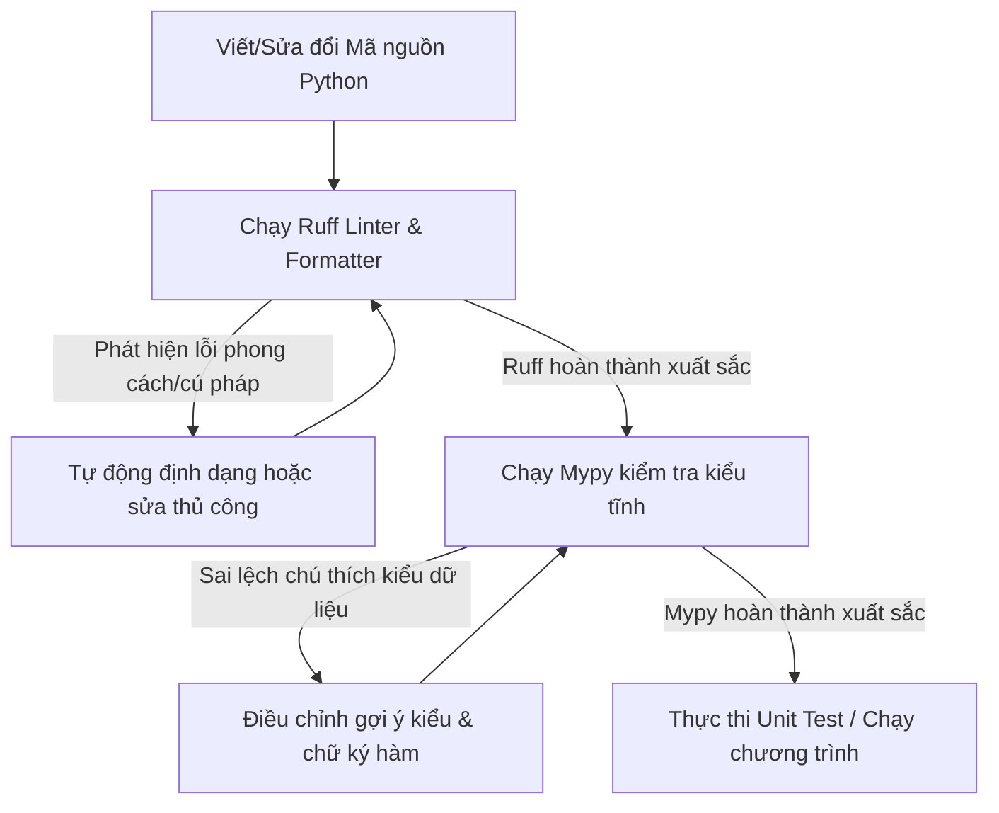

### 🎯 Mục tiêu học tập
- Phân biệt sự khác biệt cơ bản giữa phân tích tĩnh (Static Analysis) và kiểm tra khi chạy (Runtime Checks).
- Phân loại các công cụ xác thực mã nguồn thành linters (phát hiện lỗi cấu trúc/cú pháp) và formatters (tự động căn chỉnh phong cách viết code).
- Nắm vững các tiêu chuẩn PEP 8 cơ bản để viết mã nguồn Python sạch và dễ đọc.
- Cấu hình và sử dụng **Ruff** để kiểm tra lỗi (lint) và định dạng (format) code với hiệu năng cực cao.
- Thiết lập và vận hành **Mypy** để thực hiện kiểm tra kiểu tĩnh (static type checking) một cách nghiêm ngặt.
- Áp dụng các chú thích kiểu dữ liệu (type annotations) từ mô-đun `typing` để xây dựng các hàm rõ ràng và an toàn về kiểu.

### 🧩 Khái niệm cốt lõi (Tại sao)

Trong phát triển phần mềm quy mô lớn, việc duy trì chất lượng mã nguồn và sự nhất quán là vô cùng quan trọng. Khi dự án lớn lên, việc kiểm tra thủ công các vi phạm phong cách viết code, các lệnh import dư thừa hay lỗi kiểu dữ liệu trở nên bất khả thi. Các công cụ phân tích tĩnh giải quyết vấn đề này bằng cách đánh giá mã nguồn trước khi chương trình được thực thi.

#### 1. Phân tích Tĩnh vs. Kiểm tra khi Chạy (Runtime Checks)
- **Phân tích Tĩnh (Static Analysis)**: Việc phân tích mã nguồn mà không cần chạy chương trình. Nó kiểm tra cấu trúc logic, tính hợp lệ của cú pháp, quy chuẩn viết code và tính nhất quán của kiểu dữ liệu để phát hiện lỗi sớm.
- **Kiểm tra khi Chạy (Runtime Checks)**: Lỗi chỉ được phát hiện khi chương trình đang chạy (ví dụ: lỗi `TypeError` khi cộng một chuỗi với một số nguyên). Mặc dù kiểm tra khi chạy (như viết unit test) là rất quan trọng, chúng chỉ có thể bắt được lỗi trên các luồng logic thực sự được kích hoạt khi chạy.

#### 2. Linters vs. Formatters
- **Linters**: Phân tích mã nguồn để tìm ra các lỗi cú pháp, cấu trúc code dễ gây lỗi, vi phạm quy tắc định dạng (như PEP 8), độ phức tạp của code và các lỗ hổng bảo mật tiềm ẩn. Ví dụ: Flake8, Pylint, Pycodestyle.
- **Formatters**: Tự động viết lại mã nguồn theo một tiêu chuẩn phong cách thống nhất (khoảng cách, độ dài dòng, dấu ngoặc). Định dạng tự động loại bỏ hoàn toàn các tranh luận không cần thiết về cách trình bày code. Ví dụ: Black, YAPF.

#### 3. PEP 8 & Yêu cầu về Kiểu Dữ liệu (Typing)
PEP 8 là tài liệu hướng dẫn phong cách lập trình Python chính thức. Nó quy định chi tiết về khoảng trắng, quy tắc đặt tên (snake_case cho hàm, PascalCase cho lớp) và độ dài dòng tối đa (truyền thống là 79 ký tự, các dự án hiện đại thường dùng 88 hoặc 100). Python là một ngôn ngữ động (dynamically typed), nhưng PEP 484 đã giới thiệu **type hinting (gợi ý kiểu dữ liệu)** để cho phép các công cụ phân tích tĩnh kiểm tra tính an toàn của kiểu dữ liệu.

#### 4. Tiêu chuẩn hiện đại: Ruff & Mypy
Trước đây, các dự án Python phải cài đặt nhiều công cụ độc lập: Black (định dạng), Flake8 (kiểm tra lỗi), isort (sắp xếp import) và autoflake (xóa import thừa).
- **Ruff**: Một công cụ linter và formatter tích hợp cực nhanh được viết bằng Rust. Nó nhanh hơn từ 10 đến 100 lần so với các công cụ cũ và thay thế hoàn toàn Black, Flake8, isort.
- **Mypy**: Công cụ kiểm tra kiểu tĩnh tiêu chuẩn cho Python. Nó xác minh rằng các biến, tham số truyền vào hàm và giá trị trả về khớp với các gợi ý kiểu đã khai báo.

---

### 🔁 Logic và hoạt động

Xác thực tĩnh hoạt động như một chốt chặn tự động. Sơ đồ dưới đây trình bày luồng làm việc của lập trình viên khi sử dụng Ruff và Mypy trước khi thực thi hoặc deploy mã nguồn:



Trong quy trình này:
1. **Ruff** dọn dẹp bố cục, định dạng, các vi phạm cú pháp và các thư viện import dư thừa.
2. **Mypy** tiến hành phân tích ngữ nghĩa, theo dõi phạm vi của biến và chữ ký hàm để đảm bảo tính an toàn của kiểu dữ liệu.
3. Khi cả hai bước kiểm tra đều vượt qua, mã nguồn được đảm bảo tuân thủ đúng quy chuẩn phong cách và các quy tắc kiểu dữ liệu trước khi các bài test khi chạy được bắt đầu.

---

### 📝 Ví dụ minh họa có chú thích

Để sử dụng Ruff và Mypy, lập trình viên thường viết các cấu hình trong tệp `pyproject.toml` đặt tại thư mục gốc của dự án.

#### 1. Cấu hình mẫu (`pyproject.toml`)
```toml
# Cấu hình cho Ruff
[tool.ruff]
line-length = 88
target-version = "py310"

[tool.ruff.lint]
# Kích hoạt các tập quy tắc Pyflakes (F), Autopep8/Pycodestyle (E, W), isort (I), và Bugbear (B)
select = ["E", "F", "W", "I", "B"]
ignore = []

[tool.ruff.format]
quote-style = "double"
indent-style = "space"

# Cấu hình cho Mypy
[tool.mypy]
python_version = "3.10"
warn_return_any = true
warn_unused_configs = true
disallow_untyped_defs = true  # Bắt buộc khai báo kiểu cho mọi định nghĩa hàm
```

#### 2. Trước khi phân tích tĩnh (Vi phạm PEP 8, import thừa, lỗi kiểu)
```python
# bad_code.py
import sys  # Import thừa, không sử dụng (Ruff F401)
import os

def calculate_average(numbers):  # Thiếu chú thích kiểu dữ liệu (Mypy disallow_untyped_defs)
    total = sum(numbers)
    # Thụt lề không nhất quán và thiếu khoảng trắng hợp lý
    return total/len(numbers)

# Truyền vào một chuỗi thay vì một danh sách các số
print(calculate_average("not-a-list")) # Gây TypeError khi chạy, nhưng trình phân tích động thông thường không phát hiện được trước đó!
```

#### 3. Sau khi tái cấu trúc và khai báo kiểu (Vượt qua Ruff và Mypy)
```python
# good_code.py
from typing import List

# Chú thích kiểu dữ liệu: 'numbers' phải là List các số thực, trả về kiểu float
def calculate_average(numbers: List[float]) -> float:
    # Xử lý trường hợp danh sách rỗng để tránh lỗi chia cho 0 khi chạy
    if not numbers:
        return 0.0
    return sum(numbers) / len(numbers)

# Khai báo biến với kiểu dữ liệu chính xác
valid_numbers: List[float] = [10.0, 20.0, 30.0]
print(calculate_average(valid_numbers))  # Được xác thực tĩnh an toàn
```

---

### ❌ Các lỗi thường gặp

**Lỗi 1: Khai báo cấu trúc dữ liệu khả biến (Mutable) làm giá trị mặc định cho tham số**
```python
# Ruff báo lỗi B006: Không sử dụng cấu trúc dữ liệu khả biến làm giá trị mặc định
def add_user(username: str, roles: list[str] = []) -> dict:
    roles.append(username)
    return {"user": username, "roles": roles}
```
```text
bad_code.py:2:45: B006 Do not use mutable data structures for argument defaults
```
```python
from typing import Optional

def add_user(username: str, roles: Optional[list[str]] = None) -> dict:
    if roles is None:
        roles = []
    roles.append(username)
    return {"user": username, "roles": roles}
```
> Các giá trị mặc định của tham số trong Python chỉ được đánh giá duy nhất một lần khi định nghĩa hàm. Điều này có nghĩa là mọi lệnh gọi hàm không truyền tham số `roles` sẽ dùng chung một đối tượng danh sách duy nhất. Ruff giúp phát hiện ngay lỗi logic nghiêm trọng này thông qua quy tắc `B006`.

**Lỗi 2: Thiếu khai báo kiểu khi định nghĩa biến khiến Mypy mặc định coi là `Any`**
```python
# Mypy báo lỗi: Thiếu chú thích kiểu cho đầu vào của hàm
def process_data(data) -> str:
    return data.strip()
```
```text
error: Function is missing a type annotation  [no-untyped-def]
```
```python
def process_data(data: str) -> str:
    return data.strip()
```
> Dưới cấu hình kiểm tra kiểu tĩnh nghiêm ngặt (`disallow_untyped_defs = true`), Mypy yêu cầu mọi đối số và kiểu trả về của hàm phải được khai báo rõ ràng. Việc bỏ sót chú thích kiểu sẽ tự động chuyển kiểu dữ liệu thành `Any`, làm mất đi tác dụng của kiểm tra tĩnh.

---

### 💡 Mẹo & Cách viết tối ưu

- **Chạy Ruff Tự động**: Thiết lập IDE để tự động định dạng code bằng Ruff mỗi khi lưu file. Bạn cũng có thể chạy trực tiếp bằng dòng lệnh:
  ```bash
  ruff format .   # Định dạng trực tiếp các file tại chỗ
  ruff check .    # Kiểm tra các lỗi linting
  ruff check --fix .  # Tự động sửa các lỗi có thể sửa được (như import thừa)
  ```
- **Khai báo kiểu Collections Hiện đại**: Từ Python 3.9 trở đi, bạn không cần import `List`, `Dict` hay `Tuple` từ mô-đun `typing` nữa. Bạn có thể sử dụng trực tiếp các kiểu viết thường tiêu chuẩn:
  ```python
  def count_words(phrases: list[str]) -> dict[str, int]:
      return {}
  ```
- **Bỏ qua Cảnh báo một cách An toàn**: Nếu bạn bắt buộc phải bỏ qua một kiểm tra nào đó, hãy thêm ghi chú thích hợp. Đối với Ruff, hãy dùng `# noqa: <MÃ_QUY_TẮC>`; đối với Mypy, hãy dùng `# type: ignore`:
  ```python
  import unused_lib  # noqa: F401
  bad_types: int = "string"  # type: ignore
  ```

---

### 🧠 Đi sâu phân tích (Cơ chế bên dưới)
<details><summary>Cây Cú pháp Trừu tượng (AST) & Hệ thống Suy luận Kiểu dữ liệu</summary>

Làm thế nào để các công cụ này đánh giá mã nguồn của bạn mà không cần chạy nó?

#### Cơ chế phân tích AST của Ruff
Khi bạn chạy Ruff, nó sẽ thực thi trình phân tích cú pháp viết bằng Rust để chuyển đổi mã nguồn Python thuần túy của bạn thành một **Cây cú pháp trừu tượng (AST - Abstract Syntax Tree)**. AST là một sơ đồ phân cấp dạng cây đại diện cho cấu trúc cú pháp của code.
Ví dụ, dòng mã `a = 1 + 2` được cấu trúc thành:
```text
Assign
  ├── targets: Name(id="a")
  └── value: BinOp(left=Num(1), op=Add, right=Num(2))
```
Ruff duyệt qua cây cú pháp này và áp dụng các quy tắc kiểm tra song song trên các nhân CPU của bạn để nhanh chóng tìm ra các phần code kém hiệu quả hoặc vi phạm định dạng.

#### Hệ thống suy luận kiểu ngữ nghĩa của Mypy
Khác với các ngôn ngữ biên dịch tiến hành kiểm tra kiểu trong lúc build, Mypy phân tích mã nguồn của bạn, giải quyết phạm vi biến (bảng ký hiệu) và thực hiện **suy luận kiểu dữ liệu (Type Inference)**. Mypy theo dõi:
1. **Phép gán**: Đảm bảo một biến đã gán kiểu chuỗi không bị gán lại kiểu số nguyên về sau.
2. **Ranh giới hàm**: Kiểm tra xem các đối số truyền vào khi gọi hàm có khớp với kiểu tham số được chú thích ở định nghĩa hàm hay không.
3. **Generics & Subtypes**: Kiểm tra các ràng buộc về tính đồng biến (covariance) và nghịch biến (contravariance) trong các collection phức tạp hoặc cấu trúc kế thừa lớp.

Vì Python vẫn giữ nguyên tính chất động khi chạy, các công cụ này không biên dịch ra code thực thi nào mà chỉ xác thực các quy chuẩn để đảm bảo sự ổn định của phần mềm.
</details>

---

### 🏋️ Bài tập thực hành
Thêm chú thích kiểu dữ liệu (type annotations) cho hàm `process_values`. Hàm này nhận vào một danh sách các số nguyên và trả về một danh sách các số thực. Sửa đổi chữ ký kiểu dữ liệu động để vượt qua kiểm tra kiểu tĩnh nghiêm ngặt.

```python
# Sửa đổi chữ ký kiểu dữ liệu động để vượt qua kiểm tra kiểu tĩnh nghiêm ngặt.
# Hàm process_values nhận vào một danh sách các số nguyên và trả về một danh sách các số thực.
def process_values(values):
    pass
```

---

### ✅ Tự kiểm tra
1. Sự khác biệt cơ bản giữa một công cụ định dạng code (formatter) và một công cụ kiểm tra lỗi code (linter) là gì?
2. Tại sao Ruff lại được ưa chuộng hơn so với việc kết hợp các công cụ cũ như Flake8, Black và isort?
3. Làm thế nào để thực hiện kiểm tra kiểu tĩnh nghiêm ngặt bằng Mypy trong dự án của bạn?
<details><summary>Đáp án tự kiểm tra</summary>

1. **Linter** kiểm tra cấu trúc mã nguồn và các quy tắc cú pháp để phát hiện các bug tiềm ẩn, các import không sử dụng hoặc các thiết kế kém. **Formatter** tự động viết lại và sắp xếp bố cục code (khoảng trắng, ngắt dòng, căn lề) để giữ cho code đồng nhất về mặt thẩm mỹ.
2. **Ruff** được viết bằng Rust, chạy nhanh hơn tới 100 lần so với các công cụ viết bằng Python trước đây. Nó cũng tích hợp toàn bộ các tính năng định dạng, kiểm tra lỗi và sắp xếp import vào trong một công cụ duy nhất với một tệp cấu hình (`pyproject.toml`).
3. Bằng cách chạy lệnh `mypy <thư_mục_đối_tượng>` và bật cấu hình kiểm tra nghiêm ngặt trong `pyproject.toml` như `disallow_untyped_defs = true`, bắt buộc mọi hàm đều phải khai báo kiểu dữ liệu rõ ràng ở chữ ký hàm.
</details>

---

### 📌 Tóm tắt
- **Phân tích Tĩnh** xác thực cú pháp và kiểu dữ liệu trước khi chạy chương trình, giúp chặn đứng các lỗi phát sinh trước khi đưa mã nguồn lên môi trường thực tế.
- **Ruff** mang lại tốc độ định dạng và kiểm tra lỗi vượt trội, thay thế hoàn hảo cho Black, Flake8 và isort.
- **Mypy** kiểm soát tính an toàn của kiểu dữ liệu cho các biến, collection và hàm thông qua gợi ý kiểu (type hinting).
- Tích hợp các bộ kiểm tra tĩnh giúp mã nguồn luôn sạch, đồng bộ và ổn định.
