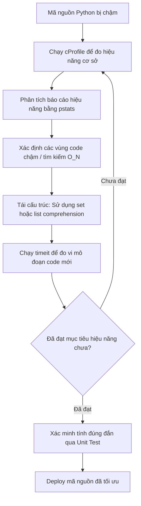

### 🎯 Mục tiêu học tập
- Đánh giá thời gian và không gian thực thi của thuật toán sử dụng ký pháp Big O.
- Thực hiện chẩn đoán hiệu năng tổng quan (macro-profiling) sử dụng mô-đun built-in `cProfile`.
- Phân tích báo cáo đo lường bằng `pstats` để xác định các nút thắt cổ chai (bottlenecks) của chương trình.
- Thực hiện đo lường chi tiết (microbenchmarking) với `timeit` để so sánh tốc độ của các cú pháp lệnh khác nhau.
- Áp dụng kỹ thuật tối ưu hóa bằng cách chuyển đổi tìm kiếm tuần tự từ danh sách $O(N)$ sang tra cứu nhanh bằng set $O(1)$.
- Áp dụng các mẫu code tối ưu bộ nhớ bằng cách sử dụng biểu thức generator và list comprehension một cách hợp lý.

### 🧩 Khái niệm cốt lõi (Tại sao)

"Tối ưu hóa sớm là nguồn cơn của mọi tội lỗi" (Premature optimization is the root of all evil) là câu nói nổi tiếng của Donald Knuth. Trước khi tiến hành tối ưu hóa bất kỳ đoạn mã nào, trước tiên bạn phải **đo lường** tốc độ thực thi của nó và **xác định** chính xác nút thắt cổ chai nằm ở đâu.

#### 1. Phân tích độ phức tạp (Ký pháp Big O)
Ký pháp Big O mô tả xu hướng thay đổi thời gian hoặc bộ nhớ của thuật toán khi kích thước đầu vào tăng dần tới vô hạn.
- **$O(1)$ (Thời gian hằng số)**: Thời gian thực thi không thay đổi bất kể kích thước đầu vào lớn thế nào. Ví dụ: Tra cứu khóa trong một dictionary hoặc kiểm tra phần tử trong một set.
- **$O(N)$ (Thời gian tuyến tính)**: Thời gian thực thi tăng tỷ lệ thuận với kích thước đầu vào $N$. Ví dụ: Tìm kiếm tuyến tính quét qua từng phần tử trong một `list`.
- **$O(N^2)$ (Thời gian bậc hai)**: Thời gian thực thi tăng theo hàm bình phương. Ví dụ: Các vòng lặp lồng nhau quét qua các phần tử danh sách.

#### 2. Phân tích Hiệu năng (Profiling) vs. Đo lường Hiệu năng (Benchmarking)
- **Profiling (Đo lường Vĩ mô)**: Phân tích hành vi chạy của toàn bộ chương trình để xác định tần suất và thời gian các hàm được gọi. Python cung cấp công cụ **`cProfile`** cho mục đích này.
- **Benchmarking (Đo lường Vi mô)**: Đo lường thời gian thực thi của các khối mã nguồn nhỏ hoặc các câu lệnh riêng lẻ. Python cung cấp **`timeit`** để thực thi lặp lại các đoạn mã ngắn hàng nghìn lần để lấy thời gian trung bình.

#### 3. Các chiến lược tối ưu hóa phổ biến trong Python
1. **Sử dụng Set để tìm kiếm**: Câu lệnh kiểm tra `x in list` có độ phức tạp $O(N)$ vì nó phải duyệt qua danh sách từ đầu đến cuối. Việc chuyển đổi danh sách thành một `set` giúp cho phép tra cứu `x in set` chạy trong thời gian $O(1)$ nhờ vào cấu trúc bảng băm (hash table).
2. **List Comprehension vs. Vòng lặp For**: List comprehension chạy ở tốc độ ngôn ngữ C bên dưới trình thông dịch Python, nhanh hơn nhiều so với việc gọi thủ công phương thức `.append()` bên trong một vòng lặp `for` Python thông thường.
3. **Sử dụng Generator để tối ưu bộ nhớ**: Generator (`yield` hoặc biểu thức generator dạng `(...)`) đánh giá các phần tử một cách trì hoãn (lazy evaluation) khi cần thiết, hầu như không tiêu thụ bộ nhớ so với việc tạo danh sách tải toàn bộ các giá trị vào RAM cùng một lúc.

---

### 🔁 Logic và hoạt động

Tối ưu hóa hiệu năng là một quy trình lặp liên tục. Sơ đồ dưới đây phác thảo chu kỳ đo lường, chẩn đoán, đo lường vi mô và cải thiện mã nguồn:



Trong quy trình này:
1. Lập trình viên không bao giờ phỏng đoán xem mã nguồn bị chậm ở đâu; họ dùng **`cProfile`** để khoanh vùng các hàm chạy chậm nhất.
2. Sau khi tìm ra các hàm này, họ cải thiện độ phức tạp thuật toán (ví dụ: chuyển từ tìm kiếm list sang set).
3. Họ sử dụng **`timeit`** để xác minh xem đoạn mã mới thực sự chạy nhanh hơn so với phiên bản cũ trước khi tiến hành viết test case.

---

### 📝 Ví dụ minh họa có chú thích

#### 1. Profiling với `cProfile` và `pstats`
Đoạn mã dưới đây minh họa cách đo lường hiệu năng của một chương trình chứa các hàm tìm kiếm nhanh và chậm:

```python
import cProfile
import pstats
import time

def slow_list_search(size: int):
    # Khởi tạo một danh sách lớn chứa các số nguyên
    dataset = list(range(size))
    # Thực hiện tìm kiếm tuyến tính nhiều lần (mỗi lần tìm kiếm tốn O(N))
    found_count = 0
    for query in range(size // 10):
        if query in dataset:
            found_count += 1
    return found_count

def fast_set_search(size: int):
    # Chuyển đổi danh sách thành set (tốn O(N) duy nhất một lần)
    dataset = set(range(size))
    # Thực hiện tìm kiếm với thời gian hằng số O(1) nhiều lần
    found_count = 0
    for query in range(size // 10):
        if query in dataset:
            found_count += 1
    return found_count

if __name__ == "__main__":
    size_parameter = 50000
    
    # Khởi tạo cProfile
    profiler = cProfile.Profile()
    profiler.enable()
    
    # Chạy các hàm thử nghiệm
    slow_list_search(size_parameter)
    fast_set_search(size_parameter)
    
    profiler.disable()
    
    # Định dạng và hiển thị kết quả đo lường
    stats = pstats.Stats(profiler).sort_stats('tottime')
    stats.print_stats(10)  # In ra top 10 cuộc gọi hàm tốn thời gian nhất
```

Giải thích các trường thông tin trong báo cáo `pstats`:
- `ncalls`: Số lần hàm được gọi.
- `tottime`: Tổng thời gian thực thi nằm trong chính hàm đó (không tính thời gian chạy của các hàm con được nó gọi).
- `cumtime`: Tổng thời gian tích lũy tiêu tốn trong chính hàm đó và tất cả các hàm con của nó.
- `filename:lineno(function)`: Vị trí dòng code định nghĩa hàm.

#### 2. Microbenchmarking với `timeit`
So sánh hiệu năng ở mức vi mô giữa việc sử dụng vòng lặp thông thường và list comprehension:

```python
import timeit

# Khối mã 1: Sử dụng vòng lặp for và append thông thường
loop_setup = "data = list(range(1000))"
loop_code = """
result = []
for x in data:
    result.append(x * 2)
"""

# Khối mã 2: Sử dụng List Comprehension (Chạy nhanh hơn ở tầng C)
comp_code = """
result = [x * 2 for x in data]
"""

# Chạy mỗi khối mã 10,000 lần để đo thời gian
loop_time = timeit.timeit(stmt=loop_code, setup=loop_setup, number=10000)
comp_time = timeit.timeit(stmt=comp_code, setup=loop_setup, number=10000)

print(f"Standard Loop time: {loop_time:.4f} seconds")
print(f"List Comprehension time: {comp_time:.4f} seconds")
print(f"Speedup factor: {loop_time / comp_time:.2f}x")
```

---

### ❌ Các lỗi thường gặp

**Lỗi 1: Cố gắng chuyển đổi danh sách các phần tử khả biến (nested lists) thành một set**
```python
dataset = [[1, 2], [3, 4], [5, 6]]
# Tìm cách chuyển trực tiếp danh sách chứa danh sách con thành set để tối ưu tìm kiếm
dataset_set = set(dataset)
```
```text
Traceback (most recent call last):
  File "main.py", line 3, in <module>
    dataset_set = set(dataset)
TypeError: unhashable type: 'list'
```
```python
dataset = [[1, 2], [3, 4], [5, 6]]
# Chuyển đổi các danh sách con thành các tuple (bất biến) để cho phép băm (hashable)
dataset_set = {tuple(item) for item in dataset}
```
> Các phần tử của set bắt buộc phải băm được (hashable), nghĩa là chúng phải có tính bất biến (immutable). Do các list là đối tượng khả biến có thể thay đổi lúc runtime, Python ngăn chặn việc đưa chúng vào set. Việc chuyển đổi list thành tuple giúp bạn khai thác được khả năng tra cứu $O(1)$ của set.

**Lỗi 2: Nối chuỗi bằng toán tử `+=` bên trong một vòng lặp**
```python
def build_paragraph(words: list[str]) -> str:
    paragraph = ""
    for word in words:
        paragraph += word + " "
    return paragraph
```
```text
Traceback (most recent call last):
  File "benchmark.py", line 5, in <module>
    assert run_benchmark(build_paragraph) < 0.1
AssertionError: execution timeout on 100,000 iterations
```
```python
def build_paragraph(words: list[str]) -> str:
    return " ".join(words) + " " if words else ""
```
> Chuỗi (string) trong Python là đối tượng bất biến. Khi dùng toán tử `+=` nối chuỗi trong vòng lặp, Python buộc phải cấp phát một vùng nhớ mới cho chuỗi kết quả và sao chép toàn bộ nội dung của chuỗi cũ sang vùng nhớ mới này ở mỗi vòng lặp, gây ra độ phức tạp $O(N^2)$ cực kỳ chậm. Sử dụng `.join()` sẽ ước lượng bộ nhớ cần dùng trước và chỉ cấp phát duy nhất một lần, đưa độ phức tạp về dạng tuyến tính $O(N)$.

---

### 💡 Mẹo & Cách viết tối ưu

- **Chuyển đổi một lần, tìm kiếm nhiều lần**: Việc ép kiểu một list có kích thước $N$ thành set tốn chi phí $O(N)$ về thời gian. Nếu bạn chỉ cần kiểm tra sự tồn tại của phần tử một lần duy nhất, việc ép sang set là không hiệu quả. Set chỉ thực sự phát huy tác dụng khi bạn có nhiều lượt tra cứu liên tiếp ($M$ lượt tìm kiếm với $M > 1$).
- **Sử dụng Biểu thức Generator để tối ưu bộ nhớ**: Khi cần tính toán tổng hoặc xử lý một luồng dữ liệu lớn mà không cần lưu giữ mảng kết quả trong RAM, hãy bỏ dấu ngoặc vuông `[]` để dùng biểu thức generator thay vì list comprehension:
  ```python
  # Tối ưu RAM (Generator): Đánh giá và trả về từng phần tử một
  total_sum = sum(x * x for x in range(1000000))
  
  # Lãng phí RAM (List Comprehension): Khởi tạo mảng 1 triệu phần tử trong RAM trước khi tính tổng
  total_sum = sum([x * x for x in range(1000000)])
  ```
- **Lưu trữ cục bộ các biến (Local Variable Cache)**: Python tìm kiếm các biến cục bộ (local variables) nhanh hơn so với các biến toàn cục (global variables) hoặc các thuộc tính của đối tượng. Nếu bạn truy cập nhiều lần thuộc tính `self.attribute` bên trong một vòng lặp lớn, hãy gán nó vào một biến cục bộ để cải thiện hiệu năng:
  ```python
  attr = self.attribute
  for x in data:
      process(attr, x)
  ```

---

### 🧠 Đi sâu phân tích (Cơ chế bên dưới)
<details><summary>Xử lý va chạm băm (Hash Collisions), Hệ số tải (Load Factors) và Cơ chế tra cứu của Set</summary>

Tại sao tốc độ tra cứu của set trong Python lại cực kỳ nhanh và không đổi? Hãy cùng khám phá cơ chế hoạt động đằng sau các bảng băm (hash tables).

#### Cơ chế hoạt động của Set Lookup
Khi bạn viết lệnh kiểm tra `x in dataset_set`, Python không thực hiện duyệt tuần tự qua các phần tử của set. Thay vào đó:
1. Python thực thi hàm `hash(x)` để lấy mã băm của đối tượng.
2. Nó chuyển mã băm này thành chỉ mục (index) tương ứng trong bảng nhớ nội bộ của set.
3. Nếu ô nhớ tại chỉ mục này đang trống, nó trả về `False`. Nếu ô nhớ chứa đối tượng cần tìm, nó trả về `True`.
4. Nếu ô nhớ chứa một đối tượng khác (xảy ra **va chạm băm - hash collision**), Python sẽ sử dụng một chuỗi dò giả ngẫu nhiên (pseudo-random probe sequence) để tìm kiếm các ô nhớ thay thế khác.

Thuật toán tra cứu này chạy trong **thời gian hằng số $O(1)$**.

#### Sự đánh đổi giữa Bộ nhớ và Tốc độ
Tốc độ nhanh này đi kèm cái giá phải trả về dung lượng bộ nhớ. Để giảm thiểu va chạm băm, set trong Python bắt buộc phải giữ **hệ số tải (load factor)** (tỷ lệ giữa số phần tử thực tế và kích thước bảng băm) ở mức thấp.
- Khi set đạt ngưỡng $2/3$ dung lượng lưu trữ, Python sẽ tự động thay đổi kích thước bảng băm, cấp phát một vùng nhớ lớn hơn nhiều và băm lại toàn bộ các phần tử hiện có.
- Do đó, cấu trúc dữ liệu `set` tiêu tốn nhiều bộ nhớ hơn đáng kể so với cấu trúc `list` khi lưu giữ cùng số lượng phần tử.

```text
So sánh bộ nhớ ước tính trên Python 64-bit:
List chứa 1.000 phần tử: ~8 KB
Set chứa 1.000 phần tử: ~32 KB
```
Hãy sử dụng set khi cần tối ưu tuyệt đối về tốc độ tìm kiếm và giữ list hoặc generator khi việc tiết kiệm bộ nhớ RAM là ưu tiên hàng đầu.
</details>

---

### 🏋️ Bài tập thực hành
Tối ưu hóa hàm tìm kiếm dưới đây. Hãy chuyển đổi danh sách `dataset_list` đầu vào thành một set để kích hoạt kiểm tra phần tử với độ phức tạp $O(1)$, sau đó đếm số lượng truy vấn trong `queries_list` thực sự xuất hiện trong dataset đó.

```python
# Optimize search lookup in a large dataset list.
# Convert the input dataset list to a set to enable O(1) membership test.
def optimize_search(dataset_list, queries_list):
    # Returns count of queries found in dataset
    pass
```

---

### ✅ Tự kiểm tra
1. Khi nào việc chuyển đổi danh sách thành set để thực hiện tìm kiếm trở nên kém hiệu quả hơn?
2. Sự khác biệt giữa `tottime` và `cumtime` trong báo cáo kết quả của `cProfile` là gì?
3. Biểu thức generator giúp tiết kiệm dung lượng bộ nhớ như thế nào so với list comprehension?
<details><summary>Đáp án tự kiểm tra</summary>

1. Khi bạn chỉ thực hiện một lần tìm kiếm duy nhất trên danh sách. Vì quá trình chuyển đổi từ list sang set tốn độ phức tạp $O(N)$, chi phí chuyển đổi này sẽ lớn hơn rất nhiều so với việc chỉ cần quét tuyến tính tìm kiếm một lần duy nhất. Kỹ thuật này chỉ tối ưu khi cần thực hiện tìm kiếm nhiều lần.
2. `tottime` là tổng thời gian chương trình chạy trong chính hàm đó, không bao gồm thời gian chạy của các hàm con khác được gọi từ nó. `cumtime` là tổng thời gian tích lũy để thực thi hàm đó cùng với tất cả các hàm con được nó gọi.
3. List comprehension lập tức tính toán và khởi tạo toàn bộ danh sách kết quả vào bộ nhớ RAM. Biểu thức generator thực hiện đánh giá lười (lazy evaluation), chỉ sinh phần tử khi được yêu cầu duyệt qua, giúp duy trì dung lượng bộ nhớ cố định $O(1)$ bất kể kích thước dữ liệu lớn thế nào.
</details>

---

### 📌 Tóm tắt
- **Phân tích độ phức tạp** giúp lập trình viên xác định các đường dẫn thực thi chậm bằng toán học thông qua ký pháp Big O.
- **`cProfile`** đo lường toàn bộ cây thực thi của chương trình để tìm ra chính xác hàm thắt nút cổ chai bằng các chỉ số như `tottime`.
- **`timeit`** đo lường chi tiết các khối mã nguồn nhỏ để so sánh sự chênh lệch hiệu năng giữa các cú pháp viết code.
- **Set** cung cấp khả năng tìm kiếm trong thời gian hằng số $O(1)$, mang lại sự nhảy vọt về hiệu năng so với tìm kiếm tuyến tính $O(N)$ của list đối với dữ liệu lớn.
- **Generator** mang lại khả năng lặp cực kỳ tiết kiệm bộ nhớ bằng cách chỉ tính toán và sinh dữ liệu khi cần thiết.
