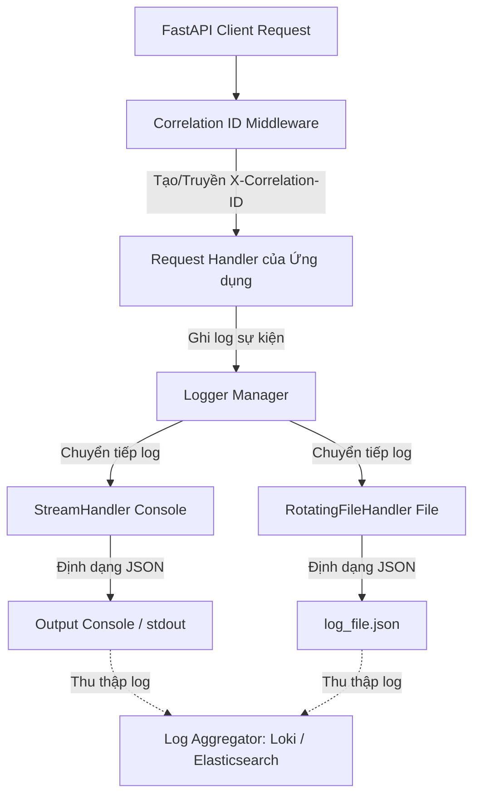

### 🎯 Mục tiêu học tập
- Phân biệt 5 mức độ ghi nhật ký (logging levels) tiêu chuẩn và áp dụng chúng phù hợp cho các sự kiện hệ thống.
- Cấu hình logger, handler, formatter và các quy tắc truyền log (propagation) bằng cách cấu hình tiêu chuẩn của Python.
- Thiết lập cấu hình động bằng `dictConfig` để tách biệt cấu hình log khỏi mã nguồn ứng dụng.
- Triển khai ghi log cấu trúc dạng JSON hỗ trợ các hệ thống lưu trữ và tìm kiếm log tập trung như Loki hoặc Elasticsearch.
- Cấu hình xoay vòng file log (log rotation) bằng `RotatingFileHandler` nhằm tránh tình trạng đầy ổ cứng.
- Tích hợp ID tương quan (Correlation ID) trong middleware của FastAPI để thực hiện truy vết yêu cầu (request tracing) đầu-cuối.

### 🧩 Khái niệm cốt lõi (Tại sao)

#### 1. Tại sao không dùng `print()` để ghi log?
Trong các ứng dụng chạy trên môi trường production, sử dụng `print()` để dò lỗi (debugging) là một phản khuôn mẫu (anti-pattern):
- **Không phân cấp**: `print()` không thể phân biệt giữa thông tin vết (info), cảnh báo (warning), hay lỗi hệ thống nghiêm trọng (critical).
- **Không quản lý được đầu ra**: `print()` mặc định ghi ra `stdout`. Rất khó để chuyển hướng các tin nhắn cụ thể vào file log, gửi email, hay các hệ thống cảnh báo tự động.
- **Hiệu năng**: Câu lệnh `print()` chạy đồng bộ, gây chặn (block) các hoạt động I/O và làm giảm nghiêm trọng hiệu năng của ứng dụng dưới tải cao.
- **Thiếu siêu dữ liệu**: Đầu ra của `print()` không có ngữ cảnh (mốc thời gian, ID luồng, tên module, dòng code phát sinh).

#### 2. Các mức độ ghi log (Logging Levels)
Thư viện chuẩn của Python định nghĩa 5 mức độ ghi log tăng dần dựa trên các giá trị số nguyên:
- **DEBUG (10)**: Thông tin chi tiết phục vụ chẩn đoán lỗi trong quá trình phát triển.
- **INFO (20)**: Các sự kiện thông thường xác nhận hệ thống hoạt động ổn định (như khởi động, hoàn thành một request).
- **WARNING (30)**: Cảnh báo về các sự kiện bất thường nhỏ hoặc tính năng sắp bị loại bỏ nhưng không làm gián đoạn chương trình.
- **ERROR (40)**: Các ngoại lệ nghiêm trọng làm thất bại một thao tác cụ thể của người dùng.
- **CRITICAL (50)**: Sự cố hệ thống cực kỳ nghiêm trọng cần can thiệp ngay lập tức (như mất kết nối DB, cạn kiệt RAM).

#### 3. Handler và Formatter
- **Logger**: Giao diện chính mà mã nguồn ứng dụng gọi để gửi tin nhắn log.
- **Handler**: Quyết định nơi gửi log (console, file cục bộ, socket, stream qua mạng). Các handler phổ biến gồm `StreamHandler`, `FileHandler`, và `RotatingFileHandler`.
- **Formatter**: Định nghĩa định dạng chuỗi văn bản hoặc cấu trúc hiển thị cuối cùng của bản ghi log.
- **Propagation**: Quyết định xem một logger con có chuyển tiếp bản ghi log của nó lên các logger cha (ví dụ: root logger) hay không.

#### 4. Khả năng giám sát hệ thống (Observability) và Log cấu trúc
Observability là khả năng hiểu được trạng thái bên trong của hệ thống dựa trên đầu ra bên ngoài của nó (metrics, logs, traces).
- **Structured JSON Logging**: Log dạng văn bản thông thường rất khó để phân tích bằng regex. Định dạng log dưới dạng đối tượng JSON giúp máy móc dễ đọc. Các hệ thống quản lý log (Elasticsearch, Loki, Datadog) có thể lập chỉ mục (index) các trường JSON trực tiếp, giúp nhà phát triển tìm kiếm log nhanh chóng theo trường (như level, thời gian phản hồi, hoặc ID người dùng).
- **Correlation ID (Truy vết)**: Là một chuỗi định danh duy nhất được tạo ra cho mỗi yêu cầu HTTP đi vào hệ thống. Bằng cách đính kèm ID này vào mọi log được ghi trong suốt vòng đời của request đó, nhà phát triển có thể liên kết toàn bộ hành trình xử lý đi qua nhiều microservices hay database query khác nhau.

---

### 🔁 Logic và hoạt động

Sơ đồ dưới đây mô tả luồng hoạt động của một request HTTP đi vào ứng dụng FastAPI, từ khi ID tương quan được sinh ra, truyền tải qua context, định dạng thành JSON và lập chỉ mục:



1. **Nhận request**: Middleware chặn request, trích xuất hoặc sinh mới một correlation ID, và lưu trữ vào bộ nhớ cục bộ theo ngữ cảnh (context-local storage).
2. **Xử lý ứng dụng**: Hàm xử lý logic ghi nhận các cột mốc trong quá trình chạy.
3. **Chuyển tiếp và định dạng**: Logger tiếp nhận bản ghi và đẩy qua các handler. JSON Formatter lấy correlation ID từ contextvars để nhúng vào log record.
4. **Tích hợp log**: Bộ thu thập log đọc luồng stdout hoặc file log để chuyển lên hệ thống lưu trữ tập trung.

---

### 📝 Ví dụ minh họa có chú thích

#### 1. Cấu hình tách biệt sử dụng `dictConfig`
Thay vì cấu hình log trực tiếp trong code, chúng ta nên định nghĩa cấu hình dạng từ điển (dictionary) để dễ dàng quản lý hoặc đọc từ file cấu hình JSON/YAML, giúp chuyển đổi nhanh chóng giữa môi trường Dev và Prod.

```python
import logging.config

LOGGING_CONFIG = {
    "version": 1,
    "disable_existing_loggers": False,
    "formatters": {
        "standard": {
            "format": "%(asctime)s [%(levelname)s] %(name)s: %(message)s"
        },
    },
    "handlers": {
        "console": {
            "class": "logging.StreamHandler",
            "level": "DEBUG",
            "formatter": "standard",
            "stream": "ext://sys.stdout",
        },
        "file": {
            "class": "logging.handlers.RotatingFileHandler",
            "level": "INFO",
            "formatter": "standard",
            "filename": "app.log",
            "maxBytes": 1048576,  # 1 MB
            "backupCount": 3,
            "encoding": "utf8",
        },
    },
    "root": {
        "handlers": ["console", "file"],
        "level": "DEBUG",
    },
}

# Áp dụng cấu hình từ dictionary
logging.config.dictConfig(LOGGING_CONFIG)
logger = logging.getLogger("app.module")

logger.info("Khởi tạo ứng dụng thành công.")
logger.warning("Phát hiện ghi đè cấu hình hệ thống.")
```

#### 2. Viết Custom Formatter xuất log dạng JSON cấu trúc
Định nghĩa một lớp kế thừa từ `logging.Formatter` và ghi đè phương thức `format()` để chuyển đổi log sang chuỗi JSON cho production.

```python
import logging
import json
import datetime

class StructuredJSONFormatter(logging.Formatter):
    def format(self, record: logging.LogRecord) -> str:
        log_entry = {
            "timestamp": datetime.datetime.utcnow().isoformat(),
            "level": record.levelname,
            "logger": record.name,
            "message": record.getMessage(),
        }
        
        # Nhúng thông tin lỗi stack trace nếu có ngoại lệ xảy ra
        if record.exc_info:
            log_entry["exception"] = self.formatException(record.exc_info)
            
        return json.dumps(log_entry)

# Thiết lập handler sử dụng formatter JSON tùy chỉnh
handler = logging.StreamHandler()
handler.setFormatter(StructuredJSONFormatter())
logger = logging.getLogger("structured_logger")
logger.addHandler(handler)
logger.setLevel(logging.INFO)

logger.info("Ví dụ về log cấu trúc JSON.")
```

#### 3. Truy vết request trong ứng dụng FastAPI (Middleware sinh Correlation ID)
Sử dụng `contextvars` để chia sẻ correlation ID an toàn giữa các tác vụ bất đồng bộ (async tasks), sau đó định dạng chúng vào log.

```python
import logging
import json
import datetime
import uuid
import contextvars
from fastapi import FastAPI, Request
from starlette.middleware.base import BaseHTTPMiddleware

# Biến ngữ cảnh để giữ correlation ID trong phạm vi của mỗi request
correlation_id_ctx = contextvars.ContextVar("correlation_id", default="N/A")

class ContextualJSONFormatter(logging.Formatter):
    def format(self, record: logging.LogRecord) -> str:
        log_entry = {
            "timestamp": datetime.datetime.utcnow().isoformat(),
            "level": record.levelname,
            "message": record.getMessage(),
            "correlation_id": correlation_id_ctx.get() # Lấy ID tương quan từ contextvars
        }
        return json.dumps(log_entry)

# Tạo ứng dụng FastAPI
app = FastAPI()

class CorrelationIDMiddleware(BaseHTTPMiddleware):
    async def dispatch(self, request: Request, call_next):
        # Lấy ID từ header hoặc tự sinh ID ngẫu nhiên mới
        correlation_id = request.headers.get("X-Correlation-ID", str(uuid.uuid4()))
        token = correlation_id_ctx.set(correlation_id)
        try:
            response = await call_next(request)
            response.headers["X-Correlation-ID"] = correlation_id
            return response
        finally:
            correlation_id_ctx.reset(token)

app.add_middleware(CorrelationIDMiddleware)

# Cấu hình log
logger = logging.getLogger("api")
handler = logging.StreamHandler()
handler.setFormatter(ContextualJSONFormatter())
logger.addHandler(handler)
logger.setLevel(logging.INFO)

@app.get("/items")
async def read_items():
    logger.info("Người dùng yêu cầu lấy danh sách sản phẩm")
    return {"items": ["item1", "item2"]}
```

---

### ❌ Các lỗi thường gặp

**Lỗi 1: Sử dụng nối chuỗi hoặc f-string trực tiếp trong lệnh gọi logger**
```python
import logging
# Ghi log không tối ưu, chuỗi f-string bị biên dịch ngay lập tức
logging.debug(f"Giá trị tính toán tốn kém: {run_expensive_calculation()}")
```
```text
Traceback (most recent call last):
  File "app.py", line 5, in <module>
    logging.debug(f"Giá trị tính toán tốn kém: {run_expensive_calculation()}")
NameError: name 'run_expensive_calculation' is not defined
```
```python
import logging
# Định dạng chuỗi trì hoãn (lazy evaluation) sử dụng placeholder của logger
logging.debug("Giá trị tính toán tốn kém: %s", run_expensive_calculation())
```
> Việc sử dụng f-string khiến Python đánh giá và tính toán chuỗi ngay lập tức, ngay cả khi mức cấu hình log hiện tại cao hơn (ví dụ: WARNING), dẫn đến việc chạy hàm `run_expensive_calculation()` vô ích. Sử dụng placeholder dạng `%` giúp hoãn việc tính toán giá trị cho đến khi trình ghi log thực sự quyết định ghi tin nhắn đó ra.

**Lỗi 2: Thiếu thông tin stack trace khi ghi log ngoại lệ**
```python
import logging
try:
    1 / 0
except ZeroDivisionError as e:
    logging.error(f"Đã xảy ra lỗi: {e}")
```
```text
ERROR:root:Đã xảy ra lỗi: division by zero
```
```python
import logging
try:
    1 / 0
except ZeroDivisionError:
    logging.exception("Đã xảy ra lỗi khi thực hiện phép chia")
```
> Chỉ ghi chuỗi ngoại lệ bằng `logging.error()` sẽ làm mất toàn bộ vết ngăn xếp (traceback) của lỗi. Bằng cách gọi `logging.exception()` (hoặc cấu hình `exc_info=True`), Python tự động trích xuất thông tin lỗi hiện tại và đính kèm đầy đủ stack trace vào log, giúp việc debug trên production dễ dàng hơn.

---

### 💡 Mẹo & Cách viết tối ưu

- **Dùng `__name__` để đặt tên Logger**: Luôn khởi tạo logger bằng `logging.getLogger(__name__)`. Điều này giúp phân chia log theo cấu trúc module của dự án, cho phép bật/tắt hoặc nâng mức log cho từng thư mục hoặc lớp cụ thể.
- **Bắt buộc dùng xoay vòng log (Log Rotation)**: Đừng bao giờ dùng `FileHandler` thuần túy trên môi trường production. Một file log phình to vô hạn sẽ làm đầy ổ cứng và làm sập hệ điều hành. Hãy luôn cấu hình `RotatingFileHandler` (xoay vòng theo dung lượng) hoặc `TimedRotatingFileHandler` (xoay vòng theo thời gian) kết hợp với thuộc tính `backupCount` để tự động xóa file cũ.
- **Ghi ra luồng chuẩn (stdout)**: Trong các môi trường container như Docker hay Kubernetes, hãy ghi log trực tiếp ra stdout/stderr. Đừng ghi ra file bên trong container; hãy để hạ tầng container tự động thu thập luồng console đó và đẩy về các hệ thống thu thập log tập trung.

---

### 🧠 Đi sâu phân tích (Cơ chế bên dưới)
<details><summary>Thread-Safety, Cơ chế truyền log và ContextVars trong Async Code</summary>

#### 1. Tính an toàn luồng (Thread-Safety) của thư viện log
Thư viện `logging` tiêu chuẩn của Python được thiết kế an toàn khi chạy đa luồng. Các handler ghi log sử dụng cơ chế khóa nội bộ (`threading.RLock`) để tuần tự hóa quyền truy cập vào các tài nguyên I/O dùng chung. Điều này đảm bảo các log được ghi đồng thời bởi nhiều luồng khác nhau không bị ghi đè hay đứt gãy. Tuy nhiên, việc tranh chấp khóa lock sẽ gây ra độ trễ nhỏ đối với ứng dụng có lượng đa luồng cực cao.

#### 2. Cơ chế truyền log (Propagation)
Khi một logger nhận được bản ghi log:
1. Nó kiểm tra mức log của chính nó. Nếu mức log của bản ghi thấp hơn, nó sẽ bỏ qua.
2. Nếu thỏa mãn, bản ghi được gửi đến tất cả handler đã đăng ký trực tiếp trên logger này.
3. Nếu thuộc tính `propagate` là `True` (mặc định), bản ghi tiếp tục được gửi lên logger cha trong hệ thống phân cấp tên (ví dụ: `app.submodule` sẽ truyền lên `app`, rồi truyền lên root logger).
4. Các handler của logger cha sẽ xử lý bản ghi này **bất chấp** cấu hình mức độ log của chính logger cha đó. Để tránh log bị ghi trùng lặp nhiều lần, hãy đặt `logger.propagate = False`.

#### 3. So sánh ContextVars và Thread-Local Storage
Trong các ứng dụng đa luồng truyền thống, `threading.local()` được dùng để cô lập dữ liệu theo từng luồng. Tuy nhiên, các ứng dụng bất đồng bộ (như FastAPI/Starlette) chia sẻ chung một luồng duy nhất của hệ điều hành cho nhiều tác vụ bất đồng bộ (tasks) khác nhau chạy đan xen.
- Sử dụng `threading.local` trong async code sẽ gây ra lỗi tranh chấp dữ liệu (race conditions), vì các tác vụ khác nhau sẽ đọc ghi đè lên biến của nhau trong cùng một luồng.
- `contextvars` cung cấp khả năng cách ly trạng thái cho từng task riêng biệt. Mỗi async task giữ một bản sao trạng thái của riêng mình. Khi một coroutine tạm dừng ở lệnh `await`, `contextvars` sẽ tự động chuyển đổi ngữ cảnh an toàn, giúp logger lấy đúng Correlation ID của request hiện tại.
</details>

---

### 🏋️ Bài tập thực hành
Hãy viết hàm formatter cho log có tên `format_json_log(level: str, message: str) -> str` trả về một chuỗi JSON cấu trúc chứa các trường: `level`, `message`, và `timestamp` (được định dạng ISO theo giờ UTC).

```python
import json

# Viết hàm định dạng nhật ký `format_json_log(level: str, message: str) -> str`
# trả về một chuỗi JSON cấu trúc chứa các trường: level, message, và timestamp.
def format_json_log(level: str, message: str) -> str:
    pass
```

---

### ✅ Tự kiểm tra
1. Handler nào giúp bảo vệ ổ đĩa hệ thống khỏi bị đầy bởi các file log dung lượng lớn?
2. Điều gì xảy ra nếu thiết lập `propagate` là `True` trên một logger con vốn đã có handler của riêng nó?
3. Tại sao `threading.local` không hoạt động ổn định trong các ứng dụng async của FastAPI?
<details><summary>Đáp án câu hỏi tự kiểm tra</summary>

1. `RotatingFileHandler` (hoặc `TimedRotatingFileHandler`) giới hạn dung lượng file tối đa và tự động xoay vòng cũng như xóa bớt các file log cũ dựa trên giá trị `backupCount`.
2. Tin nhắn log sẽ bị in ra hai lần: một lần bởi handler của logger con và một lần bởi handler của logger cha/root logger.
3. Các ứng dụng async chạy nhiều tác vụ đồng thời trên một luồng hệ điều hành duy nhất. `threading.local` chỉ cô lập dữ liệu giữa các luồng chứ không cô lập giữa các tác vụ async trên cùng một luồng, dẫn đến dữ liệu yêu cầu bị rò rỉ chéo giữa các request.
</details>

---

### 📌 Tóm tắt
- **Logging** tối ưu hơn `print()` nhờ hỗ trợ phân cấp độ, định tuyến đích đến của log, cấu hình động và cấu trúc định dạng đa dạng.
- **`dictConfig`** tách biệt cấu hình thiết lập log ra khỏi logic code chính của chương trình.
- **Log cấu trúc JSON** giúp các công cụ thu thập log tập trung (Loki/Elasticsearch) truy vấn nhanh các thuộc tính trực tiếp mà không cần dùng regex phân tích văn bản thô.
- **Correlation ID** là khóa cốt lõi để xâu chuỗi luồng xử lý của một request đi qua middleware và các dịch vụ bất đồng bộ.
- **`contextvars`** cô lập trạng thái dữ liệu của request bên trong vòng lặp sự kiện của coroutine bất đồng bộ.
