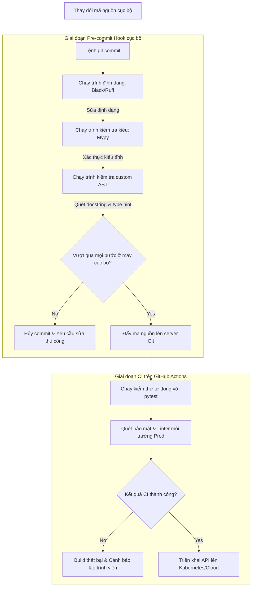

### 🎯 Mục tiêu học tập
- Thiết kế và tích hợp quy trình xác thực tĩnh trong luồng Tích hợp Liên tục (CI).
- Thiết lập các pre-commit hook ở máy cục bộ để tự động hóa định dạng, kiểm tra lỗi và kiểu dữ liệu trước khi commit code.
- Phân tích cấu trúc cú pháp của mã nguồn Python sử dụng Cây Cú pháp Trừu tượng (AST).
- Xây dựng một trình kiểm định Python tùy chỉnh sử dụng `ast` để áp dụng các ràng buộc thiết kế của dự án (ví dụ bắt buộc viết type hint hoặc docstring).
- Thiết lập cơ chế ngăn chặn mã nguồn lỗi dựa trên mã thoát (Exit Code) để chặn các commit không hợp lệ.

### 🧩 Khái niệm cốt lõi (Tại sao)

#### 1. Tại sao cần tự động hóa trong quy trình CI?
Trong phát triển phần mềm chuyên nghiệp, việc review code thủ công rất dễ xảy ra sai sót. Hệ thống Tích hợp Liên tục (CI) giúp tự động hóa quá trình xác thực này:
- **Tính nhất quán**: Đảm bảo toàn bộ mã nguồn khi được merge đều tuân thủ chính xác các tiêu chuẩn về phong cách viết (style guide), chất lượng và gợi ý kiểu (type hint).
- **Phát hiện lỗi sớm (Fail Fast)**: Nhận diện ngay lập tức các lỗi logic hồi quy, lỗi định dạng và kiểu dữ liệu chỉ trong vài phút, ngăn chặn bug đi lên môi trường production.
- **Giảm thiểu thời gian của con người**: Giải phóng thời gian review của các lập trình viên cấp cao bằng cách chuyển giao việc kiểm tra cú pháp, định dạng và phân tích tĩnh cho các công cụ tự động.

#### 2. So sánh Pre-Commit Hook và Pipeline CI
Một luồng làm việc đáng tin cậy sẽ thiết lập hàng rào bảo vệ ở cả hai lớp:
- **Local Pre-commit Hook**: Chạy ngay trên máy của lập trình viên *trước khi* lệnh Git commit được hoàn tất. Nếu kiểm tra thất bại, lệnh commit sẽ bị hủy. Điều này giúp tiết kiệm thời gian chạy của máy chủ CI và giữ lịch sử commit luôn sạch sẽ.
- **CI Pipeline (Remote)**: Chạy trên máy chủ Git (như GitHub Actions, GitLab CI) *sau khi* mã nguồn được đẩy lên (push). Đây là chốt chặn cuối cùng kiểm thử tính đúng đắn của toàn bộ ứng dụng trước khi chấp nhận Pull Request.

#### 3. Các công cụ xác thực cốt lõi
- **Trình định dạng/Kiểm tra phong cách (Ruff / Black)**: Chuẩn hóa khoảng trắng, thụt lề, tự động xóa các thư viện import thừa và sửa lỗi định dạng.
- **Trình kiểm tra kiểu tĩnh (Mypy)**: Truy vết các định nghĩa kiểu dữ liệu và đưa ra cảnh báo nếu biến vi phạm các chú thích kiểu.
- **Custom Validator (AST)**: Đôi khi các công cụ linter có sẵn không thể ép buộc các quy tắc đặc thù của dự án (ví dụ: "Mọi hàm API endpoint bắt buộc phải có docstring" hoặc "Mọi database model bắt buộc phải kế thừa từ một lớp cơ sở cụ thể"). Việc viết các trình xác thực tùy chỉnh sử dụng AST cho phép lập trình viên phân tích sâu cấu trúc của code.

---

### 🔁 Logic và hoạt động

Dưới đây là sơ đồ kiến trúc hoàn chỉnh thể hiện vòng đời của mã nguồn, từ việc commit cục bộ đến khi kiểm thử trên CI và triển khai lên production:



1. **Chặn commit cục bộ**: Chạy lệnh `git commit` sẽ kích hoạt script pre-commit hook.
2. **Quét linter & định dạng cục bộ**: Code được định dạng lại, kiểm tra kiểu dữ liệu tĩnh và chuyển qua trình quét AST tùy chỉnh.
3. **Push và CI**: Nếu các bước kiểm tra cục bộ thành công, commit được tạo và lập trình viên có thể push. Máy chủ CI clone code, thiết lập môi trường sạch, chạy suite kiểm thử với `pytest` và quét bảo mật.
4. **Triển khai**: Nếu tất cả các bước CI trả về mã thoát `0`, API được đóng gói và deploy.

---

### 📝 Ví dụ minh họa có chú thích

#### 1. Trình xác thực code tùy chỉnh sử dụng Cây Cú pháp Trừu tượng (AST)
Một AST chuyển đổi mã nguồn dạng text thành một cây các node đại diện cho ngữ pháp của ngôn ngữ lập trình. Đoạn code dưới đây duyệt qua cây AST để kiểm tra xem mọi hàm đã được định nghĩa docstring và gợi ý kiểu đầy đủ hay chưa.

```python
import ast

def inspect_source_code(source_code: str) -> dict:
    # Phân tích cú pháp chuỗi nguồn thành cây AST
    tree = ast.parse(source_code)
    
    report = {
        "missing_docstrings": [],
        "missing_annotations": [],
        "errors": 0
    }
    
    # Duyệt qua tất cả các node trong cây
    for node in ast.walk(tree):
        # Chúng ta chỉ quan tâm đến các định nghĩa hàm (FunctionDef)
        if isinstance(node, ast.FunctionDef):
            func_name = node.name
            
            # Kiểm tra tài liệu hướng dẫn docstring
            docstring = ast.get_docstring(node)
            if not docstring:
                report["missing_docstrings"].append(func_name)
                report["errors"] += 1
                
            # Kiểm tra chú thích kiểu cho các đối số đầu vào
            for arg in node.args.args:
                # Đối với phương thức trong Class, bỏ qua kiểm tra 'self' hoặc 'cls'
                if arg.arg in ("self", "cls"):
                    continue
                if arg.annotation is None:
                    report["missing_annotations"].append(f"{func_name}.{arg.arg}")
                    report["errors"] += 1
                    
            # Kiểm tra chú thích kiểu trả về
            if node.returns is None:
                report["missing_annotations"].append(f"{func_name}.returns")
                report["errors"] += 1
                
    return report

# Đoạn code kiểm thử
snippet = """
def add(x: int, y: int) -> int:
    '''Cộng hai số lại với nhau.'''
    return x + y

def log_message(msg):
    print(msg)
"""

results = inspect_source_code(snippet)
print(results)
# Kết quả: {'missing_docstrings': ['log_message'], 'missing_annotations': ['log_message.msg', 'log_message.returns'], 'errors': 3}
```

#### 2. Mô phỏng kịch bản chặn commit (Gatekeeper Script)
Các pre-commit hook và các bước CI hoạt động dựa trên mã thoát (exit code) của hệ điều hành. Trả về `sys.exit(0)` biểu thị sự thành công, trong khi bất kỳ mã thoát khác không (như `sys.exit(1)`) sẽ hủy lệnh git commit hoặc đánh dấu build CI thất bại.

```python
import sys
import ast

def run_gatekeeper(file_path: str) -> None:
    print(f"[*] Đang phân tích file: {file_path}...")
    try:
        with open(file_path, "r", encoding="utf-8") as f:
            source = f.read()
            
        tree = ast.parse(source)
        errors_found = 0
        
        for node in ast.walk(tree):
            if isinstance(node, ast.FunctionDef):
                # Phát hiện nếu hàm thiếu gợi ý kiểu trả về
                if node.returns is None:
                    print(f"[!] Lỗi: Hàm '{node.name}' không có chú thích kiểu trả về.")
                    errors_found += 1
                    
        if errors_found > 0:
            print("[-] Gatekeeper thất bại. Vui lòng sửa các lỗi tĩnh nêu trên.")
            sys.exit(1) # Hủy lệnh commit hoặc đánh dấu CI lỗi
            
        print("[+] Gatekeeper thành công.")
        sys.exit(0) # Thành công
        
    except SyntaxError as e:
        print(f"[-] Lỗi cú pháp trong mã nguồn: {e}")
        sys.exit(1)
```

#### 3. Mô phỏng quy trình chạy CI Pipeline
Một đoạn script Python giả lập máy chủ CI chạy tuần tự các lệnh kiểm tra:

```python
import subprocess
import sys

def run_step(command: list[str]) -> bool:
    print(f"[*] Đang chạy: {' '.join(command)}")
    result = subprocess.run(command, capture_output=True, text=True)
    if result.returncode != 0:
        print(f"[-] Bước chạy thất bại. Lỗi chi tiết:\n{result.stderr or result.stdout}")
        return False
    print("[+] Bước chạy thành công.")
    return True

def run_pipeline() -> None:
    # 1. Kiểm tra định dạng (sử dụng black hoặc ruff)
    if not run_step(["black", "--check", "."]):
        sys.exit(1)
        
    # 2. Kiểm tra kiểu tĩnh (sử dụng mypy)
    if not run_step(["mypy", "."]):
        sys.exit(1)
        
    # 3. Chạy các unit test (sử dụng pytest)
    if not run_step(["pytest", "tests/"]):
        sys.exit(1)
        
    print("[SUCCESS] Đã vượt qua toàn bộ các giai đoạn của pipeline. Sẵn sàng release.")
    sys.exit(0)
```

---

### ❌ Các lỗi thường gặp

**Lỗi 1: Phân tích file thô bằng AST mà không bắt ngoại lệ SyntaxError**
```python
import ast
def check_syntax(code: str):
    # Biên dịch AST trực tiếp không có khối try-except
    tree = ast.parse(code)
    return "VALID"
```
```text
Traceback (most recent call last):
  File "validator.py", line 4, in check_syntax
    tree = ast.parse(code)
  File "/usr/lib/python3.10/ast.py", line 50, in parse
    return compile(source, filename, mode, flags,
  File "<unknown>", line 1
    def bad_func(x
                 ^
SyntaxError: unexpected EOF while parsing
```
```python
import ast
def check_syntax(code: str) -> str:
    try:
        ast.parse(code)
        return "VALID"
    except SyntaxError:
        return "INVALID"
```
> Lệnh `ast.parse()` sẽ ném ra ngoại lệ `SyntaxError` nếu chuỗi code đầu vào không phải là mã nguồn Python hợp lệ. Khi chạy trình xác thực trong pipeline, bạn phải bắt ngoại lệ này để trả về kết quả kiểm tra thất bại thay vì để chương trình kiểm tra crash đột ngột làm sập pipeline.

**Lỗi 2: Bỏ quên không loại trừ tham số self/cls khi kiểm tra chú thích kiểu**
```python
import ast
def verify_no_missing_annotations(src: str) -> bool:
    tree = ast.parse(src)
    for node in ast.walk(tree):
        if isinstance(node, ast.FunctionDef):
            for arg in node.args.args:
                if arg.annotation is None:
                    return False
    return True
```
```text
Traceback (most recent call last):
  File "test_pipeline.py", line 6, in <module>
    # Thất bại đối với các Class hợp lệ do tham số 'self' thông thường không được khai báo kiểu
    assert verify_no_missing_annotations("class User:\n    def run(self):\n        pass") == True
AssertionError
```
```python
import ast
def verify_no_missing_annotations(src: str) -> bool:
    tree = ast.parse(src)
    for node in ast.walk(tree):
        if isinstance(node, ast.FunctionDef):
            for i, arg in enumerate(node.args.args):
                # Bỏ qua tham số 'self' hoặc 'cls' ở vị trí đầu tiên của các phương thức OOP
                if i == 0 and arg.arg in ("self", "cls"):
                    continue
                if arg.annotation is None:
                    return False
    return True
```
> Trong lập trình hướng đối tượng của Python, tham số `self` (cho instance method) và `cls` (cho class method) không cần chú thích kiểu rõ ràng vì kiểu của chúng đã được các trình kiểm tra ngầm định hiểu theo ngữ cảnh lớp. Nếu không bỏ qua các đối số này, validator sẽ đánh dấu sai các class thông thường là vi phạm quy tắc.

---

### 💡 Mẹo & Cách viết tối ưu

- **Tận dụng Framework `pre-commit`**: Thay vì viết các script Bash thủ công dưới thư mục ẩn `.git/hooks/pre-commit`, hãy sử dụng thư viện `pre-commit` viết bằng Python. Công cụ này quản lý các dependencies của script tự động, chỉ chạy kiểm tra trên các file đang được staged và cache môi trường sạch sẽ.
- **Fail Fast, Run Cheap First**: Trong cấu hình pipeline CI của bạn, hãy chạy các bước quét tĩnh nhanh trước (như Ruff, Black). Để các bước kiểm thử tích hợp chậm (như pytest chạy qua DB) ở cuối cùng. Điều này giúp tối ưu hóa chi phí máy chủ và phản hồi kết quả nhanh hơn cho lập trình viên.
- **Sử dụng AST thay vì Regex**: Đừng bao giờ dùng biểu thức chính quy (regular expressions) để quét tìm các quy tắc cú pháp hoặc kiểm tra import trong code. Regex rất dễ bị đánh lừa bởi nội dung chuỗi ký tự hoặc thay đổi căn lề. Hãy sử dụng thư viện `ast` tích hợp sẵn của Python để đọc cấu trúc ngữ pháp một cách chuẩn xác.

---

### 🧠 Đi sâu phân tích (Cơ chế bên dưới)
<details><summary>Abstract Syntax Tree, Node Visitor và Mã thoát (Exit Codes) trong quy trình CI</summary>

#### 1. Cây Cú pháp Trừu tượng (AST) là gì?
Trước khi trình biên dịch hay trình thông dịch thực thi mã nguồn, chúng sẽ tách chuỗi text thành các token và dựng lên một Cây Cú pháp Trừu tượng (AST).
- Mỗi node trên cây tương ứng với một đơn vị ngữ pháp (ví dụ: Node `FunctionDef` đại diện cho một hàm, `BinOp` đại diện cho phép toán nhị phân như `+`, `Call` đại diện cho một lệnh gọi hàm).
- Bằng cách duyệt qua cây này, các công cụ phân tích có thể hiểu được cấu trúc ngữ nghĩa của chương trình mà không cần chạy code.
- Python cung cấp sẵn module `ast` giúp lập trình viên phân tích, duyệt qua, hoặc thậm chí sửa đổi các node này trước khi compile ngược lại.

#### 2. Duyệt cây bằng Node Visitor
Thay vì sử dụng các vòng lặp nested thủ công kết hợp `ast.walk()`, một mẫu thiết kế sạch hơn là kế thừa lớp `ast.NodeVisitor`:

```python
import ast

class MethodAnnotationValidator(ast.NodeVisitor):
    def visit_FunctionDef(self, node: ast.FunctionDef):
        # Phương thức này tự động được gọi mỗi khi tìm thấy một node FunctionDef
        if node.returns is None:
            print(f"[-] Thiếu kiểu trả về tại hàm: {node.name}")
        # Tiếp tục duyệt qua các node con của node hiện tại
        self.generic_visit(node)

# Cách dùng:
# validator = MethodAnnotationValidator()
# validator.visit(tree)
```

#### 3. Mã thoát của hệ điều hành (OS Exit Codes)
Mọi lệnh chạy trong terminal đều trả về một mã trạng thái kết thúc (một số nguyên từ `0` đến `255`).
- **`0`**: Lệnh kết thúc thành công không có lỗi.
- **Khác 0 (ví dụ `1`, `2`, `127`)**: Đã xảy ra lỗi trong quá trình thực thi.
Các trình chạy CI (như GitHub Actions runner) thực thi các câu lệnh tuần tự. Nếu bất kỳ bước nào trả về mã thoát khác `0`, runner sẽ dừng ngay lập tức, đánh dấu build thất bại và chặn việc merge hay deploy. Do đó, các script xác thực của bạn bắt buộc phải gọi `sys.exit(1)` khi phát hiện vi phạm.
</details>

---

### 🏋️ Bài tập thực hành
Hãy triển khai hàm kiểm định pipeline `verify_pipeline(code_module_src: str) -> str` kiểm tra:
1. Chú thích kiểu dữ liệu: tất cả các hàm phải có gợi ý kiểu (type hint). Trả về "PASS" hoặc "FAIL".

```python
import sys

# Triển khai hàm kiểm định pipeline `verify_pipeline(code_module_src: str) -> str` kiểm tra:
# 1. Chú thích kiểu dữ liệu: tất cả các hàm phải có gợi ý kiểu (type hint). Trả về "PASS" hoặc "FAIL".
def verify_pipeline(code_module_src: str) -> str:
    pass
```

---

### ✅ Tự kiểm tra
1. Tại sao việc sử dụng pre-commit hook cục bộ lại tối ưu hơn việc chỉ phụ thuộc vào máy chủ CI từ xa?
2. Ngoại lệ nào trong Python được ném ra nếu bạn truyền một đoạn code sai cú pháp vào `ast.parse()`?
3. Trình chạy CI làm thế nào để biết một câu lệnh shell script bị chạy thất bại?
<details><summary>Đáp án câu hỏi tự kiểm tra</summary>

1. Các hook cục bộ giúp phát hiện và sửa các lỗi định dạng hoặc lỗi kiểu dữ liệu ngay lập tức trên máy lập trình viên, giữ lịch sử commit sạch sẽ và tránh lãng phí thời gian chờ đợi hàng đợi trên máy chủ CI.
2. Nó sẽ ném ra ngoại lệ `SyntaxError`.
3. Trình chạy CI kiểm tra mã thoát (exit code) của tiến trình. Bất kỳ giá trị nào khác `0` đều được coi là thất bại và dừng pipeline.
</details>

---

### 📌 Tóm tắt
- **CI Pipeline** tự động hóa quy trình xác thực để đảm bảo chất lượng code đồng đều giữa các thành viên trong dự án.
- **Pre-commit hook** ngăn chặn việc tạo commit lỗi ở máy cục bộ, tiết kiệm tài nguyên tính toán của server.
- **Abstract Syntax Tree (AST)** giúp các công cụ phân tích cấu trúc cú pháp của mã nguồn Python một cách mạnh mẽ mà không cần chạy code.
- **`ast.parse` và `ast.walk`** cho phép viết các trình kiểm tra tùy chỉnh phục vụ các quy chuẩn nội bộ của dự án (như ép buộc viết docstring hoặc type hint).
- **Mã thoát của tiến trình** là cơ chế cơ bản được các hệ thống tự động sử dụng làm mốc ranh giới để dừng hoặc tiếp tục pipeline.
