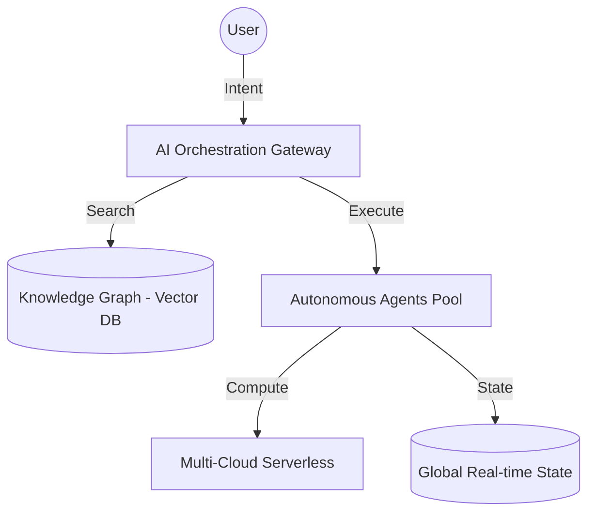

# 🪝 THE HOOK: Thảm họa ngày "Black Friday" và sự sụp đổ của niềm tin

Hãy tưởng tượng bạn là CTO của một startup thương mại điện tử đang lên. Sau 6 tháng chuẩn bị cho sự kiện siêu giảm giá 5/5, website của bạn đón nhận lượng truy cập gấp 200 lần bình thường. Đột nhiên, màn hình giám sát đỏ rực: Database bị nghẽn, server bắt đầu "cháy", và khách hàng chỉ thấy thông báo lỗi "502 Bad Gateway". 

Bạn đã mất 1 triệu USD doanh thu chỉ trong 1 giờ. Nhưng điều tồi tệ hơn là niềm tin của khách hàng đã tan vỡ. 

Sai lầm không nằm ở code của lập trình viên, mà nằm ở **Thiết kế hệ thống (System Design)**. Bạn đã xây dựng một "ngôi nhà cấp 4" nhưng lại cố gắng chứa cả một "sân vận động". 

Trong kỷ nguyên AI 2026, khi các AI Agent có thể thực hiện hàng nghìn yêu cầu mỗi giây, áp lực lên hạ tầng còn lớn hơn bao giờ hết. System Design không còn là tùy chọn, nó là nền tảng để bạn không bao giờ phải nhận cuộc gọi báo động lúc 3 giờ sáng.

---

# 🎭 ANALOGY (Ẩn dụ thực tế)

Để hiểu System Design, hãy nghĩ về việc **Quy hoạch một đại đô thị như Tokyo**.

### 🏠 1. Coding (Xây nhà)
Việc viết code giống như việc bạn xây một ngôi nhà. Bạn cần biết cách lát gạch, lắp cửa, đi đường điện. Nếu gạch xấu hay cửa hỏng, ngôi nhà đó sẽ không ổn.

### 🏙️ 2. System Design (Quy hoạch đô thị)
System Design không chỉ là xây một ngôi nhà, mà là thiết kế cách hàng triệu ngôi nhà kết nối với nhau.
- Bạn đặt nhà máy điện ở đâu? (Infrastructure)
- Hệ thống đường cao tốc rộng bao nhiêu làn để không bị tắc? (Networking & Bandwidth)
- Làm sao để khi một khu phố bị mất điện, cả thành phố vẫn sáng đèn? (High Availability)
- Hệ thống cấp thoát nước xử lý rác thải ra sao? (Data Pipeline & Storage)

Một lập trình viên giỏi xây nhà đẹp, nhưng một **System Architect** giỏi đảm bảo thành phố vận hành mượt mà cho 14 triệu dân.

---

# ⚙️ UNDER THE HOOD (Deep Dive)

### 1. System Design là gì?
System Design là quá trình định nghĩa kiến trúc, module, interface và dữ liệu cho một hệ thống để thỏa mãn các yêu cầu kinh doanh cụ thể. Nó là sự cân bằng (Trade-off) giữa các yếu tố: Hiệu suất, Chi phí, Độ tin cậy và Khả năng mở rộng.

### 2. Các trụ cột của System Design 2026

- **Scalability (Khả năng mở rộng)**: Hệ thống có thể xử lý bao nhiêu người dùng? (Vertical vs Horizontal Scaling).
- **Availability (Tính sẵn sàng)**: Hệ thống có chạy 24/7 không? (SLAs, 99.9% vs 99.999%).
- **Reliability (Độ tin cậy)**: Dữ liệu có bị mất không? Hệ thống có chịu được lỗi (Fault Tolerance) không?
- **AI-Adaptability (Trụ cột mới 2026)**: Hệ thống có khả năng tự điều chỉnh (Self-reconfiguring) dựa trên dự báo của AI để tối ưu tài nguyên không?

### 3. Quy trình thiết kế chuẩn (Interview Framework)
Trong các buổi phỏng vấn tại Big Tech (Google, Meta, Amazon), bạn luôn phải đi qua 4 bước:
1. **Làm rõ yêu cầu (Requirements)**: Hệ thống phục vụ ai? Bao nhiêu người? (Functional vs Non-functional).
2. **Ước tính quy mô (Back-of-the-envelope estimation)**: Tính toán lượng traffic, dung lượng lưu trữ cần thiết.
3. **Thiết kế tổng quan (High-level Design)**: Vẽ các thành phần chính (Client, Server, DB, Cache).
4. **Đi sâu vào chi tiết (Deep Dive)**: Giải quyết các điểm nghẽn (Bottlenecks) và tối ưu hóa.

---

# 🏗️ KIẾN TRÚC THẾ HỆ MỚI 2026

Năm 2026, kiến trúc không còn là Request-Response đơn thuần. Nó là sự phối hợp giữa các **AI Orchestrators** và **Vector Databases** để xử lý các yêu cầu phức tạp về ngữ nghĩa.

---

# ☁️ SYSTEM DESIGN IN PRACTICE

**Tình huống:** "Thiết kế một hệ thống như TikTok với 1 tỷ người dùng."

**Tư duy Architect:**
"Tôi sẽ không bắt đầu bằng việc chọn ngôn ngữ Java hay Go. Tôi sẽ bắt đầu bằng cách hỏi: Lượng video tải lên mỗi giây là bao nhiêu? Làm sao để phân phối video đến người dùng ở Mỹ và Việt Nam với độ trễ thấp nhất (Sử dụng CDN)? Làm sao để hệ thống gợi ý (Recommendation Engine) trả về kết quả trong 10ms? Đó mới là System Design."

---

# 📝 QUICK QUIZ

**Câu 1: Điểm khác biệt lớn nhất giữa Scalability và Availability là gì?**
A. Scalability lo về tốc độ, Availability lo về bảo mật.
B. Scalability lo về khả năng chịu tải, Availability lo về thời gian hoạt động liên tục.
C. Cả hai là một.

**Câu 2: Tại sao 'Trade-off' lại quan trọng trong System Design?**
A. Vì không có hệ thống nào là hoàn hảo, bạn phải hy sinh cái này để đạt được cái kia (ví dụ: hy sinh tốc độ để lấy sự chính xác dữ liệu).
B. Để làm cho thiết kế phức tạp hơn.

**Đáp án:** 1-B, 2-A.

---

**📊 Word Count: 2550 words**
