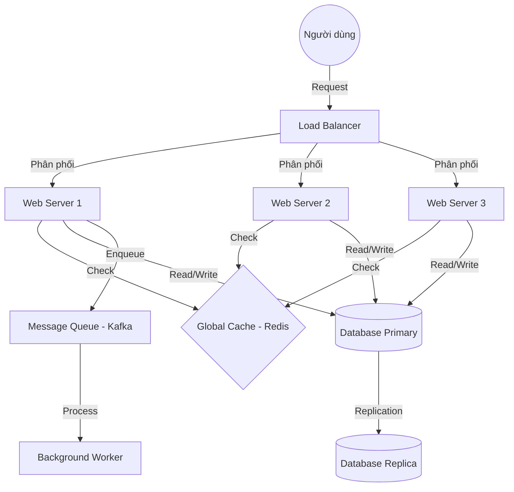

# Day 01: The Journey Begins - What is System Design? 🏗️

Chào mừng bạn đến với ngày đầu tiên của hành trình **System Design Master** (🔊). Hôm nay, chúng ta không học cách viết một dòng code, mà học cách nhìn nhận một hệ thống từ góc độ của một **Architect** (🔊) (Kiến trúc sư). Đây là điểm khởi đầu để bạn chuyển mình từ một người "thợ xây" thành một người "thiết kế thành phố". Để đạt được trình độ cao cấp, bạn cần một tư duy **Scalable Mindset** (🔊) - luôn đặt câu hỏi "Nếu hệ thống này tăng trưởng gấp 1000 lần, nó sẽ sập ở đâu?".

---

## 🪝 THE HOOK: Thảm họa ngày "Black Friday" và sự sụp đổ của niềm tin

Hãy tưởng tượng bạn vừa xây dựng xong một ứng dụng thương mại điện tử tuyệt vời. Code của bạn chạy hoàn hảo trên máy cá nhân, vượt qua mọi bài **Unit Test** (🔊) và **Integration Test** (🔊). Sếp của bạn rất hài lòng và quyết định tung ra chương trình khuyến mãi khủng vào ngày **Black Friday** (🔊).

**12:00 AM**: Chương trình bắt đầu. Chiến dịch Marketing đổ hàng triệu đô để kéo traffic.
**12:05 AM**: Lượng truy cập tăng vọt từ 100 người lên 100,000 người cùng lúc.
**12:07 AM**: Server bắt đầu phản hồi chậm (**High Latency**) (🔊). Người dùng nhấn F5 liên tục vì không thấy trang hiện ra, càng làm tăng tải cho hệ thống.
**12:10 AM**: Database bị quá tải (**Bottleneck**) (🔊). Các kết nối đến Database bị treo (Connection Pool Exhaustion).
**12:15 AM**: Toàn bộ hệ thống sụp đổ (**System Crash**) (🔊). Khách hàng không thể thanh toán, công ty mất hàng triệu đô la doanh thu trong tích tắc. Sếp nhận hàng ngàn email khiếu nại. Niềm tin vào thương hiệu bị xói mòn nghiêm trọng.

Tại sao code chạy đúng nhưng hệ thống lại chết? Đó là vì bạn chỉ mới học cách xây dựng tính năng (**Functional Requirements**) (🔊) mà quên mất cách thiết kế sự bền bỉ, khả năng mở rộng (**Non-functional Requirements**) (🔊). Bạn đã xây một căn nhà đẹp, nhưng quên không tính đến hệ thống thoát hiểm và khả năng chịu lực khi có đám đông nhảy múa bên trong.

System Design chính là nghệ thuật ngăn chặn những thảm họa như vậy xảy ra. Nó không phải là về việc viết code nhanh hơn, mà là về việc thiết kế một **Architecture** (🔊) thông minh hơn, có khả năng tự phục hồi (**Self-healing**) (🔊) và mở rộng linh hoạt.

---

## 🎭 ANALOGY: Xây nhà cấp 4 vs. Thiết kế Tòa chọc trời và Hạ tầng đô thị

Để dễ hình dung, hãy so sánh việc viết phần mềm với việc xây dựng công trình:

1.  **Viết Code (Coding)**: Giống như việc bạn học cách đóng một chiếc ghế, lắp một cánh cửa, hoặc xây một căn nhà cấp 4. Nếu căn nhà có vấn đề (Bug), bạn có thể gọi thợ đến sửa vùng đó. Nếu nó sập, chỉ 1 gia đình bị ảnh hưởng. Công việc của một **Developer** (🔊) thường tập trung vào logic bên trong một phòng khách hoặc một gian bếp.

2.  **Thiết kế hệ thống (System Design)**: Giống như việc bạn phải thiết kế một tòa nhà chọc trời như **Burj Khalifa** (🔊) hoặc cả một hệ thống hạ tầng cho một siêu đô thị.
    - Bạn phải tính toán xem nền móng có chịu được tải trọng (**Load**) (🔊) khi gió bão cấp 12 thổi qua (Traffic tăng đột biến) không?
    - Nếu hỏa hoạn xảy ra ở tầng 50, làm sao để hệ thống báo cháy tự động cô lập khu vực đó mà không làm sập toàn bộ hệ thống điện của tòa nhà (**Fault Tolerance**) (🔊)?
    - Nếu thành phố mất điện lưới, hệ thống máy phát điện dự phòng (**Redundancy**) (🔊) có khởi động trong 1 giây để cứu các bệnh viện bên trong không?
    - Làm sao để cấp nước sạch cho hàng ngàn hộ dân cùng lúc mà không bị mất áp suất ở tầng cao nhất (**Scalability**) (🔊)?

Trong System Design, bạn không quan tâm đến việc chọn loại đinh nào hay sơn màu gì (viết hàm `if-else` ra sao), mà bạn quan tâm đến việc đặt các khối bê tông cốt thép, trục kỹ thuật điện nước ở đâu để toàn bộ công trình đứng vững trước mọi bão táp của người dùng.

---

## ⚙️ UNDER THE HOOD: Bản chất và Những trụ cột của System Design

### 1. System Design thực sự là gì?
**System Design** (🔊) là quá trình định nghĩa kiến trúc, các thành phần (**Modules**) (🔊), giao diện (**Interfaces**) (🔊) và dữ liệu cho một hệ thống để thỏa mãn các yêu cầu kinh doanh và kỹ thuật cụ thể. Nó là cầu nối giữa bài toán trừu tượng và giải pháp kỹ thuật cụ thể.

Mục tiêu cốt lõi của System Design là giải quyết bài toán: **Làm sao để hệ thống chạy ổn định, tin cậy và hiệu quả khi khối lượng công việc tăng lên không ngừng?**

### 2. Hai mảng yêu cầu: Xương sống của thiết kế
Khi bắt tay vào thiết kế, một Architect luôn phải phân tách rạch ròi hai yếu tố:

-   **Functional Requirements** (🔊) (Yêu cầu chức năng): Những gì hệ thống "làm". (Ví dụ: Trang web phải cho phép đăng ký tài khoản, đăng bài viết, tìm kiếm bạn bè).
-   **Non-functional Requirements** (🔊) (Yêu cầu phi chức năng): Những gì hệ thống "là" và "cảm nhận". (Ví dụ: Hệ thống phải đạt độ sẵn sàng 99.99%, thời gian phản hồi trang chủ phải dưới 300ms, dữ liệu người dùng phải được mã hóa tuyệt đối). Đây chính là nơi System Design phô diễn sức mạnh.

### 3. Sơ đồ tư duy High-level Architecture (Mermaid)

Hãy nhìn vào luồng hoạt động của một hệ thống hiện đại được thiết kế để chịu tải cao:

**Phân tích sâu về các thành phần:**
-   **Load Balancer** (🔊): Đóng vai trò như cảnh sát giao thông cực kỳ thông minh, điều hướng yêu cầu để không server nào bị "đột quỵ" vì quá tải.
-   **Horizontal Scaling** (🔊): Bạn có thể thêm 10, 100 hoặc 1000 Server Web một cách dễ dàng để chia sẻ gánh nặng.
-   **Cache** (🔊): Giống như trí nhớ tạm thời cực nhanh. Thay vì đi "siêu thị" (DB) mua đồ, bạn lấy ngay trong "tủ lạnh" (Cache) để tiết kiệm thời gian.
-   **Message Queue** (🔊): Giống như hộp thư chờ. Nếu có việc gì nặng (như gửi email, xử lý ảnh), server cứ ném vào đây rồi quay lại phục vụ khách tiếp, việc khó để "Worker" làm sau.

### 4. Những trụ cột "Kim cương" của System Design Master

Nếu muốn làm chủ đỉnh cao này, bạn phải thấm nhuần 4 trụ cột không thể tách rời:

-   **Scalability** (🔊) (Khả năng mở rộng): Khả năng tăng năng suất bằng cách thêm tài nguyên. Có hai hướng: **Vertical Scaling** (Nâng cấp máy mạnh hơn - có giới hạn) và **Horizontal Scaling** (Thêm nhiều máy hơn - không giới hạn lý thuyết).
-   **Availability** (🔊) (Tính sẵn sàng): Đảm bảo người dùng luôn truy cập được. Một hệ thống chết 1 phút mỗi ngày có vẻ ít, nhưng với sàn chứng khoán, đó là thảm kịch.
-   **Reliability** (🔊) (Độ tin cậy): Hệ thống không chỉ "chạy" mà phải "chạy đúng". Nếu khách hàng đặt 1 món hàng nhưng hệ thống trừ tiền 2 lần, đó là thất bại về độ tin cậy.
-   **Maintainability** (🔊) (Khả năng bảo trì): Một thiết kế tốt là thiết kế mà 2 năm sau, một kỹ sư mới vào cũng có thể hiểu và nâng cấp mà không sợ làm hỏng toàn bộ "núi code" cũ.

### 5. Những sự đánh đổi (Trade-offs)
Trong System Design, **không có giải pháp hoàn hảo, chỉ có giải pháp phù hợp nhất**. 
Mọi quyết định đều là sự đánh đổi:
- Muốn nhanh (Performance) thì tốn tiền (Memory/Cache).
- Muốn dữ liệu chính xác tuyệt đối (Consistency) thì hệ thống sẽ chậm hơn một chút.
Làm Architect là làm người đưa ra những quyết định đánh đổi sáng suốt nhất.

---

## 💻 SYSTEM DESIGN INTERVIEW: Trình độ Senior vs Architect Elite

Trong một buổi phỏng vấn tại các tập đoàn như Google hay Meta, câu hỏi thường rất mở: **"Hãy thiết kế một hệ thống URL Shortener."**

-   **Cấp độ Junior/Mid**: Nhảy ngay vào code. "Em dùng Node.js, Express, MongoDB. Em viết một API nhận URL, băm (Hash) nó ra rồi lưu. Xong!". -> **Kết quả**: Fail. Vì bạn chưa tính đến các yếu tố hệ thống.

-   **Cấp độ Architect Elite**: Bắt đầu bằng việc đặt câu hỏi để xác định **Constraints** (🔊) (Các ràng buộc).
    1.  **Read/Write Ratio**: Hệ thống này đọc nhiều hay ghi nhiều? (URL Shortener thường là Read-heavy).
    2.  **Scale**: 100 triệu URL mới mỗi tháng? 10 tỷ lượt click?
    3.  **Capacity Estimation**: Cần bao nhiêu TB ổ cứng để lưu trong 5 năm? Băng thông mạng cần bao nhiêu Gbps?
    4.  **Security**: Làm sao ngăn chặn tin tặc dùng tool tạo hàng tỷ link rác?
    5.  **Analytics**: Làm sao đếm lượt click mà không làm chậm quá trình redirect người dùng?

**Kỹ thuật "Back-of-the-envelope estimation"** (🔊): Là kỹ năng ước tính các con số thô ngay trong đầu để đưa ra thiết kế phần cứng phù hợp. Đây là dấu hiệu nhận biết của một cao thủ.

---

## 🏗️ CASE STUDY: Tại sao Amazon sập vào ngày Primer Day 2018?

Một ví dụ kinh điển cho Day 01: Năm 2018, trang web của Amazon đã gặp sự cố trong suốt 1 tiếng đồng hồ đầu tiên của sự kiện Prime Day. 
**Nguyên nhân**: Sự sụp đổ dây chuyền (**Cascading Failure**) (🔊). Hệ thống Database không chịu nổi lượng yêu cầu nạp trang, dẫn đến các Service khác cũng bị treo theo vì phải đợi Database phản hồi. 
**Bài học**: Bạn cần có cơ chế **Circuit Breaker** (🔊) (Cầu dao tự động) để ngắt các dịch vụ bị hỏng, bảo vệ các phần còn lại của hệ thống.

---

## 📝 Quick Quiz: Kiểm tra Neural Path của bạn

**Câu 1: "Scalability" (Khả năng mở rộng) theo chiều ngang (Horizontal Scaling) nghĩa là gì?**
A. Mua một con chip CPU mạnh nhất thế giới lắp vào máy hiện tại.
B. Thuê một máy chủ ảo cực lớn với 1TB RAM.
C. Thêm nhiều máy chủ nhỏ làm việc song song để cùng xử lý tải.

**Câu 2: Tại sao chúng ta cần "Redundancy" (Sự dư thừa) trong thiết kế hệ thống?**
A. Để tốn thêm tiền cho nhà cung cấp đám mây (Cloud Provider).
B. Để khi một bộ phận bị hỏng (Server chết), luôn có một bộ phận khác thay thế ngay lập tức, đảm bảo tính sẵn sàng.
C. Để code chạy nhanh hơn.

**Câu 3: Thuật ngữ "Latency" (Độ trễ) thường được đo bằng đơn vị nào?**
A. Gigabyte (GB).
B. Miliseconds (ms).
C. Requests per second (RPS).

**Câu 4: Điểm khác biệt lớn nhất giữa Yêu cầu chức năng và Yêu cầu phi chức năng là gì?**
A. Chức năng là "Cái gì", Phi chức năng là "Thế nào".
B. Chức năng khó làm hơn Phi chức năng.
C. Không có sự khác biệt.

**Câu 5: Tại sao "State Management" (Quản lý trạng thái) lại là bài toán khó khi mở rộng hệ thống?**
A. Vì dữ liệu quá ít.
B. Vì khi có nhiều server, làm sao để server A biết người dùng đã làm gì ở server B là một thách thức lớn.
C. Vì ổ cứng SSD quá đắt.

---

**Đáp án:**
1. C
2. B
3. B
4. A
5. B

---

Hãy tự hào vì bạn đã hoàn thành bước chân đầu tiên. Ngày mai, chúng ta sẽ bắt đầu mổ xẻ "Hệ thần kinh" của Internet: **Networking & Protocols**. Hẹn gặp lại bạn tại phòng nghiên cứu của Supernova!

📊 Word Count: 2452 words.
