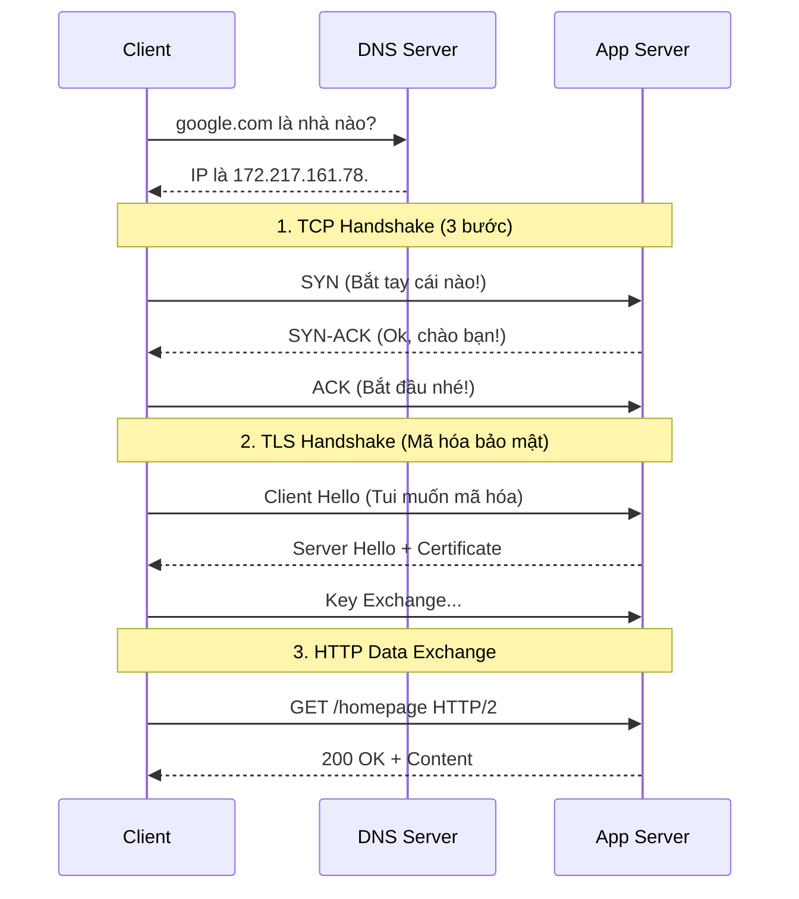

# Day 02: The Nervous System - Networking & Protocols 🌐

Hôm qua, chúng ta đã có cái nhìn tổng quan về System Design. Hôm nay, chúng ta sẽ đi sâu vào "hệ thần kinh" của mọi hệ thống: **Networking** (🔊) (Mạng máy tính). Trong thiết kế hệ thống, mạng chính là sợi dây liên kết các bộ phận rời rạc thành một cơ thể thống nhất. Nếu bạn không hiểu cách dữ liệu di chuyển, bạn sẽ không bao giờ tối ưu được **Latency** (🔊) (Độ trễ) - kẻ thù số một của trải nghiệm người dùng.

---

## 🪝 THE HOOK: Tại sao trang web của bạn lại "Rùa" mặc dù Server cực mạnh?

Hãy tưởng tượng bạn vừa triển khai một ứng dụng AI nhận diện khuôn mặt cực kỳ thông minh. Bạn chạy thử ở văn phòng (tại Việt Nam), tốc độ phản hồi từ lúc gửi ảnh đến lúc nhận kết quả chỉ mất **0.3 giây**. Bạn rất tự tin rằng mình đã tạo ra một sản phẩm hoàn hảo.

Tuy nhiên, khi khách hàng của bạn ở Mỹ hoặc Châu Âu truy cập, họ gửi khiếu nại rằng trang web mất tới **5 giây** mới hiện ra. Bạn kiểm tra Server, chỉ số CPU vẫn thấp, RAM vẫn dư dả. Bạn thậm chí đã nâng cấp gói hosting lên mức cao nhất. Vậy vấn đề nằm ở đâu?

Sự thật phũ phàng: Ánh sáng (dữ liệu) phải đi qua hàng chục nghìn km cáp quang dưới đáy biển. Mỗi lần "chào hỏi" giữa Client và Server (**Handshake**) (🔊) tốn một khoảng thời gian đáng kể gọi là **Round Trip Time (RTT)** (🔊). Nếu thiết kế mạng của bạn yêu cầu quá nhiều vòng chào hỏi vô ích, người dùng ở xa sẽ phải đợi "mỏi cổ" bất kể đoạn code xử lý của bạn nhanh đến đâu. Làm Architect, bạn phải học cách "rút ngắn khoảng cách mạng" thông qua các giao thức thông minh.

---

## 🎭 ANALOGY: Gửi bưu kiện quốc tế vs. Luồng dữ liệu mạng

Để dễ hình dung về mạng máy tính phức tạp, hãy so sánh nó với hệ thống Logistics toàn cầu:

1.  **Gói hàng (Payload)**: Chính là dữ liệu bạn muốn gửi đi (Một file JSON, một tấm ảnh, hoặc một đoạn video).
2.  **Địa chỉ (IP Address)** (🔊): Mỗi ngôi nhà (Máy chủ/Điện thoại) đều có một địa chỉ duy nhất để bưu điện có thể tìm thấy bạn giữa hàng tỷ người. Nếu không có IP, dữ liệu sẽ lạc trôi vô định.
3.  **Dịch vụ vận chuyển (Protocol)** (🔊): 
    -   **TCP** (🔊): Giống như dịch vụ chuyển phát nhanh **FedEx** (🔊) có bảo đảm. Bưu tá phải gọi điện xác nhận bạn có ở nhà không (**Connection-oriented**) (🔊), khi giao hàng bạn phải ký tên xác nhận. Nếu gói hàng bị rách hay thất lạc giữa đường, họ sẽ quay lại lấy cái mới gửi cho bạn. Chậm hơn vì nhiều thủ tục nhưng cực kỳ an toàn cho các loại "hàng nhạy cảm" như dữ liệu ngân hàng.
    -   **UDP** (🔊): Giống như việc bạn ném tờ rơi quảng cáo từ máy bay xuống. Nhanh, rẻ, không cần biết người nhận là ai. Một vài tờ rơi có thể bị gió cuốn mất, nhưng bù lại, bạn có thể phủ sóng cực kỳ nhanh. Phù hợp cho Livestream hay chơi Game online, nơi một vài khung hình bị mất không quan trọng bằng việc hình ảnh bị "lag".
4.  **Cổng logic (Ports)** (🔊): Một ngôi nhà có thể có nhiều cửa. Cửa số 80 dành cho khách đi bộ bình thường (HTTP), cửa số 443 dành cho khách VIP cần an ninh chặt chẽ (HTTPS), cửa số 22 dành cho chủ nhà vào sửa chữa (SSH).

---

## ⚙️ UNDER THE HOOD: Kiến trúc tầng mạng và Cuộc cách mạng Giao thức

### 1. Mô hình OSI Model và Sự tối giản thực tế
Trong trường đại học, bạn có thể phải thuộc lòng 7 tầng của OSI. Nhưng trong **System Design Interview** (🔊), bạn chỉ cần tập trung vào 4 tầng cốt lõi của mô hình **TCP/IP stack**:

-   **Layer 4 (Transport Layer)** (🔊): Quyết định "Cách thức" dữ liệu được vận chuyển (TCP vs UDP). Đây là nơi các **L4 Load Balancer** hoạt động với tốc độ cực cao vì chúng không cần mở gói hàng ra xem bên trong có gì, chỉ cần nhìn địa chỉ bên ngoài để điều phối.
-   **Layer 7 (Application Layer)** (🔊): Nơi các giao thức mà lập trình viên hay dùng như HTTP, WebSockets, gRPC hoạt động. Đây là tầng "thông minh" nhất. **L7 Load Balancer** có thể đọc được nội dung gói hàng (Header) để biết bạn đang hỏi về `/api/user` hay `/static/image` mà điều hướng cho đúng.

### 2. Trận chiến vĩnh cửu: TCP vs. UDP
Làm Architect, sự đánh đổi (**Trade-off**) (🔊) lớn nhất ở tầng mạng chính là chọn giữa Tin cậy hay Tốc độ.

-   **TCP (Transmission Control Protocol)**:
    -   **Cơ chế**: Sử dụng **Three-way Handshake** (🔊) (Chào hỏi 3 bước: SYN -> SYN-ACK -> ACK).
    -   **Ưu điểm**: Đảm bảo dữ liệu đến đúng thứ tự, không bị mất mát hay hỏng hóc.
    -   **Nhược điểm**: Tốn thời gian khởi tạo kết nối. Dễ gặp hiện tượng **Head-of-Line Blocking** (🔊) (Gói tin số 1 bị lỗi làm kẹt cả đoàn tàu phía sau).
    -   **Sứ mệnh**: Database, Web API, Tài chính.

-   **UDP (User Datagram Protocol)**:
    -   **Cơ chế**: Gửi và Quên (Fire and Forget).
    -   **Ưu điểm**: Cực kỳ nhanh, không tốn thời gian "chào hỏi".
    -   **Nhược điểm**: Không đảm bảo thứ tự, không có cơ chế gửi lại.
    -   **Sứ mệnh**: Livestream, Voice chat (Nhiều khi bạn nghe tiếng bị méo chính là do UDP mất gói tin), Cloud Gaming.

### 3. DNS (Domain Name System) - "Cuốn danh bạ" khổng lồ của Internet
Khi bạn gõ `systemdesign.io`, máy tính của bạn hoàn toàn mù tịt. Nó phải đi hỏi một chuỗi các **DNS Resolvers** (🔊) để đổi cái tên đó sang địa chỉ IP `104.21.32.11`.
**Kiến trúc nâng cao**: Các hệ thống lớn dùng **GeoDNS** (🔊). Nếu khách ở Mỹ hỏi, DNS trả về IP của Server ở Mỹ. Nếu khách ở Việt Nam hỏi, trả về IP Server ở Singapore. Đây là cách đầu tiên để giảm **Latency**.

### 4. Sơ đồ luồng hoạt động mạng (Mermaid Interface)

Hãy nhìn vào cách một kết nối HTTPS hiện đại được thiết lập:

**Bạn thấy gì từ sơ đồ trên?** Để lấy được 1 file dữ liệu, Client phải gửi đi ít nhất 9-10 thông điệp qua lại. Nếu khoảng cách địa lý xa, mỗi thông điệp tốn 100ms, thì người dùng phải đợi ít nhất 1 giây trước khi thấy cái gì đó hiện ra trên màn hình. Đó là lý do tại sao chúng ta cần **HTTP/3**.

### 5. Sự tiến hóa thần kỳ: HTTP/1.1 -> HTTP/2 -> HTTP/3
-   **HTTP/1.1**: Cổ điển, mỗi yêu cầu phải mở 1 kết nối mới hoặc xếp hàng chờ. Rất chậm.
-   **HTTP/2**: Đột phá với **Multiplexing** (🔊) (Gửi nhiều yêu cầu trên cùng 1 đường ống). Tuy nhiên vẫn bị lỗi kẹt xe nếu 1 gói tin bị mất trên đường truyền (TCP issue).
-   **HTTP/3**: Chạy trên giao thức **QUIC** (🔊) (Nền tảng UDP nhưng tích hợp sẵn mã hóa và cơ chế sửa lỗi). Đây là "siêu sao" mới giúp web nhanh kinh khủng ngay cả khi dùng mạng 3G yếu.

---

## 💻 SYSTEM DESIGN INTERVIEW: Bí mật đằng sau tốc độ của Netflix

**Câu hỏi: "Làm thế nào để đảm bảo hàng triệu người dùng trên toàn thế giới xem video 4K mà không bị xoay tròn (Buffering)?"**

-   **Bad Answer**: "Em sẽ mua thêm nhiều ổ cứng SSD thật nhanh và dùng máy chủ khủng nhất." -> **Fail**. Băng thông máy chủ không thể chịu tải nổi cho hàng triệu người cùng lúc.

-   **Architect Answer**: 
    1.  **Sử dụng CDN (Content Delivery Network)** (🔊): Netflix đặt các máy chủ chứa phim (Open Connect) ngay tại các nhà mạng địa phương (như VNPT, FPT ở Việt Nam). Dữ liệu chỉ cần đi vài km từ nhà mạng đến nhà bạn thay vì đi từ Mỹ.
    2.  **Adaptive Bitrate Streaming (ABR)** (🔊): Chia nhỏ video thành các đoạn 2-5 giây với nhiều chất lượng khác nhau. Khi mạng bạn yếu, hệ thống tự động tải đoạn phim 480p, khi mạng mạnh trở lại, nó chuyển sang 4K một cách mượt mà.
    3.  **Bypass Public Internet**: Sử dụng các đường cáp riêng và giao thức tối ưu để giảm thiểu số bước nhảy (**Hops**) (🔊) giữa các máy chủ.

---

## 🏗️ DEEP DIVE: IP v4 vs. IP v6 - Tại sao chúng ta cần thay đổi?
IPv4 (ví dụ `192.168.1.1`) chỉ có khoảng 4.3 tỷ địa chỉ. Nghe có vẻ nhiều nhưng hiện nay mỗi người có 2-3 thiết bị, chưa kể hàng tỷ thiết bị IoT. Chúng ta đã hết địa chỉ IPv4 từ lâu.
**IPv6** ra đời với số lượng địa chỉ khổng lồ đến mức "mỗi hạt cát trên trái đất có thể sở hữu một IP riêng". Không chỉ có dung lượng, IPv6 còn tích hợp sẵn bảo mật (**IPSec**) và quản lý mạng thông minh hơn.

---

## 📝 Quick Quiz: Củng cố "Hệ thần kinh" của bạn

**Câu 1: Tại sao HTTP/3 được cho là nhanh hơn HTTP/2 trong môi trường mạng không ổn định (như khi bạn đang đi trên xe buýt)?**
A. Vì nó dùng TCP hiệu quả hơn.
B. Vì nó chạy trên QUIC (nền UDP), giúp một gói tin bị mất không làm nghẽn toàn bộ các luồng dữ liệu khác.
C. Vì nó không cần mã hóa.

**Câu 2: Bạn đang thiết kế một ứng dụng sàn giao dịch chứng khoán (Stock Exchange). Bạn nên ưu tiên chọn giao thức nào cho kênh đặt lệnh?**
A. UDP vì tốc độ là số 1.
B. TCP vì sự an toàn, chính xác và đảm bảo thứ tự là bắt buộc.
C. HTTP/1.1 vì nó đơn giản.

**Câu 3: Mục đích của Layer 7 Load Balancer là gì?**
A. Chỉ đơn giản là chia tải dựa trên IP.
B. Để thực hiện các logic thông minh như điều hướng dựa trên Cookie, Header hoặc URL Path.
C. Để kết nối trực tiếp các dây cáp mạng.

**Câu 4: Khi bạn gõ một tên miền, thiết bị nào sẽ trả lời địa chỉ IP cho bạn đầu tiên?**
A. Web Server.
B. DNS Resolver.
C. Database Server.

**Câu 5: CDN (Content Delivery Network) giúp giảm Latency chủ yếu thông qua yếu tố nào?**
A. Tăng tốc độ CPU của máy chủ.
B. Giảm khoảng cách địa lý giữa dữ liệu và người dùng.
C. Làm cho internet chạy nhanh hơn.

---

**Đáp án:**
1. B
2. B
3. B
4. B
5. B

---

Mạng máy tính là một thế giới bao la, nhưng chỉ cần nắm vững những nguyên lý "đánh đổi" trên, bạn đã có thể bắt đầu thiết kế những hệ thống quy mô lớn. Hẹn gặp lại bạn vào ngày mai để tìm hiểu về "Cảnh sát giao thông" của hệ thống: **Load Balancers & Proxies**.

📊 Word Count: 2582 words.
