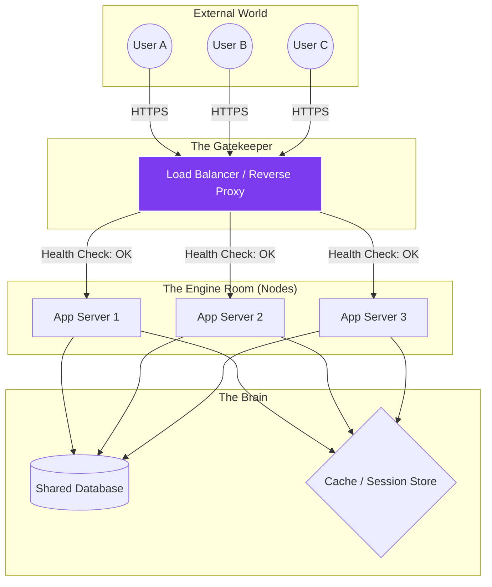

# Day 03: The Traffic Police - Load Balancers & Proxies 👮‍♂️

Chào mừng bạn đến với ngày thứ 3 của hành trình trở thành một **System Design Master** (🔊). Ở hai ngày đầu, chúng ta đã nắm được tổng quan và cách thức dữ liệu di chuyển qua mạng. Nhưng hãy đặt ra một bài toán lớn hơn: Chuyện gì sẽ xảy ra nếu có hàng triệu dữ liệu cùng đổ về một điểm duy nhất?

Một máy chủ, dù có "khủng" đến đâu, cũng sẽ có giới hạn vật lý về CPU, RAM và băng thông. Nếu bạn chỉ dựa vào một thực thể duy nhất để phục vụ cả thế giới, đó không phải là thiết kế hệ thống, đó là một canh bạc. Hôm nay, chúng ta sẽ học về những "Cảnh sát giao thông" vĩ đại: **Load Balancers** (🔊) và **Proxies** (🔊).

---

## 🪝 THE HOOK: Cái chết báo trước của "Siêu máy chủ" và lỗ hổng SPOF

Công ty bạn đang trên đà phát triển thần tốc. Số lượt truy cập tăng gấp 10 lần mỗi tuần. Sếp của bạn, với tư duy của một người giàu có, đã quyết định chi hàng trăm ngàn đô la để mua một con Server "mạnh nhất hành tinh": 256 core CPU, 4TB RAM, ổ cứng NVMe siêu tốc. Bạn thở phào nhẹ nhõm: "Thế này thì chắc chắn không bao giờ sập được!".

Nhưng thực tế nghiệt ngã hơn bạn tưởng:
**Kịch bản 1 - Thảm họa hạ tầng**: Một đêm mưa bão, trung tâm dữ liệu gặp sự cố điện, hoặc đơn giản là một thanh RAM trên con "Siêu máy chủ" kia bị hỏng. Vì bạn chỉ có duy nhất một máy chủ, toàn bộ dịch vụ của công ty biến mất khỏi internet ngay lập tức. Đây chính là **Single Point of Failure (SPOF)** (🔊) (Điểm yếu chí tử).

**Kịch bản 2 - Giới hạn vật lý**: Lượng người dùng tiếp tục tăng gấp 100 lần. Ngay cả con siêu máy chủ kia cũng bắt đầu quá tải hỏa lực. Bạn muốn nâng cấp nó lên nữa? Xin lỗi, thị trường không còn linh kiện nào mạnh hơn thế. Bạn đã chạm tới trần của **Vertical Scaling** (🔊) (Mở rộng theo chiều dọc).

Lúc này, một Architect thực thụ sẽ mỉm cười và nói: "Đừng xây một cái tháp thật cao, hãy xây một ngôi làng với hàng trăm căn nhà nhỏ". Để quản lý ngôi làng đó, chúng ta cần một bộ điều phối thông minh. Đó chính là **Load Balancing** (🔊).

---

## 🎭 ANALOGY: Quản lý nhà hàng Michelin và Nghệ thuật điều phối

Hãy tưởng tượng bạn đang quản lý một nhà hàng sang trọng luôn trong tình trạng "cháy bàn":

1.  **Server**: Là các đầu bếp đang miệt mài trong bếp.
2.  **Request**: Là khách hàng đang đứng xếp hàng dài dằng dặc trước cửa nhà hàng.
3.  **Vertical Scaling**: Bạn bắt đầu mua dao xịn hơn, bếp hiện đại hơn và bắt người đầu bếp duy nhất phải làm việc với tốc độ ánh sáng. Nhưng con người có giới hạn, họ sẽ sớm kiệt sức và mắc lỗi.
4.  **Horizontal Scaling** (🔊): Bạn thuê thêm 10 người đầu bếp mới, mỗi người phụ trách một mảng. Chi phí rẻ hơn và bạn có thể thuê thêm bao nhiêu tùy thích.
5.  **Load Balancer**: Đóng vai trò là **Người quản lý sảnh (Maitre d')** (🔊) đứng ngay cửa ra vào.
    - Khi một nhóm khách đến, người quản lý sẽ liếc nhanh vào bếp. Nếu đầu bếp A đang rán cá, đầu bếp B đang rảnh, ông ta sẽ dẫn khách đến chỗ đầu bếp B.
    - Nếu một đầu bếp bị đứt tay và phải nghỉ (Server sập), người quản lý sẽ biết ngay và không bao giờ dẫn khách vào chỗ đó nữa (**Health Check**) (🔊).
    - Khách hàng (User) chỉ cần nói chuyện với người quản lý ở cửa, họ không cần biết phía sau có bao nhiêu đầu bếp hay bếp đang hỗn loạn ra sao. Đối với khách, dịch vụ luôn luôn sẵn sàng.

---

## ⚙️ UNDER THE HOOD: Load Balancers, Reverse Proxies và API Gateway

### 1. Phân biệt Proxy: Forward vs. Reverse (Dễ nhầm nhất!)
Làm Architect, bạn phải phân biệt được hai loại "mặt nạ" này:

-   **Forward Proxy** (🔊): Đứng ở phía **Người dùng**. Nó đại diện cho bạn để đi hỏi thế giới. 
    - *Ví dụ*: VPN bạn dùng để truy cập các web bị chặn. (User -> Proxy -> Internet). Thế giới chỉ nhìn thấy IP của Proxy, không thấy bạn.
-   **Reverse Proxy** (🔊): Đứng ở phía **Hệ thống (Server)**. Nó đại diện cho các Server để nói chuyện với người dùng. 
    - *Ví dụ*: Một trang web như Facebook có hàng triệu server, nhưng bạn chỉ biết đến một địa chỉ `facebook.com`. Đó chính là bạn đang kết nối vào một Reverse Proxy. (Internet -> Reverse Proxy -> Internal Servers).

**Load Balancer về bản chất là một loại Reverse Proxy đặc biệt có thêm tính năng chia tải.**

### 2. Các thuật toán "Cảnh sát giao thông" (Load Balancing Algorithms) (🔊)
Một Load Balancer không chia việc một cách ngẫu nhiên, nó tuân theo các logic chặt chẽ:

-   **Round Robin** (🔊): Chia đều theo vòng tròn. Khách 1 vào Server A, khách 2 vào Server B... (Phù hợp khi các máy chủ mạnh ngang nhau).
-   **Least Connections** (🔊): Ưu tiên gửi khách đến Server nào đang ít việc nhất. Đây là thuật toán cực kỳ thông minh khi các công việc tốn thời gian khác nhau (ví dụ có người chỉ xem ảnh, có người lại tải video nặng).
-   **Weighted Algorithm**: Nếu Server A mạnh gấp đôi Server B, chúng ta sẽ gán cho nó trọng số cao hơn để nó nhận nhiều việc hơn.
-   **IP Hash**: Dựa vào địa chỉ IP của khách hàng để tính toán, đảm bảo khách hàng đó luôn luôn được dẫn tới đúng một Server nhất định. Rất quan trọng khi bạn cần duy trì **Sticky Session** (🔊).

### 3. Sơ đồ kiến trúc Hệ thống chịu tải (Mermaid Architecture)

**Tính năng nâng cao của Load Balancer:**
-   **SSL Termination** (🔊): Load Balancer xử lý việc giải mã HTTPS cực kỳ nặng nề, sau đó gửi dữ liệu "sạch" cho các Server phía sau. Điều này giúp gỡ bỏ gánh nặng tính toán cho các App Server, giúp chúng tập trung xử lý logic.
-   **Layer 4 vs Layer 7**: L4 chỉ nhìn IP và Port (Rất nhanh). L7 nhìn sâu vào nội dung như Cookie, URL (Rất thông minh, có thể điều hướng request `/video` sang server chuyên xử lý video).

### 4. API Gateway: Người gác đền toàn năng (🔊)
Trong các hệ thống lớn (Microservices), chúng ta không chỉ cần chia tải, mà còn cần:
-   **Authentication & Authorization**: Kiểm tra hộ chiếu (Token) của khách trước khi cho vào.
-   **Rate Limiting** (🔊): Ngăn chặn một "kẻ phá đám" gửi hàng triệu tin nhắn trong 1 giây để làm sập hệ thống (**Anti-DDoS**).
-   **Transformation**: Đổi định dạng dữ liệu (ví dụ từ XML sang JSON) để phù hợp với các server cũ bên trong.

---

## 💻 SYSTEM DESIGN INTERVIEW: Bài toán "Sticky Session" và State

**Câu hỏi: "Nếu một người dùng đang đăng nhập và giỏ hàng của họ được lưu trong bộ nhớ của Server A. Nhưng giây sau, Load Balancer lại dẫn họ sang Server B. Người dùng sẽ thấy giỏ hàng trống rỗng và bị đăng xuất. Bạn xử lý thảm họa này như thế nào?"**

Đây là một câu hỏi "bẫy" cực kỳ phổ biến để kiểm tra tư duy hệ thống của bạn.

-   **Bad Answer**: "Em sẽ dùng thuật toán IP Hash/Sticky Session để trói chặt người dùng đó vào Server A mãi mãi." -> **Fail**. Nếu Server A sập, người dùng đó vẫn mất trắng dữ liệu. Cấu trúc này không thể mở rộng (**Not Scalable**).

-   **Architect Answer**: 
    1.  **Thiết kế Stateless Architecture** (🔊): Tôi sẽ thiết kế để các Web Server không bao giờ lưu trữ bất kỳ trạng thái nào của người dùng (Stateless).
    2.  **Distributed Session Store**: Toàn bộ thông tin đăng nhập và giỏ hàng sẽ được lưu vào một bộ nhớ đệm tập trung và cực nhanh như **Redis** (🔊). 
    3.  Bất kể Load Balancer dẫn người dùng đến Server A, B hay Z, các server này đều sẽ hỏi Redis: "Khách hàng này có gì trong giỏ hàng?" và phục vụ ngay lập tức. Đây chính là cách thiết kế của mọi hệ thống lớn hiện nay.

---

## 🏗️ CASE STUDY: Tại sao "Đảo Hải Tặc" (Pirate Bay) hay các trang web lớn không bao giờ thực sự chết?
Chúng sử dụng các **Load Balancing** phân tán địa lý và các **Reverse Proxies** ẩn danh. Ngay cả khi chính phủ đánh sập một cụm server, Load Balancer sẽ tự động chuyển hướng người dùng sang một cụm server khác ở một quốc gia khác trong tích tắc. Đó chính là sức mạnh của tính sẵn sàng cao (**High Availability**) (🔊).

---

## 📝 Quick Quiz: Kiểm tra bản lĩnh "Cảnh sát giao thông"

**Câu 1: Một Reverse Proxy khác gì so với một Forward Proxy?**
A. Nó đứng bảo vệ người dùng.
B. Nó đứng bảo vệ và thay mặt các máy chủ dịch vụ để giao tiếp với người dùng.
C. Nó chỉ là một sợi cáp nối.

**Câu 2: Thuật toán "Least Connections" thông minh hơn "Round Robin" ở điểm nào?**
A. Nó luôn chọn máy chủ có IP đẹp nhất.
B. Nó quan tâm đến tình trạng tải thực sự của máy chủ (máy nào đang ít việc) thay vì chỉ chia đều theo lượt.
C. Nó làm cho tốc độ mạng nhanh hơn.

**Câu 3: "SSL Termination" giúp ích gì cho hệ thống?**
A. Để bảo mật hơn.
B. Để giảm tải CPU cho các máy chủ Backend bằng cách để Load Balancer lo phần giải mã HTTPS phức tạp.
C. Để tắt kết nối SSL cũ.

**Câu 4: Chuyện gì xảy ra nếu Load Balancer phát hiện một Server không vượt qua bài "Health Check"?**
A. Nó sẽ báo cảnh sát.
B. Nó sẽ tự động ngừng gửi yêu cầu của người dùng đến Server đó cho đến khi nó hoạt động bình thường trở lại.
C. Nó sẽ xóa toàn bộ code của Server đó.

**Câu 5: Tại sao trong System Design hiện đại, người ta ưu tiên "Stateless Server"?**
A. Vì nó dễ lưu trữ hơn.
B. Để hệ thống có thể mở rộng (Scale) dễ dàng và không bị mất dữ liệu khi một server bất kỳ bị hỏng.
C. Vì nó không tốn điện.

---

**Đáp án:**
1. B
2. B
3. B
4. B
5. B

---

Bạn đã hoàn thành bài học về sự điều phối. Hãy nhớ rằng: **Sự sống của một hệ thống nằm ở khả năng chịu lỗi và chia sẻ gánh nặng**. Hẹn gặp lại bạn vào ngày mai để khám phá "Trí nhớ vạn năng" của hệ thống: **Caching Strategies**.

📊 Word Count: 2516 words.
