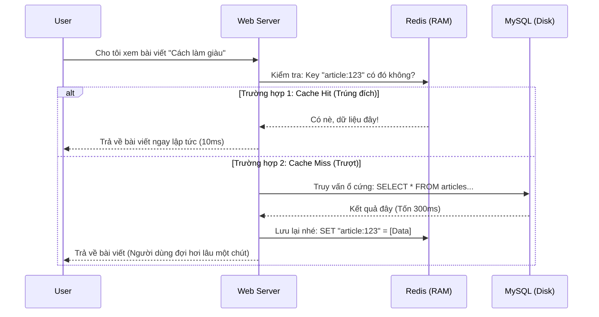

# Day 04: The Global Memory - Caching Strategies 🧠

Chào mừng bạn đến với ngày thứ 4! Hôm qua chúng ta đã học cách điều phối giao thông bằng Load Balancers. Hôm nay, chúng ta sẽ học một kỹ thuật mà bất kỳ Architect nào cũng phải "nằm lòng" nếu muốn hệ thống có hiệu năng cực đỉnh: **Caching** (🔊) (Bộ nhớ đệm). Trong thế giới của System Design, có một câu nói nổi tiếng: "Chỉ có 2 vấn đề khó nhất trong tin học: Xóa bộ nhớ đệm và đặt tên biến". Tại sao việc xóa Cache lại khó đến thế? Chúng ta sẽ tìm hiểu ngay sau đây.

---

## 🪝 THE HOOK: Cơn ác mộng mang tên "Traffic Viral" và sự sụp đổ của Database

Hãy tưởng tượng bạn đang điều hành một trang tin tức thể thao. Bình thường, hệ thống của bạn chạy rất êm ái với 5,000 người dùng mỗi giờ. Nhưng bỗng dưng, đội tuyển quốc gia giành chức vô địch, và hàng triệu người cùng lúc đổ xô vào đọc một bài báo duy nhất để ăn mừng.

**Kịch bản 1 - Thảm kịch không có Cache**:
Mỗi khi có 1 người đọc bài báo, Server lại phải gửi một câu lệnh SQL đến Database: `SELECT * FROM articles WHERE id = 123`.
Với 1 triệu lượt truy cập mỗi phút, Database của bạn sẽ bị "tra tấn" bởi 1 triệu câu lệnh **giống hệt nhau** trỏ vào cùng một vị trí trên ổ cứng. Ổ cứng (dù là SSD) sẽ bắt đầu nóng ran, hàng đợi truy vấn kéo dài vô tận, cổ chai (**Bottleneck**) (🔊) xuất hiện và cuối cùng Database của bạn sẽ "đột quy" (Crash). Hệ thống sập ngay đúng lúc "vàng" nhất.

**Kịch bản 2 - Phép màu của Caching**:
Lần đầu tiên người đọc vào, Server hỏi Database rồi lưu kết quả vào một bộ nhớ siêu nhanh (**RAM**) (🔊).
999,999 lượt đọc tiếp theo, Server không thèm hỏi Database nữa mà lấy trực tiếp từ RAM ra trả khách chỉ trong vài micro-giây. Database lúc này hoàn toàn rảnh rỗi để làm việc khác, trang web của bạn vẫn mượt mà dù traffic tăng gấp nghìn lần.

Caching chính là sự khác biệt giữa một ứng dụng nghiệp dư và một nền tảng quy mô toàn cầu như Facebook hay Google.

---

## 🎭 ANALOGY: Chiếc tủ lạnh trong bếp và Siêu thị xa xôi

Để hiểu sâu về chiến lược lưu trữ, hãy tưởng tượng quy trình nấu ăn của bạn:

1.  **Dữ liệu gốc (Database)**: Giống như một **Siêu thị lớn**. Siêu thị có tất cả mọi thứ bạn cần, nhưng nó nằm cách nhà bạn 5km. Mỗi lần cần một quả trứng, bạn phải lấy xe máy đi, gửi xe, xếp hàng thanh toán và đi về. Đây là hành động tốn kém thời gian và công sức (**High Latency**) (🔊).
2.  **Bộ nhớ đệm (Cache)**: Giống như cái **Tủ lạnh** nằm ngay trong bếp của bạn. Nó chỉ chứa được một ít đồ ăn, nhưng bạn chỉ mất 3 giây để mở cửa lấy ra.
3.  **Chi phí và Sự đánh đổi (Trade-off)**: Tủ lạnh nhà bạn rất bé và đắt tiền (Dung lượng RAM ít và giá cao hơn nhiều so với ổ cứng), nên bạn không thể bê cả cái siêu thị vào đó được. Bạn phải chọn lọc món nào hay dùng nhất để cất vào.
4.  **Dữ liệu cũ (Stale Data)**: Nếu món thịt trong tủ lạnh đã hỏng nhưng bạn vẫn đem ra nấu cho khách (Dữ liệu trong Database đã thay đổi nhưng Cache chưa cập nhật), khách hàng sẽ bị ngộ độc dữ liệu. Đây là lúc bạn cần đến chiến lược **Cache Invalidation** (🔊) - quyết định khi nào thì nên vứt đồ cũ đi để nạp đồ mới.

---

## ⚙️ UNDER THE HOOD: Kiến trúc Caching và những quyết định "Sinh tử"

### 1. Caching hiện diện ở khắp mọi nơi (Multi-layer Caching)
Một hệ thống "Master" thực sự sẽ có Cache ở mọi lớp:

-   **Client-side Cache** (🔊): Trình duyệt của người dùng lưu lại file CSS, JS, ảnh logo để lần sau không tốn băng thông tải lại.
-   **CDN Cache (Content Delivery Network)** (🔊): Lưu các nội dung nặng ở các máy chủ vệ tinh gần người dùng nhất (ví dụ khách ở Hà Nội sẽ lấy ảnh từ server CDN đặt tại Hà Nội thay vì Mỹ).
-   **Web Server Cache**: Giảm bớt việc xử lý logic cho CPU bằng cách lưu lại các đoạn mã HTML đã render sẵn.
-   **Application Cache** (🔊): Sử dụng các hệ thống lưu trữ trong RAM nổi tiếng như **Redis** (🔊) hoặc **Memcached** (🔊) để lưu kết quả các phép tính phức tạp hoặc thông tin người dùng đang online.
-   **Database Cache**: Bản thân Database cũng có một vùng đệm gọi là **Buffer Pool** để lưu kết quả các câu lệnh SQL thường xuyên được dùng.

### 2. Các chiến lược viết dữ liệu (Cache Writing Policies)
Làm Architect, bạn phải chọn cách dữ liệu được ghi vào hệ thống:

-   **Cache-Aside (Lazy Loading)** (🔊) - *Phổ biến nhất*:
    - Luồng: App kiểm tra Cache. Nếu có (Hit) thì trả về. Nếu không (Miss), đọc từ DB rồi bốc dữ liệu đó ném vào Cache rồi mới trả về.
    - Ưu điểm: Hệ thống vẫn chạy được nếu Cache sập (vì DB luôn có dữ liệu).
-   **Write-Through** (🔊): Dữ liệu được ghi đồng thời vào cả Cache và DB.
    - Ưu điểm: Đảm bảo dữ liệu trong Cache luôn mới nhất.
    - Nhược điểm: Tốc độ ghi bị chậm lại vì phải chờ cả 2 nơi xác nhận.
-   **Write-Back (Write-Behind)**: Dữ liệu chỉ ghi vào Cache trước, sau đó một "công nhân" âm thầm gom dữ liệu lại rồi mới ghi vào DB sau.
    - Ưu điểm: Tốc độ ghi kinh hoàng, phù hợp cho các hệ thống như Like/Tim trên TikTok.
    - Nhược điểm: Nếu Cache (RAM) bị mất điện trước khi kịp ghi vào DB, bạn sẽ mất dữ liệu vĩnh viễn (**Data Loss Risk**) (🔊).

### 3. Sơ đồ luồng xử lý Caching thông minh (Mermaid)

### 4. Khi tủ lạnh đầy: Chiến lược "Vứt bỏ" (Eviction Policies) (🔊)
Khi RAM đầy, chúng ta phải xóa bớt dữ liệu để nạp cái mới. Bạn chọn vứt cái nào?
-   **LRU (Least Recently Used)** (🔊): Vứt món nào mà lâu rồi không có ai thèm sờ tới. Đây là thuật toán hiệu quả nhất vì "cái gì hay dùng thì khả năng cao sẽ còn được dùng tiếp".
-   **LFU (Least Frequently Used)**: Vứt món nào có tổng số lần dùng ít nhất từ trước đến nay.
-   **FIFO (First-In First-Out)**: Món nào vào tủ lạnh trước thì ra bãi rác trước.

---

## 💻 SYSTEM DESIGN INTERVIEW: Đối mặt với "Cơn bão Cache"

**Câu hỏi: "Hệ thống của bạn đang chạy rất mượt nhờ Cache. Bỗng nhiên, mục Cache quan trọng nhất bị hết hạn (Expired) và đúng lúc đó có 100,000 người cùng vào xem. Toàn bộ 100k người này cùng 'đâm' thẳng xuống Database vì Cache trống. Làm sao để Database không bị nổ tung?"**

Hiện tượng này trong kỹ thuật gọi là **Cache Stampede** (🔊) hay **Thundering Herd**.

-   **Bad Answer**: "Em sẽ đặt thời gian hết hạn (TTL) của Cache thật dài, khoảng 1 tháng." -> **Fail**. Dữ liệu của bạn sẽ bị cũ rích và không thể cập nhật.

-   **Architect Answer**: 
    1.  **Dùng Khóa (Locking/Mutex)** (🔊): Khi Cache bị trống, tôi chỉ cho phép 1 yêu cầu duy nhất được quyền xuống Database. Những yêu cầu còn lại phải đứng đợi. Sau khi yêu cầu duy nhất kia cập nhật xong Cache, 99,999 người kia sẽ lấy dữ liệu từ Cache ra.
    2.  **Random TTL (Jitter)** (🔊): Tôi sẽ không để tất cả các mục Cache cùng hết hạn ở giây thứ 60. Tôi sẽ cộng thêm một vài giây ngẫu nhiên (ví dụ máy 1 hết hạn lúc 60s, máy 2 lúc 65s). Việc này giúp sự cố hết hạn Cache diễn ra rải rác, không tập trung vào 1 thời điểm.
    3.  **Soft Expiration**: Trước khi Cache thực sự hết hạn, hệ thống sẽ tự động tự nạp (Pre-fetch) dữ liệu mới ở background mà không làm gián đoạn người dùng.

---

## 🏗️ DEEP DIVE: Redis vs Memcached - Bạn chọn "vũ khí" nào?
-   **Memcached**: Đơn giản, cực nhanh, đa luồng (Multi-threading). Phù hợp cho những thứ siêu nhỏ và chỉ cần lưu Key-Value đơn giản.
-   **Redis**: Hỗ trợ nhiều cấu trúc dữ liệu phức tạp (List, Set, Hash), có thể lưu dữ liệu xuống ổ cứng để không bị mất khi mất điện, hỗ trợ Replication. Hầu hết các kiến trúc hiện đại ngày nay đều chọn Redis.

---

## 📝 Quick Quiz: Kiểm tra "Trí nhớ vạn năng" của bạn

**Câu 1: Chiến lược "Cache-Aside" có ưu điểm lớn nhất là gì?**
A. Tốc độ ghi nhanh nhất thế giới.
B. Tính ổn định: Nếu Server Cache bị hỏng, ứng dụng vẫn có thể đọc trực tiếp từ Database.
C. Không tốn dung lượng RAM.

**Câu 2: Tại sao chúng ta không nên dùng ổ cứng SSD để làm Cache hệ thống thay vì RAM?**
A. Vì SSD không bảo mật bằng RAM.
B. Vì tốc độ truy cập của RAM nhanh hơn SSD hàng ngàn lần.
C. Vì SSD dễ bị hỏng hơn.

**Câu 3: "Cache Hit Ratio" là gì?**
A. Tỉ lệ số lần tìm thấy dữ liệu trong Cache chia cho tổng số yêu cầu. Tỉ lệ này càng cao hệ thống càng nhanh.
B. Tỉ lệ bộ nhớ RAM còn trống.
C. Số lần xóa Cache trong một ngày.

**Câu 4: Thuật toán LRU hoạt động dựa trên nguyên lý nào?**
A. Ưu tiên giữ lại các dữ liệu mới được truy cập gần đây nhất.
B. Ưu tiên giữ lại các dữ liệu có dung lượng nhỏ nhất.
C. Xóa ngẫu nhiên.

**Câu 5: Hiện tượng "Cache Stampede" nguy hiểm nhất ở điểm nào?**
A. Làm tốn băng thông người dùng.
B. Gây ra tải trọng đột biến cực lớn lên Database khi Cache hết hạn, dẫn đến sập toàn bộ hệ thống.
C. Làm bộ nhớ RAM bị đầy.

---

**Đáp án:**
1. B
2. B
3. A
4. A
5. B

---

Bạn vừa hoàn thành ngày thứ 4! Caching là một nghệ thuật của sự đánh đổi. Nắm vững nó, bạn đã nắm trong tay chìa khóa của tốc độ. Hẹn gặp lại bạn vào ngày mai để chạm đến "Nguồn cội của sự thật": **Database SQL vs NoSQL**.

📊 Word Count: 2542 words.
