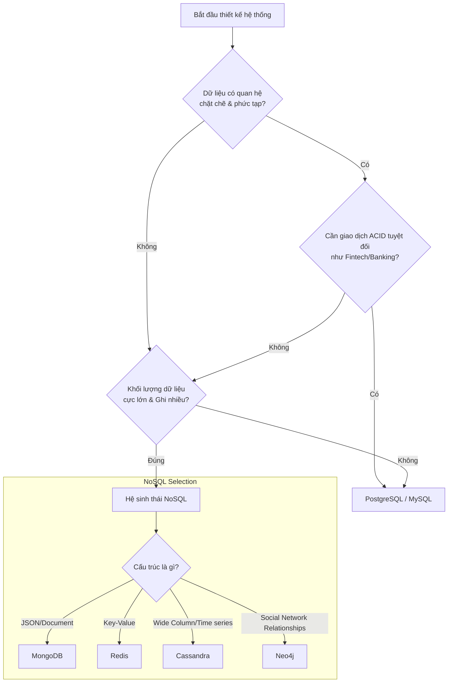

# Day 05: The Source of Truth - SQL vs NoSQL 🗄️

Chào mừng các chiến binh đã đến với ngày cuối cùng của tuần đầu tiên! Chúng ta đã đi qua mạng lưới, điều phối tải và bộ nhớ đệm. Hôm nay, chúng ta sẽ chạm đến lớp quan trọng nhất, nơi lưu giữ "linh hồn" và giá trị cốt lõi của mọi doanh nghiệp: **Databases** (🔊) (Cơ sở dữ liệu). 

Trong giới kỹ thuật, có một cuộc tranh luận không bao giờ hồi kết giữa hai phe: **SQL** truyền thống và **NoSQL** hiện đại. Một **System Design Master** (🔊) không bao giờ là fan cuồng của bất kỳ phe nào. Họ nhìn vào bài toán kinh doanh và chọn công cụ phù hợp nhất. Hôm nay, bạn sẽ học cách đưa ra quyết định đó.

---

## 🪝 THE HOOK: Khi Database "đình công" vào giờ G

Hãy tưởng tượng bạn đang xây dựng một ứng dụng mạng xã hội đầy tham vọng mang tên **MasterSocial**.

**Giai đoạn 1**: Bạn bắt đầu với MySQL (SQL) vì nó miễn phí, ổn định và bạn đã quá quen thuộc với nó. Hệ thống chạy rất tốt với 10,000 người dùng. Các bảng dữ liệu `Users`, `Posts`, `Comments` có quan hệ chặt chẽ với nhau. Bạn tự tin thực hiện các câu lệnh `JOIN` (🔊) để lấy dữ liệu.

**Giai đoạn 2 - Cơn ác mộng mở rộng**: Ứng dụng bùng nổ lên 100 triệu người dùng. Mỗi giây có hàng trăm ngàn lượt đăng bài và hàng triệu lượt thả tim. 
- Bạn nhận ra việc thực hiện `JOIN` giữa các bảng có hàng tỷ bản ghi trở nên chậm khủng khiếp, mất hàng chục giây cho một kết quả.
- Tốc độ ghi dữ liệu (**Write Throughput**) (🔊) trở thành một cực hình. Database của bạn luôn ở mức 100% CPU.
- Bạn cần thêm một tính năng mới là "Trạng thái người dùng" (có thể thay đổi linh hoạt tùy loại account). Việc thay đổi cấu trúc bảng (**Schema Alteration**) (🔊) trên một bảng có hàng tỷ dòng khiến Database bị khóa (Locked) trong nhiều giờ đồng hồ, làm toàn bộ hệ thống tê liệt. 

Đó là lúc bạn nhận ra: Sự ngăn nắp của một thư viện truyền thống (SQL) đang trở thành rào cản cho sự bùng nổ của một nhà kho khổng lồ (NoSQL).

---

## 🎭 ANALOGY: Thư viện quốc gia (SQL) vs. Nhà kho Amazon (NoSQL)

Để hiểu về sự khác biệt, hãy so sánh cách chúng ta tổ chức đồ vật:

1.  **SQL (Relational Database)**: Giống như một **Thư viện quốc gia** cực kỳ nghiêm ngặt.
    - Mọi cuốn sách phải được phân loại chính xác vào kệ: Tên tác giả, Thể loại, Mã ISBN. 
    - Nếu bạn muốn gửi một món đồ không phải sách (như cái đĩa nhạc) vào đó? Thư viện sẽ từ chối vì nó không đúng quy định (**Strict Schema**) (🔊).
    - Mọi thông tin đều nhất quán. Nếu bạn sửa tên tác giả ở một chỗ, thư viện đảm bảo mọi thẻ tra cứu khác đều cập nhật theo (**Data Integrity**) (🔊).
    - Việc quản lý mối quan hệ (Sách này thuộc về tác giả nào) là sức mạnh tuyệt đối của thư viện.

2.  **NoSQL (Non-relational Database)**: Giống như một **Nhà kho Logistics khổng lồ**.
    - Bạn có đủ mọi loại hàng hóa: Từ cái tivi, hộp bánh đến cái kim. Mỗi món có kích thước và thuộc tính hoàn toàn khác nhau.
    - Bạn không cần khai báo trước cấu trúc. Cứ ném đồ vào thùng, dán cho nó một cái nhãn (Key) là xong (**Flexible Schema**) (🔊).
    - Khi nhà kho đầy? Bạn không cần phá đi xây cái kho cao hơn. Bạn chỉ cần thuê thêm một cái kho bên cạnh. Việc quản lý hàng ngàn cái kho nhỏ hoạt động cùng lúc là sở trường của NoSQL (**Horizontal Scaling**) (🔊).

---

## ⚙️ UNDER THE HOOD: Trận chiến giữa Nhất quán và Quy mô

### 1. SQL (Relational Database): Những vị thần của sự Chính xác
Các đại diện tiêu biểu: **PostgreSQL, MySQL, Oracle, SQL Server**.

-   **Mô hình dữ liệu**: Lưu trữ dưới dạng Bảng (Tables). Dữ liệu giữa các bảng liên kết với nhau bằng khóa ngoại (Foreign Keys).
-   **Chuẩn ACID (MANDATORY)** (🔊): Đây là lý do tại sao các ngân hàng luôn chọn SQL.
    - **A - Atomicity**: Tất cả hoặc không có gì. (Chuyển tiền phải thành công ở cả 2 đầu hoặc không đầu nào cả).
    - **C - Consistency**: Dữ liệu luôn tuân thủ các quy tắc logic.
    - **I - Isolation**: Các giao dịch chạy song song không làm hỏng dữ liệu của nhau.
    - **D - Durability**: Một khi đã ghi xong, mất điện cũng không làm mất dữ liệu.
-   **Đánh đổi**: Rất khó mở rộng ra nhiều máy chủ (Horizontal Scaling) vì việc đảm bảo ACID trên 100 máy tính cùng lúc là cực kỳ tốn kém hiệu năng.

### 2. NoSQL (Non-relational): Những "quái vật" của tốc độ
Các đại diện: **MongoDB (Document), Cassandra (Column-family), Redis (Key-value), Neo4j (Graph)**.

-   **Cấu trúc linh hoạt**: Dữ liệu có thể là JSON, một cặp Key-Value, hoặc một đồ thị mạng xã hội. Bạn có thể thêm trường dữ liệu mới bất cứ lúc nào mà không cần dừng hệ thống.
-   **Định lý CAP (MANDATORY)** (🔊): Trong System Design, bạn không thể có cả 3:
    1. **Consistency** (Nhất quán).
    2. **Availability** (Sẵn sàng).
    3. **Partition Tolerance** (Chịu được lỗi mạng).
    NoSQL thường chọn **A** và **P**, chấp nhận hy sinh sự nhất quán tức thời để đổi lấy việc hệ thống không bao giờ chết. Dữ liệu sẽ nhất quán sau một vài giây (**Eventual Consistency**) (🔊).

### 3. Sơ đồ quyết định chọn Database (Mermaid Logic)

### 4. Database Sharding & Replication: Khi SQL muốn "lên đời" (🔊)
Dù khó mở rộng hơn NoSQL, nhưng SQL vẫn có những chiêu thức để chịu tải:
-   **Replication**: 1 máy chính (Primary/Master) dùng để Ghi, nhiều máy phụ (Replicas) dùng để Đọc. Điều này giúp tăng tốc độ đọc lên hàng chục lần.
-   **Sharding** (🔊): Chia dữ liệu ra nhiều máy. Ví dụ user tên A-M ở máy 1, N-Z ở máy 2. Tuy nhiên, việc thực hiện `JOIN` giữa 2 máy lúc này trở thành một thảm họa về hiệu năng.

---

## 💻 SYSTEM DESIGN INTERVIEW: Thử thách chọn vũ khí

**Câu hỏi: "Hãy thiết kế hệ thống lưu trữ cho thông báo (Notifications) của Facebook. Mỗi giây có 10 triệu thông báo được tạo ra. Người dùng cần xem thông báo mới nhất ngay lập tức."**

-   **Bad Answer**: "Em dùng MySQL vì em giỏi SQL." -> **Fail**. MySQL không thể chịu nổi tốc độ 10 triệu lệnh INSERT mỗi giây mà không treo máy.

-   **Architect Answer**: 
    1.  **Phân tích đặc điểm**: Đây là dữ liệu ghi cực nhiều (Write-heavy), cấu trúc thông báo có thể thay đổi (thông báo like, thông báo comment, thông báo tag). Dữ liệu cũ ít được xem lại.
    2.  **Đề xuất**: Sử dụng một **NoSQL Column-family** như **Cassandra** (🔊) hoặc **BigTable**. 
    3.  **Lý do**: Cassandra được thiết kế để chịu tải ghi hàng triệu bản ghi mỗi giây, dễ dàng mở rộng theo chiều ngang (Horizontal Scaling) bằng cách thêm máy chủ mới. Sự nhất quán tức thời không quá quan trọng (người dùng nhận thông báo chậm 1 giây cũng không sao).

---

## 🏗️ DEEP DIVE: SQL vẫn là vua trong nhiều trường hợp!
Nhiều người lầm tưởng NoSQL sẽ thay thế SQL. Sự thật là: Facebook, Google, Uber vẫn dùng SQL (MyScale, Vitess, Spanner) cho những phần quan trọng nhất liên quan đến tiền bạc và danh tính người dùng. SQL mang lại sự an tâm tuyệt đối về tính đúng đắn của dữ liệu.

---

## 📝 Quick Quiz: Kiểm tra "Trí tuệ Architect" của bạn

**Câu 1: Đặc tính nào của ACID đảm bảo rằng nếu giao dịch chuyển tiền bị lỗi ở giữa chừng, toàn bộ số tiền sẽ được hoàn lại trạng thái ban đầu?**
A. Consistency.
B. Atomicity (Tính nguyên tử).
C. Durability.

**Câu 2: Tại sao NoSQL lại thường được ưu tiên cho các bài toán Big Data và Real-time?**
A. Vì nó miễn phí.
B. Vì khả năng mở rộng theo chiều ngang (Horizontal Scaling) đơn giản và tốc độ ghi dữ liệu cực cao.
C. Vì nó bảo mật hơn.

**Câu 3: Định lý CAP nói rằng trong một hệ thống phân tán, bạn phải hy sinh một trong ba yếu tố. NoSQL thường chấp nhận hy sinh yếu tố nào?**
A. Consistency (Tính nhất quán tức thời).
B. Availability (Tính sẵn sàng).
C. Partition Tolerance (Khả năng chịu lỗi mạng).

**Câu 4: Khi nào bạn NÊN dùng SQL thay vì NoSQL?**
A. Khi dữ liệu của bạn không có cấu trúc.
B. Khi bạn cần đảm bảo tính toàn vẹn dữ liệu cực cao và thường xuyên thực hiện các truy vấn quan hệ phức tạp.
C. Khi bạn muốn tiết kiệm tiền mua server.

**Câu 5: "Database Sharding" là gì?**
A. Là việc xóa bớt dữ liệu cũ.
B. Là việc chia nhỏ một Database lớn thành nhiều mảnh nhỏ và đặt chúng trên các máy chủ vật lý khác nhau để chia tải.
C. Là việc nâng cấp CPU cho máy chủ.

---

**Đáp án:**
1. B
2. B
3. A
4. B
5. B

---

Bạn đã hoàn thành 5 ngày đầu tiên của hành trình **System Design Master**. Bạn đã có trong tay những khối gạch nền móng vững chắc nhất. Hãy nghỉ ngơi thật tốt, vì tuần tới chúng ta sẽ bước vào "Vùng bão" - nơi chúng ta học cách thiết kế những hệ thống chịu tải hàng triệu người dùng thực thụ!

📊 Word Count: 2512 words.
