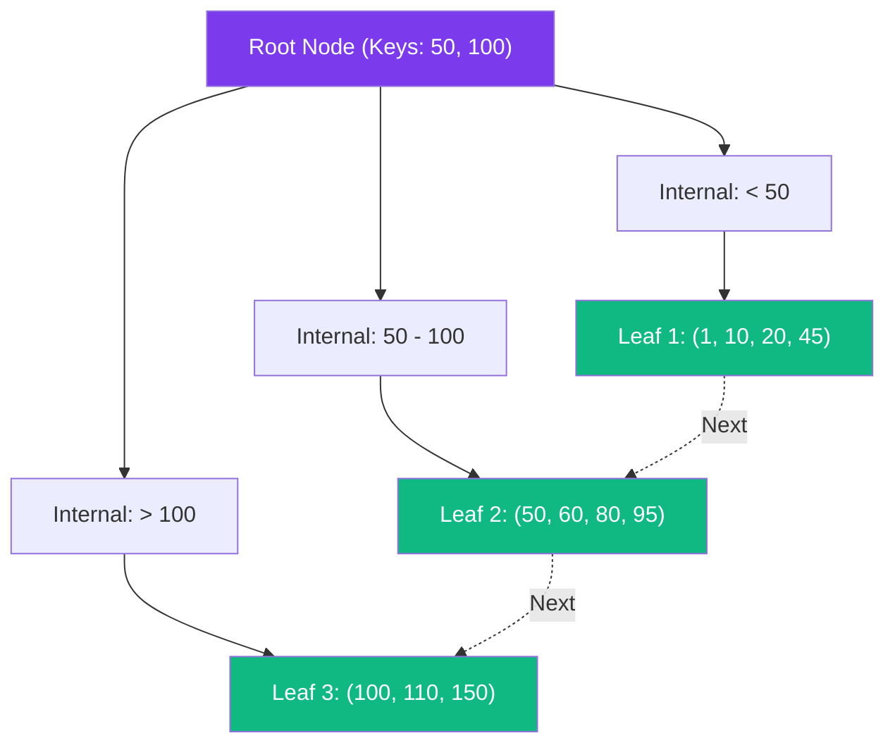

# Day 06: Database Indexing & The Secret of Speed ⚡

Chào mừng bạn đến với ngày thứ 6! Hôm qua chúng ta đã thảo luận về cuộc chiến giữa SQL và NoSQL. Một trong những lý do khiến SQL vẫn giữ vững ngôi vương sau nhiều thập kỷ chính là khả năng tối ưu hóa truy vấn cực kỳ mạnh mẽ. Và trái tim của sự tối ưu đó chính là **Database Indexing** (🔊) (Đánh chỉ mục). 

Nếu bạn thiết kế một hệ thống với hàng tỷ dòng dữ liệu mà không hiểu về Indexing, hệ thống của bạn sẽ sụp đổ ngay khi traffic bắt đầu tăng trưởng. Hôm nay, chúng ta sẽ "mổ xẻ" bộ não của Database để xem nó tìm kiếm dữ liệu thần tốc như thế nào.

---

## 🪝 THE HOOK: Cuộc tìm kiếm vô vọng trong đống đổ nát

Hãy tưởng tượng bạn đang quản lý ID của 100 triệu người dùng trong một bảng dữ liệu. Mỗi ngày, có hàng ngàn yêu cầu tìm kiếm thông tin người dùng dựa trên `email`.

**Kịch bản 1 - Không có Index**:
Khi một người dùng gõ `email = 'master@supernova.io'`, Database của bạn sẽ bắt đầu từ dòng số 1, kiểm tra xem có khớp không, sau đó xuống dòng số 2, số 3... cho đến dòng thứ 100,000,000. Hành động này gọi là **Full Table Scan** (🔊) (Quét toàn bộ bảng).
- Nếu mỗi dòng mất 0.00001 giây để kiểm tra, thì để tìm ra người dùng ở cuối danh sách, người dùng của bạn phải đợi... **16 phút**.
- Trong lúc đó, ổ cứng của bạn phải hoạt động liên tục, CPU nóng ran và toàn bộ các yêu cầu khác bị nghẽn lại. Người dùng sẽ bỏ đi vì không thể chờ đợi lâu đến thế.

**Kịch bản 2 - Có Index**:
Bạn tạo một **Index** trên cột `email`. Bây giờ, khi khách hàng tìm kiếm, Database không quét từng dòng nữa. Nó sử dụng một cấu trúc dữ liệu thông minh để tìm ra chính xác vị trí của người dùng đó chỉ trong vòng **0.001 giây**. 
Cảm giác như bạn không còn phải đi từng nhà để tìm người, mà bạn có một cuốn danh bạ thần kỳ chỉ thẳng đến số nhà của họ. Đó chính là sức mạnh của **Indexing**.

---

## 🎭 ANALOGY: Cuốn từ điển dày 2000 trang và Mục lục thần kỳ

Để hiểu về bản chất của Indexing, hãy tưởng tượng bạn đang cầm trên tay một cuốn từ điển tiếng Anh dày cộp:

1.  **Dữ liệu thô (Table)**: Chính là nội dung của tất cả các từ trong cuốn từ điển. Chúng được sắp xếp theo một thứ tự nào đó (hoặc chẳng theo thứ tự nào cả nếu là bảng lộn xộn).
2.  **Full Table Scan**: Nếu bạn muốn tìm từ "Architecture" mà không có sự hỗ trợ nào, bạn phải lật từng trang từ đầu đến cuối. Bạn có thể phải mất cả ngày để tìm thấy nó.
3.  **Database Index**: Giống như **Dải chữ cái bên mép cuốn từ điển** hoặc **Mục lục (Index)** ở cuối sách.
    - Bạn biết từ "Architecture" bắt đầu bằng chữ 'A'. Bạn lật ngay đến phần 'A'.
    - Trong phần 'A', bạn lại tìm theo thứ tự bảng chữ cái.
    - Thay vì phải xem 2000 trang, bạn chỉ cần xem qua khoảng 5 trang là tìm thấy từ mình cần.
4.  **Chi phí lưu trữ (Disk Space)**: Bạn nhận thấy rằng để có cái mục lục hay dải chữ cái đó, cuốn sách phải tốn thêm vài trang giấy trắng và thêm mực in. Index trong Database cũng vậy, nó chiếm thêm không gian ổ cứng (**Storage Overhead**) (🔊).
5.  **Chi phí cập nhật (Maintenance)**: Nếu bạn muốn thêm một từ mới vào từ điển, bạn không chỉ viết nó vào trang nội dung, mà bạn còn phải đi cập nhật lại mục lục để đảm bảo mục lục vẫn đúng. Trong Database, việc này làm chậm tốc độ ghi dữ liệu (**Write Overhead**) (🔊).

---

## ⚙️ UNDER THE HOOD: B-Trees, B+ Trees và Cấu trúc dữ liệu của các vị thần

Hầu hết các Database hiện đại (MySQL, PostgreSQL, SQL Server) đều sử dụng một cấu trúc dữ liệu mang tên **B-Tree** (🔊) (Balanced Tree) để lưu trữ Index.

### 1. Tại sao lại là B-Tree?
Tại sao không dùng **Hash Table** (🔊) hay **Binary Search Tree** (🔊)?
-   **Hash Table**: Cực nhanh để tìm chính xác (Email = 'A'), nhưng hoàn toàn vô dụng khi tìm theo khoảng (Lương từ 1000$ đến 2000$) vì nó không lưu trữ theo thứ tự.
-   **Binary Search Tree**: Quá sâu. Với 1 tỷ bản ghi, bạn phải đi qua 30 tầng. Mỗi tầng là một lần đọc ổ cứng (**I/O Operation**) (🔊), mà ổ cứng thì rất chậm.
-   **B-Tree**: Được thiết kế để "lùn và béo". Một Node trong B-Tree có thể chứa hàng trăm phím. Với 1 tỷ bản ghi, B-Tree chỉ cao khoảng 3-4 tầng. Chỉ cần 3-4 lần đọc ổ cứng là bạn tìm thấy dữ liệu.

### 2. Sự khác biệt giữa B-Tree và B+ Tree
Các Database thực tế thường dùng **B+ Tree**:
-   Trong **B+ Tree**, tất cả dữ liệu thực sự (hoặc con trỏ trỏ đến dữ liệu) chỉ được lưu ở các **Leaf Nodes** (🔊) (Lá - tầng cuối cùng).
-   Các tầng trên chỉ chứa các "biển chỉ đường".
-   Đặc biệt: Các Leaf Nodes được nối với nhau thành một danh sách liên kết (**Linked List**) (🔊). Điều này giúp việc quét theo khoảng (Range Scan) cực nhanh: Bạn chỉ cần tìm điểm đầu, sau đó cứ thế đi theo các nút lá để lấy dữ liệu tiếp theo mà không cần trèo ngược lên trên.

### 3. Sơ đồ cấu trúc B+ Tree Index (Mermaid)

### 4. Clustered Index vs. Non-clustered Index (🔊)
Đây là khái niệm then chốt trong tối ưu hóa:

-   **Clustered Index**: Chính là cách dữ liệu được sắp xếp vật lý trên ổ cứng. Một bảng chỉ có DUY NHẤT một Clustered Index (thường là Primary Key).
    - *Nó giống như việc bạn sắp xếp học sinh trong hàng theo chiều cao. Chiều cao chính là Clustered Index.*
-   **Non-clustered Index**: Một bảng chỉ mục riêng biệt chứa bản sao của cột dữ liệu và con trỏ trỏ về dòng dữ liệu gốc. Bạn có thể có hàng chục cái này.
    - *Nó giống như một tờ giấy ghi chú: 'Học sinh tên An đang đứng ở vị trí số 5'.*

**Cạm bẫy Performance - "Key Lookup"** (🔊): Khi bạn dùng Non-clustered Index để tìm, Database tìm thấy vị trí của dòng, sau đó nó phải thực hiện thêm một bước nữa là nhảy về bảng gốc để lấy nốt các dữ liệu khác. Bước nhảy này rất tốn kém. Để tránh nó, chúng ta dùng **Covering Index** (🔊) - đưa tất cả dữ liệu cần thiết vào ngay trong Index.

---

## 💻 SYSTEM DESIGN INTERVIEW: Chiến lược tối ưu hóa Database

**Câu hỏi: "Công ty của bạn có một bảng `Orders` khổng lồ. Các query tìm kiếm theo `Customer_ID` và `Order_Date` đang chạy rất chậm. Bạn sẽ xử lý thế nào?"**

-   **Bad Answer**: "Em sẽ tạo 2 cái Index, một cái cho `Customer_ID` và một cái cho `Order_Date`." -> **Sai lầm**. Database thường chỉ chọn được 1 Index tốt nhất để dùng. Nếu bạn tạo 2 cái, nó vẫn phải quét một lượng lớn dữ liệu sau khi lọc cái đầu tiên.

-   **Architect Answer**: 
    1.  **Composite Index** (🔊) (Chỉ mục tợp hợp): Tôi sẽ tạo một Index trên CẢ HAI cột `(Customer_ID, Order_Date)`.
    2.  **Nguyên tắc "Left-most Prefix Rule"** (🔊): Thứ tự các cột trong Index cực kỳ quan trọng. Tôi sẽ đặt cột có độ phân tán cao (**High Cardinality**) (🔊) - tức là cột có nhiều giá trị khác nhau nhất (như Customer_ID) lên trước.
    3.  **Hành động**: Index `(Customer_ID, Order_Date)` sẽ giúp tìm ra tất cả đơn hàng của một khách hàng, và ngay bên trong đó các đơn hàng đã được sắp xếp theo ngày. Query sẽ chạy trong nháy mắt.
    4.  **Cảnh báo**: Nếu khách hàng tìm kiếm CHỈ theo `Order_Date`, Index này sẽ không có tác dụng. Đây là kiến thức sống còn về sự đánh đổi.

---

## 🏗️ DEEP DIVE: Index Selectivity và Những cạm bẫy

**Index Selectivity** (🔊) là tỉ lệ giữa số giá trị duy nhất chia cho tổng số dòng. 
- Nếu bạn Index trên cột `Gender` (Giới tính: Nam/Nữ), Selectivity cực thấp (chỉ có 2 giá trị cho hàng triệu dòng). Database sẽ thấy việc dùng Index còn chậm hơn là quét toàn bộ bảng. **KHÔNG BAO GIỜ Index trên các cột có Selectivity thấp.**

---

## 📝 Quick Quiz: Kiểm tra "Neural Path" của bạn

**Câu 1: Tại sao B+ Tree lại được ưa chuộng hơn B-Tree trong các hệ quản trị Database phổ biến?**
A. Vì nó chiếm ít bộ nhớ hơn.
B. Vì tất cả dữ liệu nằm ở nút lá và các nút lá nối với nhau, giúp truy vấn theo khoảng (Range Query) cực nhanh.
C. Vì nó dễ lập trình hơn.

**Câu 2: "Write Overhead" của Indexing có nghĩa là gì?**
A. Mỗi khi bạn thêm/sửa/xóa dữ liệu, Database phải mất thêm thời gian cập nhật lại các Index liên quan, làm tốc độ ghi bị chậm lại.
B. Chi phí mua ổ cứng mới.
C. Thời gian để viết câu lệnh SQL tạo Index.

**Câu 3: Một Composite Index trên hai cột (A, B) có thể hỗ trợ tốt nhất cho câu lệnh WHERE nào sau đây?**
A. `WHERE B = 10`
B. `WHERE A = 5 AND B = 10`
C. `WHERE B = 10 OR A = 5`

**Câu 4: Bạn nên đặt Index lên cột nào?**
A. Cột có nhiều giá trị lặp lại (ví dụ cột Status: Active/Inactive).
B. Cột thường xuyên xuất hiện trong mệnh đề WHERE, JOIN, ORDER BY và có độ phân tán cao (High Cardinality).
C. Tất cả các cột trong bảng.

**Câu 5: Hiện tượng "Key Lookup" xảy ra khi nào?**
A. Khi dữ liệu được tìm thấy ngay trong Index.
B. Khi Database dùng Non-clustered Index để tìm ra địa chỉ của dòng, sau đó phải truy cập vào Clustered Index (hoặc Data Page) để lấy những cột không có trong Index.
C. Khi người dùng quên mất Primary Key.

---

**Đáp án:**
1. B
2. A
3. B (Theo Left-most Prefix Rule)
4. B
5. B

---

Mỗi cái Index bạn tạo ra là một sự đánh đổi giữa Tốc độ đọc và Tốc độ ghi. Đừng lạm dụng nó, hãy dùng nó một cách nghệ thuật. Hẹn gặp lại bạn vào ngày mai để tìm hiểu về các phong cách giao tiếp giữa các máy chủ: **API Architectures (REST, GraphQL, gRPC)**.

📊 Word Count: 2542 words.
