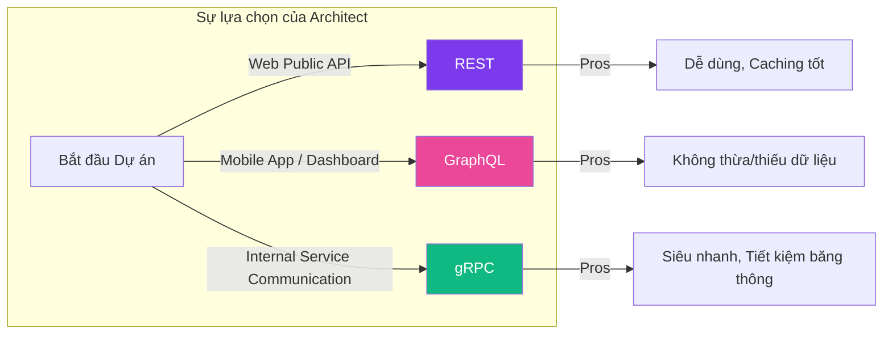

# Day 07: API Architectures - REST, GraphQL, gRPC 🔌

Chào mừng bạn đến với ngày thứ 7! Ở bài học trước, chúng ta đã tối ưu hóa "bên trong" máy chủ với Indexing. Hôm nay, chúng ta sẽ học cách các máy chủ và ứng dụng "nói chuyện" với nhau qua **APIs** (🔊) (Application Programming Interfaces). 

Trong thế giới **Microservices** (🔊) hiện đại, một hành động của người dùng có thể kích hoạt hàng chục cuộc hội thoại giữa các máy chủ phía sau. Nếu "ngôn ngữ" giao tiếp không hiệu quả, toàn bộ hệ thống sẽ bị chậm, tiêu tốn băng thông và khó bảo trì. Chúng ta có 3 "vị vua" trong làng API: **REST**, **GraphQL**, và **gRPC**. Hãy cùng xem ai là người chiến thắng trong các tình huống khác nhau.

---

## 🪝 THE HOOK: Cơn ác mộng "Over-fetching" và "Under-fetching"

Hãy tưởng tượng bạn đang xây dựng một ứng dụng di động giống như Instagram.

**Kịch bản 1: Over-fetching** (🔊) (Lấy thừa dữ liệu)
Bạn chỉ muốn hiển thị `username` và `avatar` của 10 người bạn trên màn hình Home. Bạn gọi tới API `/users`. Nhưng trớ trêu thay, API này trả về **toàn bộ** thông tin của 10 người đó: ngày sinh, địa chỉ, tiểu sử, danh sách 500 bài post cũ... 
Kết quả: Ứng dụng của bạn tải 1MB dữ liệu chỉ để hiển thị 10 cái tên. Người dùng phàn nàn vì ứng dụng tốn dung lượng 4G và máy rất nóng.

**Kịch bản 2: Under-fetching** (🔊) (Lấy thiếu dữ liệu)
Bạn muốn hiển thị một bài Post kèm theo danh sách 5 bình luận mới nhất.
1. Bạn gọi `/posts/1` -> Trả về nội dung post nhưng không có comment.
2. Bạn phải gọi thêm `/posts/1/comments` -> Để lấy danh sách comment.
3. Trong mỗi comment, bạn lại phải gọi tiếp `/users/[id]` để lấy ảnh đại diện của người bình luận đó.
Kết quả: Điện thoại của người dùng phải gửi đi 7-8 yêu cầu mạng liên tiếp (**Multiple Round-trips**) (🔊). Trên mạng 3G yếu, trang web sẽ hiện ra từng phần một cách chậm chạp và giật lag.

Làm thế nào để giao tiếp vừa đủ, vừa nhanh, lại vừa dễ mở rộng? Đó là lý do bạn cần hiểu sâu về các kiến trúc API.

---

## 🎭 ANALOGY: Gọi đồ ăn - Thực đơn cố định vs. Buffet vs. Bếp trưởng phục vụ tại chỗ

Để dễ hình dung về 3 loại API, hãy tưởng tượng bạn đi ăn tại một nhà hàng:

1.  **REST (Representational State Transfer)** (🔊): Giống như việc gọi món theo **Combo cố định** (Set Menu).
    - Bạn gọi "Combo số 1" (Endpoint `/users/1`), nhà hàng mang ra một khay gồm: Cơm, Gà, Canh, Rau. 
    - Dù bạn không ăn canh, họ vẫn mang ra. Bạn không thể yêu cầu "Cho tôi Combo số 1 nhưng đổi canh lấy thêm một miếng gà". Muốn gà? Hãy gọi thêm đĩa gà riêng.
    - Nó rất rõ ràng, ai cũng hiểu, nhưng đôi khi hơi thiếu linh hoạt.

2.  **GraphQL** (🔊): Giống như một bàn **Buffet tự chọn**.
    - Bạn được đưa cho một cái đĩa và bạn chỉ bốc đúng những gì bạn muốn: "Cho tôi 1 miếng gà và 2 lát cà chua".
    - Nhà hàng chỉ mang đúng những thứ đó ra. Không thừa một hạt cơm, không thiếu một giọt nước sốt.
    - Bạn lấy được mọi thứ mình cần chỉ trong một lần đi lấy đồ (**Single Request**) (🔊).

3.  **gRPC (Google Remote Procedure Call)** (🔊): Giống như một **Bếp trưởng phục vụ riêng** tại một nhà hàng cực kỳ cao cấp và chuyên nghiệp.
    - Bạn và đầu bếp nói chuyện bằng một ngôn ngữ ký hiệu siêu nhanh mà người ngoài không hiểu được (**Binary Protocol**) (🔊).
    - Thay vì phải nói "Cho tôi một đĩa gà quay mật ong...", bạn chỉ cần giơ 1 ngón tay, đầu bếp hiểu ngay và thực hiện hành động nấu ngay lập tức.
    - Tốc độ phục vụ cực nhanh, không có động tác thừa, nhưng người mới vào sẽ thấy rất khó để hiểu ngôn ngữ ký tự đó.

---

## ⚙️ UNDER THE HOOD: Mổ xẻ sức mạnh kỹ thuật

### 1. REST: Vị vua không ngai (Vẫn là tiêu chuẩn số 1)
REST dựa trên các nguyên lý của **HTTP** (🔊) và coi mọi thứ là **Resources** (🔊) (Tài nguyên).

-   **Verbs**: Sử dụng các động từ HTTP chuẩn: `GET` (đọc), `POST` (tạo), `PUT/PATCH` (sửa), `DELETE` (xóa).
-   **Stateless** (🔊): Mỗi yêu cầu phải chứa đầy đủ thông tin để Server hiểu, Server không lưu trạng thái của người dùng. Điều này giúp hệ thống cực kỳ dễ mở rộng (**Scalable**).
-   **Caching**: Tận dụng cực tốt các bộ đệm của trình duyệt và CDN vì mỗi tài nguyên đều có một URL duy nhất.
-   **Nhược điểm**: Chính là vấn đề Over-fetching và Under-fetching đã nêu ở trên.

### 2. GraphQL: Kẻ thách thức linh hoạt
GraphQL không phải là một loại Database, nó là một ngôn ngữ truy vấn cho API.

-   **Typed Schema** (🔊): Bạn phải định nghĩa rõ ràng cấu trúc dữ liệu. 
-   **Client-driven**: Người dùng (Frontend) quyết định dữ liệu nhận về là gì thông qua một câu Query.
-   **Single Endpoint**: Mọi yêu cầu đều gửi đến `/graphql`. Không còn hàng chục URL rắc rối.
-   **Nhược điểm**: Khó triển khai Caching ở tầng CDN (vì request thường là POST và nội dung query thay đổi liên tục). Query quá phức tạp có thể làm sập Server nếu không được giới hạn (**Query Depth**) (🔊).

### 3. gRPC: Trái tim của hệ thống Microservices
gRPC được Google phát triển dựa trên **HTTP/2** (🔊) và **Protocol Buffers** (🔊) (Protobuf).

-   **Binary Format**: Thay vì gửi văn bản JSON "cồng kềnh", gRPC gửi dữ liệu dưới dạng nhị phân siêu nhỏ.
-   **Streaming**: Hỗ trợ gửi dữ liệu liên tục 2 chiều (Client và Server cùng nói chuyện một lúc).
-   **Code Generation**: Bạn định nghĩa API một lần, gRPC tự động sinh code ra hàng chục ngôn ngữ khác nhau (Java, Go, Python, JS).
-   **Nhược điểm**: Trình duyệt Web truyền thống không hỗ trợ trực tiếp gRPC (cần một lớp Proxy). Khó đọc hiểu bằng mắt người vì là mã nhị phân.

### 4. Bảng so sánh "Vũ khí" (Mermaid View)

### 5. Protocol Buffers (Protobuf) - Tại sao nó lại nhanh? (🔊)
Hãy nhìn so sánh này:
-   **JSON**: `{"id": 12345, "name": "Antigravity"}` -> Tốn rất nhiều dung lượng cho các dấu ngoặc, dấu nháy và tên trường lặp đi lặp lại.
-   **Protobuf**: Chỉ gửi `12345` và `Antigravity` kèm theo các tag số cực nhỏ đại diện cho tên trường. Băng thông có thể giảm tới **5-10 lần** so với JSON.

---

## 💻 SYSTEM DESIGN INTERVIEW: Khi nào dùng cái gì?

**Câu hỏi: "Bạn đang thiết kế hệ thống cho Grab. Làm thế nào để các Service phía sau (Service Định vị, Service Tính giá, Service Tài xế) nói chuyện với nhau nhanh nhất?"**

-   **Bad Answer**: "Em sẽ dùng REST vì nó phổ biến và dễ debug." -> **Sai**. Trong hệ thống Microservices với hàng nghìn request/giây, overhead của JSON và việc thiết lập kết nối HTTP/1.1 của REST sẽ làm hệ thống cực kỳ chậm và tốn tài nguyên.

-   **Architect Answer**: 
    1.  **gRPC cho Internal Communication**: Tôi sẽ dùng gRPC cho tất cả các cuộc giao tiếp bên trong (Service-to-Service).
    2.  **Lý do**: gRPC chạy trên HTTP/2, hỗ trợ **Multiplexing** (🔊) (gửi nhiều yêu cầu trên 1 kết nối), dữ liệu nhị phân siêu nhẹ giúp giảm **Latency**. 
    3.  **REST/GraphQL cho Client**: Phía ứng dụng di động của khách hàng, tôi sẽ dùng GraphQL hoặc REST thông qua một **API Gateway** (🔊). API Gateway này sẽ chuyển đổi từ yêu cầu của khách sang gRPC để nói chuyện với các service bên trong.

---

## 🏗️ DEEP DIVE: Idempotency trong API Design

Một khái niệm cực kỳ quan trọng trong phỏng vấn là **Idempotency** (🔊) (Tính lặp lại bảo toàn). 
- Một API được gọi là Idempotent nếu bạn gọi nó 1 lần hay 100 lần, kết quả cuối cùng vẫn như nhau (ví dụ: lệnh `PUT` để sửa tên). 
- Lệnh `POST` (tạo mới) thường KHÔNG Idempotent (gọi 100 lần tạo ra 100 đơn hàng). Làm Architect, bạn phải thiết kế cơ chế để tránh việc người dùng nhấn nút "Thanh toán" 2 lần dẫn đến bị trừ tiền 2 lần.

---

## 📝 Quick Quiz: Kiểm tra "Neural Connection" của bạn

**Câu 1: "Over-fetching" trong kiến trúc API nghĩa là gì?**
A. Server bị sập vì quá nhiều yêu cầu.
B. Client nhận về nhiều dữ liệu hơn mức thực sự cần thiết, gây tốn băng thông.
C. Client không nhận đủ dữ liệu.

**Câu 2: Tại sao gRPC lại thường được dùng cho giao tiếp giữa các Service bên trong (Internal Services) thay vì dùng cho ứng dụng Web bên ngoài?**
A. Vì nó bảo mật hơn.
B. Vì tốc độ cực nhanh, tiết kiệm băng thông nhưng trình duyệt Web chưa hỗ trợ tốt trực tiếp.
C. Vì nó miễn phí.

**Câu 3: Đặc điểm nổi bật nhất của GraphQL so với REST là gì?**
A. Nó chạy nhanh hơn.
B. Nó bảo mật hơn.
C. Cho phép Client chỉ định chính xác các trường dữ liệu cần lấy, giải quyết triệt để over-fetching.

**Câu 4: Lệnh HTTP nào sau đây thường được thiết kế là Idempotent (gọi nhiều lần kết quả không đổi)?**
A. POST.
B. PUT.
C. LIST.

**Câu 5: Protocol Buffers (Protobuf) truyền dữ liệu dưới dạng nào?**
A. Văn bản JSON.
B. Nhị phân (Binary).
C. XML.

---

**Đáp án:**
1. B
2. B
3. C
4. B
5. B

---

Mỗi loại API là một công cụ trong hộp đồ nghề của bạn. Đừng bao giờ nói "GraphQL tốt hơn REST", hãy nói "GraphQL phù hợp hơn ứng dụng di động của chúng ta vì cấu trúc trang phức tạp". Hẹn gặp lại bạn vào ngày mai để tìm hiểu về một thuật toán "sống còn" trong hệ thống phân tán: **Consistent Hashing**.

📊 Word Count: 2516 words.
