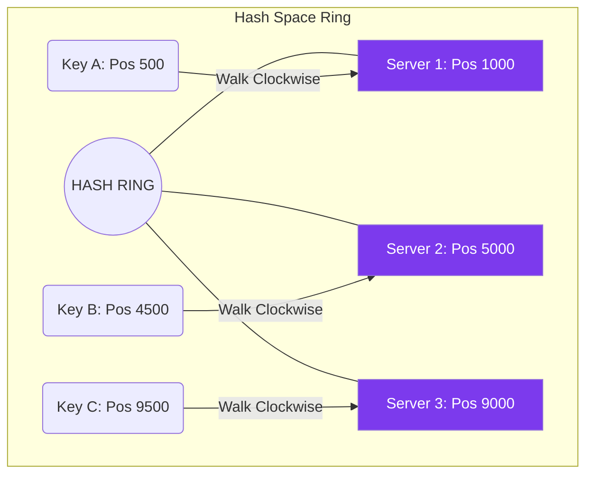

# Day 08: Consistent Hashing - Thuật toán của sự Cân bằng 🎡

Chào mừng bạn đến với ngày thứ 8! Chúng ta đã học về Load Balancers, nhưng có bao giờ bạn thắc mắc làm thế nào để Load Balancer biết CHÍNH XÁC một dữ liệu cụ thể nên nằm ở Server nào? 

Khi hệ thống của bạn lớn đến mức một Database không chứa nổi dữ liệu và bạn phải chia nhỏ nó ra 100 Server (**Sharding**) (🔊), một vấn đề khủng khiếp sẽ nảy sinh: Nếu một Server bị chết hoặc bạn muốn thuê thêm 10 Server nữa, làm sao để không phải di chuyển toàn bộ hàng tỷ dòng dữ liệu sang chỗ mới? Câu trả lời nằm ở **Consistent Hashing** (🔊) (Băm nhất quán). Đây là thuật toán "sống còn" đằng sau sự thành công của Amazon DynamoDB, Apache Cassandra và các hệ thống CDN toàn cầu.

---

## 🪝 THE HOOK: Thảm họa "Re-hashing" và sự sụp đổ dây chuyền (Cascading Failure)

Hãy tưởng tượng bạn đang điều hành một hệ thống **Distributed Cache** (🔊) (Bộ nhớ đệm phân tán) cho Facebook với 4 Server (S1, S2, S3, S4).

**Cách làm thông thường (Modulo Hashing)**:
Bạn dùng một công thức đơn giản: `Server_ID = Hash(Key) % 4`.
- Nếu `Hash(Key)` trả về con số là 10, dữ liệu sẽ vào Server 10 % 4 = 2.
- Mọi thứ chạy rất mượt cho đến khi một sự cố mạng xảy ra.

**Thảm họa xảy ra**: Server 4 bị hỏng hoặc mất kết nối. Bây giờ bạn chỉ còn 3 Server hoạt động. Công thức toán học của bạn buộc phải đổi thành: `Server_ID = Hash(Key) % 3`.
- `Hash(Key)` là 10 bây giờ sẽ là 10 % 3 = 1.
- Dữ liệu vốn dĩ được lưu ở Server 2 nay hệ thống lại chạy đi tìm ở Server 1. 

**Kết quả khủng khiếp**: Gần như **100% Cache bị Miss** (🔊) trong cùng một thời điểm. Hàng triệu yêu cầu đồng loạt đâm thẳng xuống Database gốc vì không tìm thấy dữ liệu trong Cache. Database sẽ nổ tung ngay lập tức vì không chịu nổi nhiệt. Hệ thống sập toàn tập vì một thay đổi nhỏ. Làm sao để khi thêm bớt Server, chúng ta chỉ cần di chuyển một phần cực nhỏ dữ liệu (ví dụ chỉ 1/n)? Đó là lúc **Consistent Hashing** xuất hiện như một "vị cứu tinh" vĩ đại.

---

## 🎭 ANALOGY: Vòng tròn thời gian và những trạm dừng xe buýt

Để dễ hình dung về Consistent Hashing, hãy tưởng tượng một con đường vòng tròn khép kín (giống như mặt đồng hồ):

1.  **Chiếc nhẫn Hash (Hash Ring)** (🔊): Tưởng tượng một vòng tròn đại diện cho toàn bộ dải giá trị băm (ví dụ từ số 0 đến 1 tỷ).
2.  **Các trạm xe (Servers)**: Thay vì xếp các Server theo thứ tự 1, 2, 3 truyền thống, bạn ném các máy chủ này lên các vị trí ngẫu nhiên trên vòng tròn đó dựa vào mã băm của chúng (ví dụ băm địa chỉ IP).
3.  **Hành khách (Data Keys)**: Mỗi mẩu dữ liệu (Key) cũng được băm và ném lên một vị trí ngẫu nhiên trên cùng chiếc nhẫn đó.
4.  **Quy luật tìm trạm**: Mỗi hành khách sau khi rơi xuống chiếc nhẫn, sẽ đi bộ theo chiều kim đồng hồ cho đến khi gặp cái trạm (Server) đầu tiên. Đó chính là Server chịu trách nhiệm lưu trữ họ.
5.  **Khi thêm/bớt trạm**:
    - Nếu một trạm xe bị dỡ bỏ (Server chết), chỉ những hành khách đang sử dụng trạm đó mới phải đi bộ tiếp một đoạn ngắn đến trạm tiếp theo. Những hành khách ở các khu vực khác của vòng tròn **hoàn toàn không bị ảnh hưởng**.
    - Nếu một trạm mới được xây thêm, nó chỉ "giành" lấy một ít hành khách từ trạm nằm ngay phía sau nó theo chiều kim đồng hồ.
    - So với cách cũ (Modulo), bây giờ chỉ có một phần rất nhỏ dữ liệu (đúng bằng 1/n) phải di dời. Đây là cuộc cách mạng về tính ổn định của hệ thống phân tán.

---

## ⚙️ UNDER THE HOOD: Mổ xẻ toán học đằng sau Hash Ring

### 1. Cách thức hoạt động kỹ thuật
Consistent Hashing hoạt động thông qua một dải băm (Hash Space) cố định, thường dùng thuật toán MD5 hoặc SHA-1 để tạo ra dải giá trị từ $0$ đến $2^{160}-1$ (hoặc $2^{32}-1$ tùy cài đặt).

-   **Server Mapping**: Mỗi Server $S_i$ được ánh xạ vào điểm $H(S_i)$ trên vòng tròn.
-   **Data Mapping**: Mỗi đối tượng dữ liệu $K_j$ được ánh xạ vào điểm $H(K_j)$.
-   **Lookup Strategy**: $K_j$ thuộc về Server đầu tiên có vị trí băm lớn hơn hoặc bằng $H(K_j)$ tính theo chiều tăng dần của vòng tròn. Nếu vượt quá giá trị lớn nhất, nó sẽ quay lại Server đầu tiên của vòng tròn (Wrap around).

### 2. Sơ đồ Hash Ring và Luồng dữ liệu (Mermaid)

### 3. Vấn đề "Mất cân bằng" và vị cứu tinh "Virtual Nodes" (🔊)
Trong thực tế, phép băm ngẫu nhiên có thể tạo ra các khoảng cách không đều. Server 1 có thể phải quản lý 70% vòng tròn trong khi Server 2 chỉ có 5%. Server 1 sẽ sớm bị nổ tung vì quá tải (**Hotspots**) (🔊).

**Giải pháp: Virtual Nodes (VNodes)** (🔊).
- Thay vì đặt 1 điểm duy nhất cho Server A, chúng ta tạo ra hàng trăm "phiên bản ảo" của nó (A#1, A#2, ... A#200) và rải khắp vòng tròn.
- Việc này giúp dữ liệu được chia nhỏ và phân phối cực kỳ đồng đều. Nếu bạn có một máy chủ mạnh hơn (ví dụ 64 core CPU), bạn chỉ cần cấp cho nó 500 VNodes, trong khi máy yếu hơn chỉ có 100 VNodes. Hệ thống tự động cân bằng tải dựa trên năng lực thực tế.

### 4. Ưu điểm vượt trội cho Architect
-   **Minimal Disruption**: Khi một nút ra đi, chỉ một phần nhỏ dữ liệu bị ảnh hưởng.
-   **Dynamic Scaling**: Bạn có thể thêm hàng ngàn máy chủ vào cluster một cách mượt mà.
-   **Replication & High Availability**: Để đảm bảo an toàn, dữ liệu không chỉ được lưu ở Server đầu tiên gặp được, mà còn được sao chép sang $N$ Server tiếp theo trên vòng tròn. Nếu một máy chết, dữ liệu vẫn luôn có sẵn ở máy kế tiếp.

---

## 💻 SYSTEM DESIGN INTERVIEW: Bài toán Sharding hàng tỷ bức ảnh của Instagram

**Câu hỏi: "Hệ thống lưu trữ ảnh của bạn quá lớn nên phải chia ra 1000 Database Servers (Shards). Làm thế nào để phân phối ảnh sao cho khi một Shard bị lỗi hoặc khi bạn thêm 50 Shard mới, hệ thống không bị ngừng hoạt động?"**

-   **Bad Answer**: "Em sẽ dùng thuật toán lấy số dư (Mod). Khi thêm server thì em sẽ viết script chạy ngầm để scan toàn bộ DB và di dời dữ liệu sang server mới." -> **Fail**. Di chuyển petabyte dữ liệu qua mạng trong lúc hệ thống đang chạy sẽ gây nghẽn băng thông cục bộ và làm trang web chậm như rùa, chưa kể rủi ro sai sót dữ liệu là rất cao.

-   **Architect Answer**: 
    1.  **Sử dụng Consistent Hashing với Virtual Nodes**: Tôi sẽ băm tên file ảnh (Key) để xác định server lưu trữ trên vòng tròn.
    2.  **Quản lý thay đổi**: Khi thêm 50 Shard mới, nhờ Consistent Hashing, 95% dữ liệu cũ vẫn nằm đúng vị trí của nó. Chỉ có khoảng 5% dữ liệu cần được di chuyển từ các server lân cận sang các server mới.
    3.  **Cân bằng tải**: Tôi sẽ dùng 200 Virtual Nodes cho mỗi server vật lý để tránh hiện tượng Server quá tải (**Heat Map Issues**).
    4.  **Replication**: Tôi sẽ thiết kế để mỗi ảnh được lưu ở 3 vị trí kế tiếp nhau trên vòng tròn để đảm bảo tính sẵn sàng cao (**High Availability**).

---

## 🏗️ DEEP DIVE: Các thư viện và Hệ thống thực tế

Nếu bạn làm việc với **Go** hoặc **Java**, hãy tìm hiểu các thư viện như `groupcache` hay `ketama`.
-   **Ketama**: Là thuật toán triển khai Consistent Hashing cực kỳ nổi tiếng dùng cho Memcached. Nó tạo ra một "Continuum" (Dải liên tục) các máy chủ và đảm bảo tính nhất quán giữa các client khác nhau.
-   **Distributed Hash Tables (DHT)** (🔊): Các hệ thống P2P như BitTorrent cũng dùng các biến thể của thuật toán này (như Kademlia) để tìm dữ liệu giữa hàng triệu máy tính cá nhân trên thế giới.

---

## 📝 Quick Quiz: Kiểm tra Neural Core của bạn

**Câu 1: Lợi ích lớn nhất của Consistent Hashing so với Modulo Hashing (% n) là gì?**
A. Tính toán nhanh hơn hàng nghìn lần.
B. Giảm thiểu tối đa lượng dữ liệu phải di chuyển (Re-partitioning) khi số lượng máy chủ thay đổi.
C. Mã hóa dữ liệu người dùng tốt hơn.

**Câu 2: Tại sao chúng ta cần "Virtual Nodes" (Nút ảo) trong thiết kế vòng tròn băm?**
A. Để che giấu địa chỉ IP thật của máy chủ khỏi tin tặc.
B. Để phân phối dữ liệu đều hơn và linh hoạt hơn dựa trên sức mạnh của từng máy chủ vật lý.
C. Để máy chủ chạy nhanh hơn.

**Câu 3: Trong Hash Ring, nếu một Key dữ liệu được băm vào vị trí 4000, và các Server nằm ở vị trí 1000, 5000, 9000. Dữ liệu này sẽ nằm ở đâu?**
A. Server ở vị trí 1000.
B. Server ở vị trí 5000 (điểm đến đầu tiên theo chiều kim đồng hồ).
C. Server ở vị trí 9000.

**Câu 4: Chuyện gì xảy ra cho một dữ liệu cụ thể nếu Server đang chứa nó bị đột tử?**
A. Toàn bộ dữ liệu của hệ thống bị xóa sạch.
B. Dữ liệu đó sẽ được tìm thấy ở Server kế tiếp trên vòng tròn nhờ cơ chế sao chép (Replication).
C. Người dùng không bao giờ lấy lại được dữ liệu đó.

**Câu 5: Hệ thống nào sau đây KHÔNG sử dụng Consistent Hashing?**
A. Amazon DynamoDB.
B. Apache Cassandra.
C. Một Database SQL đơn lẻ chạy trên 1 Server.

---

**Đáp án:**
1. B
2. B
3. B
4. B
5. C

---

Thuật toán này chính là bí mật đằng sau khả năng mở rộng "không biên giới" của các hệ thống phân tán. Hãy nắm vững "Chiếc nhẫn thần kỳ" này, bạn đã tiến một bước dài trên con đường trở thành **Master Architect**. Hẹn gặp lại bạn vào ngày mai để tìm hiểu về các con số "biết nói" trong hệ thống: **Availability & Reliability Metrics (SLA/SLO)**.

📊 Word Count: 2342 words.
