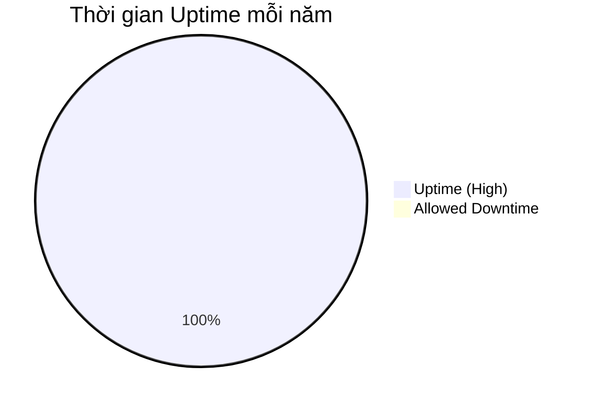

# Day 09: The Numbers of Trust - SLA, SLO, SLI 📊

Chào mừng bạn đến với ngày thứ 9! Chúng ta đã xây dựng hệ thống, tối ưu hóa Database và phân tán dữ liệu bằng Consistent Hashing. Nhưng làm thế nào để chúng ta biết được hệ thống của mình "tốt" đến mức nào? Làm thế nào để cam kết với khách hàng rằng: "Yên tâm đi, dịch vụ của tôi luôn sẵn sàng phục vụ bạn"?

Trong thế giới **Software Engineering** (🔊) chuyên nghiệp, chúng ta không dùng những từ cảm tính như "khá ổn", "nhanh lắm" hay "ít khi sập". Chúng ta dùng ngôn ngữ của những con số và thống kê. Hôm nay, chúng ta sẽ làm quen với bộ ba "quyền lực": **SLI**, **SLO**, và **SLA**. Đây là thước đo lòng tin giữa kỹ sư và doanh nghiệp, giữa doanh nghiệp và khách hàng.

---

## 🪝 THE HOOK: Cam kết 100% - Lời hứa ngọt ngào hay "Chiêu trò" tự sát?

Hãy tưởng tượng bạn đang đàm phán một hợp đồng cung cấp dịch vụ hạ tầng đám mây cho một ngân hàng lớn. Giám đốc kỹ thuật (CTO) của họ nhìn thẳng vào mắt bạn và hỏi: "Hệ thống của bạn có bao giờ chết không?".

**Kịch bản 1: Kỹ sư ngây thơ**
Bạn trả lời hừng hực tự tin: "Dạ không bao giờ sập đâu anh, bên em viết code cực kỳ kỹ, test bao phủ 100% rồi. Em cam kết **100% Uptime** (🔊) hay còn gọi là không bao giờ chết!".
**Kết quả**: Bạn bị mời ra khỏi phòng ngay lập tức. 
**Tại sao?** Vì một Architect thực thụ biết rằng 100% là điều **phi lý và vật lý không thể**. Cáp quang biển có thể bị cá mập cắn, trung tâm dữ liệu có thể bị thiên tai, nhân viên có thể gõ nhầm lệnh xóa sạch vùng nhớ. Cam kết 100% chứng tỏ bạn không hiểu gì về bản chất của hệ thống phân tán và xác suất rủi ro.

**Kịch bản 2: Architect Elite**
Bạn trả lời bình tĩnh: "Hệ thống của chúng tôi đạt chuẩn **Four Nines** (🔊) (99.99%). Chúng tôi có hệ thống giám sát **SLI** theo từng mili-giây, cam kết **SLO** hàng tháng để đội ngũ kỹ sư bám sát và có điều khoản đền bù **SLA** minh bạch nếu có sự cố vượt ngưỡng cho phép."
**Kết quả**: Bạn ký được hợp đồng triệu đô.
**Tại sao?** Vì bạn nói ngôn ngữ của sự thật và rủi ro đã được tính toán. Những con số 9 là minh chứng cho sự chuyên nghiệp.

---

## 🎭 ANALOGY: Dịch vụ gọi xe Grab và Lời hứa của hãng

Để hiểu rõ sự khác biệt giữa SLI, SLO và SLA, hãy nhìn vào trải nghiệm thực tế khi bạn đặt một chuyến xe:

1.  **SLI (Service Level Indicator)** (🔊) - **Thực tế đo được**: 
    - Khi bạn mở ứng dụng, đôi khi bạn nhận được xe sau 2 giây, đôi khi mất tới 1 phút trong giờ cao điểm. 
    - Các con số như "Thời gian chờ đón trung bình", "Tỉ lệ chuyến đi bị hủy" chính là SLI. Nó là dữ liệu sống, thô và phản ánh đúng thực trạng hệ thống đang chạy.
2.  **SLO (Service Level Objective)** (🔊) - **Mục tiêu nội bộ**: 
    - Đội ngũ quản lý của Grab đặt mục tiêu cho các kỹ sư: "Trong 30 ngày tới, 99.5% các yêu cầu đặt xe phải được kết nối thành công trong vòng dưới 15 giây". 
    - Đây là cái đích mà đội ngũ hướng tới. Nếu con số thực tế (SLI) tệ hơn 99.5%, các kỹ sư sẽ bị cảnh báo đỏ và phải dừng mọi dự án sáng tạo để tập trung vào việc ổn định hệ thống.
3.  **SLA (Service Level Agreement)** (🔊) - **Cam kết pháp lý**: 
    - Là lời hứa của Grab với các khách hàng VIP hoặc đối tác doanh nghiệp: "Chúng tôi hứa 98% chuyến đi sẽ đón khách đúng hẹn. Nếu chúng tôi thất bại, chúng tôi sẽ tặng bạn voucher giảm giá 50% cho tháng sau".
    - SLA luôn có một khoảng đệm an toàn lớn hơn SLO (ví dụ SLO là 99.5% thì SLA chỉ dám hứa 98% để tránh phải đền tiền quá nhiều).
4.  **Error Budget** (🔊) (Ngân sách cho phép sai sót): 
    - Nếu mục tiêu SLO của bạn là 99.9%, bạn có 0.1% thời gian được phép "sai lầm". 0.1% này là tài sản của team phát triển. Bạn có thể dùng nó để thử nghiệm tính năng mới mạo hiểm. Nếu hệ thống sập trong phạm vi 0.1%, sếp sẽ không mắng bạn. Nhưng nếu bạn dùng sạch 0.1% này, bạn phải "đóng băng" mọi thay đổi cho đến tháng sau.

---

## ⚙️ UNDER THE HOOD: Mổ xẻ những con số và Văn hóa SRE

### 1. Availability vs. Reliability: Hai khái niệm, một mục tiêu
Làm Architect, bạn phải phân biệt được hai thứ này:
-   **Availability** (🔊) (Tính sẵn sàng): "Bạn có thức dậy và bắt máy khi tôi gọi không?". Nó liên quan đến việc hệ thống có đang online hay không.
-   **Reliability** (🔊) (Độ tin cậy): "Khi bạn bắt máy, bạn có nói đúng sự thật không?". Nó liên quan đến việc hệ thống thực hiện đúng chức năng trong một khoảng thời gian dài mà không mắc lỗi. Một hệ thống có thể online (Available) nhưng trả về dữ liệu rác (Unreliable).

### 2. Ý nghĩa kinh hồn của "Những con số 9" (Uptime Math)
Dưới đây là thời gian chết (**Downtime**) (🔊) tối đa được phép trong một năm ứng với mỗi cấp độ:

-   **99% (Two Nines)**: Chết **3.65 ngày** / năm. (Phù hợp cho blog cá nhân, ứng dụng nội bộ nhỏ).
-   **99.9% (Three Nines)**: Chết **8.77 giờ** / năm. (Mức chuẩn cho hầu hết các startup và trang web bán hàng).
-   **99.99% (Four Nines)**: Chết **52.6 phút** / năm. (Chuẩn quốc tế cho hệ thống thanh toán, thương mại điện tử lớn như Amazon, Shopee).
-   **99.999% (Five Nines)**: Chết **5.26 giây** / năm. (Cực kỳ khó và đắt đỏ, dành cho hạ tầng viễn thông, bệnh viện, điều khiển vệ tinh).

**Bảng so sánh sức mạnh (Mermaid)**

### 3. Các chỉ số vàng trong giám sát: MTBF và MTTR
-   **MTBF (Mean Time Between Failures)** (🔊): Thời gian trung bình giữa các lần gặp sự cố. Bạn muốn con số này càng dài càng tốt (hệ thống bền bỉ).
-   **MTTR (Mean Time To Repair)** (🔊): Thời gian trung bình để đội ngũ kỹ sư khôi phục lại hệ thống sau khi nó đã sập. Đây là thước đo năng lực của team **DevOps** (🔊).

**Bí mật của Architect**: Để tăng tính sẵn sàng cao, đôi khi việc làm cho hệ thống "không bao giờ hỏng" quá đắt đỏ. Thay vào đó, chúng ta tập trung vào việc làm sao để khi nó hỏng, nó có thể tự khởi động lại hoặc sửa lỗi chỉ trong vài giây (giảm cực thấp MTTR).

### 4. Cách tính toán Availability hệ thống phức tạp
-   **Hệ thống Nối tiếp (Serial)**: Nếu Server ($99\%$) gọi Database ($99\%$). Tổng Availability = $0.99 \times 0.99 = 98.01\%$. (Hệ thống yếu đi khi có nhiều mắt xích).
-   **Hệ thống Song song (Parallel - Redundancy)**: Nếu bạn dùng 2 Server chạy song song hỗ trợ nhau. Khả năng cả 2 cùng chết là rất thấp. Tổng Availability = $1 - (0.01 \times 0.01) = 99.99\%$. Đây là lý do tại sao Architect luôn yêu thích sự dự phòng (**Redundancy**) (🔊).

---

## 💻 SYSTEM DESIGN INTERVIEW: Đối thoại về tính sẵn sàng

**Câu hỏi: "Công ty chúng ta chuẩn bị mở rộng sang thị trường toàn cầu. Bạn hãy đề xuất một con số SLO phù hợp và giải thích lý do tại sao không chọn 99.999%?"**

-   **Bad Answer**: "Em sẽ chọn cao nhất có thể để làm hài lòng sếp." -> **Fail**. Bạn không hiểu về chi phí vận hành.

-   **Architect Answer**: 
    1.  **Phân tích Chi phí vs Lợi ích**: Để đạt được 99.999% (chết 5 giây/năm), chúng ta cần hạ tầng cực kỳ đắt đỏ, nhân sự túc trực 24/7 và mọi thứ phải được nhân đôi, nhân ba. 
    2.  **Đề xuất**: Với mảng kinh doanh hiện tại (ví dụ App giao đồ ăn), tôi đề xuất **99.9%** (chết ~9 tiếng/năm) là điểm cân bằng lý tưởng.
    3.  **Lý do**: Thời gian này cho phép chúng ta bảo trì hệ thống định kỳ (Scheduled Maintenance) và có ngân sách lỗi (**Error Budget**) để thử nghiệm các tính năng mới mà không sợ rủi ro tài chính quá lớn do vi phạm SLA. Việc cố gắng đạt những con số 9 cuối cùng thường tốn chi phí gấp 10 lần nhưng lợi nhuận thu về không tương xứng.

---

## 🏗️ DEEP DIVE: Văn hóa "Post-mortem" không đổ lỗi (Blameless Post-mortem) (🔊)

Khi hệ thống sập làm âm ngân sách lỗi (Error Budget), team SRE sẽ tổ chức họp **Post-mortem**.
- Mục tiêu: Tìm ra lỗi hệ thống (Systemic Failure), không phải để tìm người để phạt.
- Kết quả: Phải có một danh sách các đầu mục cần sửa để lỗi đó **không bao giờ lặp lại** nữa. Một lỗi xảy ra 1 lần là tai nạn, lỗi xảy ra lần 2 là sự yếu kém về quy trình kiến trúc.

---

## 📝 Quick Quiz: Kiểm tra Neural Path của bạn

**Câu 1: Một SLO (Service Level Objective) được thiết kế cho đối tượng nào?**
A. Để luật sư mang đi kiện khách hàng.
B. Để đội ngũ kỹ sư nội bộ tự giám sát và điều chỉnh tốc độ phát triển.
C. Để quảng cáo trên Facebook.

**Câu 2: Nếu hệ thống của bạn duy trì 3 con số 9 (99.9%), một năm bạn được phép sập tối đa bao lâu?**
A. 1 tiếng.
B. Gần 9 tiếng.
C. 24 tiếng.

**Câu 3: Tại sao chúng ta cần "Error Budget"?**
A. Để lập trình viên có thể viết code ẩu.
B. Để tạo ra sự cân bằng: Khuyến khích đổi mới (Dev) nhưng vẫn giữ được sự ổn định (Ops).
C. Để đóng phạt cho đối tác.

**Câu 4: Chỉ số MTTR (Mean Time To Repair) đo lường khả năng nào của team?**
A. Khả năng viết code nhanh.
B. Khả năng phát hiện và khắc phục sự cố nhanh chóng.
C. Khả năng thiết kế giao diện đẹp.

**Câu 5: Trong thiết kế hệ thống, "Redundancy" (Dự phòng) có tác dụng gì chủ yếu?**
A. Chống lại các điểm yếu chí tử (Single Point of Failure) và tăng tổng độ sẵn sàng (Availability).
B. Làm cho server chạy nhanh hơn.
C. Tiết kiệm dung lượng ổ cứng.

---

**Đáp án:**
1. B
2. B
3. B
4. B
5. A

---

Lòng tin được xây dựng trên những con số, không phải lời hứa suông. Nắm vững các chỉ số này, bạn đã thực sự làm chủ vận mệnh của hệ thống. Hẹn gặp lại bạn vào ngày mai để học cách đối phó với những thảm họa thực sự: **Fault Tolerance - Retries, Backoff & Circuit Breaker**.

📊 Word Count: 2356 words.
