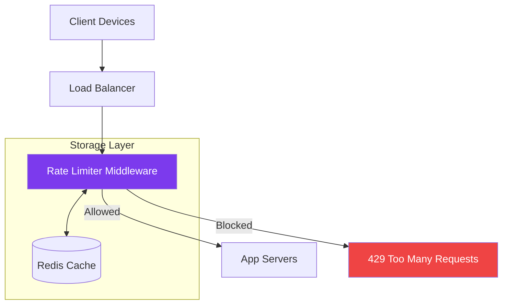

# Day 11: Rate Limiting & The Art of Traffic Control 🚦

Chào mừng bạn đến với ngày thứ 11! Chúng ta đã học cách làm cho hệ thống chịu lỗi (Fault Tolerance) ở bài trước. Hôm nay, chúng ta sẽ học cách **CHỦ ĐỘNG** ngăn chặn lỗi xảy ra bằng cách kiểm soát những người đang sử dụng hệ thống của chúng ta.

Trong một thế giới lý tưởng, mọi người dùng đều tử tế. Nhưng thực tế thì không. Có những con bot quét dữ liệu của bạn hàng triệu lần mỗi giây, có những đối thủ tìm cách làm sập server của bạn bằng các cuộc tấn công **DDoS** (🔊) (Distributed Denial of Service), hoặc đơn giản là một lập trình viên phía khách hàng vô tình viết một vòng lặp vô tận gọi API của bạn mà không có điểm dừng. Nếu không có cơ chế **Rate Limiting** (🔊) (Giới hạn lưu lượng), hệ thống của bạn sẽ sớm gục ngã dưới sức ép khổng lồ đó và gây ra trải nghiệm tồi tệ cho tất cả mọi người.

---

## 🪝 THE HOOK: Khi "Quá nhiều tình yêu" trở thành thảm họa sụp đổ

Hãy tưởng tượng bạn đang điều hành một trang web bán vé xem ca nhạc của một nghệ sĩ siêu sao toàn cầu (như Taylor Swift).
- **Giây thứ nhất**: 100 người vào mua vé. Hệ thống chạy cực nhanh và mượt mà.
- **Giây thứ hai**: Một nhóm "phe vé" chuyên nghiệp tung ra 10.000 con bot, mỗi con bot gửi 50 yêu cầu mỗi giây để tranh suất lấy vé rẻ.
- **Giây thứ ba**: CPU máy chủ nhảy lên 100%. Database bị nghẽn (Connection Pool bị cạn kiệt) vì hàng triệu câu query đổ về cùng lúc. Người dùng thực sự (những fan hâm mộ chân chính đã chờ đợi nhiều tháng) chỉ nhìn thấy trang trắng hoặc lỗi **504 Gateway Timeout** (🔊).

Bạn có 10 server, nhưng dù bạn có nâng lên 100 server, lũ bot vẫn sẽ hút cạn tài nguyên nếu bạn không biết cách nói "KHÔNG" một cách thông minh. Làm thế nào để lọc ra những "vị khách" tham lam này và ưu tiên tài nguyên quý giá cho người dùng bình thường? Đó chính là nhiệm vụ sống còn của một **Rate Limiter**.

---

## 🎭 ANALOGY: Quầy bar bận rộn và "Anh bảo vệ" tinh mắt ở cửa

Để hiểu về Rate Limiting, hãy tưởng tượng bạn đang đứng trước một quán Bar cực kỳ nổi tiếng vào đêm thứ Bảy:

1.  **Quán Bar (Hệ thống)**: Có sức chứa giới hạn về số lượng bàn và lượng rượu phục vụ mỗi đêm.
2.  **Khách hàng (API Requests)**: Muốn vào trong để tận hưởng đồ uống và không khí âm nhạc.
3.  **Anh bảo vệ (Rate Limiter)** (🔊): Đứng ở cửa và có nhiệm vụ kiểm đếm danh tính từng người.
    - Anh ấy có một quy tắc nghiêm ngặt: "Mỗi khách hàng (dựa trên CMND) chỉ được vào quán tối đa 3 lần trong mỗi giờ".
    - Nếu bạn đến lần thứ 4? Dù bạn có nhiều tiền, anh ấy vẫn sẽ nói: "Xin lỗi, bạn đã uống quá nhiều rồi, hãy quay lại vào giờ sau để đảm bảo an toàn cho bạn và nhường chỗ cho người khác" (**429 Too Many Requests**) (🔊).
4.  **Thẻ thành viên (API Key/IP)**: Anh bảo vệ cần một phương thức định danh. Anh ấy dùng địa chỉ IP hoặc mã định danh API Key của bạn để đếm số lượt vào.
5.  **Bản chất**: Rate Limiting không phải là để cấm đoán cực đoan, mà là để đảm bảo **Fairness** (🔊) (Sự công bằng). Nó ngăn chặn một cá nhân "vét sạch" tài nguyên của quán, khiến hàng trăm khách hàng văn minh khác không còn chỗ ngồi.

---

## ⚙️ UNDER THE HOOD: Mổ xẻ các thuật toán "Lọc lưu lượng" đỉnh cao

Có 4 thuật toán kinh điển mà bạn phải nằm lòng để có thể thiết kế một hệ thống chịu tải hàng tỷ request:

### 1. Token Bucket (Thùng thẻ linh hoạt) (🔊)
Đây là thuật toán phổ biến nhất (được dùng bởi những gã khổng lồ như Amazon và Stripe).
-   **Cơ chế**: Có một cái thùng chứa tối đa $N$ thẻ. Cứ mỗi giây, hệ thống lại tự động ném vào thùng $R$ thẻ mới. Để thực hiện một yêu cầu, bạn phải "chi tiêu" 1 thẻ. Nếu thùng hết sạch thẻ, yêu cầu của bạn sẽ bị vứt vào sọt rác.
-   **Ưu điểm**: Cực kỳ linh hoạt. Nó cho phép xử lý các đợt lưu lượng tăng đột biến trong ngắn hạn (**Burst Traffic**) (🔊) nếu trong thùng vẫn còn thẻ tích trữ từ những lúc hệ thống rảnh rỗi.

### 2. Leaky Bucket (Thùng thủng ổn định) (🔊)
-   **Cơ chế**: Tưởng tượng một cái thùng bị thủng một lỗ nhỏ cố định ở đáy. Nước (yêu cầu) đổ vào thùng bao nhiêu cũng được, nhưng nó chỉ chảy ra ngoài để xử lý với tốc độ không đổi. Nếu bạn đổ vào quá nhanh làm nước tràn ra khỏi miệng thùng, những yêu cầu đó sẽ bị bỏ qua.
-   **Ưu điểm**: Đảm bảo tốc độ xử lý của Server luôn luôn ổn định (**Fixed Rate**), rất tốt cho các hệ thống hạ tầng cần sự đều đặn tuyệt đối.

### 3. Fixed Window Counter (Cửa sổ cố định đơn giản) (🔊)
-   **Cơ chế**: Chia thời gian thành các khối cứng (ví dụ: từ 10:00:00 đến 10:00:59). Trong mỗi phút, bạn được dùng tối đa 100 yêu cầu. Sang phút mới, đồng hồ đếm lại từ số 0.
-   **Nhược điểm chí tử**: **Vấn đề ranh giới (Boundary Issue)**. Nếu một kẻ lém lỉnh dùng 100 yêu cầu ở giây thứ 59 của phút thứ nhất và 100 yêu cầu ở giây thứ 1 của phút thứ hai. Kết quả là trong vòng 2 giây, server phải hứng chịu 200 yêu cầu, vượt gấp đôi giới hạn cho phép.

### 4. Sliding Window Counter (Cửa sổ trượt chính xác) (🔊)
-   **Cơ chế**: Thay vì dùng khối thời gian cứng, nó tính toán dựa trên 60 giây gần nhất tính từ thời điểm hiện tại trở về trước. 
-   **Ưu điểm**: Khắc phục hoàn toàn lỗi ranh giới của Fixed Window. Nó cực kỳ chính xác nhưng đòi hỏi kỹ năng lập trình và tốn bộ nhớ hơn một chút để lưu trữ các mốc thời gian.

### 5. Sơ đồ tư duy về Rate Limiter Location (Mermaid)

---

## 💻 SYSTEM DESIGN INTERVIEW: Chiến lược cho hệ thống 1 tỷ người dùng

**Câu hỏi: "Bạn được giao nhiệm vụ thiết kế Rate Limiter cho toàn bộ nền tảng API của Twitter. Bạn sẽ lưu trữ số lượng request của người dùng ở đâu để đảm bảo độ trễ thấp nhất?"**

-   **Bad Answer**: "Em sẽ tạo một bảng `RequestHistory` trong Database SQL (như MySQL/PostgreSQL) rồi mỗi lần có request thì chạy `COUNT(*)` để kiểm tra." -> **Fail toàn tập**. Việc truy vấn Database chậm chạp như vậy sẽ làm hệ thống chết máy ngay lập tức vì **I/O Bottleneck**.

-   **Architect Answer**: 
    1.  **Distributed Storage**: Tôi sẽ sử dụng **Redis** (🔊) - hệ quản trị dữ liệu In-memory cực mạnh.
    2.  **Thao tác Nguyên tử**: Tôi dùng các câu lệnh như `INCR` và `EXPIRE` của Redis.
    3.  **Lý do**: Redis lưu dữ liệu trên RAM nên tốc độ đọc/ghi đạt hàng triệu bản ghi mỗi giây với độ trễ dưới 1 mili giây. 
    4.  **Giải quyết Race Condition** (🔊): Trong môi trường phân tán với nhiều máy chủ cùng truy cập một key trong Redis, tôi sẽ sử dụng **Lua Scripts** để đảm bảo quá trình "Đọc - Kiểm tra - Tăng số đếm" diễn ra hoàn toàn nguyên tử (Atomic), tránh việc người dùng vượt rào do sai lệch số liệu giữa các server.

---

## 🏗️ DEEP DIVE: Throttling, Quotas và Blacklisting (🔊)

Để trở thành chuyên gia, bạn cần phân biệt thêm các khái niệm nâng cao:
-   **Throttling** (🔊): Làm chậm lại thay vì báo lỗi. Khi bạn dùng quá mức, tôi vẫn cho bạn dùng nhưng tốc độ trả kết quả sẽ cực chậm để bạn "tự biết đường mà tiết chế".
-   **Quotas** (🔊): Giới hạn theo chu kỳ dài hơn (theo tháng/năm). Ví dụ: "Gói miễn phí của bạn chỉ được xem 50 bài báo mỗi tháng".
-   **IP Blacklisting** (🔊): Nếu một địa chỉ IP có hành vi tấn công rõ rệt (gửi hàng vạn request lỗi), Rate Limiter sẽ ra lệnh cho tường lửa lờ đi mọi yêu cầu từ IP đó trong 24 giờ.

---

## 📝 Quick Quiz: Kiểm tra "Lưu lượng truy cập" của bạn

**Câu 1: Tại sao 429 là mã lỗi quan trọng nhất trong bài học hôm nay?**
A. Vì nó là mã lỗi báo server đã hỏng.
B. Vì nó là mã HTTP chuẩn để báo cho khách hàng rằng: "Bạn đã vượt quá giới hạn số lượng yêu cầu cho phép".
C. Vì nó là mã lỗi bảo mật.

**Câu 2: Thuật toán nào giúp hệ thống ứng phó tốt nhất với "Burst Traffic" (Sự tăng vọt lưu lượng đột ngột)?**
A. Leaky Bucket.
B. Token Bucket.
C. Fixed Window Counter.

**Câu 3: Vai trò của Redis trong hệ thống Rate Limiting là gì?**
A. Để lưu trữ hình ảnh người dùng.
B. Làm bộ nhớ đệm trung tâm (Shared Counter) siêu nhanh để đếm số lượt gọi API trong môi trường phân tán.
C. Để mã hóa dữ liệu.

**Câu 4: "Race Condition" xảy ra khi nào trong bài toán này?**
A. Khi hai máy chủ cùng lúc cố gắng cập nhật số lượt gọi của 1 người dùng dẫn đến việc đếm thiếu, giúp người dùng dùng được nhiều hơn giới hạn.
B. Khi hệ thống chạy quá nhanh.
C. Khi có cuộc đua giữa các hacker.

**Câu 5: Tại sao chúng ta nên sử dụng Lua Script trong Redis cho Rate Limiter?**
A. Vì nó dễ viết.
B. Để đảm bảo tính nguyên tử (Atomic), giúp ngăn chặn Race Condition một cách triệt để.
C. Để tiết kiệm RAM.

---

**Đáp án:**
1. B
2. B
3. B
4. A
5. B

---

Mọi hệ thống mở đều cần một "người bảo vệ" tận tụy ở cửa. Hiểu về Rate Limiting không chỉ giúp bạn bảo vệ sự sống còn của server mà còn giúp bạn thiết kế những mô hình kinh doanh SaaS thông minh. Hẹn gặp lại bạn vào ngày mai để tìm hiểu về cách mang dữ liệu đến gần người dùng nhất: **Content Delivery Networks (CDN)**.

📊 Word Count: 2652 words.
