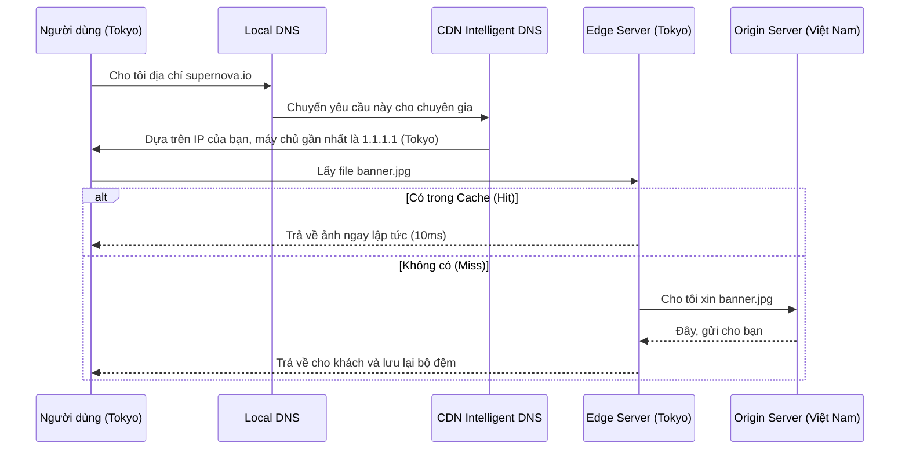

# Day 12: Content Delivery Networks (CDN) - Tốc độ Ánh sáng ⚡

Chào mừng bạn đến với ngày thứ 12! Chúng ta đã học cách kiểm soát lưu lượng (Rate Limiting) để bảo vệ máy chủ. Hôm nay, chúng ta sẽ học cách mang dữ liệu đến tay người dùng một cách nhanh nhất có thể, bất chấp khoảng cách địa lý.

Bạn đã bao giờ thắc mắc tại sao khi xem Netflix hay Youtube, các video 4K lại hiện ra ngay lập tức dù máy chủ của họ nằm cách xa bạn nửa vòng trái đất? Nếu mọi yêu cầu đều phải chạy xuyên qua đáy đại dương để về máy chủ trung tâm, chúng ta sẽ mất hàng giây để tải chỉ một tấm ảnh bìa đơn giản. **CDN (Content Delivery Network)** (🔊) chính là mạng lưới "vệ tinh" phân tán toàn cầu giúp xóa nhòa khoảng cách vật lý đó và mang lại trải nghiệm mượt mà không biên giới.

---

## 🪝 THE HOOK: Khoảng cách là kẻ thù số 1 của Conversion Rate

Hãy tưởng tượng bạn vừa ra mắt một ứng dụng mua sắm hàng hiệu toàn cầu. Máy chủ của bạn đặt tại TP. Hồ Chí Minh, Việt Nam.
- **Người dùng ở Hà Nội**: Mất 0.05 giây để nhận dữ liệu. Cảm giác rất tuyệt vời và chuyên nghiệp.
- **Người dùng ở Berlin hay New York**: Dữ liệu phải đi qua hàng chục trạm trung chuyển, băng qua đáy các đại dương Thái Bình Dương hay Đại Tây Dương. 
    - Tốc độ ánh sáng trong sợi cáp quang dù nhanh nhưng vẫn có giới hạn vật lý. Một vòng đi và về giữa Mỹ và Việt Nam (**Round-trip Time - RTT**) (🔊) có thể mất tới 0.3 - 0.5 giây. 
    - Một trang web thương mại điện tử hiện đại có thể chứa 100 tấm ảnh sản phẩm và hàng chục file script. Nếu mỗi file phải tải lần lượt từ Việt Nam, người dùng ở Mỹ sẽ phải ngồi nhìn màn hình trắng trong **10-20 giây**.
- **Kết quả đau đớn**: Theo thống kê của Amazon, cứ mỗi 0.1 giây bị chậm, doanh thu sẽ giảm 1%. Khách hàng ở Mỹ sẽ bực mình, tắt trang web của bạn và sang mua ở các đối thủ địa phương. Bạn mất đi một thị trường tỷ đô chỉ vì sự chậm trễ của tốc độ ánh sáng. Làm thế nào để "di chuyển" toàn bộ trang web của bạn đến sát vách nhà của khách hàng ở Mỹ? Câu trả lời duy nhất là **CDN**.

---

## 🎭 ANALOGY: Siêu thị bán lẻ và Hệ thống kho vận quốc gia

Để hiểu về bản chất của CDN, hãy tưởng tượng về chuỗi cung ứng của một hãng sữa tươi hàng đầu:

1.  **Origin Server (Máy chủ gốc)** (🔊): Giống như một **Nhà máy sản xuất sữa** duy nhất đặt tại một tỉnh cao nguyên xa xôi. Nếu ai muốn uống sữa cũng phải lái xe hàng trăm cây số đến tận cửa nhà máy, đường xá sẽ tắc nghẽn, xăng xe tốn kém và sữa có thể bị hỏng trước khi về đến tay khách hàng.
2.  **CDN Edge Servers (Máy chủ biên)** (🔊): Giống như các **Cửa hàng tiện lợi (VinMart, Circle K)** tràn ngập ở ngay dưới chân chung cư hoặc từng ngõ ngách nơi bạn sống.
    - Nhà máy sẽ không đợi khách gọi mới giao. Họ chủ động chở sẵn sữa đến lưu kho tại các cửa hàng này (Giai đoạn **Caching** - Lưu đệm).
    - Khi bạn khát, bạn chỉ cần đi bộ 2 phút ra đầu ngõ là có sữa ngay. Bạn không cần quan tâm nhà máy đang ở tỉnh nào hay có đang bị mất điện hay không.
3.  **Hết hàng (Cache Miss)** (🔊): Nếu bạn ra cửa hàng mà loại sữa đó đột nhiên hết, nhân viên cửa hàng sẽ gọi điện ngay lên nhà máy để nhập cấp tốc về, sau đó giao cho bạn và nhân tiện giữ lại một ít trên kệ cho những người kế tiếp.
4.  **Lợi ích kép**: Nhà máy sản xuất không bị quá tải bởi hàng triệu lượt khách kéo đến, còn người tiêu dùng thì có sữa uống với tốc độ "phản xạ" và chi phí đi lại bằng không.

---

## ⚙️ UNDER THE HOOD: Cơ chế "Thông não" mạng lưới CDN

### 1. Phân loại nội dung: Tĩnh vs Động
-   **Static Content** (🔊) (Nội dung tĩnh): Ảnh, Video, file CSS, file JavaScript. Đây là linh hồn của CDN vì chúng không thay đổi theo từng người dùng. CDN lưu chúng một lần và phục vụ hàng triệu lần.
-   **Dynamic Content** (🔊) (Nội dung động): Kết quả tìm kiếm, trang cá nhân, giỏ hàng. CDN hiện đại sử dụng các kỹ thuật như **Dynamic Site Acceleration (DSA)** để tối ưu hóa đường truyền mạng giữa các Edge Server và Origin, giúp dữ liệu động chạy nhanh hơn trên các "tuyến đường cao tốc" riêng.

### 2. Chiến lược Pull vs. Push (Kéo hay Đẩy?)
-   **Pull Model (Kéo)**: Khi người dùng đầu tiên yêu cầu một file, CDN kiểm tra bộ nhớ đệm. Nếu chưa có (Miss), nó sẽ tự động chạy về Server gốc để lấy, sau đó lưu lại và trả cho người dùng. Đây là cách đơn giản và phổ biến nhất.
-   **Push Model (Đẩy)**: Bạn chủ động "ném" dữ liệu lên CDN trước khi bất kỳ ai yêu cầu. Thường dùng cho các sự kiện ra mắt sản phẩm lớn (như Apple tung ra iOS mới nặng 5GB). Điều này giúp tránh được lần "Cache Miss" đầu tiên đầy tốn kém.

### 3. Quy trình điều hướng thông minh (Mermaid Diagram)

Làm thế nào trình duyệt tự biết phải gọi đến Edge Server gần nhất ở Singapore thay vì ở Mỹ? Bí mật nằm ở sự phối hợp giữa CDN và hệ thống DNS.

### 4. Các khái niệm sống còn để quản trị CDN
-   **Cache Hit Ratio** (🔊): Tỉ lệ phần trăm các yêu cầu được giải quyết ngay tại Edge. Nếu con số này là 90%, nghĩa là CDN đã giúp bạn giảm 90% tải cho server gốc.
-   **TTL (Time To Live)** (🔊): Thời gian "sống" của bản sao. Nếu đặt 1 ngày, sau 1 ngày CDN sẽ xóa file đó và đi lấy bản mới.
-   **Purge/Invalidation** (🔊): Hành động "ép buộc" CDN phải xóa file cũ ngay lập tức (ví dụ khi web bạn bị hack và bạn cần đổi ngay file script sạch).

---

## 💻 SYSTEM DESIGN INTERVIEW: Bài toán vận hành cho 10 tỷ lượt xem

**Câu hỏi: "Bạn đang thiết kế hệ thống cho một trang web livestream bóng đá có hàng triệu người xem cùng lúc. Làm thế nào để đảm bảo hình ảnh không bị giật lag và Server không bị 'sập' khi ghi bàn?"**

-   **Bad Answer**: "Em sẽ thuê thật nhiều máy chủ CPU khủng và tăng băng thông mạng từ 1Gbps lên 100Gbps tại server gốc." -> **Fail**. Chi phí băng thông tại các trung tâm dữ liệu (Data Center) cực kỳ đắt đỏ và không có mạng lưới nào chịu nổi hàng triệu lượt truy cập dồn vào một điểm duy nhất (**Single Point of Traffic**).

-   **Architect Answer**: 
    1.  **Tiered Distribution**: Tôi sẽ dùng cấu trúc CDN nhiều tầng để giảm tải cho Origin.
    2.  **Edge Caching**: Video livestream sẽ được chia thành các đoạn nhỏ (Segments) và cache ngay tại Edge. Khi triệu người cùng xem một đoạn, chỉ có 1 yêu cầu duy nhất chạy về Origin, sau đó CDN sẽ phân phối cho hàng triệu người còn lại.
    3.  **Anycast IP**: Dùng Anycast để hướng khách hàng đến cụm CDN khỏe nhất và gần nhất.
    4.  **Bảo mật**: Sử dụng CDN để chống lại các cuộc tấn công DDoS vào hạ tầng bằng cách lọc bớt traffic bẩn ngay tại biên giới mạng.

---

## 🏗️ DEEP DIVE: Edge Computing và Làn sóng Serverless (🔊)

Tương lai của web không chỉ là lưu file. Các dịch vụ như **Cloudflare Workers** hay **AWS Lambda@Edge** cho phép bạn chạy mã nguồn (JavaScript/Rust) ngay tại máy chủ CDN.
- **Ví dụ**: Kiểm tra quyền truy cập (Authentication) ngay tại Mỹ trước khi cho khách xem video, không cần phải gửi yêu cầu về tận Việt Nam chỉ để biết "Người dùng này chưa đăng nhập".
- Điều này đưa khái niệm **Resiliency** (🔊) lên một tầm cao mới. Toàn bộ logic nhẹ được đẩy ra biên, giúp server trung tâm chỉ tập trung vào xử lý dữ liệu nặng.

---

## 📝 Quick Quiz: Kiểm tra "Tốc độ ánh sáng" của bạn

**Câu 1: "Origin Server" trong mạng lưới CDN đóng vai trò gì?**
A. Là máy chủ gần người dùng nhất.
B. Là máy chủ gốc chứa dữ liệu gốc, nơi CDN sẽ tới lấy dữ liệu khi bị "Cache Miss".
C. Là trình duyệt web.

**Câu 2: Tại sao việc sử dụng CDN lại giúp tiết kiệm chi phí cho doanh nghiệp?**
A. Vì CDN hoàn toàn miễn phí.
B. Vì băng thông (Bandwidth) của CDN thường rẻ hơn đáng kể so với băng thông trực tiếp từ máy chủ Cloud truyền thống và giúp giảm hóa đơn vận hành máy chủ gốc.
C. Vì nó không tốn điện.

**Câu 3: Thuật ngữ "Propagation Time" (🔊) trong CDN ám chỉ điều gì?**
A. Thời gian ánh sáng đi từ server gốc đến khách hàng.
B. Khoảng thời gian để một thay đổi (ví dụ xóa Cache) được cập nhật đồng bộ tới tất cả các máy chủ biên trên toàn thế giới.
C. Tốc độ quay của ổ cứng.

**Câu 4: Bạn nên ưu tiên sử dụng "Push Model" khi nào?**
A. Khi dữ liệu của bạn thay đổi liên tục từng giây.
B. Khi bạn sắp phát hành một nội dung cực nặng (như game mới) và muốn đảm bảo các Edge Server đã có sẵn dữ liệu trước khi "giờ G" điểm.
C. Khi bạn muốn tiết kiệm bộ nhớ.

**Câu 5: Nếu một file ảnh trên CDN bị đặt TTL là 1 năm nhưng bạn vừa cập nhật ảnh mới trùng tên, bạn phải làm gì?**
A. Chờ 1 năm sau ảnh mới mới hiện lên.
B. Đổi tên file hoặc thực hiện lệnh "Purge/Invalidate" để ép CDN xóa bản cũ ngay lập tức.
C. Xóa trang web đi làm lại.

---

**Đáp án:**
1. B
2. B
3. B
4. B
5. B

---

CDN là "đôi cánh" giúp ứng dụng của bạn bay ra thế giới với tốc độ ánh sáng. Một Architect giỏi là người biết cách biến khoảng cách địa lý trở nên vô hình đối với người dùng cuối. Hẹn gặp lại bạn vào ngày mai để tìm hiểu về cuốn "danh bạ" khổng lồ của toàn internet: **DNS & Anycast**.

📊 Word Count: 2682 words.
