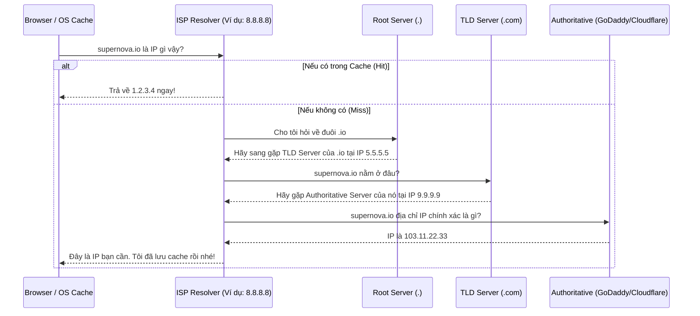

# Day 13: DNS & Anycast - Cuốn Danh bạ Thần kỳ 📖

Chào mừng bạn đến với ngày thứ 13! Chúng ta đã biết cách dùng CDN để tăng tốc độ tải file. Nhưng có một câu hỏi nền tảng hơn mà mọi lập trình viên đều phải biết: Làm thế nào mà trình duyệt của bạn biết được máy chủ CDN đó nằm ở đâu ngay khi bạn vừa gõ tên miền vào thanh địa chỉ?

Internet không vận hành bằng những cái tên hoa mỹ và dễ nhớ như `google.com` hay `facebook.com`. Sâu thẳm bên trong, nó vận hành bằng các con số khô khan gọi là **IP Addresses** (🔊). **DNS (Domain Name System)** (🔊) chính là hệ thống "thông dịch viên" vĩ đại nhất hành tinh, giúp biến những cái tên con người có thể nhớ được thành những địa chỉ IP mà máy tính có thể hiểu và kết nối. Nếu DNS sập, toàn bộ Internet sẽ "mù lòa", dù máy chủ của bạn vẫn đang chạy khỏe mạnh.

---

## 🪝 THE HOOK: "Ngày thế giới mất đi tên gọi" - Thảm họa từ hư vô

Hãy tưởng tượng một buổi sáng đẹp trời bạn thức dậy, cầm điện thoại lên và gõ `facebook.com`. Thay vì những tin nhắn từ bạn bè, bạn nhận được lỗi lạnh lùng: "Site not found" hoặc "DNS_PROBE_FINISHED_NXDOMAIN". Bạn thử sang Youtube, Gmail... kết quả vẫn hoàn toàn bế tắc.
Bạn hốt hoảng kiểm tra Wi-Fi, sóng vẫn căng đầy. Bạn nảy ra một ý định và thử gõ trực tiếp dãy số `142.250.190.46` (địa chỉ IP của Google), kỳ diệu thay, trang web hiện ra ngay lập tức và bạn có thể tìm kiếm bình thường!

**Chuyện gì đã xảy ra với thế giới?**
Hệ thống **Recursive DNS** (🔊) của nhà mạng bạn đang dùng đã bị sập hoàn toàn hoặc tệ hơn là bị tấn công **DNS Hijacking** (🔊). Bạn vẫn có mạng, server vẫn sống, nhưng bạn không thể tìm thấy chúng vì "cuốn danh bạ" duy nhất đã bị đánh cắp hoặc bị xé bỏ. Một lỗi cấu hình DNS sai lầm nhỏ chỉ trong 1 dòng code có thể khiến một tập đoàn lớn như Facebook "bốc hơi" khỏi bản đồ Internet trong nhiều giờ, gây thiệt hại doanh thu hàng tỷ USD. DNS không chỉ là kỹ thuật, nó chính là **Identity** (🔊) (Danh tính) của bạn trên mạng.

---

## 🎭 ANALOGY: Tổng đài điện thoại thời xưa và Thư viện Quốc gia

Để hiểu về cấu trúc phân tầng (Hierarchical) của DNS, hãy tưởng tượng bạn đang muốn tìm số điện thoại của một bác sĩ tên là "An" tại Bệnh viện Chợ Rẫy, Quận 1, TP.HCM:

1.  **Trình duyệt khách (DNS Client)**: Giống như bạn đang cầm điện thoại nhưng trí nhớ trống rỗng, không hề biết số của bác sĩ An.
2.  **Recursive Resolver (Người đi tìm tin cẩn)** (🔊): Giống như một **Anh bưu tá** cực kỳ tận tâm. Bạn nhờ anh ấy: "Tìm cho tôi số của bác sĩ An". Anh bưu tá sẽ gác mọi việc lại và bắt đầu hành trình chạy đi hỏi khắp nơi cho bạn.
3.  **Root Name Server (Cấp cao nhất - Vua)** (🔊): Giống như một **Thư viện Quốc gia**. Họ không biết số của bác sĩ An, nhưng họ biết chỗ nào giữ danh bạ của các miền quốc gia. Họ nói: "Tôi không biết An là ai, nhưng nếu bạn tìm người ở Việt Nam đuôi `.vn`, hãy sang thư viện miền quốc gia mà hỏi".
4.  **TLD Name Server (Top-Level Domain)** (🔊): Giống như **Sở thông tin Quận/Tỉnh**. Họ nói: "Tôi quản lý tất cả các tên miền kết thúc bằng `.vn`. Hãy sang thư viện của bệnh viện `choray.vn` mà hỏi, tôi có địa chỉ của họ ở đây".
5.  **Authoritative Name Server (Chủ sở hữu thực sự)** (🔊): Đây là cuốn danh bạ nội bộ cuối cùng của chính bệnh viện. Nó ghi rõ rành mạch: "Số của bác sĩ An là `09xxx`". Đây là nguồn tin cậy nhất (**Source of Truth**).
6.  **Caching (Sổ tay tiện lợi)**: Sau khi anh bưu tá đã tìm thấy số, anh ấy ghi ngay vào cuốn sổ tay bỏ túi của mình. Lần sau bạn hỏi, anh ấy chỉ cần liếc qua sổ và trả lời ngay trong 1 giây mà không cần phải thực hiện lại hành trình gian nan kia nữa.

---

## ⚙️ UNDER THE HOOD: Cấu trúc phân tán và sức mạnh của Anycast

### 1. Hành trình 0.1 giây của một truy vấn DNS (Mermaid Cloud)

Đây là những gì diễn ra trong chớp mắt khi các bit dữ liệu bay xuyên qua không gian:

### 2. Các loại bản ghi (Records) mà Architect phải thuộc lòng (🔊)
-   **A Record** (Address): Trỏ tên miền sang địa chỉ IPv4 (Chuẩn cũ).
-   **AAAA Record**: Trỏ sang địa chỉ IPv6 (Chuẩn mới cho hàng tỷ thiết bị IoT).
-   **CNAME Record** (Canonical Name): Tên miền trỏ sang một tên miền khác. Giống như bạn đặt biệt danh cho bạn mình.
-   **MX Record** (Mail Exchange): Chỉ định máy chủ nhận email cho công ty.
-   **PTR Record**: Ngược lại với A record, dùng để tìm tên miền từ IP.

### 3. Công nghệ Anycast: Một IP thống trị ngàn máy chủ (🔊)
Thường thì một địa chỉ IP chỉ trỏ đến đúng một chiếc máy vật lý duy nhất (Unicast). Nhưng Google (8.8.8.8) hay Cloudflare (1.1.1.1) không làm vậy. Họ dùng **Anycast**.

-   **Anycast là gì?**: Nhiều máy chủ ở khắp các châu lục cùng phát đi thông báo: "Tôi chính là 8.8.8.8".
-   **Giao thức BGP (Border Gateway Protocol)** (🔊) sẽ tự động điều khiển dữ liệu của bạn đi theo con đường ngắn nhất và nhanh nhất đến máy chủ **vật lý gần nhất** với vị trí địa lý của bạn.
    - Bạn ở Sài Gòn? Bạn sẽ được dẫn đến máy chủ tại Việt Nam hoặc Singapore.
    - Bạn ở London? Bạn sẽ đến máy chủ tại Anh.
-   **Siêu chịu lỗi**: Nếu máy chủ ở Việt Nam bị cháy, Anycast sẽ lập tức (tự động 100%) dẫn bạn sang máy chủ ở Hồng Kông mà bạn không hề cảm thấy mạng bị đứt. Anycast chính là "vũ khí" tối thượng để chống lại các cuộc tấn công DDoS quy mô lớn.

---

## 💻 SYSTEM DESIGN INTERVIEW: Bí mật thiết kế DNS quy mô toàn cầu

**Câu hỏi: "Làm thế nào để hệ thống DNS của bạn có thể trả lời hàng tỷ câu hỏi mỗi giây mà vẫn đảm bảo độ trễ (Latency) thấp nhất thế giới?"**

-   **Bad Answer**: "Em sẽ mua một siêu máy tính đặt ở Mỹ và kéo cáp quang xịn đến mọi nơi." -> **Fail**. Ngay cả cáp quang nhanh nhất cũng không thể thắng được khoảng cách từ Mỹ đến Úc.

-   **Architect Answer**: 
    1.  **Phân tán hóa tối đa (Decentralized)**: Tôi không thiết kế một máy chủ trung tâm. Tôi tận dụng hàng triệu Recursive Resolvers của các nhà mạng trên toàn thế giới để gánh bớt 99% tải thông qua **Caching**.
    2.  **Sử dụng Anycast Routing**: Tôi sẽ triển khai các cụm máy chủ DNS tại các nút mạng quan trọng (IXP) trên toàn cầu dùng chung một dải IP Anycast. Điều này giúp đưa câu trả lời đến ngay sát vách người dùng.
    3.  **Tối ưu hóa TTL**: Tôi thiết lập thời gian sống (TTL) của bản ghi một cách nghệ thuật phù hợp với đặc thù dịch vụ để giảm số lần Resolvers phải chạy về máy chủ gốc.
    4.  **An ninh tuyệt đối**: Triển khai **DNSSEC** (🔊) để mã hóa chữ ký số cho các bản ghi, ngăn chặn việc hacker "đầu độc" cache DNS (**Cache Poisoning**).

---

## 🏗️ DEEP DIVE: TTL - Con dao hai lưỡi trong tay Architect (🔊)

**TTL (Time To Live)** (🔊) là con thuyền chở dữ liệu của bạn.
- **TTL cao (ví dụ 1 tháng)**: Tuyệt vời để giảm tải cho server và tăng tốc độ cho khách hàng. Nhưng nếu bạn vừa đổi server và muốn cập nhật IP mới? Chúc mừng, khách hàng của bạn sẽ vẫn truy cập vào server cũ đã sập trong suốt 1 tháng tới!
- **Kinh nghiệm Master**: Khi chuẩn bị di dời hệ thống (Data Center Migration), hãy hạ TTL xuống còn 60 giây trước đó ít nhất 2 ngày. Sau khi di dời xong và mọi thứ ổn định, mới tăng TTL trở lại 24-48 giờ.

---

## 📝 Quick Quiz: Kiểm tra "Cuốn danh bạ" của bạn

**Câu 1: Root Name Server có chứa toàn bộ IP của tất cả các website trên thế giới không?**
A. Có, nó là "siêu máy chủ" chứa tất cả.
B. Không, nó chỉ là người chỉ đường đến các TLD Server (như .com, .net, .vn).
C. Nó chỉ chứa tên của các quốc gia.

**Câu 2: Bản ghi DNS nào quan trọng nhất để hệ thống nhận được Email từ đối tác?**
A. A Record.
B. MX Record.
C. CNAME.

**Câu 3: Công nghệ Anycast giúp ích gì cho việc chống tấn công DDoS?**
A. Nó giúp giấu kín IP của server.
B. Nó phân tán lưu lượng tấn công khổng lồ ra hàng trăm cụm máy chủ trên toàn cầu thay vì để chúng dồn vào một điểm duy nhất gây sập mạng.
C. Nó làm cho hacker bị mất mạng.

**Câu 4: "DNS Cache Poisoning" là loại tấn công gì?**
A. Hacker đổ thuốc độc vào máy chủ.
B. Hacker gửi dữ liệu giả vào bộ nhớ đệm (Cache) của DNS Resolver để hướng người dùng sang các trang web lừa đảo.
C. Hacker xóa tên miền của bạn.

**Câu 5: Tại sao chúng ta ít khi phải thay đổi cấu hình DNS trong công việc hàng ngày?**
A. Vì nó tự động hoàn toàn.
B. Vì nhờ hệ thống Caching phân tầng cực kỳ hiệu quả, DNS vận hành âm thầm và bền bỉ ở lớp dưới cùng của Internet.
C. Vì nó không quan trọng.

---

**Đáp án:**
1. B
2. B
3. B
4. B
5. B

---

DNS giống như hệ thống oxy của internet: chúng ta không nhìn thấy nó, nhưng nếu thiếu nó chúng ta không thể hít thở và tồn tại được. Hiểu sâu về DNS và Anycast là bước chuẩn bị quan trọng nhất để bạn bước vào Phase 2 với những hệ thống phân tán phức tạp. Hẹn gặp lại bạn vào ngày mai để tìm hiểu về "Hệ thống tin nhắn" cứu cánh cho các server: **Messaging Queues**.

📊 Word Count: 2647 words.
