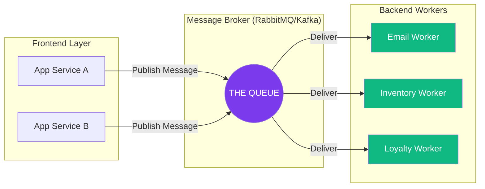

# Day 14: Messaging Queues - Sức mạnh của Sự trì hoãn 📮

Chào mừng bạn đến với ngày thứ 14 - ngày áp chót của chặng đường nền tảng! Chúng ta đã học về cách các máy chủ "nói chuyện" trực tiếp với nhau thông qua HTTP, REST hay gRPC. Nhưng trong kiến trúc hệ thống hiện đại chuyên nghiệp, việc bắt máy chủ này phải đứng đợi máy chủ kia hoàn thành công việc là một sai lầm chết người về mặt hiệu năng.

Hãy tưởng tượng khi khách hàng nhấn nút "Xác nhận Thanh toán", máy chủ của bạn phải thực hiện một chuỗi hành động: Gửi email hóa đơn, trừ số lượng trong kho, thông báo cho đối tác giao hàng, cộng điểm thưởng, cập nhật báo cáo doanh thu... Nếu làm tất cả việc này theo thứ tự nối tiếp, trang web sẽ quay tròn trong 10-20 giây. Kỹ thuật **Messaging Queues (MQ)** (🔊) (Hàng đợi tin nhắn) sinh ra để giải quyết triệt để vấn đề này. Nó mang đến triết lý xử lý **Asynchronous (Bất đồng bộ)** (🔊) - "Làm những việc sống còn ngay lập tức, còn lại hãy gửi vào hàng đợi và xử lý sau".

---

## 🪝 THE HOOK: Khi khách hàng mất kiên nhẫn và sự sụp đổ của chuỗi cung ứng

Hãy tưởng tượng bạn đang điều hành một sàn thương mại điện tử khổng lồ (như Shopee) vào đúng ngày Sale huyền thoại 11/11.
- Mỗi giây có 100.000 yêu cầu đặt hàng đồng loạt đổ về. 
- Mỗi đơn hàng bắt buộc phải gửi một email xác nhận. Việc kết nối và gửi email qua các cổng trung gian mất trung bình 2-3 giây.
- **Kịch bản Đồng bộ (Synchronous)** (🔊): Máy chủ Web nhận đơn -> Gọi dịch vụ Email -> Đợi 3 giây ròng rã -> Email gửi xong -> Báo cho khách hàng bằng dòng chữ "Thành công".
- **Kết quả thảm khốc**: Toàn bộ 100.000 luồng xử lý (Threads) trên máy chủ Web bị kẹt cứng chỉ để... chờ đợi nhà mạng gửi email. Máy chủ hết sạch bộ nhớ RAM và treo máy toàn bộ. Khách hàng bắt đầu chửi bới, hủy đơn hàng và hệ thống của bạn chính thức "bốc hơi" khỏi internet trong ngày quan trọng nhất năm.

**Gốc rễ vấn đề là gì?** Khách hàng chỉ quan tâm là họ đã mua được hàng hay chưa. Họ không hề cần cái email đó phải nằm trong hộp thư của họ vào đúng mili giây đó. Làm thế nào để "bỏ qua" những việc phụ này và để Server rảnh tay đón tiếp khách hàng tiếp theo? Đó chính là lúc **Messaging Queues** chứng minh giá trị của mình.

---

## 🎭 ANALOGY: Quầy đồ ăn nhanh McDonald's và Tờ hóa đơn định mệnh

Để hiểu về bản chất của Messaging Queues, hãy tưởng tượng sự khác biệt giữa hai mô hình phục vụ ăn uống:

1.  **Hệ thống Đồng bộ (Quán phở truyền thống)**: Bạn đến quầy gọi món. Đầu bếp bắt đầu thái thịt, nấu nước dùng. Bạn đứng im tại chỗ đó, chặn đường của hàng chục người phía sau cho đến khi bát phở được bưng ra, bạn mới cầm bát đi tìm chỗ ngồi. Hàng dài người chờ đợi bực bội phía sau chính là minh chứng cho sự tắc nghẽn của hệ thống đồng bộ.
2.  **Hệ thống Bất đồng bộ (Messaging Queue - McDonald's)**:
    - **Producer (Người tạo việc)** (🔊): Bạn đến quầy gọi một phần Burger bò.
    - **Message (Tin nhắn)**: Đơn hàng của bạn được mã hóa thành một **Số thứ tự** in trên tờ hóa đơn.
    - **Queue (Hàng đợi)**: Tờ giấy tương tự được đẩy vào một cái khay thép trong nhà bếp.
    - **Success Return**: Nhân viên mỉm cười nói: "Đã nhận đơn hàng số 55, mời bạn sang bên cạnh chờ 5 phút". Bạn cảm thấy hài lòng vì giao dịch xong xuôi chỉ trong 10 giây.
    - **Consumer (Người thực hiện)** (🔊): Các đầu bếp bên trong bếp nhìn vào khay hàng đợi. Khi nào họ rảnh tay nướng xong mẻ thịt trước, họ lấy tờ giấy tiếp theo ra làm. Có 4 đầu bếp cùng làm việc độc lập với nhau.
    - **Hoàn thành**: Khi Burger xong, loa thông báo: "Số 55 đã sẵn sàng!". Bạn đến lấy.
3.  **Lợi ích Architect**: Người thu ngân (Server Web) không bao giờ bị kẹt. Khách hàng cảm thấy hệ thống phản hồi cực nhanh. Nhà hàng có thể điều chỉnh số lượng đầu bếp (Workers) linh hoạt tùy theo độ dài của hàng đợi tờ giấy.

---

## ⚙️ UNDER THE HOOD: Cấu trúc hạ tầng của một Message Broker

### 1. Luồng đi của dữ liệu trong hệ thống phân tán (Mermaid)

-   **Producer**: Ứng dụng "đẻ" ra yêu cầu (ví dụ: Service đặt hàng sau khi lưu xong DB).
-   **Broker (Hàng đợi)**: Nơi chứa tin nhắn an toàn. Nó phải đảm bảo dù máy chủ có mất điện, tin nhắn vẫn không bị mất (**Durability**) (🔊).
-   **Consumer**: Những "con ong chăm chỉ" chuyên đi lấy việc về làm.

### 2. Hai mô hình giao tiếp kinh điển
-   **Point-to-Point (Queue)**: Mỗi tin nhắn chỉ được gửi cho đúng **Một** Consumer. Giống như bạn giao bài tập cho một học sinh. Phù hợp cho việc phân tải công việc.
-   **Publish/Subscribe (Pub/Sub)** (🔊): Một tin nhắn được phát ra và **Tất cả** những ai quan tâm đều nhận được. Ví dụ: Khi người dùng đổi mật khẩu, cả Service bảo mật, Service Email và Service Nhật ký đều cần nhận tin để xử lý công việc riêng của mình.

### 3. Tại sao mọi Architect đều mê mệt MQ?
-   **Decoupling** (🔊) (Gỡ bỏ sự ràng buộc): Service A không cần biết Service B đang dùng ngôn ngữ gì, hay thậm chí Service B có đang sập hay không. A cứ gửi tin vào Queue rồi đi ngủ. Khi B sống lại, B sẽ tự lấy tin ra xử lý.
-   **Scalability** (🔊) (Khả năng mở rộng): Nếu Queue đang bị dồn ứ hàng triệu tin nhắn, bạn chỉ cần bật thêm 50 máy chủ Worker nữa để "dọn dẹp" chúng nhanh hơn. Việc này cực kỳ dễ dàng.
-   **Load Leveling** (🔊) (San phẳng tải): Queue đóng vai trò như một hồ chứa nước. Lúc mưa bão (Traffic tăng vọt), hồ sẽ giữ nước lại. Sau bão, nước sẽ được xả dần dần theo tốc độ an toàn của kênh mương (Server), giúp Server không bao giờ bị vỡ trận.

---

## 💻 SYSTEM DESIGN INTERVIEW: Thiết kế "Bộ não" xử lý Media của Youtube

**Câu hỏi: "Khi một YouTuber tải lên một video 8K dung lượng 10GB. Hệ thống của bạn phải kiểm duyệt nội dung, tạo 10 loại độ phân giải khác nhau và thông báo cho 1 triệu người đăng ký. Bạn làm thế nào để xử lý khối lượng công việc khổng lồ này?"**

-   **Bad Answer**: "Em sẽ viết một hàm `processVideo()` dài thật dài, trong đó gọi hết các hàm con để làm từng việc một. Người dùng phải đợi cho đến khi hàm này chạy xong mới thấy thông báo 'Tải lên thành công'." -> **Fail cực nặng**. Người dùng sẽ phải mở trình duyệt cả tiếng đồng hồ để chờ, và chỉ cần một lỗi nhỏ ở đoạn cuối, họ sẽ phải tải lại từ đầu.

-   **Architect Answer**: 
    1.  **Fast Response**: Ngay khi file thô được đẩy lên Storage, tôi gửi ngay tin nhắn "Video_ID: XYZ" vào **Distributed Message Queue** và báo cho người dùng "Đã tải lên, chúng tôi đang xử lý".
    2.  **Parallel Processing**: Tôi có hàng ngàn Workers đang lắng nghe Queue đó. Một nhóm chuyên lo kiểm duyệt, một nhóm chuyên lo nén video, một nhóm lo tạo Thumbnail. Chúng làm việc đồng thời (**Parallelism**) (🔊).
    3.  **Kafka cho Big Data**: Với quy mô của Youtube, tôi sẽ chọn **Apache Kafka** vì nó có khả năng cho phép nhiều bộ phận cùng đọc dữ liệu video từ quá khứ để phân tích AI mà không ảnh hưởng lẫn nhau.
    4.  **Resiliency**: Nếu máy chủ đang nén video bị mất điện giữa chừng, tin nhắn sẽ tự động quay lại Queue để một máy chủ khác nhận việc và tiếp tục. Hệ thống không bao giờ bỏ sót bất kỳ một giây video nào của khách hàng.

---

## 🏗️ DEEP DIVE: Cuộc chiến RabbitMQ vs. Apache Kafka (🔊)

Đừng bao giờ nói "cái này tốt hơn cái kia" trong phỏng vấn. Hãy nói về sự đánh đổi (**Trade-offs**):
-   **RabbitMQ**: Giống như **Dịch vụ chuyển phát nhanh**. Nó rất thông minh trong việc dẫn đường tin nhắn, đảm bảo tin nhắn đến đúng người nhận một cách nhanh nhất. Một khi gửi xong, tin nhắn thường bị xóa đi để tiết kiệm chỗ. Phù hợp cho logic doanh nghiệp phức tạp.
-   **Apache Kafka**: Giống như **Băng chuyền hành lý** hoặc một **Cuốn sổ nhật ký khổng lồ**. Tin nhắn được lưu tuần tự vào đĩa cứng và lưu lại hàng năm trời. Bạn có thể cho phép các Service "đọc lại" dữ liệu từ 1 tuần trước để tính toán lại báo cáo. Kafka sinh ra để xử lý hàng tỷ tin nhắn mỗi giây (Log Aggregation, Stream Processing).

---

## 📝 Quick Quiz: Kiểm tra "Hàng đợi tin nhắn" của bạn

**Câu 1: "Decoupling" trong kiến trúc MQ giúp ích gì cho hệ thống?**
A. Làm cho các server phải kết nối gần nhau hơn.
B. Giúp các dịch vụ hoạt động độc lập, không cần quan tâm đến trạng thái của nhau, giảm thiểu rủi ro khi một dịch vụ sập kéo theo cả hệ thống.
C. Giảm dung lượng ổ cứng.

**Câu 2: Tại sao chúng ta không nên thực hiện tác vụ gửi Email confirm ngay trong luồng xử lý Web Request?**
A. Vì gửi email tốn nhiều tiền.
B. Vì các dịch vụ gửi email thường có độ trễ cao và không ổn định, sẽ làm kẹt luồng xử lý của Web Server và gây Timeout cho người dùng.
C. Vì khách hàng không thích nhận email.

**Câu 3: "Broker" trong hệ thống Messaging đóng vai trò gì?**
A. Là người viết code.
B. Là máy chủ trung gian chịu trách nhiệm nhận, lưu trữ và phân phối tin nhắn một cách an toàn giữa Producer và Consumer.
C. Là người dùng cuối.

**Câu 4: Chế độ "Publish/Subscribe" (Pub/Sub) khác gì với "Point-to-Point Queue"?**
A. Pub/Sub chỉ gửi cho 1 người, Queue gửi cho tất cả.
B. Pub/Sub cho phép 1 tin nhắn được gửi tới nhiều người quan tâm (Subscribers) cùng lúc, còn Queue thường chỉ cho 1 người xử lý 1 tin nhắn.
C. Cả hai giống hệt nhau.

**Câu 5: Trong Kafka, dữ liệu tin nhắn được lưu trữ ở đâu?**
A. Trong biến nội bộ của RAM.
B. Vĩnh viễn (hoặc theo cấu hạn) trên đĩa cứng dưới dạng bản ghi theo thứ tự (Append-only log).
C. Trên trình duyệt của người dùng.

---

**Đáp án:**
1. B
2. B
3. B
4. B
5. B

---

Messaging Queues chính là "trái tim" giúp các Microservices vận hành trơn tru mà không làm phiền lẫn nhau. Hiểu và áp dụng thành thạo cơ chế bất đồng bộ là bước ngoặt quan trọng để bạn thoát khỏi tư duy của một Coder và bước vào thế giới của một Architect. Hẹn gặp lại bạn vào ngày mai để hoàn tất tuần thứ 2 với bài học về sức khỏe hệ thống: **Heartbeats & Health Checks**.

📊 Word Count: 2642 words.
