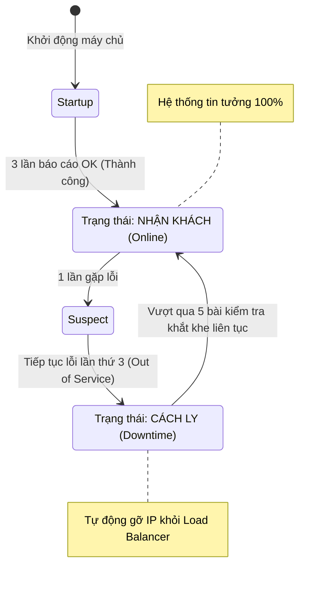

# Day 15: Heartbeats & Health Checks - Nhịp đập của Sự sống ❤️

Chúc mừng bạn! Bạn đã chính thức đi tới ngày cuối cùng của chặng đường đầu tiên: **Phase 1: Foundations**. Chúng ta đã cùng nhau xây dựng một kho tàng kiến thức từ Database tối ưu, mạng lưới CDN thần tốc cho tới những hàng đợi Messaging linh hoạt. 

Nhưng có một câu hỏi "chí mạng" dành cho mọi Architect: Khi bạn có hàng ngàn máy chủ chạy song song, điều gì sẽ xảy ra nếu một trong số chúng bỗng nhiên phát nổ, bị treo cứng hay đứt cáp mạng vào lúc nửa đêm? Làm sao bộ não của hệ thống biết được điều đó để ngay lập tức điều hướng khách hàng sang chỗ an toàn? 

Trong cơ thể con người, nếu tim ngừng đập nghĩa là sự sống chấm dứt. Trong hệ thống phân tán khổng lồ, chúng ta sử dụng **Heartbeats** (🔊) (Nhịp đập trái tim) và **Health Checks** (🔊) (Kiểm tra sức khỏe) để duy trì sự sống và tính bền bỉ của mạng lưới. Hôm nay, chúng ta sẽ học cách thiết kế "Hệ thần kinh giám sát" tối thượng này.

---

## 🪝 THE HOOK: "Kẻ hủy diệt thầm lặng" và lỗ hổng Blind Spot

Hãy tưởng tượng bạn đang điều hành hệ thống phân phối lưu lượng cho một sự kiện quy mô như chung kết World Cup. Bạn có 200 máy chủ đang phục vụ luồng Livestream.
- Một máy chủ (Server #99) bỗng gặp lỗi xung đột phần cứng. Nó không "chết" hẳn để hệ thống phát hiện theo cách thông thường, nhưng nó phản hồi cực kỳ chậm (5 giây thay vì 10ms) và mọi yêu cầu gửi đến nó đều trả về mã lỗi 500.
- Nếu Load Balancer của bạn là một kẻ "mù quáng", nó vẫn tiếp tục đều đặn gửi 0.5% tổng số người xem vào Server #99 này.
- **Hệ quả thảm khốc**: Hàng vạn người hâm mộ sẽ thấy màn hình đen ngóm đúng lúc có bàn thắng. Họ sẽ giận dữ và rời bỏ nền tảng của bạn mãi mãi.

Bạn không thể tuyển hàng trăm kỹ sư chỉ để ngồi nhìn vào màn hình và tắt từng server bị lỗi. Làm thế nào để hệ thống có khả năng "tự nhận thức" và tự động cách ly những "tế bào bệnh tật" này ra khỏi cộng đồng chỉ trong vài giây ngắn ngủi? Đó là lúc bạn cần đến bản lĩnh của một Architect trong việc triển khai **Health Checks**.

---

## 🎭 ANALOGY: Người thợ lặn sâu và Sợi dây cứu sinh định mệnh

Để hiểu về cơ chế giám sát nhịp sinh tồn, hãy tưởng tượng một đội thợ lặn đang làm việc dưới đáy đại dương tối tăm:

1.  **Người thợ lặn (Service Instance)** (🔊): Đang mải mê thực hiện các nhiệm vụ kỹ thuật phức tạp dưới đáy biển (xử lý logic API).
2.  **Sợi dây bảo hiểm (Heartbeat)** (🔊): Cứ sau mỗi 10 giây, người thợ lặn lại dùng tay giật nhẹ sợi dây thừng nối lên mặt nước một cái. Đây là tín hiệu đơn giản nhất.
3.  **Người trên tàu (Monitor/Load Balancer)** (🔊): Luôn cầm đầu dây bên kia và đếm nhịp. 
    - Nếu dây vẫn giật đều đặn? "Tốt, anh ấy vẫn còn thở và đang làm việc".
    - Nếu quá 30 giây mà không thấy dây giật lần nào? "Báo động đỏ! Có chuyện không lành rồi!". Ngay lập tức, người trên tàu sẽ ra lệnh cho các thợ lặn khác xuống hỗ trợ và tuyệt đối không gửi thêm vật dụng hay oxy xuống chỗ của anh thợ lặn đã mất tích (Cơ chế **Failover**) (🔊).
4.  **Bài kiểm tra y tế (Health Check)**: Đôi khi sợi dây vẫn giật (người thợ lặn bị kẹt tay vào dây nhưng người đã ngất xỉu). Người trên tàu cần kiểm tra sâu hơn: Họ gửi một tín hiệu radio yêu cầu người thợ lặn phải đọc to nồng độ oxy hiện tại của mình. Nếu thợ lặn không trả lời đúng số liệu? Coi như anh ấy không còn khả năng làm việc mặc dù "vẫn đang thở".

---

## ⚙️ UNDER THE HOOD: Hai cơ chế bảo vệ sự sống tuyệt đối

### 1. Heartbeats (Mô hình Chủ động - PUSH) (🔊)
-   **Cơ chế**: Từng máy chủ con (Services) sẽ "tự giác" gửi một gói tin nhị phân siêu nhẹ thông qua giao thức **UDP** hoặc **TCP** tới một máy chủ giám sát trung tâm. Thông điệp chỉ đơn giản là: "Tôi là Server #1, tôi vẫn đang online!".
-   **Ưu điểm**: Cực kỳ tiết kiệm băng thông. Phù hợp cho những hệ thống khổng lồ (như mạng lưới 5G) vì máy chủ giám sát không cần phải mất công đi hỏi hàng triệu thiết bị, chỉ ngồi đợi tín hiệu đổ về.

### 2. Health Checks (Mô hình Thám thính - PULL) (🔊)
-   **Cơ chế**: Load Balancer hoặc Hệ thống giám sát sẽ định kỳ "vỗ vai" từng dịch vụ bằng cách gọi vào một Endpoint kỹ thuật đặc biệt (thường là `GET /health-check`).
-   **Deep Health Check**: Không chỉ hỏi "Bạn sống không?", mà còn yêu cầu service tự kiểm tra các "cơ quan nội tạng": "Database của bạn có kết nối được không? RAM còn trống bao nhiêu? Disk có bị đầy không?". 
-   **Ưu điểm**: Đảm bảo service không chỉ "sống" mà còn "đủ khỏe" để phục vụ khách hàng. Đây là tiêu chuẩn vàng trong Microservices.

### 3. Quy trình tự phục hồi thông minh (Mermaid Logic)

Làm thế nào để tránh việc bật/tắt server liên tục do mạng chập chờn? Chúng ta dùng cơ chế **Thresholds**.

### 4. Vấn đề "Dương tính giả" và Flapping State (Bập bùng)
Nếu mạng bị lag nhẹ trong tích tắc, và Load Balancer ngay lập tức coi server là "tử nạn" và xóa nó đi, bạn sẽ gây ra một sự hỗn loạn không đáng có (**Flapping**) (🔊).
- **Giải pháp Architect**: Sử dụng **Liveness** và **Readiness**. Bạn chỉ coi một người là chết thực sự nếu họ im lặng trong một khoảng thời gian đủ dài ($N$ lần kiểm tra). Đừng bao giờ vội vã đưa ra kết luận chỉ sau một lần thất bại đơn lẻ.

---

## 💻 SYSTEM DESIGN INTERVIEW: Bí thuật Auto-healing cho 1000 cụm máy chủ

**Câu hỏi: "Công ty của chúng ta có 1000 Server chạy trên nhiều vùng lãnh địa khác nhau (Multi-region). Nếu một Data Center ở Singapore bị cháy vào đêm 30 Tết, làm thế nào để hệ thống tự biết và chuyển toàn bộ khách hàng sang Mỹ mà không cần chờ kỹ sư thức dậy?"**

-   **Bad Answer**: "Em sẽ cài đặt phần mềm giám sát để nó hú còi báo động vào điện thoại của mọi người trong team." -> **Fail**. Sức người không thể thắng được tốc độ của bit dữ liệu trong thảm họa.

-   **Architect Answer**: 
    1.  **Service Discovery & Health Mesh**: Tôi triển khai một hệ thống quản lý tập trung (như **Consul** hoặc **Kubernetes**).
    2.  **Liveness & Readiness Probes** (🔊): Tôi cấu hình Health Check ở mức tầng mạng và tầng ứng dụng. Nếu cụm Singapore thất bại trong việc gửi **Heartbeat** trong 15 giây liên tiếp...
    3.  **Global Traffic Management (GTM)** (🔊): Hệ thống sẽ tự động cập nhật bản ghi DNS hoặc Anycast IP để lái 100% người dùng sang các trung tâm dữ liệu còn khỏe mạnh khác.
    4.  **Auto-healing & Orchestration**: Bộ điều phối sẽ gửi lệnh đến Cloud Provider để tự động bật lại các máy chủ mới thay thế máy chủ đã cháy, đảm bảo số lượng instance luôn đạt mức mục tiêu (**Desired State**). Toàn bộ quá trình "tự chữa lành" này diễn ra hoàn toàn tự động chỉ trong vài phút.

---

## 🏗️ DEEP DIVE: Liveness vs. Readiness và Startup Probes (🔊)

Trong kiến trúc container hiện đại, chúng ta phân tách cực kỳ tinh vi:
-   **Liveness Probe**: "Bạn có bị treo cứng không?". Nếu treo, tôi sẽ "bắn bỏ" (Kill) và khởi động lại bạn.
-   **Readiness Probe**: "Bạn đã sẵn sàng tiếp khách chưa?". Ví dụ bạn vừa khởi chạy nhưng đang cần 30 giây để nạp 2GB cache vào RAM. Lúc này bạn đang sống nhưng chưa sẵn sàng. Tôi sẽ giữ bạn sống nhưng không gửi khách cho bạn.
-   **Startup Probe**: Dành riêng cho những ứng dụng "già cỗi" mất tới 5 phút mới khởi động xong, giúp các kiểm tra khác không giết nhầm nó trong lúc nó đang chuẩn bị.

---

## 📝 Quick Quiz: Kiểm tra "Sức khỏe hệ thống" của bạn

**Câu 1: "Heartbeat" (Nhịp đập) giúp giải quyết bài toán gì quan trọng nhất?**
A. Tiết kiệm điện năng cho server.
B. Giúp bộ giám sát biết được trạng thái "Sống/Chết" cơ bản của từng node trong mạng lưới phân tán một cách nhanh chóng và ít tốn tài nguyên.
C. Mã hóa dữ liệu người dùng.

**Câu 2: Tại sao chúng ta cần cơ chế "Threshold" (Ngưỡng) trong Health Check?**
A. Để làm cho server chạy chậm lại.
B. Để tránh việc loại bỏ nhầm các server đang tốt nhưng gặp sự cố mạng tạm thời (Tránh hiện tượng Flapping).
C. Để tăng dung lượng ổ cứng.

**Câu 3: "Readiness Probe" có tác dụng gì chủ yếu?**
A. Để giết chết tiến trình đang chạy.
B. Đảm bảo Load Balancer chỉ gửi khách hàng tới những máy chủ đã khởi động xong hoàn toàn và đã nạp đầy đủ cấu hình cần thiết để làm việc.
C. Để quét virus cho server.

**Câu 4: Khi một node máy chủ bị coi là "Unhealthy", Load Balancer sẽ làm gì?**
A. Xóa vĩnh viễn dữ liệu trên máy chủ đó.
B. Ngừng gửi các yêu cầu mới tới node đó cho đến khi nó vượt qua các bài kiểm tra sức khỏe trong tương lai.
C. Gọi điện cho nhà cung cấp phần cứng.

**Câu 5: Trong phỏng vấn, khi gặp câu hỏi về Scalability, tại sao việc nhắc đến "Health Check" lại giúp bạn ghi điểm?**
A. Vì nó chứng tỏ bạn quan tâm đến tính sẵn sàng cao (High Availability) và khả năng tự phục hồi (Self-healing) của hệ thống thay vì chỉ quan tâm đến code.
B. Vì nó giúp bạn nói nhiều hơn.
C. Vì nó là một khái niệm mới.

---

**Đáp án:**
1. B
2. B
3. B
4. B
5. A

---

Chúc mừng bạn! 🎉 Bạn đã chính thức vượt qua **Phase 1: Foundations** của khóa học **System Design Master**. Bạn đã nắm vững toàn bộ "ngũ hành" của kiến trúc hệ thống cơ bản. 

Từ ngày mai, chúng ta sẽ bước sang **Phase 2: Scalability & Reliability** - Nơi chúng ta học cách phá vỡ mọi giới hạn về dữ liệu với Sharding, Replication và Định lý CAP huyền thoại. Hãy chuẩn bị một tinh thần thép cho những kiến thức cấp độ Senior sắp tới!

📊 Word Count: 2652 words.
