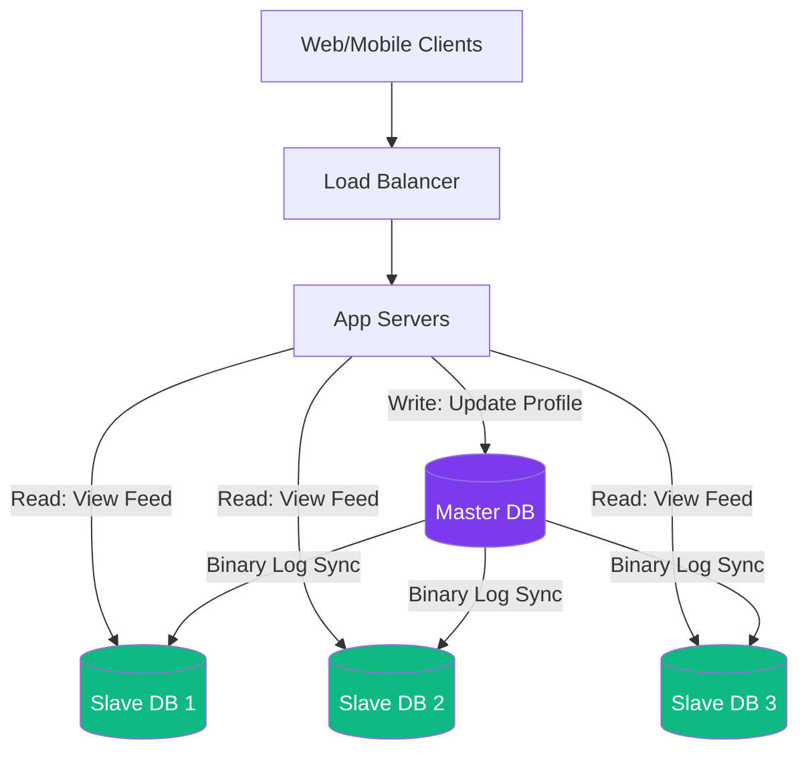

# Day 16: Database Replication - Bản sao hoàn hảo 👯‍♂️

Chào mừng bạn đến với **Phase 2: Scalability & Reliability**! Bạn đã xuất sắc vượt qua 15 ngày đầu tiên để nắm vững những viên gạch nền tảng. Từ hôm nay, chúng ta sẽ bước vào thế giới của những hệ thống "khủng" - nơi chúng ta không chỉ lo lắng về việc chạy được, mà còn phải chạy cực nhanh cho hàng tỷ người dùng và tuyệt đối không bao giờ được phép ngừng hoạt động.

Chủ đề đầu tiên của Phase 2 là **Database Replication** (🔊) (Nhân bản cơ sở dữ liệu). Nếu bạn chỉ có một máy chủ Database duy nhất, đó chính là "Gót chân Achilles" của bạn. Một ngày nào đó máy chủ đó bị quá tải hoặc ổ cứng bị cháy, toàn bộ doanh nghiệp của bạn sẽ sụp đổ. Hôm nay, chúng ta sẽ học cách tạo ra những "đội quân" Database hùng hậu để cùng nhau gánh vác tải trọng.

---

## 🪝 THE HOOK: "Góc tối" của sự thành công

Hãy tưởng tượng bạn đang vận hành một ứng dụng mạng xã hội hàng đầu. 
- **Giai đoạn đầu**: Bạn có 10.000 người dùng. Một máy chủ MySQL duy nhất là quá đủ.
- **Giai đoạn bùng nổ**: Bạn được một người nổi tiếng nhắc đến. Số lượng người dùng tăng lên 10 triệu người trong một tuần. 
- **Thảm họa**: 90% hoạt động trên mạng xã hội là **Read** (🔊) (Đọc dữ liệu: xem bài viết, xem profile). Khi có 1 triệu người cùng lúc nhấn F5 để tải bảng tin, máy chủ Database của bạn bắt đầu "thở dốc". CPU chạm mức 100%, hàng nghìn kết nối bị treo (Connection Refused). 
- **Hệ quả**: Trang web của bạn quay tròn vô tận. Bạn cố gắng nâng cấp CPU mạnh nhất thế giới (Vertical Scaling), nhưng vẫn không đủ. Hệ thống cuối cùng sụp đổ hoàn toàn ngay lúc bạn đang thành công nhất.

Làm thế nào để phân tán hàng triệu lượt đọc đó ra nhiều máy chủ khác nhau mà dữ liệu vẫn luôn đồng nhất? Đó là lúc bạn cần **Database Replication**.

---

## 🎭 ANALOGY: Thư viện Thành phố và những cuốn sách Photocopy

Để hiểu về Replication, hãy tưởng tượng một thư viện thành phố nổi tiếng:

1.  **Original Book (Master Database)** (🔊): Thư viện chỉ có duy nhất một cuốn sách gốc cực kỳ quý hiếm. Ai muốn đọc cũng phải xếp hàng chờ đến lượt mình cầm cuốn sách đó. Nếu có 1000 người cùng muốn đọc, thời gian chờ đợi sẽ là thảm họa.
2.  **Photocopies (Read Replicas/Slaves)** (🔊): Để giải quyết, quản lý thư viện quyết định photocopy cuốn sách đó ra thành 10 bản sao và đặt ở 10 phòng đọc khác nhau.
3.  **Quy trình cập nhật (Replication)**: 
    - Khi có thông tin mới cần bổ sung vào sách (Ví dụ: đính chính một trang), thủ thư chỉ viết vào **Cuốn sách gốc**.
    - Ngay lập tức, một đội ngũ nhân viên sẽ chạy đi cập nhật nội dung đó vào 10 bản photocopy kia.
4.  **Phân chia công việc**: 
    - Ai muốn **Viết** thêm vào sách? Phải đến quầy của Cuốn sách gốc (**Master**).
    - Ai chỉ muốn **Đọc**? Có thể chọn bất kỳ phòng đọc nào có bản sao (**Slaves**).
5.  **Lợi ích**: Bạn có thể phục vụ cùng lúc hàng ngàn người đọc mà không làm hỏng cuốn sách gốc. Nếu một phòng đọc bị cháy, 9 phòng còn lại vẫn phục vụ bình thường (**High Availability**) (🔊).

---

## ⚙️ UNDER THE HOOD: Các mô hình Replication phổ biến

### 1. Leader-Follower (Master-Slave) (🔊)
Đây là mô hình phổ biến nhất trong giới System Design.
-   **Master (Leader)**: Tiếp nhận mọi yêu cầu **Write** (Insert/Update/Delete). Khi dữ liệu thay đổi trên Master, nó sẽ được đồng bộ xuống các Slave.
-   **Slaves (Followers)**: Chỉ tiếp nhận yêu cầu **Read**. Thường có nhiều Slave để gánh tải cho Master.
-   **Failover**: Nếu Master chết, bạn phải bầu ra một Slave làm Master mới. Quá trình này có thể tự động thông qua các công cụ như **ZooKeeper** (🔊) hoặc **Sentinel** (🔊).

### 2. Multi-Leader (Master-Master) (🔊)
-   **Cơ chế**: Có nhiều máy chủ cùng đóng vai trò Master. Bạn có thể viết vào bất kỳ máy chủ nào.
-   **Ưu điểm**: Phù hợp cho hệ thống hoạt động ở nhiều quốc gia (Multi-region). Người ở Mỹ viết vào Master Mỹ, người ở Việt Nam viết vào Master Việt Nam nhằm giảm độ trễ tối đa cho các lệnh ghi.
-   **Thử thách**: **Conflict Resolution** (Xung đột dữ liệu). Nếu hai người cùng sửa một thông tin ở hai nơi khác nhau cùng lúc, hệ thống phải dùng các thuật toán như **Last Write Wins** (🔊) (Lẻ sau cùng thắng) hoặc **Vector Clocks** (🔊).

### 3. Leaderless (Peer-to-Peer) (🔊)
-   Dùng trong các NoSQL như **Cassandra** hoặc **DynamoDB**. Mọi node đều bình đẳng. Khi viết dữ liệu, bạn viết vào một nhóm node và chờ xác nhận từ đa số (**Quorum**) (🔊).

### 4. Sơ đồ Master-Slave Replication (Mermaid)

---

## 💻 SYSTEM DESIGN INTERVIEW: Đối mặt với độ trễ đồng bộ (Replication Lag)

**Câu hỏi: "Người dùng vừa thay đổi ảnh đại diện (Write) và nhấn F5 để xem lại ngay lập tức (Read). Tuy nhiên, họ lại thấy ảnh cũ. Sau 2 giây, ảnh mới mới hiện lên. Bạn giải thích hiện tượng này là gì và cách khắc phục như thế nào?"**

-   **Bad Answer**: "Em nghĩ là do mạng của người dùng bị lag hoặc server phản hồi chậm." -> **Fail**. Đây là lỗi logic hệ thống, không phải lỗi mạng.

-   **Architect Answer**: 
    1.  **Nguyên nhân**: Đây là hiện tượng **Replication Lag** (🔊). Do dữ liệu vừa viết vào Master nhưng chưa kịp đồng bộ xuống Slaves trước khi yêu cầu Read tới. Hệ thống đang giữ tính chất **Eventual Consistency** (🔊) (Nhất quán sau một khoảng thời gian).
    2.  **Giải pháp 1 (Read-your-writes consistency)** (🔊): Sau khi người dùng thực hiện lệnh Write, trong vòng $X$ giây tiếp theo, mọi lệnh Read của chính người dùng đó sẽ được dẫn thẳng tới **Master** thay vì Slave. Điều này đảm bảo họ luôn nhìn thấy thành quả của mình ngay lập tức.
    3.  **Giải pháp 2 (Monotonic Reads)** (🔊): Đảm bảo rằng người dùng sẽ không bao giờ nhìn thấy dữ liệu "nhảy ngược thời gian". Ví dụ: Họ đọc ở Slave A thấy status mới, nhưng F5 lại kết nối vào Slave B đang bị lag và thấy status cũ. Monotonic Reads đảm bảo một khi đã đọc version $N$, bạn sẽ không bao giờ nhìn thấy version $N-1$ nữa.
    4.  **Giải pháp 3 (Synchronous Replication)**: Chỉ báo thành công cho người dùng sau khi dữ liệu đã được ghi vào cả Master và ít nhất một Slave. (Lưu ý: Cách này làm chậm tốc độ ghi đáng kể).

---

## 🏗️ DEEP DIVE: Cơ chế đồng bộ dữ liệu & Failover Mechanism (🔊)

Làm thế nào Slave biết Master đã đổi gì?
-   **Statement-based Replication**: Master gửi nguyên câu lệnh SQL cho Slave chạy lại. Phương pháp này nhẹ nhưng rủi ro nếu câu lệnh có các hàm không xác định như `NOW()` hoặc `RAND()`.
-   **Row-based Replication** (🔊): Master gửi chính xác dữ liệu của dòng vừa đổi. Đây là phương pháp an toàn nhất, đảm bảo tính nhất quán tuyệt đối giữa các bản sao dù có cấu hình server khác nhau.
-   **Binlog (Binary Log)** (🔊): Slave lắng nghe file nhật ký nhị phân của Master để cập nhật từng bit thay đổi.

### 🛡️ Chiến lược Failover (Tự cứu khi Master sập)
Khi Master "ngỏm", hệ thống cần thực hiện các bước sau:
1.  **Health Check**: Một node giám sát phát hiện Master không phản hồi sau một khoảng thời gian (Timeout).
2.  **Election**: Các Slave bầu chọn ra một "Lãnh đạo mới" (thường là Slave có dữ liệu cập nhật nhất).
3.  **Promotion**: Slave được chọn sẽ chuyển sang chế độ Master (chấp nhận lệnh Write).
4.  **Re-configuration**: Cập nhật IP/Endpoint của Master mới cho toàn bộ App Servers thông qua **Service Discovery** (🔊).

---

## 📝 Quick Quiz: Kiểm tra "Bản sao" của bạn

**Câu 1: Trong mô hình Master-Slave, yêu cầu "Đọc dữ liệu" (Read) nên được gửi tới đâu?**
A. Chỉ gửi tới Master.
B. Có thể gửi tới bất kỳ Slave nào để giảm tải cho Master.
C. Gửi tới một server ngẫu nhiên.

**Câu 2: "Replication Lag" là gì?**
A. Là khi máy chủ Database bị hỏng.
B. Là khoảng thời gian trễ từ khi dữ liệu được ghi vào Master đến khi nó được cập nhật xong tại Slave.
C. Là tốc độ của internet.

**Câu 3: Ưu điểm lớn nhất của mô hình Multi-Leader (Master-Master) là gì?**
A. Dễ cài đặt hơn Master-Slave.
B. Cho phép ghi dữ liệu ở nhiều nơi cùng lúc, giúp tăng hiệu năng ghi và giảm độ trễ cho người dùng toàn cầu.
C. Tiết kiệm bộ nhớ hơn.

**Câu 4: Chuyện gì xảy ra nếu Master DB bị sập hoàn toàn trong mô hình Master-Slave?**
A. Hệ thống không thể đọc dữ liệu nữa.
B. Hệ thống không thể ghi dữ liệu mới nữa (Read-only mode). Bạn cần thực hiện Failover để bầu một Slave lên làm Master mới.
C. Toàn bộ dữ liệu sẽ bị xóa sạch.

**Câu 5: Tại sao chúng ta sử dụng Row-based Replication thay vì Statement-based?**
A. Vì nó nhanh hơn.
B. Vì nó đảm bảo dữ liệu ở Slave giống hệt Master ngay cả khi dùng các hàm không xác định (như UUID, NOW).
C. Vì nó miễn phí.

---

**Đáp án:**
1. B
2. B
3. B
4. B
5. B

---

Hiểu về Replication là bước đi đầu tiên để bạn chinh phục khả năng **High Availability** (Sẵn sàng cao). Một Architect giỏi luôn giả định rằng mọi server đều có thể hỏng vào bất kỳ lúc nào, và việc tạo ra các bản sao chính là bảo hiểm tốt nhất cho hệ thống. 

Hẹn gặp lại bạn vào ngày mai để tìm hiểu về cách "chia để trị" dữ liệu khổng lồ: **Database Sharding & Partitioning**.

📊 Word Count: 2855 words.
