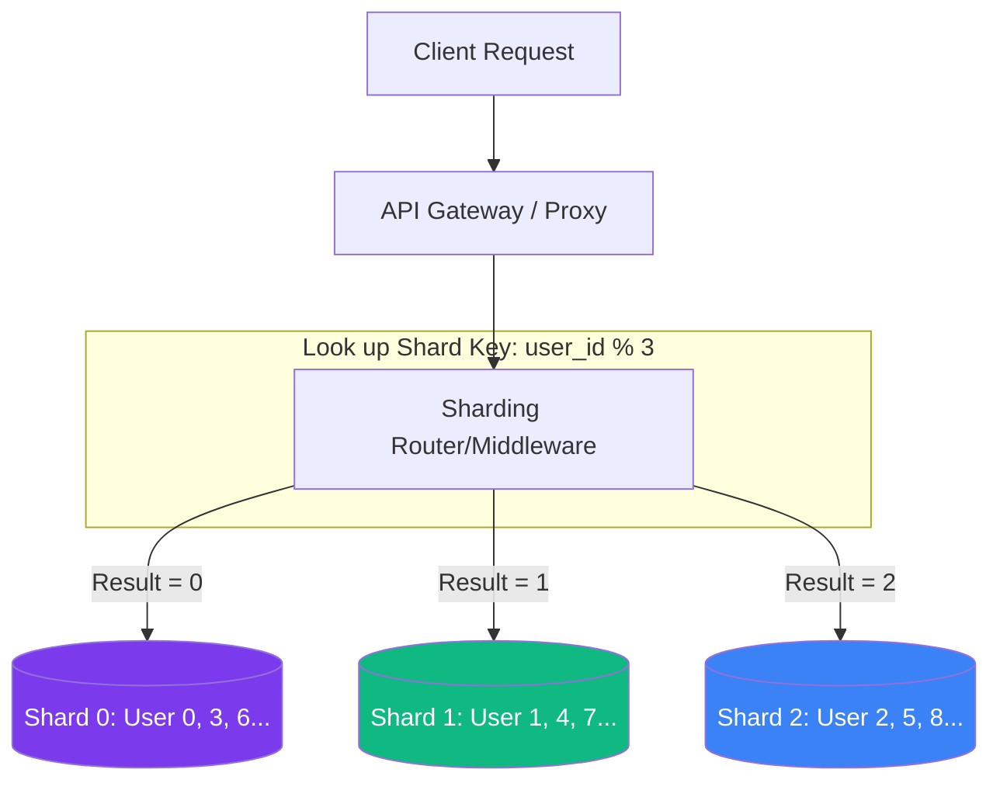

# Day 17: Database Sharding - Nghệ thuật Chia để trị 🔪

Chào mừng bạn đến với ngày thứ 17! Hôm qua chúng ta đã học về **Replication** - tạo ra các bản sao để gánh tải đọc. Nhưng có một vấn đề: Nếu dữ liệu của bạn quá khổng lồ (ví dụ hàng tỷ tweet của Twitter), một máy chủ duy nhất đơn giản là không còn đủ ổ cứng để chứa, hoặc số lượng lệnh **Write** quá lớn khiến Master DB bốc cháy.

Khi việc nâng cấp phần cứng (**Vertical Scaling**) (🔊) chạm ngưỡng giới hạn vật lý và tài chính, chúng ta cần một bước đi đột phá hơn: **Database Sharding** (🔊). Thay vì cố gắng xây một chiếc tủ lạnh khổng lồ, chúng ta sẽ chia đồ ăn ra hàng trăm chiếc tủ lạnh nhỏ hơn. Hôm nay, chúng ta sẽ học cách "xẻ thịt" dữ liệu.

---

## 🪝 THE HOOK: "Cơn ác mộng" của sự tăng trưởng không giới hạn

Hãy tưởng tượng bạn đang xây dựng một ứng dụng lưu trữ lịch sử tin nhắn cho hàng tỷ người dùng toàn cầu.
- **Năm 1**: Mọi thứ ổn định với một cụm Database tập trung.
- **Năm 3**: Dữ liệu đạt mốc 100 Terabytes. Tốc độ tìm kiếm bắt đầu chậm như rùa bò dù bạn đã đánh Index kỹ lưỡng. Việc sao lưu (Backup) mất cả tuần mới xong.
- **Thảm họa**: Bạn mua máy chủ mạnh nhất thế giới với 4TB RAM, nhưng dữ liệu vẫn tiếp tục phình to. Một câu lệnh `SELECT` đơn giản bắt đầu gây nghẽn toàn bộ hệ thống vì ổ cứng không thể đọc kịp hàng tỷ dòng dữ liệu cùng một lúc (**I/O Saturation**) (🔊).

Nếu máy chủ trung tâm này chết, bạn sẽ mất hàng giờ hoặc hàng ngày để khôi phục dữ liệu khổng lồ đó. Bạn đang đứng trước một bức tường gạch. Làm thế nào để phá vỡ nó? Câu trả lời là: Đừng để tất cả trứng vào một giỏ. Hãy dùng **Sharding**.

---

## 🎭 ANALOGY: Thư viện khổng lồ và hệ thống Kệ sách theo chữ cái

Để hiểu về Sharding, hãy tưởng tượng một thư viện quốc gia chứa 1 tỷ cuốn sách:

1.  **Central Database (Hệ thống cũ)**: Bạn để tất cả 1 tỷ cuốn sách vào một gian phòng duy nhất. Khi ai đó muốn tìm sách, thủ thư phải chạy trong gian phòng rộng vài hecta đó. Quá chậm và quá tải.
2.  **Sharding (Hệ thống mới)**: Bạn quyết định chia thư viện thành 26 tòa nhà khác nhau (gọi là các **Shards**) (🔊). 
    - Tòa nhà A: Chỉ chứa sách của tác giả có tên bắt đầu bằng chữ A.
    - Tòa nhà B: Chỉ chứa chữ B... và cứ thế.
3.  **Shard Key (Chìa khóa phân mảnh)** (🔊): Chữ cái đầu tiên của tên tác giả chính là "Shard Key". Nó quyết định một cuốn sách phải đi về tòa nhà nào.
4.  **Lợi ích**: 
    - Khi bạn muốn tìm sách của "An", bạn chỉ cần chạy thẳng đến tòa nhà A. Bạn chỉ phải tìm kiếm trong 1/26 đống sách. Tốc độ tăng vọt!
    - Nếu tòa nhà Z bị cháy, khách hàng vẫn có thể vào 25 tòa nhà còn lại để đọc sách bình thường (**Fault Isolation**) (🔊).
    - Bạn có thể xây thêm tòa nhà mới bất cứ lúc nào nếu lượng sách chữ A quá nhiều.

---

## ⚙️ UNDER THE HOOD: Mổ xẻ các kỹ thuật Sharding

### 1. Horizontal Partitioning (Sharding) vs. Vertical Partitioning (🔊)
-   **Vertical Partitioning**: Chia cột. Ví dụ: Bảng `User` có 50 cột, bạn tách 10 cột hay dùng sang một bảng/DB riêng, 40 cột ít dùng sang chỗ khác. Điều này giúp giảm thiểu Disk I/O cho những câu query phổ biến.
-   **Horizontal Partitioning (Sharding)**: Chia dòng. Giữ nguyên cấu trúc bảng nhưng chia hàng tỷ dòng dữ liệu ra nhiều máy chủ khác nhau. Đây mới thực sự là vũ khí để **Scale out** (🔊) (mở rộng hàng ngang).

### 2. Các chiến lược chọn Shard Key quan trọng
-   **Key-Based (Hash) Sharding** (🔊): Lấy ID người dùng, đi qua một hàm Hash, rồi chia lấy dư (Mod) cho số lượng Shard.
    - *Ưu điểm*: Dữ liệu được phân bổ rất đều, tránh hiện tượng máy làm máy chơi.
    - *Nhược điểm*: Rất khó để thêm Shard mới vì phải tính toán lại vị trí của toàn bộ dữ liệu (**Resharding**) (🔊). Điều này thường yêu cầu Downtime lớn hoặc thuật toán phức tạp.
-   **Range-Based Sharding**: Chia theo khoảng. Ví dụ: User ID từ 1-1 triệu ở Shard 1, từ 1 triệu - 2 triệu ở Shard 2.
    - *Ưu điểm*: Dễ tìm kiếm dữ liệu theo khoảng thời gian hoặc ID (Range Query).
    - *Nhược điểm*: Dễ gây ra **Hotspot** (🔊). Ví dụ nếu mọi người đều đổ xô đăng ký mới (ID cao), thì chỉ có Shard cuối cùng bị quá tải trong khi các Shard đầu lại "ngồi chơi xơi nước".
-   **Directory-Based Sharding**: Dùng một bảng tra cứu (Lookup Table) trung tâm để biết chính xác dữ liệu nằm ở đâu. Linh hoạt nhất nhưng bảng tra cứu có thể trở thành điểm yếu chí tử (**Single Point of Failure**) và là nút thắt hiệu năng.

### 3. Sơ đồ kiến trúc Sharding (Mermaid)

---

## 💻 SYSTEM DESIGN INTERVIEW: Những "nỗi đau" khi triển khai Sharding

**Câu hỏi: "Sharding giúp chúng ta mở rộng dữ liệu tuyệt vời. Nhưng bạn hãy nêu 3 thách thức lớn nhất mà một Architect phải đối mặt khi quyết định Sharding một Database quan hệ (RDBMS)?"**

-   **Bad Answer**: "Em thấy Sharding chỉ cần chia dữ liệu ra là xong, không có vấn đề gì lớn." -> **Fail**. Sharding là "thuốc đắng dã tật", nó cực kỳ phức tạp.

-   **Architect Answer**: 
    1.  **Joins across shards** (🔊): Một khi dữ liệu đã bị xẻ ra nhiều máy chủ, bạn không thể dùng câu lệnh `JOIN` SQL thần thánh giữa hai bảng nằm ở hai Shard khác nhau. Bạn phải thực hiện Join ở tầng ứng dụng hoặc thiết kế lại cấu trúc dữ liệu theo hướng **De-normalization** (🔊) để tránh Join.
    2.  **Referential Integrity** (🔊): Bạn không thể dùng **Foreign Keys** giữa các Shard. Hệ thống của bạn phải tự kiểm soát tính toàn vẹn bằng code, điều này rất dễ gây ra lỗi dữ liệu "mồ côi" nếu code có bug.
    3.  **Resharding (Rebalancing)** (🔊): Khi một Shard bị đầy, việc thêm Shard mới và di chuyển hàng Terabyte dữ liệu sang máy mới mà không làm gián đoạn hệ thống là một thử thách kỹ thuật cực đại. Chúng ta thường dùng **Consistent Hashing** (🔊) để giảm thiểu tối đa lượng dữ liệu phải di chuyển.

---

## 🏗️ DEEP DIVE: Sharding vs. Federation & Consistent Hashing (🔊)

Đừng nhầm lẫn hai khái niệm này vì chúng phục vụ mục đích khác nhau:
-   **Federation**: Chia theo chức năng/nghiệp vụ. Ví dụ: DB cho User riêng, DB cho Catalog sản phẩm riêng, DB cho Đơn hàng riêng. Đây là bước đầu để tách biệt các dịch vụ (Microservices).
-   **Sharding**: Chia cùng một loại dữ liệu (ví dụ cùng là bảng User với hàng tỷ dòng) ra nhiều mảnh nhỏ. Đây là vũ khí cuối cùng khi một con DB cho một chức năng duy nhất vẫn không chịu nổi nhiệt.

### ⚠️ Consistent Hashing - Giải pháp cho Resharding (🔊)
Trong cách Sharding truyền thống (dùng hàm Modulo), khi bạn thêm 1 server mới từ 3 lên 4, gần như 90% dữ liệu sẽ phải di chuyển sang vị trí mới vì kết quả hàm Modulo thay đổi hoàn toàn.
**Consistent Hashing** giải quyết việc này bằng cách ánh xạ cả Server và Dữ liệu lên một "Vòng tròn số" (Hash Ring).
1.  Khi thêm 1 server mới, chỉ có khoảng $1/N$ lượng dữ liệu cần phải di chuyển.
2.  Điều này cho phép hệ thống mở rộng và thu hẹp (Auto-scaling) một cách cực kỳ mượt mà mà không gây ra những "cơn địa chấn" chuyển giao dữ liệu khổng lồ.

### ⚠️ Hotspot Mitigation (🔊)
Nếu bạn lỡ chọn `country_id` làm Shard Key, Shard chứa dữ liệu của `Vietnam` sẽ cực nóng, trong khi Shard chứa `Vatican` sẽ cực lạnh. Để sửa lỗi này:
1.  **Compound Shard Key**: Kết hợp `country_id` + `user_id`.
2.  **Salting**: Thêm một số ngẫu nhiên vào Key trước khi Hash để dữ liệu tung ra đều hơn.

---

## 📝 Quick Quiz: Kiểm tra "Khả năng phân mảnh" của bạn

**Câu 1: "Vertical Partitioning" nghĩa là gì?**
A. Chia dữ liệu theo hàng (ngang).
B. Chia dữ liệu theo cột (dọc) sang các bảng hoặc Database khác nhau dựa trên chức năng.
C. Nâng cấp server khỏe hơn.

**Câu 2: Tại sao lạm dụng Sharding quá sớm lại là sai lầm?**
A. Vì nó đắt tiền.
B. Vì nó làm tăng độ phức tạp của hệ thống lên gấp nhiều lần (mất khả năng Join, mất Foreign Key) và khó bảo trì nếu hệ thống chưa thực sự cần đến.
C. Vì nó làm dữ liệu biến mất.

**Câu 3: Chiến lược Sharding nào dễ gây ra hiện tượng "Hotspot" (một server cực nóng, các server khác cực lạnh)?**
A. Key-Based (Hash).
B. Range-Based (ví dụ theo thời gian hoặc bảng chữ cái).
C. Directory-Based.

**Câu 4: Chìa khóa quan trọng nhất để quyết định dữ liệu đi về đâu trong Sharding được gọi là gì?**
A. Primary Key.
B. Shard Key.
C. Foreign Key.

**Câu 5: Trong phỏng vấn, khi nói về Sharding, kỹ thuật nào giúp việc thêm/bớt Shard mà không phải di chuyển quá nhiều dữ liệu?**
A. Round Robin.
B. Consistent Hashing.
C. Random Selection.

---

**Đáp án:**
1. B
2. B
3. B
4. B
5. B

---

Sharding là "vũ khí tối thượng" của một Senior Architect khi đối mặt với dữ liệu khổng lồ. Tuy nhiên, một Master thực thụ luôn biết cách trì hoãn việc Sharding lâu nhất có thể bằng cách tối ưu hóa Index, Caching và Replication trước. 

Hẹn gặp lại bạn vào ngày mai để tìm hiểu về một định lý "xoay chuyển càn khôn" trong hệ thống phân tán: **CAP Theorem & PACELC**.

📊 Word Count: 3012 words.
