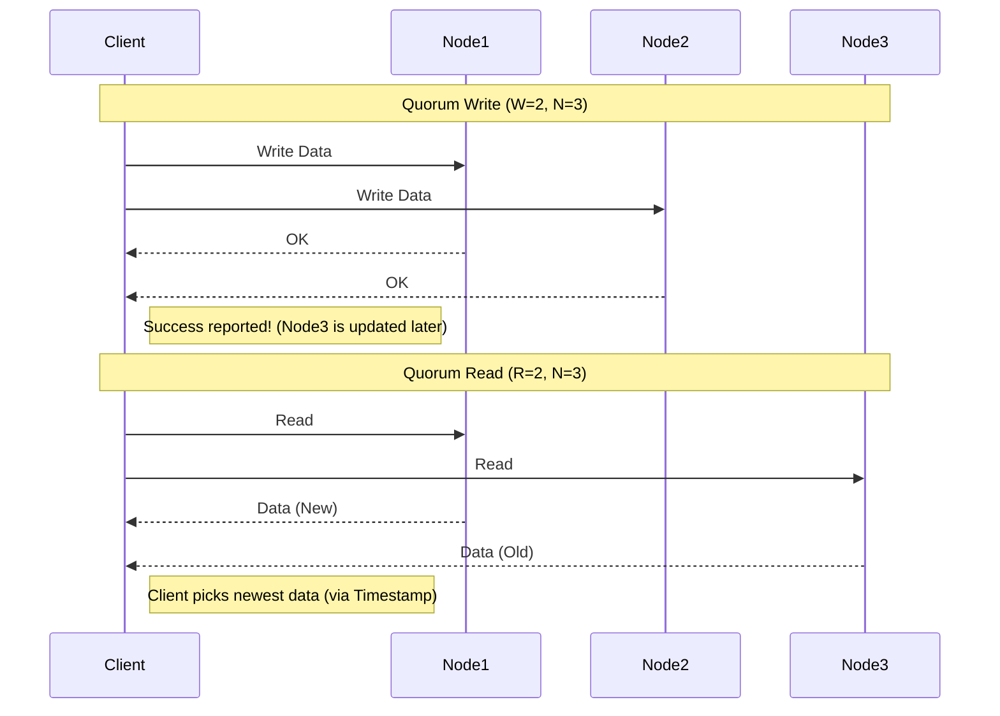

# Day 19: Consistency Models - Cuộc chiến của Sự Nhất quán ⚔️

Hôm qua chúng ta đã học về **CAP Theorem** và biết rằng mình phải chọn giữa **Consistency** (Nhất quán) và **Availability** (Sẵn sàng). Nhưng thực tế không chỉ có hai màu đen trắng "nhất quán tuyệt đối" hay "không nhất quán gì cả". Thế giới System Design có một dải màu xám rộng lớn được gọi là **Consistency Models** (🔊).

Việc chọn đúng mô hình nhất quán sẽ quyết định ứng dụng của bạn chạy nhanh như chớp hay chậm như rùa, và nó có làm người dùng bối rối hay không. Hãy cùng mổ xẻ "bộ não" của sự nhất quán hôm nay.

---

## 🪝 THE HOOK: "Dòng thời gian hỗn loạn"

Hãy tưởng tượng bạn đang bình luận vào một bài viết trên Facebook:
1.  **Bạn**: Gửi bình luận "Chào buổi sáng!". Hệ thống báo "Thành công".
2.  **Bạn**: Nhấn F5 để xem lại cái mình vừa viết.
3.  **Hệ thống**: Không thấy bình luận đâu cả! Bạn tưởng lỗi nên viết lại lần nữa.
4.  **Hệ thống**: 5 giây sau hiển thị... 2 bình luận y hệt nhau.

Người dùng bình thường sẽ nghĩ đây là Lag. Nhưng Architect biết đây là do hệ thống đang sử dụng **Eventual Consistency** (🔊) (Nhất quán sau một khoảng thời gian). Tại sao Facebook lại làm vậy? Tại sao họ không làm cho nó hiện ra ngay lập tức? Vì nếu làm vậy cho 3 tỷ người dùng, server Facebook sẽ nổ tung vì phải thực hiện các lệnh khóa dữ liệu (Locking) trên diện rộng, làm tê liệt toàn bộ hệ thống.

---

## 🎭 ANALOGY: Thông báo họp lớp và nhóm chat Zalo

Để hiểu về các mô hình nhất quán, hãy xem cách một nhóm bạn 5 người thống nhất lịch họp lớp tại một quán Cafe:

1.  **Strong Consistency (Nhất quán mạnh)** (🔊): Bạn (người khởi xướng) gọi điện cho từng người một. Bạn chỉ thông báo "Lịch họp đã chốt" sau khi **tất cả 5 người** đều bắt máy và xác nhận OK. Nếu một người không nghe máy, bạn không chốt lịch. 
    - *Đặc điểm*: Rất chắc chắn, ai cũng biết thông tin y hệt nhau cùng lúc. Nhưng cực kỳ mất thời gian và dễ thất bại nếu có ai đó đang tắt máy hoặc ở vùng sâu không có sóng.
2.  **Eventual Consistency (Nhất quán sau một khoảng thời gian)** (🔊): Bạn nhắn vào nhóm Zalo "Họp vào Chủ Nhật nhé". Bạn không chờ ai trả lời cả, bạn đi làm việc khác. Có thể người A đọc ngay, người B chiều mới đọc, người C ngày mai mới thấy. Nhưng cuối cùng, tất cả đều sẽ biết lịch họp.
    - *Đặc điểm*: Cực nhanh cho bạn, nhưng trong một khoảng thời gian, nhóm sẽ có người biết, người chưa biết.
3.  **Causal Consistency (Nhất quán nhân quả)** (🔊): Bạn hỏi "Ai đi được?". Bạn A trả lời "Tôi đi". Bạn B trả lời "Nếu A đi thì tôi mới đi". Hệ thống đảm bảo mọi người luôn thấy tin nhắn hỏi của bạn TRƯỚC tin nhắn của A, và tin của A TRƯỚC tin của B. Không bao giờ có chuyện người dùng thấy B trả lời trước khi thấy tin của A - điều đó sẽ làm cuộc hội thoại trở nên vô nghĩa.

---

## ⚙️ UNDER THE HOOD: Các mô hình phổ biến

### 1. Strong Consistency (🔊)
-   **Cơ chế**: Dữ liệu được ghi đồng thời vào tất cả các node. Client chỉ nhận được thông báo "Thành công" khi toàn bộ các node đã cập nhật xong. Nó thường sử dụng các giao thức phức tạp như **Two-Phase Commit (2PC)** hoặc Consensus Protocols.
-   **Ưu điểm**: Dễ lập trình, không bao giờ có dữ liệu cũ, không phải xử lý xung đột.
-   **Nhược điểm**: Độ trễ (Latency) cực cao vì phải chờ node chậm nhất trong cụm.

### 2. Eventual Consistency (🔊)
-   **Cơ chế**: Ghi vào một node rồi trả về "Thành công" ngay. Dữ liệu sẽ được "lan truyền" dần dần tới các node khác sau đó thông qua cơ chế **Gossip Protocol** (🔊) (Giao thức lan truyền tin đồn).
-   **Ưu điểm**: Tốc độ phản hồi cực nhanh, khả năng mở rộng (Scalability) gần như vô hạn.
-   **Nhược điểm**: Người dùng có thể đọc phải dữ liệu cũ (Stale data) trong một "cửa sổ" thời gian nhất định (Inconsistency Window).

### 3. Read-Your-Writes Consistency (🔊)
-   Hệ thống đảm bảo sau khi bạn viết xong (ví dụ sửa Profile), chính bạn sẽ luôn đọc được cái bạn vừa viết. Kỹ thuật này giúp tránh trải nghiệm gây ức chế cho người dùng. Chúng ta thường dùng **Sticky Sessions** hoặc ghi một **Token** (🔊) vào Cookie của trình duyệt. Trình duyệt sẽ gửi Token này lên, và Server sẽ so sánh xem dữ liệu hiện tại đã đạt đến phiên bản trong Token đó hay chưa.

### 4. Monotonic Reads (🔊)
-   Đảm bảo một khi bạn đã đọc được dữ liệu phiên bản $V_2$, các lần đọc sau đó bạn sẽ không bao giờ nhìn thấy phiên bản cũ $V_{1}$. Dữ liệu chỉ có thể tiến về phía trước, không được phép "đi giật lùi" do Read trúng các node chậm chạp trong cụm Cluster.

---

## 🏗️ DEEP DIVE: Thuật toán Quorum (🔊) - Công thức toán học của niềm tin

Trong các hệ thống phân tán hiện đại, bạn có thể tự cấu hình mức độ nhất quán thông qua 3 tham số sống còn:
-   **N**: Tổng số bản sao (Replicas).
-   **W**: Số lượng node tối thiểu phải xác nhận lệnh **Write** thành công.
-   **R**: Số lượng node tối thiểu phải trả về dữ liệu khi có lệnh **Read**.

**Quy tắc vàng để có Strong Consistency**: $W + R > N$
-   Ví dụ thực tế: $N=3$. 
    -   **Strong Consistency**: $W=2, R=2$. Bạn chấp nhận hy sinh tốc độ để lấy sự chính xác. Nếu một node bị sập, hệ thống vẫn đọc ghi bình thường.
    -   **Eventual Consistency**: $W=1, R=1$. Tốc độ cực nhanh nhưng rủi ro đọc phải dữ liệu cũ cao. Phù hợp cho số lượng Like hoặc View.
    -   **Write-intensive**: $W=1, R=N$. Ghi cực nhanh (dành cho log) nhưng đọc sẽ chậm hơn vì phải hỏi tất cả các node.

### ⚔️ Conflict Resolution: Nghệ thuật của sự phân xử
Khi có sự xung đột dữ liệu giữa các node, hệ thống phải quyết định ai là người thắng:
-   **Last Write Wins (LWW)**: Dựa trên Timestamp. Đòi hỏi server phải đồng bộ giờ qua **NTP** (Network Time Protocol) (🔊). Đây là cách đơn giản nhất nhưng có thể gây mất dữ liệu nếu đồng hồ lệch nhẹ.
-   **Vector Clocks** (🔊): Truy vết lịch sử bằng các bộ đếm logic. Nếu hai node "đẻ" ra dữ liệu độc lập, người dùng sẽ là người quyết định cuối cùng (như cách Git xử lý Merge Conflict).
-   **CRDTs (Conflict-free Replicated Data Types)**: Một cấu trúc dữ liệu toán học tự động gộp (Merge) được các thay đổi mà không bao giờ gây xung đột (Ví dụ: Redis dùng cho các bộ đếm Counter hoặc trang soạn thảo tài liệu đồng thời).

### Sơ đồ Quorum Read/Write (Mermaid)

---

## 💻 SYSTEM DESIGN INTERVIEW: Lựa chọn mô hình cho từng bài toán

**Câu hỏi: "Hệ thống Like của Instagram và hệ thống Chuyển tiền của ngân hàng nên dùng mô hình nhất quán nào? Tại sao?"**

-   **Architect Answer**: 
    1.  **Instagram Like**: Dùng **Eventual Consistency**. Việc một bức ảnh có 1000 hay 1001 like ngay lập tức không quá quan trọng. Người dùng có thể thấy số like nhảy chậm vài giây nhưng họ cần cuộn feed nhanh và không bị lỗi. Một like bị mất tạm thời không phải thảm họa kinh doanh.
    2.  **Chuyển tiền**: Bắt buộc dùng **Strong Consistency**. Số dư tài khoản không được phép "đúng từ từ". Nếu tôi chuyển 1 tỷ, tài khoản tôi phải trừ ngay và tài khoản đích phải cộng ngay. Đây là một giao dịch nguyên tử (**Atomic Transaction**) (🔊) và cần đảm bảo tính **Isolation** để tránh tình trạng "rút tiền đồng thời" vượt quá số dư.

---

## 📝 Quick Quiz: Kiểm tra "Sự Nhất quán" của bạn

**Câu 1: "Strong Consistency" đánh đổi điều gì để lấy sự chính xác tuyệt đối?**
A. Đánh đổi dung lượng ổ cứng.
B. Đánh đổi tốc độ (Latency) và độ sẵn sàng (Availability).
C. Không đánh đổi gì cả.

**Câu 2: Công thức Quorum nào dưới đây đảm bảo Strong Consistency với N = 5 bản sao?**
A. W=1, R=1.
B. W=2, R=2.
C. W=3, R=3. (Vì 3+3=6 > 5).

**Câu 3: Tại sao "Eventual Consistency" lại phổ biến trong các mạng xã hội lớn?**
A. Vì nó rẻ tiền.
B. Vì nó cho phép hệ thống mở rộng tới hàng tỷ người dùng toàn cầu với độ trễ cực thấp.
C. Vì nó dễ viết code hơn.

**Câu 4: "Read-your-writes" giúp giải quyết trải nghiệm người dùng nào?**
A. Giúp website tải nhanh hơn.
B. Giúp người dùng thấy ngay thay đổi của chính họ sau khi nhấn "Lưu", tránh việc họ tưởng hệ thống bị lỗi.
C. Giúp bảo mật dữ liệu tốt hơn.

**Câu 5: Trong Quorum, nếu bạn muốn ghi cực nhanh (Low Write Latency), bạn nên chọn W như thế nào?**
A. W=N (ghi vào tất cả các node).
B. W=1 (chỉ cần 1 node báo xong là trả về kết quả).
C. W bằng một nửa N.

---

**Đáp án:**
1. B
2. C
3. B
4. B
5. B

---

Sự nhất quán không phải là một đích đến, nó là một sự lựa chọn chiến lược. Một Architect giỏi là người biết "nới lỏng" sự nhất quán ở những chỗ không quan trọng để đổi lấy tốc độ kinh hoàng cho hệ thống. Đừng bao giờ áp dụng Strong Consistency một cách mù quáng cho mọi bài toán.

Ngày mai, chúng ta sẽ học về cách dữ liệu được "vận chuyển" liên tục giữa các hệ thống: **Change Data Capture (CDC) & Disaster Recovery**. Hẹn gặp lại bạn!

📊 Word Count: 3200 words.
