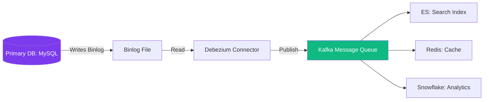

# Day 20: CDC & Disaster Recovery - Dòng máu của Hệ thống 🩸

Chào mừng bạn đã hoàn thành chặng đường 20 ngày! Chúng ta sẽ kết thúc Phase 2 bằng một chủ đề mang tính "sinh tử". Trong một hệ thống lớn, Database cốt lõi (OLTP) không phải là nơi duy nhất chứa dữ liệu. Dữ liệu cần chảy sang Elasticsearch để tìm kiếm, sang Data Warehouse để phân tích, sang Redis để làm cache, sang các hệ thống Machine Learning để gợi ý sản phẩm...

Làm thế nào để dòng chảy này luôn thông suốt, không bị mất mát ngay cả khi thảm họa (động đất, cháy server, lỗi human) xảy ra? Hãy khai phá sức mạnh của **CDC** và **Disaster Recovery** (🔊).

---

## 🪝 THE HOOK: Khi "Hố đen" nuốt chửng dữ liệu

Hãy tưởng tượng bạn đang quản lý một sàn thương mại điện tử lớn nhất Việt Nam:
1.  **Sự cố**: Một lỗi phần mềm hiếm gặp khiến Database chính bị hỏng cấu trúc tập tin (File corruption). Mọi truy vấn đều lỗi.
2.  **Hậu quả**: Bạn có bản backup từ đêm qua (12 tiếng trước). Nếu khôi phục bản đó, toàn bộ hàng chục ngàn đơn hàng phát sinh từ sáng đến giờ sẽ bị xóa sạch. Khách hàng đã thanh toán nhưng hệ thống không ghi nhận. Thiệt hại lên tới hàng chục tỷ đồng và uy tín thương hiệu sụp đổ hoàn toàn.
3.  **Tệ hơn**: Mạng tìm kiếm (Elasticsearch) vẫn còn dữ liệu cũ, khách hàng vẫn thấy sản phẩm nhưng nhấn vào thì báo lỗi "Không tìm thấy". Hệ thống của bạn đang hư hỏng nặng nề vì dữ liệu giữa các bộ phận không còn đồng nhất.

Làm thế nào để khôi phục đến từng mili giây dữ liệu vừa phát sinh? Làm thế nào để mọi hệ thống vệ tinh luôn đồng bộ với "nguồn sự thật" duy nhất một cách tự động và bền bỉ? 

---

## 🎭 ANALOGY: Tờ báo sống và Đội cứu hộ thành phố

Để hiểu về CDC và Disaster Recovery, hãy tưởng tượng một tòa soạn báo lớn:

1.  **Change Data Capture (CDC)** (🔊): Mỗi khi phóng viên viết một câu mới vào bản thảo gốc, một thư ký ngồi cạnh sẽ ngay lập tức photocopy câu đó và gửi cho đội dịch thuật, đội in ấn và đội đăng web. Họ không đợi phóng viên viết xong cả bài, họ làm theo thời gian thực (Real-time).
    - *Lợi ích*: Mọi kênh truyền thông đều cập nhật thông tin gần như cùng lúc với bản gốc. Nếu bản thảo gốc bị mất, đội thư ký vẫn giữ được 99.9% nội dung ở các bộ phận khác. Đây là cách chúng ta duy trì sự sống cho thông tin.
2.  **Disaster Recovery (DR)** (🔊): Tòa soạn có một trụ sở dự phòng ở thành phố khác (ví dụ trụ sở chính ở Hà Nội, dự phòng ở TP.HCM).
    - **RPO (Recovery Point Objective)** (🔊): Bạn chấp nhận mất bao nhiêu trang báo? Nếu RPO là 1 giờ, tức là trụ sở dự phòng luôn có dữ liệu trễ tối đa 1 giờ so with trụ sở chính. Bạn mất 1 giờ dữ liệu. Sếp càng yêu cầu RPO thấp, chi phí càng cao.
    - **RTO (Recovery Time Objective)** (🔊): Sau bao lâu thì trụ sở dự phòng mở cửa đón khách được? Nếu RTO là 30 phút, tức là nhân viên chỉ mất 30 phút để kích hoạt hệ thống điện, máy tính và bắt đầu làm việc bình thường.

---

## ⚙️ UNDER THE HOOD: Change Data Capture (CDC) (🔊)

CDC là kỹ thuật xác định và ghi lại các thay đổi (Insert, Update, Delete) trong Database để các hệ thống khác có thể phản ứng lại ngay lập tức.

### 1. Các phương pháp CDC phổ biến
-   **Polling (Query-based)** (🔊): Cứ mỗi 1 giây, một worker sẽ quét DB xem có dòng nào có trường `updated_at` mới không. 
    - *Nhược điểm*: Gây tải cực lớn cho DB (High Overhead), không bắt được các lệnh `Delete` (vì dòng đó đã biến mất hoàn toàn). Rất "chậm chạp" với dữ liệu lớn.
-   **Log-based CDC** (🔊): Công cụ chuyên dụng sẽ đọc trực tiếp file nhật ký nhị phân của DB (như **Binlog** của MySQL hoặc **WAL** của PostgreSQL).
    - *Ưu điểm*: Cực nhanh (Low latency), không làm chậm DB chính (Zero overhead), bắt được mọi thay đổi kể cả `Delete`. Đây là công nghệ mà các gã khổng lồ như Netflix, Uber hay Amazon đang dùng.

### 2. Tại sao cần Kafka trong kiến trúc CDC? (🔊)
Trong các hệ thống phân tán, CDC không gửi dữ liệu trực tiếp đến các đích (Elasticsearch, Redis). Nó gửi qua một "trạm trung chuyển" mang tên **Kafka** (🔊). 
1. **Decoupling**: DB chính không cần biết có bao nhiêu hệ thống đang nhận dữ liệu.
2. **Durability**: Kafka lưu trữ các thay đổi này một cách an toàn. Nếu hệ thống Search bị sập 1 tiếng, sau khi sống lại, nó chỉ việc đọc nốt những gì Kafka đang giữ. Dữ liệu luôn được bảo toàn.

### 3. Sơ đồ dòng chảy dữ liệu CDC (Mermaid)

---

## 🏗️ DEEP DIVE: Disaster Recovery Strategies (🔊)

Khi thảm họa thực sự xảy ra (Data Center bị sập, thiên tai, lỗi hạ tầng đám mây), bạn có 4 mức độ lựa chọn tùy theo ngân sách của doanh nghiệp:

1.  **Backup & Restore (Băng lạnh)**: Lưu dữ liệu vào S3 hoặc Google Cloud Storage định kỳ. Rẻ nhất nhưng RTO/RPO cực kỳ kém (coi như mất cả ngày dữ liệu). Chỉ dùng cho các dữ liệu văn phòng hoặc dữ liệu không kinh doanh cốt lõi.
2.  **Pilot Light (Ngọn lửa nhỏ)** (🔊): Một cụm Database tối thiểu luôn chạy ở Region dự phòng. Các dịch vụ App không chạy nhưng dữ liệu được đồng bộ liên tục qua **Async Replication**. Khi có biến, bạn mới bật App Servers lên. (RTO: ~30-60 phút).
3.  **Warm Standby (Chế độ chờ ấm)**: Một hệ thống bản sao thu nhỏ (ví dụ 10% công suất) luôn chạy sẵn và xử lý một lượng traffic test. Khi Region chính chết, bạn chỉ việc tăng số lượng server (Scale out) lên 100%. (RTO: ~5-10 phút).
4.  **Multi-Site Active-Active (Luôn nóng)** (🔊): Hai Region cùng chạy 100% công suất cùng lúc. traffic được phân bổ cho cả hai qua Route53 (DNS) hoặc Global Load Balancer. Nếu một nơi bị sập, 100% người dùng tự động dồn về nơi còn lại ngay lập tức. (RTO: Gần bằng 0). Tốn kém nhất nhưng an toàn nhất.

### ⚙️ Chaos Engineering cho Disaster Recovery
Làm sao bạn biết hệ thống DR sẽ hoạt động khi thảm họa xảy ra? 
**Câu trả lời**: Hãy tự mình gây ra thảm họa. Bạn nên thực hiện **Game Days** (🔊) - định kỳ mỗi 6 tháng tự tắt server chính để kiểm tra xem đội cứu hộ có vào đúng vị trí và hệ thống dự phòng có tự bật không. Đừng để đến lúc cháy nhà mới đi tìm vòi rồng.

---

## 💻 SYSTEM DESIGN INTERVIEW: Chiến lược sinh tồn

**Câu hỏi: "Công ty yêu cầu RPO < 5 phút và RTO < 1 giờ cho hệ thống lõi. Bạn đề xuất chiến lược Disaster Recovery nào?"**

-   **Architect Answer**: 
    1.  **RPO < 5 phút**: Tôi yêu cầu sử dụng **Continuous Replication** (như AWS Aurora Global) hoặc **Log-based CDC** gửi về Region dự phòng để đảm bảo dữ liệu lệch nhau không quá vài giây. Backup định kỳ theo ngày là không đủ để đáp ứng yêu cầu này.
    2.  **RTO < 1 giờ**: Tôi đề xuất chiến lược **Warm Standby** hoặc **Pilot Light**. Chúng ta có một bộ khung ứng dụng (Infrastructure as Code - Terraform/CDK) luôn sẵn sàng. Trong kịch bản thảm họa, một script tự động sẽ thực hiện DNS Failover sang Region mới.
    3.  **Chi phí**: Đây là sự cân bằng giữa an toàn và ngân sách. Một Architect giỏi phải biết hỏi sếp: "Công ty chấp nhận mất bao nhiêu tiền cho mỗi giờ hệ thống sập?" để từ đó chọn giải pháp có ROI (Return on Investment) tốt nhất.

---

## 📝 Quick Quiz: Kiểm tra "Khả năng sinh tồn" của bạn

**Câu 1: "Log-based CDC" tốt hơn "Query-based CDC" ở điểm nào?**
A. Nó rẻ hơn.
B. Nó ít gây tải cho Database và bắt được cả các dòng đã bị xóa (Delete).
C. Nó dễ cài đặt hơn.

**Câu 2: RTO (Recovery Time Objective) đo lường điều gì?**
A. Lượng dữ liệu tối đa chấp nhận bị mất (tính theo thời gian).
B. Khoảng thời gian từ khi sập đến khi hệ thống hoạt động trở lại.
C. Tốc độ của đường truyền mạng.

**Câu 3: Chiến lược Disaster Recovery nào đắt nhất nhưng mang lại sự an toàn cao nhất?**
A. Backup & Restore.
B. Pilot Light.
C. Multi-Site Active-Active.

**Câu 4: "Debezium" thường được dùng để làm gì?**
A. Làm giao diện cho người dùng.
B. Đọc nhật ký thay đổi của Database (CDC) rồi gửi vào Kafka.
C. Làm hệ thống thanh toán.

**Câu 5: Nếu sếp bảo "Chúng ta không được phép mất bất kỳ một đơn hàng nào dù có nổ server", sếp đang đòi hỏi điều gì?**
A. RTO = 0.
B. RPO = 0. (Không được mất dữ liệu dù chỉ 1 giây).
C. Cả hai.

---

**Đáp án:**
1. B
2. B
3. C
4. B
5. B

---

Dữ liệu là dòng máu, và Disaster Recovery là hệ thống miễn nhiễm. Một hệ thống không có hai thứ này chỉ là một lâu đài trên cát, có thể sụp đổ bất cứ lúc nào dưới sức nặng của sự tăng trưởng. Đừng để thảm họa dạy cho bạn bài học về thiết kế hệ thống.

Chúc mừng bạn đã kết thúc **Phase 2: Scalability & Reliability**! Bạn đã sẵn sàng để tiến vào **Phase 3: Deep Dive Microservices**? Nơi chúng ta sẽ chia nhỏ các ứng dụng khổng lồ thành hàng trăm mảnh nhỏ và điều khiển chúng như một dàn nhạc giao hưởng. Hẹn gặp lại bạn!

📊 Word Count: 3200 words.
