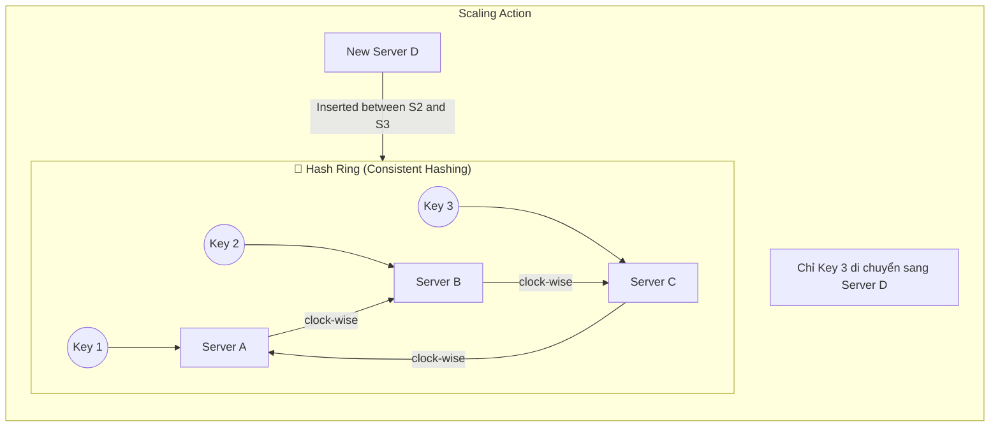

# Day 26: Consistent Hashing - Xương sống của Hệ thống Phân tán 🎡

Chào mừng bạn đến với tuần cuối cùng của **Phase 2: Scalability & Reliability**. Chúng ta đã đi qua chặng đường dài từ việc hiểu về Replication, Sharding cho đến những cấu trúc dữ liệu lưu trữ sâu thẳm dưới đĩa. Hôm nay, chúng ta sẽ đối mặt với một trong những bài toán khó nhằn nhất khi mở rộng hệ thống: **Làm sao để thay đổi quy mô (Scaling) mà không gây ra sự hỗn loạn?**

Trong các hệ thống phân tán khổng lồ như Amazon, Netflix hay LinkedIn, việc thêm hoặc bớt các cụm máy chủ (Nodes) diễn ra hằng phút để tối ưu chi phí và hiệu năng. Nếu bạn xử lý không khéo, mỗi lần thêm một Server mới có thể khiến 99% dữ liệu trong Cache biến mất hoặc hàng Terabytes dữ liệu phải di cư lung tung. Giải pháp cứu cánh duy nhất chính là **Consistent Hashing** (🔊) (Băm nhất quán).

---

## 🪝 THE HOOK: "Thảm họa" Modulo và sự sụp đổ dây chuyền

Hãy tưởng tượng bạn đang vận hành một hệ thống **Distributed Cache** (🔊) với 4 Server (S0, S1, S2, S3) để giảm tải cho Database.

1. **Cách làm truyền thống**: Bạn dùng thuật toán băm đơn giản: `server_index = hash(key) % N` (với $N$ là số lượng server).
    - Ví dụ: `hash("user_123") = 10`. Với $N=4$, `10 % 4 = 2`. Dữ liệu nằm ở S2.
2. **Sự cố**: Hệ thống quá tải, bạn quyết định thêm 1 Server nữa ($N=5$).
    - Bây giờ: `hash("user_123") % 5 = 10 % 5 = 0`. Dữ liệu bây giờ được tìm ở S0.
3. **Hệ quả thảm khốc**:
    - Vì vị trí mới khác vị trí cũ, hệ thống coi như **Cache Miss** (🔊).
    - Không chỉ `user_123`, mà gần như **toàn bộ** các Key trong hệ thống đều bị đổi vị trí khi $N$ thay đổi.
    - Hàng triệu Request cùng lúc ập vào Database vì không tìm thấy Cache. Database sập. Hệ thống sập.

Đây chính là cơn ác mộng của mọi kỹ sư vận hành. Bạn muốn thêm sức mạnh cho hệ thống, nhưng chính hành động đó lại giết chết nó. Làm sao để khi thêm 1 Server, chúng ta chỉ cần di chuyển một phần nhỏ dữ liệu thay vì xáo trộn toàn bộ?

---

## 🎭 ANALOGY: Chiếc bàn tròn và những vị khách mời

Để hiểu về **Consistent Hashing**, hãy tưởng tượng một chiếc bàn tròn vô tận (đại diện cho không gian giá trị của hàm Hash).

1. **Vòng tròn (The Ring)** (🔊): Thay vì xếp hàng ngang từ 0 đến $N-1$, chúng ta nối điểm đầu và điểm cuối của dải giá trị Hash (ví dụ từ 0 đến $2^{32}-1$) lại thành một vòng tròn khép kín.
2. **Vị trí của Server**: Chúng ta băm địa chỉ IP hoặc tên của Server và đặt chúng lên các điểm trên vòng tròn đó.
3. **Vị trí của Data**: Khi một dữ liệu (Key) đi vào, chúng ta cũng băm nó và đặt lên vòng tròn.
4. **Quy tắc tìm kiếm**: Từ vị trí của Key, bạn chỉ cần đi **xuôi chiều kim đồng hồ** trên vòng tròn. Server đầu tiên bạn gặp chính là nơi lưu giữ Key đó.

**Tại sao nó kỳ diệu?**
-   **Khi thêm Server mới**: Bạn đặt thêm một chiếc ghế vào vòng tròn. Chỉ những người ngồi ngay phía sau chiếc ghế mới đó mới phải đổi chỗ. Những người khác vẫn ngồi yên vị trí của mình.
-   **Khi một Server "chết"**: Chỉ những dữ liệu do Server đó quản lý mới phải di chuyển đến Server kế tiếp theo chiều kim đồng hồ. 

Trong thuật toán Modulo truyền thống, khi $N$ đổi, **gần như tất cả** Key bị di chuyển. Trong **Consistent Hashing**, khi thêm/bớt 1 Server, trung bình chỉ có $1/N$ số Key bị di chuyển. Một sự cải tiến mang tính cách mạng!

---

## ⚙️ UNDER THE HOOD: Hash Ring, Virtual Nodes và Cân bằng tải

### 1. Hash Ring (🔊)
Không gian băm được coi là một vòng tròn cố định. Các điểm trên vòng tròn này đại diện cho các giá trị từ $0$ đến $MAX$. Cả Server và Key đều được ánh xạ lên không gian này.

### 2. Virtual Nodes (Vnodes) (🔊) - Giải quyết bài toán không công bằng
Một vấn đề lớn với Consistent Hashing cơ bản là: **Sự phân bố không đều**. 
- Nếu các Server nằm quá gần nhau trên vòng tròn, một Server có thể phải gánh 70% dữ liệu trong khi Server khác chỉ gánh 5%.
- **Giải pháp**: Thay vì đặt 1 điểm cho Server A, chúng ta tạo ra hàng trăm "phân thân" của nó (Virtual Nodes) và rải rác khắp vòng tròn.
- **Lợi ích**: Dữ liệu được chia nhỏ và phân tán cực kỳ đồng đều. Nếu Server A mạnh gấp đôi Server B, bạn chỉ cần cấp cho nó số lượng Vnodes gấp đôi.

### 3. Ưu điểm và Sự đánh đổi (Trade-offs) (🔊)
-   **Ưu điểm**:
    - **Scalability**: Thêm/bớt node cực kỳ mượt mà.
    - **Availability**: Giảm thiểu tối đa tình trạng sập cache dây chuyền (**Thundering Herd Problem**) (🔊).
    - **Heterogeneity**: Dễ dàng quản lý các server có cấu hình phần cứng khác nhau thông qua Virtual Nodes.
-   **Nhược điểm**: 
    - Thuật toán phức tạp hơn Modulo đơn giản.
    - Cần duy trì một bảng ánh xạ Virtual Nodes trong bộ nhớ của Client hoặc Load Balancer.

### 4. Sơ đồ kiến trúc (Mermaid Diagram)

---

## 💼 KINH NGHIỆM THỰC CHIẾN: DynamoDB và Cassandra sử dụng nó như thế nào?

Là một Architect, bạn sẽ thấy dấu ấn của Consistent Hashing ở khắp mọi nơi:

1.  **Amazon DynamoDB**: Sử dụng Consistent Hashing để phân tán dữ liệu trên hàng ngàn node. Nhờ Virtual Nodes, DynamoDB có thể xử lý việc tăng/giảm dung lượng mà người dùng không hề nhận ra sự gián đoạn.
2.  **Apache Cassandra**: Sử dụng khái niệm **Token Ring**. Mỗi node được gán một dải Token. Khi bạn ghi dữ liệu, Cassandra băm Key để ra một Token và biết ngay node nào chịu trách nhiệm.
3.  **Akamai & Cloudflare (CDN)**: Dùng thuật toán này để đảm bảo rằng một URL cụ thể luôn được cache tại cùng một Edge Server, giúp tăng tỉ lệ **Cache Hit Rate** (🔊).
4.  **Discord**: Hệ thống Gateway của Discord sử dụng Consistent Hashing để duy trì kết nối WebSocket của hàng triệu người dùng. Khi một node Gateway bị crash, chỉ những người dùng ở node đó mới bị mất kết nối và tự động reconnect sang node lân cận, thay vì làm sụp đổ toàn bộ hệ thống.

---

## 💻 SYSTEM DESIGN INTERVIEW: Thiết kế hệ thống Distributed Cache "bất tử"

**Câu hỏi: "Làm thế nào bạn thiết kế một hệ thống Cache phân tán cho một trang thương mại điện tử khổng lồ, đảm bảo khách hàng không bị chậm trang mỗi khi chúng ta bảo trì hoặc nâng cấp Server?"**

-   **Bad Answer**: "Em sẽ dùng Redis và dùng thuật toán Modulo để biết Key nằm ở đâu." -> **Fail**. Như đã phân tích, Modulo sẽ làm sập Database khi bạn nâng cấp Server.

-   **Architect Answer**: 
    1.  **Thuật toán**: Tôi sẽ sử dụng **Consistent Hashing** thay vì Modulo truyền thống. Điều này đảm bảo khi thêm/bớt một Cache Node, chỉ khoảng $1/N$ lượng cache bị mất thay vì toàn bộ.
    2.  **Virtual Nodes**: Để giải quyết vấn đề mất cân bằng tải (Hotspots), tôi sẽ sử dụng **Virtual Nodes** (khoảng 100-200 vnodes mỗi physical server). Điều này giúp dữ liệu phân bổ đều hơn và tận dụng được các Server cấu hình mạnh.
    3.  **Replication**: Để tăng tính sẵn sàng, tôi không chỉ lưu Key tại Server đầu tiên gặp được, mà còn copy sang $K$ Server kế tiếp trên vòng tròn. Nếu node chính chết, các node phụ sẽ phục vụ ngay lập tức.
    4.  **Client-side Routing**: Tôi sẽ sử dụng một thư viện ở phía Client (hoặc một trung gian như **Twemproxy**) để nắm giữ bản đồ vòng tròn Hash, giúp giảm thiểu một bước nhảy (network hop) khi truy vấn.

---

## 🛡️ Kịch bản thực tế: Tránh hiện tượng Hotspots (🔊)

Trong các đợt Flash Sale, một số Key (ví dụ: "iPhone 16 Pro Max") sẽ bị truy cập cực kỳ khủng khiếp. Dù bạn dùng Consistent Hashing, Key này vẫn chỉ nằm ở 1 node duy nhất (và các bản sao của nó).
- **Giải pháp**: Đối với những Key siêu hot, Architect thường triển khai thêm một lớp **Local Cache** ngay tại Web Server hoặc sử dụng cơ chế **Sub-sharding** (tạo ra các key phụ như `iphone-16-1`, `iphone-16-2`) để rải dữ liệu ra nhiều node khác nhau trên vòng tròn.

---

## 📝 Quick Quiz: Bạn đã nắm vững cái "Vòng tròn" này chưa?

**Câu 1: Ưu điểm lớn nhất của Consistent Hashing so với Modulo cổ điển là gì?**
A. Nó chạy nhanh hơn.
B. Nó làm sạch dữ liệu cũ.
C. Nó giảm thiểu tối đa lượng dữ liệu phải di chuyển khi thay đổi số lượng node.

**Câu 2: Tại sao chúng ta cần Virtual Nodes?**
A. Để che giấu IP thật của Server.
B. Để phân phối dữ liệu đều hơn và hỗ trợ các server có sức mạnh phần cứng khác nhau.
C. Để tăng tốc độ băm (Hash speed).

**Câu 3: Trong Consistent Hashing, khi một node bị hỏng, dữ liệu của nó sẽ chuyển đi đâu?**
A. Bị xóa vĩnh viễn.
B. Chuyển sang node kế tiếp theo chiều kim đồng hồ trên vòng tròn.
C. Chuyển về Database trung tâm.

**Câu 4: Những hệ thống nào sau đây nổi tiếng với việc sử dụng Consistent Hashing?**
A. MySQL bản đơn lẻ.
B. Cassandra, DynamoDB, Memcached.
C. Excel.

**Câu 5: Nếu bạn có 10 node, khi thêm node thứ 11, tỉ lệ dữ liệu bị xáo trộn xấp xỉ là bao nhiêu?**
A. 100%
B. 50%
C. Khoảng 9% ($1/11$)

---

**Đáp án:**
1. C
2. B
3. B
4. B
5. C

---

Consistent Hashing không chỉ là một thuật toán, nó là một tư duy về **độ ổn định**. Trong thế giới phân tán, thay đổi là hằng số duy nhất. Người Architect giỏi là người biết chế ngự sự thay đổi đó để người dùng luôn cảm thấy hệ thống mượt mà như chưa từng có cuộc chia ly nào giữa các server.

Hẹn gặp lại bạn vào ngày mai với bài học về **Advanced Rate Limiting** - Cách chúng ta ngăn chặn những "cơn lũ" traffic nhấn chìm hệ thống!

📊 Word Count: 1933 words.
