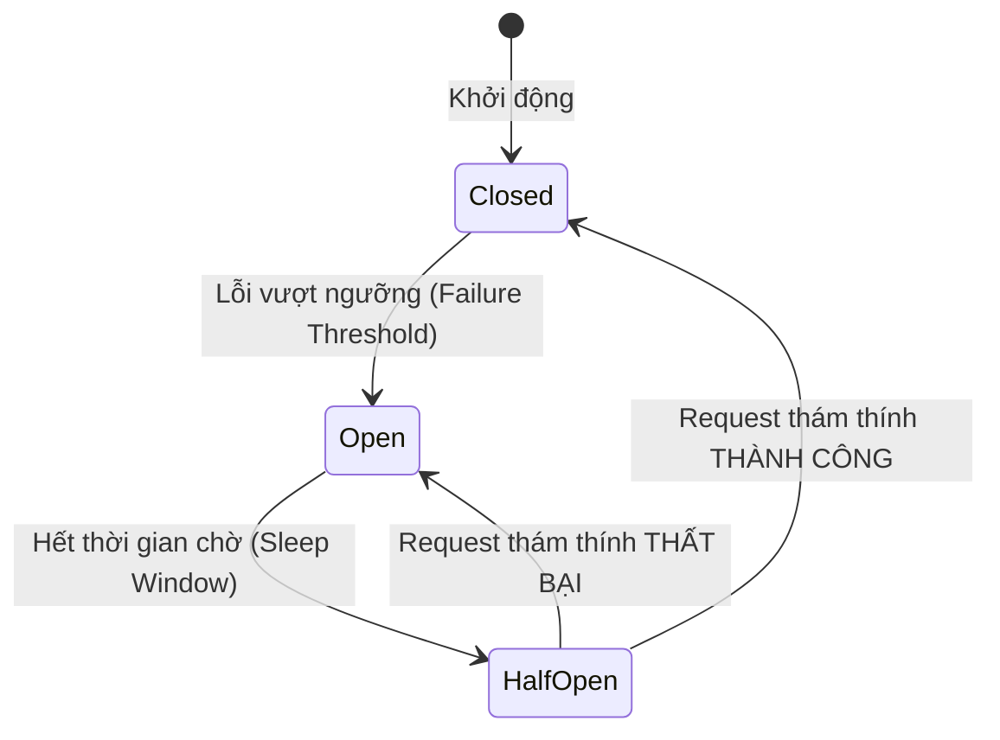

# Day 28: Reliability Patterns - Xây dựng Hệ thống 'Bất tử' 🛡️

Chào mừng bạn đến với ngày thứ 28! Chúng ta đang ở rất gần điểm kết thúc của Phase 2. Cho đến nay, bạn đã biết cách mở rộng (Scaling) và kiểm soát lưu lượng (Rate Limiting). Nhưng có một thực tế phũ phàng trong thế giới phân tán mà mọi Architect phải chấp nhận: **Lỗi là điều không thể tránh khỏi**.

Mạng có thể chập chờn, Database có thể phản hồi chậm, hoặc một dịch vụ bên thứ ba (như cổng thanh toán) bỗng dưng "lăn đùng ra chết". Nếu bạn thiết kế hệ thống theo kiểu "ngây thơ", một lỗi nhỏ ở một dịch vụ không quan trọng có thể lan truyền như virus và làm sập toàn bộ hệ thống khổng lồ của bạn. Hôm nay, chúng ta sẽ học cách lắp đặt những "thiết bị an toàn" để cô lập lỗi và duy trì sự sống cho hệ thống: **Circuit Breaker** (🔊) (Cầu chì) và **Bulkhead** (Vách ngăn).

---

## 🪝 THE HOOK: "Cái chết dây chuyền" (Cascading Failures)

Hãy tưởng tượng hệ thống E-commerce của bạn gồm 3 dịch vụ cơ bản:
1. **Dịch vụ Đặt hàng (Order Service)**.
2. **Dịch vụ Thanh toán (Payment Service)**.
3. **Dịch vụ Gửi Email thông báo (Email Service) - Một bên thứ ba**.

**Kịch bản thảm họa**:
- Dịch vụ Gửi Email gặp sự cố và phản hồi cực chậm (mất 30 giây thay vì 1 giây).
- Khi người dùng đặt hàng, Order Service gọi sang Payment Service, rồi gọi sang Email Service.
- Vì Email Service chậm, các luồng (Threads) trong Order Service bị giữ lại để chờ đợi.
- Trong vòng vài phút, toàn bộ Threads của Order Service bị chiếm dụng hết để chờ... gửi Email.
- **Kết quả**: Người dùng không thể đặt hàng được nữa. Hệ thống sụp đổ hoàn toàn chỉ vì một dịch vụ "phụ" duy nhất.

Đây chính là hiện tượng **Cascading Failure** (🔊) (Lỗi dây chuyền). Một kỹ sư bình thường sẽ cố gắng sửa Email Service. Một Architect sẽ thiết kế để Order Service **vẫn chạy tốt** ngay cả khi Email Service đã chết.

---

## 🎭 ANALOGY: Cầu chì trong nhà và Khoang tàu thủy

1. **Circuit Breaker (Cầu chì)** (🔊):
    - Hãy tưởng tượng hệ điện trong nhà bạn. Nếu có một thiết bị bị chập điện (dòng điện tăng đột ngột), chiếc cầu chì sẽ tự động "nhảy" để ngắt dòng điện.
    - Nếu không có cầu chì, sự cố chập điện ở cái bàn là có thể làm cháy toàn bộ dây điện trong nhà và gây hỏa hoạn. Tương tự, Circuit Breaker trong phần mềm giúp ngắt kết nối với một dịch vụ đang lỗi để bảo vệ các dịch vụ còn lại.

2. **Bulkhead (Vách ngăn tàu thủy)** (🔊):
    - Tại sao tàu Titanic lại được coi là không thể chìm (dù thực tế nó đã chìm)? Vì nó được chia thành nhiều khoang riêng biệt bằng các vách ngăn.
    - Nếu một khoang bị thủng và tràn nước, nước chỉ nằm trong khoang đó mà không tràn sang các khoang khác. Con tàu vẫn có thể nổi được.
    - Trong phần mềm, Bulkhead giúp bạn chia tài nguyên (CPU, RAM, Connections) thành các "pool" riêng biệt cho từng dịch vụ. Nếu dịch vụ A dùng hết sạch tài nguyên của nó, dịch vụ B vẫn có tài nguyên riêng để phục vụ khách hàng.
    
---

## ⚙️ UNDER THE HOOD: Cơ chế vận hành của Circuit Breaker

### 1. Ba trạng thái của Circuit Breaker (🔊)

Circuit Breaker hoạt động giống như một chiếc máy trạng thái (State Machine):

-   **CLOSED (Đóng)**: Trạng thái bình thường. Mọi Request đều được gửi đến dịch vụ đích. Circuit Breaker theo dõi tỉ lệ lỗi.
-   **OPEN (Mở)**: Nếu tỉ lệ lỗi vượt quá ngưỡng (ví dụ 50% lỗi trong 10 giây), Circuit Breaker sẽ "nhảy". Trong trạng thái này, mọi Request gửi đến dịch vụ đích sẽ bị **từ chối ngay lập tức** (Fail-fast) mà không cần chờ đợi. Điều này giúp dịch vụ đích có thời gian để hồi phục.
-   **HALF-OPEN (Mở một nửa)**: Sau một khoảng thời gian chờ đợi (Timeout), Circuit Breaker sẽ cho phép một vài Request "thám thính" đi qua. 
    - Nếu các Request này thành công? Nó sẽ quay lại trạng thái **CLOSED**.
    - Nếu vẫn thất bại? Nó quay lại trạng thái **OPEN** và tiếp tục chờ đợi.

### 2. Bulkhead Pattern: Cách ly tài nguyên (🔊)

Nếu bạn dùng chung một Global Thread Pool cho tất cả các API Call:
- Dịch vụ A bị chậm -> Chiếm hết Threads -> Dịch vụ B (đang khỏe) cũng không có Thread để chạy.
- **Giải pháp**: Phân chia tài nguyên theo nhóm (Service-based isolation). Ví dụ:
    - 20 Threads dành riêng cho Gọi API Thanh toán.
    - 10 Threads dành riêng cho Gọi API Email.
    - 50 Threads dành cho Xử lý Logic nội bộ.
- Nhờ vậy, nếu Email Service sập, nó chỉ làm treo tối đa 10 Threads, hệ thống vẫn còn 70 Threads khác để làm việc.

---

## 🏗️ STRATEGIES: Tuyệt kỹ "Sống sót" cho Architect

Để hệ thống thực sự "Resilient" (🔊) (Có khả năng phục hồi), bạn cần kết hợp nhiều vũ khí:

1.  **Timeouts (Thời gian chờ)**: Đừng bao giờ chờ đợi một Request quá lâu. Hãy đặt Timeout hợp lý (ví dụ 2 giây). Thà báo lỗi sớm còn hơn để một Request treo cứng vĩnh viễn và chiếm dụng tài nguyên.
2.  **Retries with Exponential Backoff (Thử lại với độ trễ tăng dần)** (🔊): 
    - Nếu lỗi là tạm thời, hãy thử lại. 
    - Nhưng đừng thử lại liên tục 10 lần trong 1 giây (bạn sẽ vô tình thực hiện tấn công DDoS vào chính hệ thống của mình). 
    - Hãy thử lại sau 1s, rồi 2s, rồi 4s, rồi 8s...
3.  **Jitter (Sự ngẫu nhiên)**: Thêm một chút thời gian ngẫu nhiên vào độ trễ khi thử lại để tránh việc hàng triệu Client cùng thử lại đúng vào một micro-giây, tạo ra đỉnh Traffic khổng lồ.
4.  **Fallback (Phương án dự phòng)**: Khi Circuit Breaker đang OPEN, đừng chỉ báo lỗi khô khan. 
    - Ví dụ: Dịch vụ "Gợi ý sản phẩm" chết -> Fallback trả về danh sách "Sản phẩm bán chạy nhất" (đã lưu cache). Người dùng vẫn thấy nội dung, trải nghiệm vẫn hoàn hảo.

---

## 💼 KINH NGHIỆM THỰC CHIẾN: Netflix Hystrix và Resilience4j

Netflix là người tiên phong trong việc phổ biến Circuit Breaker qua thư viện **Hystrix**.
- Họ nhận ra rằng trong hàng ngàn Microservices, chắc chắn sẽ có hàng chục dịch vụ bị lỗi tại bất kỳ thời điểm nào.
- Thay vì cố gắng ngăn lỗi, họ xây dựng hệ thống để **chấp nhận lỗi** và phản ứng thông minh.
- **Lời khuyên**: Nếu bạn dùng Java/Spring Boot, hãy dùng **Resilience4j**. Nếu dùng Go, hãy xem **Hystrix-Go**. Nếu dùng Node.js, thư viện **Opossum** là một sự lựa chọn tuyệt vời.

---

## 💻 SYSTEM DESIGN INTERVIEW: Bảo vệ hệ thống Checkout khi cổng thanh toán sập

**Câu hỏi: "Hệ thống Thanh toán của bạn sử dụng một bên thứ ba (ví dụ Stripe). Một ngày nọ Stripe gặp sự cố toàn cầu và phản hồi rất chậm. Làm thế nào bạn đảm bảo ứng dụng Mobile của khách hàng không bị xoay vòng tròn vô tận và sập luôn cả server Backend của bạn?"**

-   **Architect Answer**: 
    1.  **Circuit Breaker**: Tôi sẽ bọc cuộc gọi sang Stripe bằng một Circuit Breaker. Nếu Stripe phản hồi chậm hoặc lỗi quá nhiều, cầu chì sẽ nhảy. Phản hồi sẽ ngay lập tức trả về lỗi cho Client để họ không phải chờ đợi.
    2.  **Bulkhead**: Tôi cô lập các kết nối đến Stripe vào một Connection Pool riêng biệt, chiếm tối đa 20% tổng số kết nối của Server.
    3.  **Fallback Strategy**: Thay vì báo lỗi "Thanh toán thất bại", tôi sẽ triển khai chế độ **Asynchronous Payment** (🔊). Tôi lưu yêu cầu thanh toán vào một Queue (Kafka/RabbitMQ) và báo với người dùng: "Chúng tôi đang xử lý thanh toán của bạn, kết quả sẽ được thông báo qua Email trong vài phút". 
    4.  **UX Improvement**: Phía Client sẽ nhận được thông báo rõ ràng thay vì trạng thái "Loading" vô tận, giúp duy trì lòng tin của khách hàng.

---

## 🛡️ Kịch bản thực tế: Công nghệ Shadow Requests (🔊)

Trong một số hệ thống cực kỳ quan trọng, thay vì chờ Circuit Breaker nhảy, người ta dùng **Shadow Requests** (Gửi đồng thời yêu cầu đến node chính và node dự phòng). Nếu node chính không phản hồi trong 50ms, hệ thống sẽ lấy kết quả từ node dự phòng nhanh nhất. Đây là cách Google/Bing duy trì tốc độ tìm kiếm thần tốc dù mạng có chập chờn.

---

## 📝 Quick Quiz: Bạn đã sẵn sàng "Lắp cầu chì" chưa?

**Câu 1: Mục đích quan trọng nhất của Circuit Breaker là gì?**
A. Làm cho code chạy nhanh hơn.
B. Ngăn chặn lỗi lan truyền (Cascading Failures) sang các dịch vụ khỏe mạnh khác.
C. Mã hóa dữ liệu SQL.

**Câu 2: Trạng thái "HALF-OPEN" dùng để làm gì?**
A. Để đóng hẳn kết nối.
B. Để cho phép một vài Request thử nghiệm đi qua xem dịch vụ đích đã hồi phục chưa.
C. Để giảm tải CPU.

**Câu 3: Thuật ngữ "Exponential Backoff" có ý nghĩa gì?**
A. Thử lại ngay lập tức nhiều lần.
B. Thời gian chờ giữa các lần thử lại tăng dần lên theo cấp số nhân để tránh gây áp lực cho server đang lỗi.
C. Xóa dữ liệu cũ.

**Câu 4: "Bulkhead" bảo vệ hệ thống dựa trên nguyên lý nào?**
A. Cách ly tài nguyên (CPU, Pool) giữa các thành phần để lỗi một chỗ không tiêu tốn hết tài nguyên của toàn hệ thống.
B. Tăng tốc độ ghi ổ cứng.
C. Kiểm tra lỗi chính tả.

**Câu 5: Tại sao nên thêm "Jitter" vào cơ chế Retry?**
A. Để làm code phức tạp hơn.
B. Để tránh việc hàng ngàn Client cùng gửi Request thử lại vào cùng một thời điểm, tạo ra xung đột traffic.
C. Để nén dữ liệu.

---

**Đáp án:**
1. B
2. B
3. B
4. A
5. B

---

Thiết kế hệ thống không chỉ là xây dựng những gì hoạt động tốt, mà còn là lên kế hoạch cho những gì **hoạt động tệ**. Một Architect đẳng cấp không phải là người bảo đảm "Hệ thống của tôi không bao giờ lỗi", mà là người tự tin tuyên bố: "Hệ thống của tôi vẫn phục vụ được khách hàng ngay cả khi một nửa server đang bốc cháy".

Hẹn gặp lại bạn vào ngày mai với bài học về **Observability** - Cách chúng ta nhìn thấu mọi ngóc ngách của hệ thống!

📊 Word Count: 1951 words.
