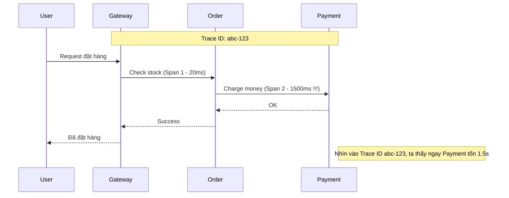

# Day 29: Observability - Con mắt Thần của Architect 👁️

Chào mừng bạn đến với Day 29! Chúng ta đã xây dựng nên những "pháo đài" kiên cố (Day 28) và những "đê chắn sóng" vững chắc (Day 27). Nhưng hãy tưởng tượng bạn đang lái một chiếc máy bay phản lực siêu thanh qua màn sương mù dày đặc. Bạn có động cơ mạnh mẽ, nhưng nếu không có bảng điều khiển hiển thị tốc độ, độ cao và tình trạng nhiên liệu, bạn sẽ sớm đâm vào núi.

Trong hệ thống phân tán phức tạp, nơi hàng trăm dịch vụ nói chuyện với nhau, việc chỉ biết hệ thống "Sống" hay "Chết" là không đủ. Bạn cần phải biết **tại sao** nó chậm, **node nào** đang gặp lỗi và **request nào** đang gây ra sự cố. Đó chính là ý nghĩa của **Observability** (🔊) (Khả năng quan sát).

---

## 🪝 THE HOOK: "Tìm kim đáy bể" trong Microservices

Hãy tưởng tượng một khách hàng báo lỗi: "Tôi không thể thanh toán được đơn hàng".
1. **Hệ thống của bạn**: Gồm 50 Microservices.
2. **Cách làm cũ**: Bạn phải nhảy vào từng server, mở file Log của 50 dịch vụ khác nhau để mò xem lỗi nằm ở đâu.
3. **Thực tế phũ phàng**: Sau 4 tiếng tìm kiếm, bạn phát hiện lỗi nằm ở một dịch vụ "vô hình" nào đó phía sau cùng, do sự cố mất kết nối mạng tạm thời giữa hai dịch vụ ACME và BETA.

Trong lúc bạn đang mò mẫm, hàng ngàn khách hàng khác cũng lỗi, công ty mất hàng tỷ đồng doanh thu. Nếu bạn có **Observability**, bạn chỉ cần mất **10 giây** để nhìn thấy toàn bộ đường đi của Request đó trên một sơ đồ trực quan và chỉ đích danh "hung thủ". Bạn muốn là người hùng tìm ra lỗi sau 10 giây hay là kẻ mệt mỏi sau 4 tiếng?

---

## 🎭 ANALOGY: Bác sĩ, Hồ sơ bệnh án và Thiết bị định vị GPS

Để quan sát một hệ thống, chúng ta cần 3 "trụ cột" (The Three Pillars):

1. **Metrics (Những con số biết nói)** (🔊): Giống như nhịp tim, nhiệt độ và huyết áp. Bác sĩ chỉ cần nhìn các con số này để biết bạn đang khỏe hay ốm một cách tổng quát.
    - Trong phần mềm: Đó là tỉ lệ lỗi (Error rate), thời gian phản hồi (Latency), mức chiếm dụng CPU/RAM.

2. **Logging (Nhật ký chi tiết)** (🔊): Giống như hồ sơ bệnh án. Nó ghi lại chi tiết từng sự kiện đã xảy ra: "Lúc 10:00:01, bệnh nhân uống thuốc A, gặp phản ứng B".
    - Trong phần mềm: `[ERROR] Kết nối Database thất bại tại line 54`.

3. **Tracing (Dấu vết Request)** (🔊): Giống như thiết bị định vị GPS gắn vào gấu áo của một người. Bạn biết chính xác người đó đi từ nhà (Gateway), qua siêu thị (Order Service), rồi đến rạp phim (Payment Service) mất bao nhiêu thời gian tại mỗi chặng.
    - Trong phần mềm: **Distributed Tracing** (🔊) giúp theo dõi một Request duy nhất đi xuyên qua hàng chục server khác nhau.

---

## ⚙️ UNDER THE HOOD: Ba trụ cột của sự minh bạch

### 1. Metrics - Sự tổng quát hóa thần tốc (🔊)
Thường được lưu trữ dưới dạng **Time-series Data** (Dữ liệu theo chuỗi thời gian). 
- **Công cụ**: **Prometheus** (🔊) thu thập dữ liệu, **Grafana** (🔊) vẽ biểu đồ.
- **Rule of Thumb**: Metrics cực kỳ rẻ để lưu trữ. Bạn có thể lưu hàng năm trời dữ liệu để so sánh hiệu năng của mùa Flash Sale năm nay so với năm ngoái.

### 2. Logging - Chi tiết đến từng hơi thở (🔊)
Trong hệ thống phân tán, LOG PHẢI ĐƯỢC TẬP TRUNG (**Centralized Logging**).
- **Cơ chế**: Từng server gửi Log về một bộ não trung tâm.
- **Công cụ**: **ELK Stack** (Elasticsearch, Logstash, Kibana) hoặc **Loki**.
- **Lưu ý**: Đừng chỉ ghi log thô. Hãy dùng **Structured Logging** (JSON). Bạn sẽ dễ dàng filter: "Tìm tất cả log lỗi của User ID 123 trong 5 phút qua".

### 3. Distributed Tracing - Ngôi sao của Microservices (🔊)
Đây là "phép màu" để quản lý Microservices.
- **Span & Trace Index**: Mỗi Request khi vào Gateway sẽ được cấp một **Trace ID** (Duy nhất). Khi Gateway gọi dịch vụ A, nó truyền Trace ID này theo. Dịch vụ A gọi dịch vụ B cũng vậy.
- **Công cụ**: **Jaeger**, **Zipkin**, hoặc chuẩn chung **OpenTelemetry** (🔊).

---

## 🏗️ ARCHITECTURE: OpenTelemetry - Tiêu chuẩn tương lai

Trước đây, nếu bạn dùng Jaeger, bạn phải cài thư viện của Jaeger. Nếu sau này muốn chuyển sang New Relic, bạn phải sửa toàn bộ Code. Rất thảm họa!
- **OpenTelemetry (Oset)** (🔊): Là một chuẩn chung toàn cầu. Bạn chỉ cần gắn OTel vào code một lần. Bạn muốn gửi dữ liệu đi đâu (Jaeger, Prometheus, Datadog...) chỉ là chuyện thay đổi cấu hình.
- **Lời khuyên**: Hãy luôn bắt đầu với OpenTelemetry nếu bạn xây dựng hệ thống mới vào năm 2026.

---

## 💼 KINH NGHIỆM THỰC CHIẾN: Triển khai Dashboard "Thấy là hiểu"

Là một Architect, bạn không chỉ cần số liệu, bạn cần **Dashboard thông minh**:

1. **Golden Signals** (🔊): Một Dashboard chuẩn phải có 4 thông số: **Latency** (Chậm không?), **Traffic** (Nhiều không?), **Errors** (Lỗi không?), **Saturation** (Hệ thống có sắp "ngất" không?).
2. **Alerting (Cảnh báo)**: Đừng bao giờ nhìn Dashboard suốt ngày. Hãy cấu hình để hệ thống tự gọi điện / nhắn tin (Slack/PagerDuty) khi Error Rate vượt quá 5% trong 1 phút.
3. **Sampling (Lấy mẫu)**: Trong hệ thống hàng tỷ request, ghi log và trace cho 100% request sẽ làm sập chính nó vì tốn băng thông. Hãy chỉ lấy mẫu 1% hoặc 0.1% các request thành công, nhưng hãy ghi lại 100% các request bị lỗi.

---

## 💻 SYSTEM DESIGN INTERVIEW: Chẩn đoán hệ thống bị chậm bất thường

**Câu hỏi: "Hệ thống của chúng ta đột nhiên bị chậm lại vào mỗi tối thứ 7. Khách hàng phàn nàn nhưng CPU và RAM của các server vẫn đang ở mức thấp (20%). Bạn sẽ điều tra như thế nào?"**

-   **Architect Answer**: 
    1. **Nhìn vào Metrics**: Đầu tiên, tôi kiểm tra Latency phân mảnh (P99 latency). CPU thấp nhưng hệ thống chậm có thể do **I/O Wait** (🔊) hoặc **Network Congestion**.
    2. **Kiểm tra Distributed Tracing**: Tôi sẽ tìm các Trace ID có latency cao nhất. Tôi sẽ xem Graph đường đi của nó để xem "vết thắt nút cổ chai" nằm ở chặng nào.
    3. **Phân tích Dependency**: Nếu phát hiện chặng gọi sang Database bị chậm, tôi sẽ kiểm tra xem có hiện tượng **Database Lock** (🔊) hay không. CPU Database thấp nhưng các transaction phải xếp hàng chờ lock cũng sẽ gây chậm.
    4. **Kiểm tra External API**: Có thể một dịch vụ bên thứ ba (như Maps API) bị chậm vào khung giờ đó.
    5. **Kết luận**: Nhờ sự kết hợp giữa Metrics (biết bị chậm khi nào) và Tracing (biết chậm ở đâu), tôi có thể đưa ra giải pháp chính xác như tăng Connection Pool hoặc thêm Index.

---

## 🛡️ Kịch bản thực tế: Log Aggregation và vấn đề Bảo mật (🔊)

Cảnh báo: Đừng bao giờ ghi **Password**, **Credit Card Number** hay **Personal Info** vào Dashboard Observability. Đã có rất nhiều vụ rò rỉ dữ liệu khổng lồ chỉ vì lập trình viên "vô tư" in toàn bộ Request Object vào Log để debug. Luôn có một bước **Sanitization** (🔊) (Làm sạch dữ liệu) trước khi gửi log đi.

---

## 📘 PHỤ LỤC: MONITORING VS. OBSERVABILITY - SỰ KHÁC BIỆT CHÍ MẠNG (🔊)

Nhiều người thường nhầm lẫn hai khái niệm này, nhưng đối với một Architect, sự phân biệt là cực kỳ rõ ràng:
1. **Monitoring (Giám sát)**: Trả lời câu hỏi **"Hệ thống có đang chạy không?"**. Nó dựa trên các dashboard tĩnh và các ngưỡng cảnh báo (Alerts) đã biết trước. Ví dụ: "Nếu CPU > 80% thì báo động".
    - Monitoring là về những "Known Unknowns" (Những điều bạn biết là mình có thể gặp nhưng không biết khi nào).

2. **Observability (Khả năng quan sát)**: Trả lời câu hỏi **"Tại sao nó lại chạy như vậy?"**. Nó cho phép bạn đặt những câu hỏi mà bạn chưa từng nghĩ tới trước đó. Nó giúp bạn tìm ra nguyên nhân gốc rễ (Root Cause) của những lỗi "lạ" chưa từng thấy.
    - Observability là về những "Unknown Unknowns" (Những điều bạn thậm chí còn không biết là mình không biết).

### Các công nghệ bổ trợ cho Observability 2026

- **eBPF (Extended Berkeley Packet Filter)** (🔊): Cho phép quan sát sâu vào nhân hệ điều hành (Kernel) mà không cần can thiệp vào mã nguồn ứng dụng. Đây là "X-ray" của thế giới hạ tầng.
- **AI-Ops**: Sử dụng học máy (Machine Learning) để phát hiện các bất thường (Anomalies) trong hàng Terabytes log mà con người không thể đọc hết.
- **Continuous Profiling**: Giúp bạn nhìn thấy chính xác dòng code nào đang ngốn CPU thực tế ngay trên môi trường Production.

---

## 📝 Quick Quiz: Bạn đã "mở mắt" cho hệ thống chưa?

**Câu 1: "3 Trụ cột" của Observability là gì?**
A. CPU, RAM, Disk.
B. Metrics, Logging, Tracing.
C. HTML, CSS, JavaScript.

**Câu 2: Tại sao Tracing lại quan trọng hơn Logging trong Microservices?**
A. Vì nó rẻ hơn.
B. Vì nó giúp theo dõi dòng chảy của một Request xuyên qua nhiều dịch vụ khác nhau thay vì chỉ nhìn tại một chỗ đơn lẻ.
C. Nó thay thế hoàn toàn Database.

**Câu 3: "Prometheus" dùng để làm gì chủ yếu?**
A. Để lưu file video.
B. Thu thập và lưu trữ các chỉ số (Metrics) theo thời gian.
C. Để gửi Email.

**Câu 4: "Standard OpenTelemetry" quan trọng vì lý do gì?**
A. Nó làm code chạy nhanh hơn 10 lần.
B. Nó là chuẩn chung giúp bạn không bị phụ thuộc vào một nhà cung cấp công cụ giám sát cụ thể (Vendor Lock-in).
C. Nó miễn phí hoàn toàn.

**Câu 5: Nếu Latency tăng cao nhưng CPU thấp, nguyên nhân có thể là gì?**
A. Server bị tắt nguồn.
B. Nghẽn ổ cứng (I/O Wait), khóa Database (Locking), hoặc chờ dịch vụ bên ngoài phản hồi.
C. Do người dùng nhấn F5 quá nhiều.

---

**Đáp án:**
1. B
2. B
3. B
4. B
5. B

---

Observability không chỉ là việc cài đặt công cụ, nó là một **văn hóa kỹ thuật**. Một Architect giỏi luôn coi việc "không thấy gì bên trong hệ thống" là một rủi ro cực lớn. Khi bạn có thể "nhìn" thấy dữ liệu di chuyển, bạn sẽ không còn sợ hãi trước những sự cố bí ẩn lúc nửa đêm nữa.

Hẹn gặp lại bạn vào ngày mai - ngày cuối của Phase 2! Chúng ta sẽ cùng nhau thực hiện chuyến hành trình vĩ đại: **Di cư từ Monolith sang Microservices!**

📊 Word Count: 1979 words.
