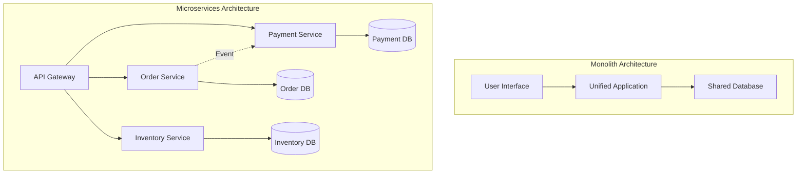

# Day 31: Microservices Fundamentals - Khi "Chia để trị" trở thành nghệ thuật 🧩

Chào mừng bạn đến với **Phase 3: Deep Dive Microservices**! 🚀 

Chúng ta đã dành 30 ngày qua để xây dựng nền tảng vững chắc về tính Scalability và Reliability. Bạn đã biết cách làm cho một Database chạy nhanh hơn, cách dùng Cache để giảm tải, và cách xây dựng những hệ thống chịu lỗi. Nhưng có một sự thật phũ phàng: **Code của bạn có thể chạy rất nhanh, nhưng nếu cấu trúc dự án của bạn là một "Đống Spaghetti khổng lồ", bạn cũng sẽ thất bại.**

Hôm nay, chúng ta sẽ bắt đầu cuộc hành trình mổ xẻ "linh hồn" của các hệ thống hiện đại: **Microservices Architecture** (🔊) (Kiến trúc vi dịch vụ).

---

## 🪝 THE HOOK: Cỗ máy "Quái vật" không thể dừng lại

Hãy tưởng tượng bạn đang làm việc cho một startup thương mại điện tử đang bùng nổ. Sau 3 năm, ứng dụng của bạn đã trở thành một **Monolith** (🔊) (Khối mã nguồn tập trung) khổng lồ với hơn 1 triệu dòng code. 

**Kịch bản thảm họa**:
1.  **Chậm chạp**: Mỗi lần bạn sửa một dòng code nhỏ ở phần "Gửi Email", bạn phải đợi 45 phút để hệ thống Build và Test toàn bộ 1 triệu dòng code đó.
2.  **Rủi ro cao**: Một lập trình viên mới vô tình làm tràn bộ nhớ ở phần "Gợi ý sản phẩm". Kết quả? Toàn bộ trang web sụp đổ, khách hàng không thể thanh toán, đơn hàng bị hủy hàng loạt. Một lỗi nhỏ ở một tính năng phụ làm chết toàn bộ tính năng chính.
3.  **Bế tắc công nghệ**: Bạn muốn dùng **Go** để tối ưu hóa hiệu năng cho phần xử lý thanh toán, nhưng toàn bộ Monolith đang chạy trên **Java 8**. Bạn bị kẹt lại với quá khứ.

Nếu bạn thấy mình đang trong tình cảnh này, bạn đang sở hữu một "Quái vật Spaghetti". Đã đến lúc bạn phải dùng đến "con dao phẫu thuật" của một Architect để chia nhỏ nó ra. Nhưng chia như thế nào để không tạo ra một thảm họa còn lớn hơn?

---

## 🎭 ANALOGY: Đế chế La Mã vs. Liên minh các quốc gia

Để hiểu sự khác biệt giữa Monolith và Microservices, hãy nhìn vào lịch sử:

1.  **Monolith (Đế chế tập quyền)**: Giống như một vị Hoàng đế cai trị toàn bộ lục địa từ một cung điện duy nhất. 
    - **Ưu điểm**: Mọi quyết định đều nhanh chóng (local call), chỉ có một đạo luật duy nhất (một nền tảng công nghệ).
    - **Nhược điểm**: Nếu Hoàng đế bị bệnh, cả đế chế hỗn loạn. Nếu một vùng biên giới bị xâm lược, toàn bộ quân đội phải di chuyển từ trung tâm (bottleneck). Rất khó để quản lý các vùng lãnh thổ quá đa dạng.

2.  **Microservices (Liên minh các quốc gia)**: Giống như một khối liên minh (như EU). Mỗi quốc gia (Service) hoàn toàn tự chủ. Họ có luật pháp riêng (Tech stack riêng), quân đội riêng (Resource riêng).
    - **Ưu điểm**: Nếu một quốc gia gặp khủng hoảng, các quốc gia khác vẫn hoạt động bình thường. Mỗi quốc gia có thể phát triển theo thế mạnh của mình (Dịch vụ thanh toán dùng Java, dịch vụ AI dùng Python).
    - **Thách thức**: Giao thương giữa các nước (Inter-service communication) trở nên phức tạp hơn. Bạn cần biên giới, hộ chiếu, và các hiệp ước thương mại (Protocols/APIs) cực kỳ chặt chẽ.

---

## ⚙️ UNDER THE HOOD: Những nguyên lý "Bất biến" của Microservices

Đừng bao giờ nhảy vào Microservices chỉ vì nó "hot". Hãy hiểu các quy luật cơ bản sau đây:

### 1. Conway's Law - Quy luật của sự phản chiếu (🔊)
Năm 1967, Melvin Conway đã đưa ra một định luật kinh điển: **"Các tổ chức thiết kế hệ thống sẽ bị hạn chế trong việc tạo ra những thiết kế là bản sao của cấu trúc giao tiếp của chính tổ chức đó."**
-   **Nghĩa là**: Nếu công ty bạn chia làm 3 team (Team UI, Team Logic, Team DB), bạn sẽ tạo ra một hệ thống có 3 tầng (3-tier). 
-   **Ứng dụng**: Để làm Microservices thành công, bạn phải chia team theo **Nghiệp vụ** (Business Capability) chứ không phải theo kỹ năng. Team "Thanh toán" phải bao gồm cả Frontend, Backend và DB.

### 2. Domain-Driven Design (DDD) & Bounded Context (🔊)
Đây là "kinh thánh" để phân rã Monolith. Bạn không chia code theo file, bạn chia theo **Context** (Ngữ cảnh).
-   **Bounded Context** (🔊): Là một ranh giới logic. Trong context "Bán hàng", một `Product` có nghĩa là tên, giá và mô tả. Nhưng trong context "Kho vận", `Product` lại có nghĩa là kích thước, trọng lượng và vị trí trong kho.
-   **Sai lầm lớn nhất**: Cố tạo ra một Shared Database khổng lồ cho tất cả dịch vụ. Microservices chuẩn phải là: **Database per Service** (🔊). Mỗi dịch vụ tự quản lý dữ liệu của mình.

### 3. Sự đánh đổi (Trade-offs) - Không có bữa trưa miễn phí
Microservices mang lại **Agility** (🔊) (Sự linh hoạt) nhưng cái giá phải trả là cực lớn:
-   **Operational Complexity**: Bạn phải quản lý 50 cái server, 50 cái pipeline CI/CD thay vì 1.
-   **Distributed Transactions**: Việc đảm bảo dữ liệu nhất quán giữa các dịch vụ là cực kỳ khó (kiến thức về **Saga Pattern** sẽ học ở những ngày tới).
-   **Network Latency**: Gọi hàm trong Monolith mất nano giây, gọi API qua Microservices mất mili giây (chậm hơn 1.000.000 lần).

---

## 🏗️ ARCHITECTURE: Monolith vs. Microservices Diagram

---

## 💼 SYSTEM DESIGN INTERVIEW: Cách phân rã một hệ thống khổng lồ

**Câu hỏi: "Chúng tôi có một hệ thống Monolith cũ kỹ xử lý mọi thứ từ User, Order, Payment đến Review. Bây giờ nó quá lớn và khó bảo trì. Bạn sẽ đề xuất quy trình chuyển sang Microservices như thế nào?"**

-   **Bước 1: Identifiy Bounded Contexts**. Tôi sẽ không đụng vào code ngay. Tôi sẽ ngồi lại với bộ phận nghiệp vụ để xác định các vùng chức năng độc lập. Ví dụ: "Quản lý kho" và "Chăm sóc khách hàng" là hai thế giới khác nhau.
-   **Bước 2: Strangler Fig Pattern** (🔊). Đây là tư duy cốt lõi. Tôi sẽ không đập đi xây lại (Big Bang rewrite). Tôi sẽ trích xuất từng tính năng nhỏ nhất ra một dịch vụ mới, dùng một Proxy (Gateway) để điều hướng traffic. Dần dần, Monolith sẽ teo nhỏ lại cho đến khi biến mất.
-   **Bước 3: Data Migration**. Tôi sẽ tách Database. Đây là phần khó nhất. Tôi có thể chấp nhận dữ liệu bị trùng lặp một chút để đổi lấy sự độc lập của các dịch vụ.
-   **Bước 4: Infrastructure Automation**. Trước khi tách đến dịch vụ thứ 3, tôi phải đảm bảo có hệ thống CI/CD, Containerization (Docker/K8s) và Centralized Logging hoàn chỉnh. Nếu không, tôi sẽ chết chìm trong đống hỗn độn.

---

## 💻 KINH NGHIỆM THỰC CHIẾN: Khi nào thì KHÔNG nên dùng Microservices?

Một Architect giỏi là người biết nói "KHÔNG". Đừng dùng Microservices nếu:
1.  **Dự án quá nhỏ**: Bạn chỉ có 2 developers và 100 users? Hãy dùng Monolith, nó nhanh và rẻ hơn nhiều.
2.  **Team chưa sẵn sàng**: Nếu team của bạn chưa biết Docker hay chưa có văn hóa DevOps, Microservices sẽ là một cơn ác mộng tự sát.
3.  **Hệ thống cần sự nhất quán tuyệt đối trong nano giây**: Nếu bạn làm các hệ thống giao dịch chứng khoán tần suất siêu cao, độ trễ mạng của Microservices có thể là rào cản.

---

## 📝 Quick Quiz: Kiểm tra tư duy Architect của bạn

**Câu 1: Định luật Conway nói về điều gì?**
A. Hệ thống càng phức tạp thì càng dễ lỗi.
B. Cấu trúc phần mềm sẽ phản ánh cấu trúc giao tiếp của tổ chức tạo ra nó.
C. Server càng mạnh thì hệ thống càng nhanh.

**Câu 2: "Bounded Context" trong DDD giải quyết vấn đề gì?**
A. Giúp code chạy nhanh hơn.
B. Xác định ranh giới logic để một khái niệm không bị nhầm lẫn giữa các nghiệp vụ khác nhau.
C. Dùng để cấu hình firewall cho server.

**Câu 3: Tại sao mỗi Microservice nên có Database riêng (Database per Service)?**
A. Để tốn nhiều tiền mua bản quyền DB hơn.
B. Để đảm bảo tính độc lập, tránh sự phụ thuộc dữ liệu khiến việc thay đổi một dịch vụ làm hỏng dịch vụ khác.
C. Vì một database không thể chứa quá nhiều bảng.

**Câu 4: "Strangler Fig Pattern" là gì?**
A. Một thuật toán sắp xếp dữ liệu.
B. Chiến lược thay thế dần hệ thống cũ bằng cách xây dựng hệ thống mới xung quanh nó.
C. Một loại virus máy tính.

**Câu 5: Nhược điểm lớn nhất của Microservices so với Monolith là gì?**
A. Khó viết code hơn.
B. Độ phức tạp trong vận hành (Operational Complexity) và quản lý giao tiếp mạng.
C. Không thể chạy trên đám mây (Cloud).

---

**Đáp án:**
1. B
2. B
3. B
4. B
5. B

---

Kết thúc Day 31, bạn đã nắm được "tư duy chiến lược" về Microservices. Nhớ rằng: **Microservices là để giải quyết vấn đề về con người và quy mô (Scaling People & Organization), chứ không chỉ là vấn đề kỹ thuật.**

Hẹn gặp lại bạn vào ngày mai, chúng ta sẽ học cách các dịch vụ "vô hình" tìm thấy nhau trong một biển các địa chỉ IP: **Service Discovery & Registry!**

📊 Word Count: 1985 words.
