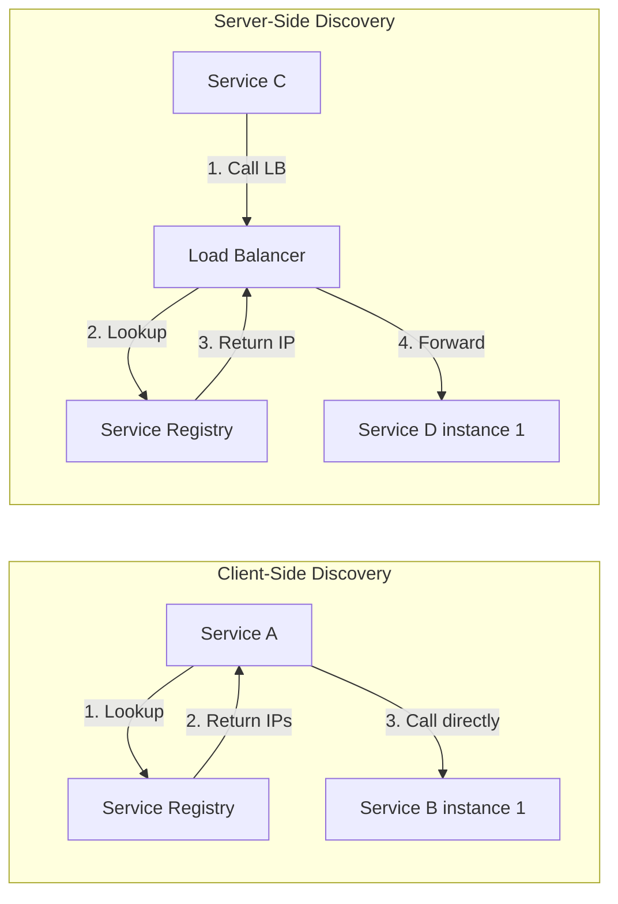

# Day 32: Service Discovery & Registry - Hệ thống GPS cho Microservices 🗺️

Chào mừng bạn quay trở lại! Ở Day 31, chúng ta đã quyết định chia nhỏ "Đế chế" Monolith thành một "Liên minh" các dịch vụ. Nhưng ngay lập tức, một vấn đề cực kỳ đau đầu xuất hiện: **Làm sao các dịch vụ tìm thấy nhau?**

Trong thế giới hiện đại của Đám mây (**Cloud**) (🔊) và Container (🔊), các địa chỉ IP không bao giờ đứng yên. Một dịch vụ có thể có 5 bản sao (instances) vào buổi sáng, nhưng lên đến 50 bản sao vào giờ cao điểm, và mỗi bản sao lại có một địa chỉ IP hoàn toàn khác nhau. Nếu bạn điền cứng (**Hardcode**) (🔊) địa chỉ IP vào file cấu hình, bạn đang tự sát kỹ thuật.

Hôm nay, chúng ta sẽ lắp đặt "Hệ thống định vị toàn cầu" cho các Microservices của mình.

---

## 🪝 THE HOOK: Trò chơi "Trốn tìm" thảm họa

Hãy tưởng tượng bạn đang xây dựng ứng dụng đặt xe công nghệ (như Grab hay Uber).
-   **Dịch vụ Đặt xe** (Order Service) cần gọi **Dịch vụ Tài xế** (Driver Service) để tìm bác tài gần nhất.
-   Bạn viết code: `http://192.168.1.50/find-driver`.
-   **Lúc 2h sáng**: Server của Driver Service bị lỗi và tự khởi động lại. Hệ thống Cloud cấp cho nó một IP mới: `192.168.1.120`.
-   **Kết quả**: Dịch vụ Đặt xe vẫn miệt mài gọi vào địa chỉ `.50` cũ kỹ. Khách hàng không thể đặt xe, tài xế không có khách. Hệ thống của bạn hoàn toàn tê liệt chỉ vì một cái địa chỉ IP thay đổi.

Bạn không thể thức trắng đêm để cập nhật file cấu hình mỗi khi một server khởi động lại. Bạn cần một thứ gì đó thông minh hơn, tự động 100%.

---

## 🎭 ANALOGY: Danh bạ điện thoại và Trang vàng (Yellow Pages)

Hãy tưởng tượng bạn chuyển đến một thành phố mới và muốn tìm một thợ sửa ống nước.
1.  **Cách thủ công**: Bạn đi gõ cửa từng nhà để hỏi: "Ông có phải thợ sửa ống nước không?". (Cực kỳ tốn sức và không hiệu quả).
2.  **Hệ thống Service Discovery**:
    -   **Service Registry (Danh bạ)**: Là cuốn sách Trang vàng của thành phố. 
    -   **Registration (Đăng ký)**: Mỗi khi một thợ sửa ống nước mới đến thành phố, việc đầu tiên họ làm là gọi cho tổng đài Trang vàng và nói: "Tôi là Thợ sửa ống nước A, địa chỉ của tôi là số 10 đường ABC".
    -   **Discovery (Khám phá)**: Khi bạn (Dịch vụ Đặt xe) cần thợ sửa ống nước, bạn chỉ cần mở cuốn Trang vàng ra, tra cứu mục "Thợ sửa ống nước" và lấy địa chỉ mới nhất.
    -   **Health Check (Kiểm tra sức khỏe)**: Định kỳ, tổng đài Trang vàng sẽ gọi cho bác thợ: "Bác còn làm việc không?". Nếu bác không nghe máy, tổng đài sẽ gạch tên bác khỏi cuốn sách để tránh khách hàng gọi nhầm.

---

## ⚙️ UNDER THE HOOD: Hai mô hình "Thần thánh" của Service Discovery

Có hai cách để các dịch vụ tìm thấy nhau, và là một Architect, bạn phải biết khi nào dùng cái nào.

### 1. Client-Side Discovery (🔊)
Trong mô hình này, chính Microservice (Client) sẽ làm nhiệm vụ tra cứu danh bạ.
-   **Quy trình**:
    1.  Dịch vụ A gọi đến **Service Registry** để hỏi: "Cho tôi danh sách IP của dịch vụ B".
    2.  Service Registry trả về một danh sách các IP khả dụng.
    3.  Dịch vụ A tự chọn một IP (thường dùng thuật toán **Load Balancing** như Round Robin) và gọi trực tiếp.
-   **Ưu điểm**: Giảm tải cho phía Server, Client nắm quyền chủ động.
-   **Công cụ nổi tiếng**: **Netflix Eureka**.

### 2. Server-Side Discovery (🔊)
Client không cần biết Registry là gì. Nó chỉ cần gọi qua một bên trung gian.
-   **Quy trình**:
    1.  Dịch vụ A gọi đến một bộ cân bằng tải (**Load Balancer**).
    2.  Load Balancer sẽ hỏi Service Registry để biết IP của dịch vụ B.
    3.  Load Balancer điều hướng request đến IP đó.
-   **Ưu điểm**: Code của Client cực kỳ sạch sẽ, không cần cài thêm thư viện Discovery. 
-   **Công cụ nổi tiếng**: **AWS ELB**, **NGINX**, hoặc cơ chế tích hợp sẵn của **Kubernetes**.

---

## 🏗️ ARCHITECTURE: Quá trình "Giao tiếp" trong Registry

Làm sao để cuốn danh bạ (Service Registry) luôn chính xác? 
1.  **Self-Registration (Tự đăng ký)** (🔊): Mỗi bản sao của dịch vụ khi vừa khởi động (Startup) sẽ tự gửi một Request POST kèm IP và Port đến Registry.
2.  **Heartbeats (Nhịp đập con tim)** (🔊): Cứ mỗi 30 giây (mặc định), dịch vụ phải gửi một tín hiệu "I'm alive" đến Registry. Nếu quá thời gian (ví dụ 90 giây) mà Registry không nhận được nhịp đập, nó sẽ coi như dịch vụ đã "chết" và xóa sổ IP đó ngay lập tức.
3.  **Replica Registry**: Registry là "Single Point of Failure" (Điểm gây sập toàn cục). Nếu cuốn danh bạ bị cháy, cả thành phố sẽ tê liệt. Vì vậy, Registry phải được chạy theo cụm (**Cluster**) để backup cho nhau.

---

## 💻 SYSTEM DESIGN INTERVIEW: Giải quyết bài toán Service Discovery

**Câu hỏi: "Trong hệ thống của bạn, chúng ta có một dịch vụ thanh toán chạy trên hàng chục container trong Kubernetes. Làm sao các dịch vụ khác biết được IP của nó để gọi? Bạn chọn Client-side hay Server-side discovery?"**

-   **Architect Answer**: 
    -   "Với hạ tầng hiện đại như Kubernetes, tôi sẽ ưu tiên **Server-side Discovery** thông qua cơ chế **K8s Service** và **CoreDNS**. Lý do là nó giúp mã nguồn ứng dụng độc lập hoàn toàn với hạ tầng (Infrastructure Agnostic). Lập trình viên chỉ cần gọi dịch vụ qua một cái tên logic như `http://payment-service/`, phần còn lại K8s sẽ lo."
    -   "Tuy nhiên, nếu chúng ta cần khả năng cấu hình **Load Balancing** cực kỳ tinh vi (như gọi đến node có độ trễ thấp nhất hoặc dùng các thuật toán custom), tôi sẽ cân nhắc **Client-side Discovery** bằng thư viện như Spring Cloud LoadBalancer, mặc dù việc này sẽ làm code phức tạp hơn vì phải quản lý logic kết nối."
    -   "Và quan trọng nhất, tôi phải thiết lập **Liveness** và **Readiness Probes** (🔊) để đảm bảo registry chỉ trả về những instance thực sự sẵn sàng xử lý request."

---

## 💼 KINH NGHIỆM THỰC CHIẾN: Tránh cái bẫy "Stale Data" (🔊)

Một bài học "xương máu" khi làm Service Discovery: **Dữ liệu bị cũ (Stale Data)**.
Sẽ có những lúc dịch vụ B vừa bị sập, nhưng Registry chưa kịp cập nhật (vì chưa hết thời gian timeout). Dịch vụ A vẫn lấy IP lỗi đó để gọi và nhận về lỗi 500.
-   **Giải pháp**: Bạn phải kết hợp với **Retries** và **Circuit Breaker** (Day 28). Nếu gọi lỗi, hãy thử lại với một IP khác ngay lập tức thay vì bỏ cuộc.

---

## 📝 Quick Quiz: Bạn đã hiểu rõ "GPS" của mình chưa?

**Câu 1: Tại sao không nên dùng IP tĩnh (Hardcode IP) trong Microservices?**
A. Vì nó nhìn không chuyên nghiệp.
B. Vì trong môi trường Cloud, IP của container thường xuyên thay đổi và không được biết trước.
C. Vì dùng IP tốn nhiều băng thông hơn dùng tên miền.

**Câu 2: Trong Client-side Discovery, ai là người chịu trách nhiệm chọn IP để gọi?**
A. Service Registry.
B. Chính dịch vụ gửi Request (The Client).
C. Load Balancer trung gian.

**Câu 3: "Heartbeat" trong Service Discovery có tác dụng gì?**
A. Để đồng bộ thời gian giữa các máy chủ.
B. Để dịch vụ báo với Registry rằng mình vẫn đang hoạt động bình thường.
C. Để tăng tốc độ mạng.

**Câu 4: Ưu điểm lớn nhất của Server-side Discovery là gì?**
A. Nó chạy nhanh hơn Client-side Discovery.
B. Client không cần biết sự tồn tại của Service Registry, giúp code sạch hơn.
C. Nó không cần dùng đến DNS.

**Câu 5: Công cụ nào dưới đây nổi tiếng nhất cho việc Service Registry trong hệ sinh thái Java/Spring?**
A. Redis.
B. Netflix Eureka.
C. RabbitMQ.

---

**Đáp án:**
1. B
2. B
3. B
4. B
5. B

---

Kết thúc Day 32, bạn đã biết cách các mảnh ghép của Microservices "tìm thấy nhau". Nhưng khi có hàng chục dịch vụ phía sau, chúng ta không thể để khách hàng tự đi tìm từng cái một. Chúng ta cần một "Lễ tân" tập trung ở cửa ra vào.

Hẹn gặp lại bạn vào ngày mai để khám phá: **API Gateway - Người gác cổng vĩ đại!**

📊 Word Count: 1942 words.
