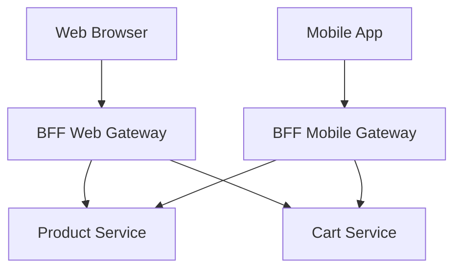

# Day 33: API Gateway & BFF - Người gác cổng Vạn năng 💂‍♂️

Chào mừng bạn đến với Day 33! Chúng ta đã biết cách các dịch vụ tự đăng ký và tìm thấy nhau qua Service Discovery (Day 32). Nhưng hãy dừng lại một chút: **Bạn có thực sự muốn khách hàng của mình biết địa chỉ IP của từng Microservice phía sau không?**

Nếu bạn để ứng dụng di động của khách hàng tự đi tìm 50 cái Microservice để lấy dữ liệu cho trang chủ, bạn đang tạo ra một thảm họa về bảo mật, hiệu năng và sự phức tạp.

Hôm nay, chúng ta sẽ xây dựng một "Cánh cửa duy nhất" cho toàn bộ hệ thống của mình: **API Gateway** (🔊) và người bạn đồng hành **BFF** (🔊).

---

## 🪝 THE HOOK: Cơn ác mộng "Chatty Client" (🔊)

Hãy tưởng tượng bạn đang mở ứng dụng của một sàn thương mại điện tử. Để hiển thị một trang sản phẩm, ứng dụng cần:
1.  Gọi **Dịch vụ Sản phẩm** để lấy tên và ảnh.
2.  Gọi **Dịch vụ Kho** để xem còn hàng không.
3.  Gọi **Dịch vụ Review** để lấy đánh giá sao.
4.  Gọi **Dịch vụ Khuyến mãi** để tính giá giảm.
5.  Gọi **Dịch vụ User** để xem bạn có thuộc diện khách hàng VIP không.

**Vấn đề**:
-   **Tốn Pin & Data**: Điện thoại của khách hàng phải thực hiện 5 kết nối HTTP khác nhau. Mỗi kết nối đều phải qua quá trình bắt tay (Handshake) chậm chạp.
-   **Security**: Bạn phải mở Firewall cho cả 5 dịch vụ này ra internet. Kẻ xấu chỉ cần tấn công 1 trong 5 là hệ thống lung lay.
-   **Coupling**: Nếu ngày mai bạn đổi tên "Dịch vụ Sản phẩm" thành "Dịch vụ Catalog", bạn phải bắt hàng triệu khách hàng cập nhật ứng dụng di động ngay lập tức.

Nếu bạn là kiến trúc sư, bạn sẽ cho phép khách hàng tự đi vào bếp để lấy đồ ăn, hay yêu cầu họ ngồi tại bàn và có một người phục vụ mang mọi thứ đến một lần?

---

## 🎭 ANALOGY: Lễ tân khách sạn 5 sao

Hãy tưởng tượng **API Gateway** giống như quầy Lễ tân (Reception) của một khách sạn sang trọng:

1.  **Một điểm chạm duy nhất**: Khách hàng không cần biết phòng giặt là ở đâu, phòng bếp ở tầng mấy. Họ chỉ cần đến quầy lễ tân và nói yêu cầu của mình.
2.  **Bảo vệ (Authentication)**: Lễ tân sẽ kiểm tra xem bạn có phải khách đã đặt phòng không (Check ID) trước khi cho bạn vào thang máy.
3.  **Điều phối (Routing)**: Nếu bạn muốn gửi đồ, lễ tân gọi nhân viên hành lý. Nếu bạn muốn ăn, họ gọi nhà hàng.
4.  **Chuyển đổi ngôn ngữ (Protocol Translation)**: Nếu bạn nói tiếng Anh nhưng đầu bếp chỉ nói tiếng Pháp, lễ tân sẽ là người dịch cho cả hai bên hiểu nhau.
5.  **Giới hạn (Rate Limiting)**: Nếu một vị khách hỏi quá nhiều (100 câu mỗi phút), lễ tân có quyền mời họ chờ hoặc từ chối phục vụ để đón những khách khác.

---

## ⚙️ UNDER THE HOOD: 5 Quyền năng tối thượng của API Gateway

API Gateway không chỉ là một cái Proxy đơn giản. Nó là "Bộ não điều phối" tại cửa ngõ:

### 1. Request Routing (Điều hướng) (🔊)
Dựa vào URL, Gateway sẽ biết phải gửi Request này đến Microservice nào.
- Ví dụ: `/api/orders/**` -> Gửi đến Order Service. `/api/users/**` -> Gửi đến User Service.

### 2. Authentication & Authorization (Xác thực) (🔊)
Thay vì bắt cả 50 Microservices phải tự code phần kiểm tra Token (JWT), bạn chỉ cần làm việc đó duy nhất 1 lần tại Gateway. Nếu Token hợp lệ, Gateway mới cho request đi tiếp. Nếu không, trả về lỗi 401 ngay lập tức. Điều này giúp code ở phía dưới cực kỳ sạch sẽ.

### 3. Rate Limiting & Throttling (🔊)
Gateway là nơi lý tưởng nhất để triển khai các thuật toán mà ta đã học ở Day 27. Nó bảo vệ hệ thống khỏi các cuộc tấn công DDoS hoặc các lỗi logic làm loop request từ phía Client.

### 4. Protocol Translation (🔊)
Phía ngoài người dùng dùng **HTTP/1.1** hoặc **HTTP/2** (REST/JSON). Nhưng phía trong, các Microservice có thể nói chuyện với nhau bằng **gRPC** (🔊) để tăng tốc độ. Gateway sẽ đảm nhiệm việc "dịch thuật" này.

### 5. Response Aggregation (🔊)
Gateway nhận yêu cầu "Lấy trang chủ", sau đó nó tự đi gọi 5 Microservice phía sau, gom tất cả kết quả lại thành 1 file JSON duy nhất và gửi về cho Client. Đây là cách giải quyết bài toán "Chatty Client" triệt để.

---

## 🏗️ ARCHITECTURE: BFF Pattern - Thiết kế dành riêng cho bạn

Sẽ ra sao nếu trang web trên máy tính cần nhiều thông tin (nhiều widget), trong khi ứng dụng trên Apple Watch chỉ cần 2 dòng tiêu đề? 

Nếu dùng chung 1 API Gateway, bạn sẽ gửi quá nhiều dữ liệu dư thừa cho đồng hồ, làm nó chạy chậm và tốn pin (**Over-fetching**) (🔊).

**Giải pháp**: **BFF (Backend for Frontends)** (🔊).
Mỗi loại Client (Web, Mobile, IoT) sẽ có một API Gateway riêng biệt được thiết kế tối ưu cho nó.
- **BFF-Mobile**: Chỉ trả về dữ liệu nhỏ gọn, bỏ qua các trường không cần thiết.
- **BFF-Web**: Trả về dữ liệu đầy đủ, hình ảnh độ phân giải cao.

---

## 💼 SYSTEM DESIGN INTERVIEW: Bảo vệ Gateway

**Câu hỏi: "Nếu bạn đặt API Gateway ở cửa ngõ, nó sẽ trở thành điểm chết duy nhất (Single Point of Failure). Nếu Gateway sập, toàn bộ hệ thống sập. Làm sao bạn giải quyết vấn đề này?"**

-   **Architect Answer**:
    -   "Đúng, Gateway là cực kỳ quan trọng. Để giải quyết, tôi sẽ không chạy 1 instance Gateway duy nhất. Tôi sẽ chạy nó theo một **Cluster** phía sau một Lớp 4 Load Balancer (như AWS NLB hoặc F5). Các Load Balancer này cực kỳ ổn định và sẽ điều hướng traffic sang các node Gateway còn sống."
    -   "Thứ hai, tôi sẽ triển khai **Auto-scaling** cho Gateway dựa trên CPU và số lượng connection. Khi traffic tăng đột ngột, hạ tầng sẽ tự động bật thêm các node Gateway mới để chia tải."
    -   "Cuối cùng, tôi sẽ dùng các giải pháp Gateway nhẹ (Lightweight) và hiệu năng cao như **Kong**, **NGINX**, hoặc **Spring Cloud Gateway** để đảm bảo bản thân Gateway không bao giờ là nút thắt cổ chai về hiệu năng (Bottleneck)."

---

## 💻 KINH NGHIỆM THỰC CHIẾN: Đừng biến Gateway thành Monolith mới!

Một sai lầm "chết người" là đưa quá nhiều logic nghiệp vụ (Business Logic) vào Gateway.
-   **Sai**: Gateway thực hiện tính toán giảm giá, kiểm tra tồn kho...
-   **Đúng**: Gateway chỉ điều hướng, xác thực và gom dữ liệu. Logic nghiệp vụ phải nằm trong các Microservice. Nếu bạn đưa quá nhiều logic vào Gateway, bạn đang tạo ra một "Tảng Monolith mới" nằm ở cửa ngõ, cực kỳ khó bảo trì.

---

## 📝 Quick Quiz: Bạn đã tìm được "Người gác cổng" ưng ý chưa?

**Câu 1: Vai trò của "Response Aggregation" trong API Gateway là gì?**
A. Đập đi xây lại toàn bộ hệ thống.
B. Gọi nhiều Microservice phía sau và gom kết quả lại để trả về cho Client trong 1 lần gọi duy nhất.
C. Sao lưu dữ liệu Database.

**Câu 2: Tại sao xác thực (Authentication) nên được làm ở Gateway?**
A. Để code nhanh hơn.
B. Để giảm bớt sự phức tạp cho các Microservice phía sau, chúng chỉ cần tập trung vào nghiệp vụ.
C. Vì các Microservice phía sau không thể tự xác thực.

**Câu 3: "BFF Pattern" (Backend for Frontends) giải quyết vấn đề gì?**
A. Giúp lập trình viên Backend và Frontend yêu nhau hơn.
B. Cung cấp các API được tối ưu riêng biệt cho từng loại thiết bị (Mobile, Web, IoT).
C. Dùng để thay thế Database.

**Câu 4: Điều gì xảy ra nếu bạn đưa quá nhiều Business Logic vào API Gateway?**
A. Hệ thống sẽ mạnh mẽ hơn.
B. Gateway trở thành một bản Monolith mới, khó bảo trì và dễ gây sập toàn hệ thống.
C. Không xảy ra vấn đề gì cả.

**Câu 5: Công cụ nào dưới đây thường được dùng làm API Gateway?**
A. React.
B. Kong / NGINX / Spring Cloud Gateway.
C. Docker Desktop.

---

**Đáp án:**
1. B
2. B
3. B
4. B
5. B

---

Kết thúc Day 33, bạn đã hoàn thành lớp bảo vệ phía ngoài của hệ thống. Nhưng khi các dịch vụ bên trong cần nói chuyện với nhau, chúng ta nên dùng lời nói trực tiếp (REST) hay gửi thư (Message Queues)?

Hẹn gặp lại bạn vào ngày mai để khám phá thế giới của: **Inter-service Communication!**

📊 Word Count: 1915 words.
