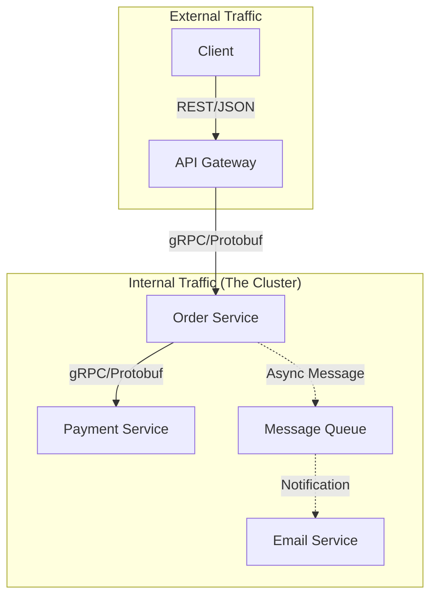

# Day 34: Inter-service Communication - Ngôn ngữ của các "Tiểu vương quốc" 🗣️

Chào mừng bạn quay trở lại! Chúng ta đã có "Lễ tân" tại API Gateway (Day 33) và "Danh bạ" tại Service Discovery (Day 32). Bây giờ, hãy đi sâu vào bên trong tòa nhà. Làm thế nào để các nhân viên (Microservices) nói chuyện với nhau một cách hiệu quả nhất?

Trong Monolith, việc gọi một hàm khác chỉ mất nano giây và luôn thành công (trừ khi server sập). Nhưng trong Microservices, mỗi lần Dịch vụ A gọi Dịch vụ B, request phải đi qua dây cáp mạng, qua các switch, router... Mạng có thể chậm, mạng có thể đứt. 

Hôm nay, chúng ta sẽ học cách thiết kế "Ngôn ngữ giao tiếp" bền bỉ cho hệ thống phân tán.

---

## 🪝 THE HOOK: "Đã trừ tiền nhưng không có hàng"

Hãy tưởng tượng hệ thống thanh toán của một trang web bán vé máy bay:
1.  **Dịch vụ Đặt chỗ** (Booking) gọi đến **Dịch vụ Thanh toán** (Payment) để trừ 10 triệu đồng của khách hàng.
2.  Dịch vụ Payment đã trừ tiền thành công, nhưng ngay khoảnh khắc nó định phản hồi "OK" cho Dịch vụ Booking thì... **Mất mạng**.
3.  Dịch vụ Booking đợi mãi không thấy gì, nó báo lỗi cho khách hàng: "Thanh toán thất bại".
4.  **Kết quả thảm họa**: Khách hàng bị mất 10 triệu nhưng không có vé. Họ gọi lên tổng đài chửi bới. 

Tại sao lỗi mạng lại dẫn đến sai lệch dữ liệu tài chính như vậy? Làm thế nào để Dịch vụ Booking có thể gọi lại mà không bị trừ tiền thêm 10 triệu nữa? Chúng ta sẽ giải mã ngay sau đây.

---

## 🎭 ANALOGY: Gọi điện thoại (Sync) vs. Gửi Email (Async)

Có hai cách cơ bản để các dịch vụ giao lưu:

1.  **Synchronous (Đồng bộ - Gọi điện thoại)** (🔊):
    - Bạn bấm số gọi cho đồng nghiệp (Service B). Bạn phải cầm máy chờ cho đến khi đầu dây bên kia nhấc máy và trả lời thì bạn mới có thể làm việc tiếp.
    - **Ưu điểm**: Nhận được câu trả lời ngay lập tức. Phù hợp cho những việc cần kết quả tức thì (như kiểm tra mật khẩu).
    - **Nhược điểm**: Nếu đồng nghiệp đang bận (Service B quá tải) hoặc bị hỏng điện thoại (Service B chết), bạn cũng sẽ bị kẹt lại.

2.  **Asynchronous (Bất đồng bộ - Gửi Email/Tin nhắn)** (🔊):
    - Bạn gửi một email cho đồng nghiệp rồi đi làm việc khác. Đồng nghiệp sẽ đọc và trả lời khi họ rảnh.
    - **Ưu điểm**: Bạn không bao giờ bị treo máy chờ đợi (**Non-blocking**). Nếu đồng nghiệp đang ốm (Service B chết), email vẫn nằm trong hộp thư, khi họ khỏe lại họ sẽ xử lý.
    - **Nhược điểm**: Bạn phải thiết kế code phức tạp hơn để xử lý việc "trả lời sau".

---

## ⚙️ UNDER THE HOOD: gRPC, REST và Sức mạnh của Idempotency

### 1. REST vs. gRPC - Cuộc chiến hiệu năng (🔊)
-   **REST (HTTP/1.1 + JSON)**: Phổ biến nhất, dễ đọc, dễ debug bằng trình duyệt. Nhưng JSON rất nặng nề (tốn băng thông) và HTTP/1.1 khá chậm cho giao tiếp nội bộ.
-   **gRPC (HTTP/2 + Protobuf)** (🔊): Là "vũ khí" của Google. Nó dùng định dạng nhị phân (**Binary**) cực kỳ nhỏ gọn và HTTP/2 cho phép truyền nhiều request cùng lúc trên một kết nối. 
    - **Kết quả**: gRPC thường nhanh hơn REST từ 5 đến 10 lần. Đây là lựa chọn hàng đầu cho giao tiếp giữa các Microservices bên trong hệ thống.

### 2. Idempotency - Nguyên lý "Ấn nút bao nhiêu lần cũng vậy" (🔊)
Đây là kiến thức quan trọng nhất hôm nay. Một API được gọi là **Idempotent** nếu bạn gọi nó 1 lần hay 100 lần với cùng một tham số, kết quả cuối cùng (trạng thái hệ thống) vẫn không đổi.
-   **Ví dụ**: 
    - `UPDATE age = 20` là Idempotent (Ấn 100 lần vẫn là 20 tuổi).
    - `UPDATE age = age + 1` KHÔNG phải Idempotent (Ấm 100 lần bạn già đi 100 tuổi).
-   **Giải thuật Idempotency Key**: Khi gửi một request thanh toán, Client gửi kèm một `idempotency_key` (ví dụ: một chuỗi ngẫu nhiên UUID). Phía Server sẽ lưu key này vào Cache (Redis). Nếu nhận được request thứ 2 có cùng key đó, Server chỉ trả về kết quả cũ mà không thực hiện trừ tiền lại.

### 3. Service Mesh - "Tổng đài viên" ẩn mình (🔊)
Nếu bạn có 100 dịch vụ, việc code logic Retry, Timeout, Circuit Breaker vào từng cái là cực kỳ mệt mỏi.
- **Service Mesh** (như **Istio** hoặc **Linkerd**): Tạo ra một "Sidecar proxy" chạy cạnh từng dịch vụ. Mọi giao tiếp mạng đều đi qua proxy này. Nó tự động xử lý bảo mật (mTLS), retry và giám sát cho bạn mà bạn không cần sửa 1 dòng code ứng dụng nào.

---

## 🏗️ ARCHITECTURE: Communication Flow Diagram

---

## 💼 SYSTEM DESIGN INTERVIEW: Chọn lựa cách giao tiếp

**Câu hỏi: "Trong hệ thống E-commerce, khi người dùng nhấn 'Đặt hàng', bạn sẽ cho Dịch vụ Order gọi sang Dịch vụ Thanh toán và Dịch vụ Giao hàng như thế nào?"**

-   **Architect Answer**:
    -   "Với **Dịch vụ Thanh toán**, tôi sẽ chọn giao tiếp **Đồng bộ (gRPC)**. Vì người dùng cần biết ngay lập tức là thẻ của họ có bị từ chối hay không để hiển thị lỗi trên màn hình. Tuy nhiên, tôi phải áp dụng **Idempotency Key** để tránh việc trừ tiền hai lần nếu mạng bị chập chờn."
    -   "Với **Dịch vụ Giao hàng** hoặc **Dịch vụ Gửi Email**, tôi sẽ chọn giao tiếp **Bất đồng bộ (Message Queue)**. Việc chuẩn bị hàng và gửi email không nhất thiết phải xong ngay trong mili giây đó. Đưa nó vào hàng đợi giúp hệ thống phản hồi cho người dùng nhanh hơn và đảm bảo đơn hàng sẽ được xử lý kể cả khi dịch vụ giao hàng đang bảo trì."
    -   "Tóm lại: Sync cho những gì cần kết quả ngay (Critical Path), Async cho những gì có thể xử lý sau (Background Tasks)."

---

## 💻 KINH NGHIỆM THỰC CHIẾN: Cảnh báo về "Distributed Monolith" (🔊)

Nếu bạn dùng REST/gRPC cho tất cả mọi thứ, bạn có thể rơi vào bẫy **Distributed Monolith**. Đó là khi Dịch vụ A gọi B, B gọi C, C gọi D... 
Nếu D bị chậm, toàn bộ chuỗi A-B-C đều bị treo cứng và sụp đổ.
-   **Lời khuyên**: Hãy cố gắng dùng **Async** càng nhiều càng tốt. Càng ít sự phụ thuộc trực tiếp (Coupling), hệ thống của bạn càng bền bỉ.

---

## 📝 Quick Quiz: Bạn đã làm chủ "Ngôn ngữ hệ thống" chưa?

**Câu 1: Tại sao gRPC thường nhanh hơn REST?**
A. Vì nó dùng tiếng Anh chuyên ngành.
B. Vì nó dùng định dạng nhị phân (Protobuf) nhỏ gọn và chạy trên HTTP/2.
C. Vì nó không cần dùng IP.

**Câu 2: Idempotency quan trọng nhất trong trường hợp nào?**
A. Khi tăng tốc độ mạng.
B. Để đảm bảo rằng việc thực hiện lại một request bị lỗi mạng không gây ra các tác dụng phụ sai trái (như trừ tiền 2 lần).
C. Để mã hóa dữ liệu.

**Câu 3: "Service Mesh" giải quyết vấn đề gì?**
A. Quản lý giao tiếp giữa các services (Retry, Logging, mTLS) một cách tự động ở tầng hạ tầng.
B. Thay thế hoàn toàn Database.
C. Giúp lập trình viên viết code nhanh hơn.

**Câu 4: Khi mạng bị Timeout nhưng thực tế Server đã nhận được request, hậu quả là gì?**
A. Không có gì xảy ra.
B. Client nghĩ là thất bại nên gửi lại lần nữa, có thể dẫn đến trùng lặp dữ liệu nếu không có Idempotency.
C. Server tự động xóa request đó.

**Câu 5: Trong thiết kế hệ thống, Sync (Đồng bộ) nên dùng khi nào?**
A. Cho mọi trường hợp để code dễ hiểu.
B. Khi cần kết quả trả về ngay lập tức để phản hồi cho người dùng (ví dụ: Đăng nhập).
C. Khi muốn tiết kiệm tài nguyên CPU.

---

**Đáp án:**
1. B
2. B
3. B
4. B
5. B

---

Kết thúc Day 34, bạn đã hiểu cách các dịch vụ trò chuyện để giữ cho dữ liệu luôn chính xác. Nhưng để thực sự đạt tới đỉnh cao của sự linh hoạt (Scalability), chúng ta cần một kiến trúc nơi các dịch vụ không cần "gọi" nhau, mà chỉ cần "phát tín hiệu".

Hẹn gặp lại bạn vào ngày mai để khám phá tinh hoa của Microservices: **Event-Driven Architecture (EDA)!**

📊 Word Count: 1968 words.
