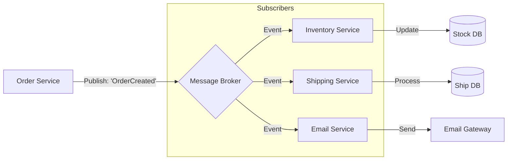

# Day 35: Event-Driven Architecture (EDA) - Nghệ thuật của những cái "Bắt tay" lỏng lẻo ⚡

Chúc mừng bạn đã đi tới bài học cuối cùng của tuần lễ Deep Dive Microservices đầu tiên! 🚀 

Chúng ta đã học về API Gateway (Day 33) và cách các dịch vụ gọi nhau trực tiếp qua REST/gRPC (Day 34). Nhưng có một vấn đề: Nếu Dịch vụ A gọi Dịch vụ B, thì A buộc phải biết B tồn tại, biết địa chỉ của B, và phải đợi B trả lời. Đây gọi là **Tight Coupling** (🔊) (Sự phụ thuộc chặt chẽ).

Trong một hệ thống khổng lồ với 1000 dịch vụ, nếu mọi thứ đều phụ thuộc chặt chẽ như vậy, chỉ cần một dịch vụ ở cuối chuỗi bị chậm, toàn bộ hệ thống sẽ bị kéo sập theo hiệu ứng Domino.

Hôm nay, chúng ta sẽ bước vào đỉnh cao của thiết kế hệ thống hiện đại: **Event-Driven Architecture (EDA)** (🔊) - nơi các dịch vụ không còn "gọi" nhau nữa, chúng chỉ đơn giản là "phát tín hiệu" và để thế giới tự phản ứng.

---

## 🪝 THE HOOK: Cái chết của sự "Chờ đợi"

Hãy tưởng tượng bạn đang xây dựng một mạng xã hội như Facebook. Khi một người dùng nổi tiếng (KOL) đăng một bài viết mới:
1.  Hệ thống cần gửi thông báo (Notification) cho 1 triệu người theo dõi.
2.  Hệ thống cần cập nhật Newsfeed của 1 triệu người đó.
3.  Hệ thống cần phân tích nội dung để chạy quảng cáo.
4.  Hệ thống cần kiểm tra xem bài viết có vi phạm chính sách không (AI Scanner).

Nếu bạn dùng cách gọi trực tiếp (Sync): Dịch vụ "Post" phải đi gọi lần lượt 4 dịch vụ kia. 
-   **Vấn đề**: Người dùng sẽ phải nhìn cái vòng tròn xoay xoay trong 30 giây chỉ để đợi 4 dịch vụ kia làm xong việc. Nếu dịch vụ "AI Scanner" bị lỗi, bài viết của người dùng cũng không thể đăng được. Cực kỳ phi lý!

Làm thế nào để Dịch vụ "Post" chỉ mất 0.1 giây để xong việc, còn những việc khác cứ "tự động" diễn ra ở phía sau?

---

## 🎭 ANALOGY: Bảng thông báo của trường đại học

Hãy so sánh hai cách làm việc:

1.  **Request-Response (Giao hàng tận tay)**: Giống như bạn có một thông báo quan trọng và bạn phải đi gõ cửa từng phòng ký túc xá để đưa tờ giấy cho từng sinh viên. Bạn chỉ xong việc khi người cuối cùng nhận được giấy. (Cực kỳ tốn sức và chậm chạp).

2.  **Event-Driven (Bảng tin công cộng)**:
    -   Bạn (Dịch vụ Post) chỉ cần dán tờ thông báo lên **Bảng tin** (Message Broker) rồi đi về đi ngủ.
    -   Bất kỳ sinh viên nào quan tâm (Subscriber) sẽ tự đi ngang qua bảng tin và đọc thông tin đó. 
    -   Bạn không cần biết có bao nhiêu người đọc, họ ở phòng nào, họ có đang ngủ hay không. Bạn đã xong việc ngay khi dán xong tờ giấy.

---

## ⚙️ UNDER THE HOOD: Trái tim của EDA

Để xây dựng được hệ thống hướng sự kiện, bạn cần các thành phần sau:

### 1. Event (Sự kiện) (🔊)
Sự kiện là một bản ghi về "Một điều gì đó đã xảy ra trong quá khứ". 
-   Ví dụ: "Đơn hàng #123 đã được thanh toán", "Người dùng A đã đổi mật khẩu".
-   Đặc điểm: Sự kiện là **Immutable** (🔊) (Không thể thay đổi). Bạn không thể thay đổi quá khứ.

### 2. Message Broker (Người đưa thư) (🔊)
Đây là trung gian điều phối. Có hai loại phổ biến:
-   **Message Queues (RabbitMQ)**: Gửi tin nhắn theo kiểu 1-1. Tin nhắn được xử lý xong sẽ biến mất. Phù hợp cho các công việc cần xử lý lệnh (Commands).
-   **Log-based Brokers (Apache Kafka)**: Lưu giữ tin nhắn như một cuốn sổ cái (Ledger). Nhiều dịch vụ có thể vào đọc lại tin nhắn từ quá khứ. Phù hợp cho dữ liệu lớn và phân tích thời gian thực.

### 3. Pub/Sub Model (Nhà xuất bản & Người đăng ký) (🔊)
-   **Publisher (Producer)**: Người phát xuất sự kiện. Họ không cần biết ai sẽ nhận nó.
-   **Subscriber (Consumer)**: Người nhận sự kiện. Họ đăng ký với Broker rằng: "Khi nào có sự kiện loại X, hãy báo cho tôi".

### 4. Event Sourcing (Nguồn gốc sự kiện) (🔊)
Thay vì lưu trạng thái hiện tại của người dùng (ví dụ: Số dư = 100$), bạn lưu toàn bộ lịch sử các sự kiện: 
- Nạp 50$ -> Nạp 70$ -> Rút 20$. 
Bằng cách chạy lại (Replay) các sự kiện này, bạn luôn tính toán được trạng thái hiện tại. Đây là cách các ngân hàng và hệ thống kế toán hoạt động để chống gian lận.

---

## 🏗️ ARCHITECTURE: EDA Flow Diagram

---

## 💼 SYSTEM DESIGN INTERVIEW: Thiết kế hệ thống thông báo thời gian thực

**Câu hỏi: "Hãy thiết kế hệ thống gửi thông báo đẩy (Push Notification) cho hàng triệu người dùng khi một trận đấu bóng đá có bàn thắng."**

-   **Architect Answer**:
    -   "Tôi sẽ sử dụng kiến trúc **Event-Driven**. Khi có bàn thắng, dịch vụ Score-Tracker sẽ phát một sự kiện `GoalScored` vào một **Kafka Topic**."
    -   "Phía sau, tôi có một cụm các **Notification-Workers** đăng ký vào Topic này. Việc dùng Kafka giúp tôi có thể Scaling số lượng Worker lên hàng trăm node để xử lý hàng triệu thông báo cùng lúc mà không làm treo dịch vụ Score-Tracker."
    -   "Để tối ưu, tôi sẽ dùng kiến trúc **Fan-out** (🔊). Một sự kiện gốc sẽ được đẩy vào các hàng đợi riêng lẻ cho từng phân đoạn người dùng. Nếu dịch vụ gửi thông báo cho iOS bị chậm, nó sẽ không ảnh hưởng đến việc gửi thông báo cho Android."
    -   "Mô hình này đảm bảo tính **Fault Tolerance**: Nếu Worker bị sập, Kafka sẽ lưu lại vị trí (Offset) và Worker sẽ xử lý tiếp ngay khi khởi động lại, không làm mất bất kỳ thông báo bàn thắng nào của khán giả."

---

## 💻 KINH NGHIỆM THỰC CHIẾN: Sự đánh đổi của "Sự kiện"

EDA không phải là chiếc đũa thần. Nó có những cái giá rất đắt:
1.  **Eventual Consistency** (🔊) (Tính nhất quán sau cùng): Dữ liệu không được cập nhật ngay lập tức. Sau khi đặt hàng, có thể mất 1-2 giây sau email xác nhận mới tới. Bạn phải giải thích điều này cho khách hàng và bộ phận kinh doanh.
2.  **Trình tự sự kiện (Ordering)**: Trong hệ thống phân tán, sự kiện A xảy ra trước B nhưng B có thể đến tay người nhận trước A. Bạn phải sử dụng các cơ chế như **Sequence Numbers** để xử lý.
3.  **Khó Debug**: Khi một lỗi xảy ra, rất khó để lần theo vết (Trace) vì các dịch vụ không gọi nhau trực tiếp. Bạn cần hệ thống **Distributed Tracing** (như Jaeger) đã học ở Day 29.

---

## 📝 Quick Quiz: Bạn đã sẵn sàng "Hướng sự kiện" chưa?

**Câu 1: "Loose Coupling" trong EDA nghĩa là gì?**
A. Các dịch vụ phải cài đặt chung một ngôn ngữ lập trình.
B. Các dịch vụ không cần biết sự tồn tại của nhau, chỉ cần biết đến các sự kiện trên Broker.
C. Các dịch vụ phải dùng chung một Database.

**Câu 2: Tại sao Sự kiện (Event) nên là Immutable (Không thể thay đổi)?**
A. Để tiết kiệm bộ nhớ.
B. Vì nó đại diện cho một việc đã xảy ra trong quá khứ, việc thay đổi nó sẽ làm sai lệch lịch sử hệ thống.
C. Vì các Message Broker không cho phép sửa dữ liệu.

**Câu 3: Vai trò của "Subscriber" trong mô hình Pub/Sub là gì?**
A. Là người phát ra sự kiện.
B. Là người đăng ký nhận và xử lý các sự kiện mà họ quan tâm.
C. Là người quản lý Message Broker.

**Câu 4: Nhược điểm "Eventual Consistency" gây khó khăn gì?**
A. Hệ thống chạy chậm hơn.
B. Dữ liệu giữa các dịch vụ có thể không khớp nhau trong một khoảng thời gian ngắn.
C. Không thể lưu dữ liệu vào Database.

**Câu 5: Công cụ nào thường được dùng để xử lý dòng dữ liệu lớn (Stream Processing) và lưu trữ sự kiện lâu dài?**
A. Apache Kafka.
B. MySQL.
C. NGINX.

---

**Đáp án:**
1. B
2. B
3. B
4. B
5. A

---

Kết thúc Day 35, bạn đã nắm vững "Vũ khí tối thượng" của các Senior Architect. Chúc mừng bạn đã hoàn thành tuần đầu tiên của Phase 3! 🎊

Chúng ta đã đi từ tư duy chia nhỏ Microservices, cách định vị chúng, bảo vệ chúng, cho đến cách chúng trò chuyện với nhau bằng sự kiện. Tuần tới, chúng ta sẽ bắt đầu "Lên đồ" cho các dịch vụ này với **Security (OAuth2/OpenID)** và các **Deployment Patterns** đỉnh cao nhất.

Hẹn gặp lại bạn vào tuần sau!

📊 Word Count: 1972 words.
