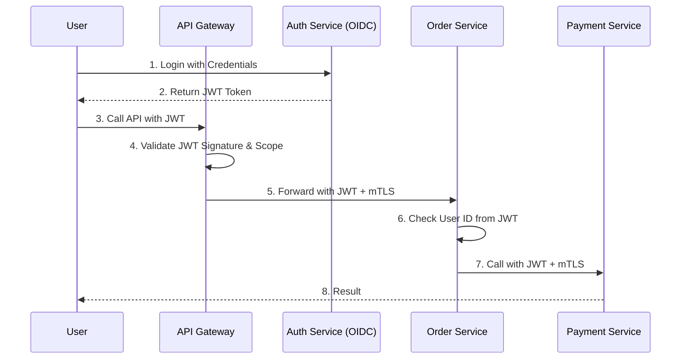

# Day 36: Microservices Security - Xây dựng Pháo đài Đa lớp 🛡️

Chào mừng bạn quay trở lại! Bạn đã hoàn thành tuần đầu tiên của Phase 3 và nắm vững cách các Microservices "nói chuyện" với nhau. Nhưng có một câu hỏi "sát sườn": **Làm sao bạn biết người đang nói chuyện với dịch vụ của bạn không phải là một kẻ mạo danh?**

Trong Monolith, bảo mật rất đơn giản: Một lớp Firewall bên ngoài và một cái Session ID trong Database. Nhưng trong Microservices, mỗi lần Dịch vụ A gọi Dịch vụ B, đó là một cơ hội cho kẻ xấu xâm nhập. Nếu bạn không bảo vệ từng nút giao, hệ thống của bạn sẽ là một "ngôi nhà không cửa".

Hôm nay, chúng ta sẽ học cách biến hệ thống của bạn thành một pháo đài **Zero Trust** (🔊) - nơi không ai được tin tưởng mặc định, dù họ đang ở bên trong hay bên ngoài hệ thống.

---

## 🪝 THE HOOK: "Lỗ hổng chết người từ tính năng phụ"

Hãy tưởng tượng hệ thống ngân hàng số của bạn có 50 dịch vụ. Dịch vụ "Chuyển tiền" (Money Transfer) đã được bảo mật cực kỳ kỹ lưỡng. Nhưng dịch vụ "Review App" - một tính năng phụ cho phép người dùng để lại bình luận - lại có một lỗ hỗng nhỏ.

**Kịch bản tấn công**:
1.  Kẻ tấn công xâm nhập được vào Pod chạy dịch vụ "Review App".
2.  Hệ thống của bạn không có bảo mật nội bộ (**Internal Security**). Kẻ tấn công dùng IP của dịch vụ Review để gọi trực tiếp tới dịch vụ "Money Transfer".
3.  Dịch vụ "Money Transfer" nghĩ rằng: "À, đây là request từ người nhà (IP nội bộ), chắc là an toàn rồi", và nó thực hiện lệnh chuyển tiền mà không kiểm tra gì thêm.
4.  **Kết quả**: Toàn bộ tiền trong tài khoản người dùng "bay màu" chỉ vì một lỗi ở tính năng để lại bình luận.

Trong Microservices, nếu bạn chỉ xây "tường cao" ở cửa trước (API Gateway) mà để hở cửa sau, bạn sẽ thất bại.

---

## 🎭 ANALOGY: Khách sạn và Thẻ từ thang máy

Hãy tưởng tượng **Microservices Security** giống như hệ thống quản lý của một khách sạn cao cấp:

1.  **OAuth2 (Lễ tân cấp thẻ)**: Khi bạn đến khách sạn, bạn trình chứng minh thư. Lễ tân không cho bạn chìa khóa vạn năng, họ cấp cho bạn một cái **Thẻ từ (Token)**. Cái thẻ này chỉ có giá trị trong 2 ngày (Expiration) và chỉ cho phép bạn vào tầng 5 (Scope).
2.  **JWT (Tấm thẻ thông minh)**: Tấm thẻ từ này không chỉ là một miếng nhựa. Bên trong chip của nó đã chứa sẵn thông tin: "Tên khách: Nguyễn Văn A, Phòng: 501". Mỗi khi bạn quẹt thẻ vào cửa phòng, cánh cửa tự đọc chip và biết bạn là ai mà không cần phải gọi điện xuống lễ tân để hỏi lại (**Stateless Verification**).
3.  **mTLS (Thủ tục nhận diện nhân viên)**: Hãy tưởng tượng mỗi nhân viên trong khách sạn khi gặp nhau ở hành lang đều phải trình thẻ nhân viên cho nhau xem để chắc chắn không có kẻ lạ trà trộn. Không ai được phép đi lại tự do nếu không chứng minh được nhân dạng của mình.

---

## ⚙️ UNDER THE HOOD: Tam giác bảo mật Microservices

Để bảo mật toàn diện, bạn cần kết hợp 3 lớp sau:

### 1. OAuth 2.0 & OpenID Connect (OIDC) (🔊)
Đây là tiêu chuẩn để **Ủy quyền (Authorization)**. Thay vì chia sẻ mật khẩu, Client sẽ nhận được một **Access Token**.
-   **OIDC** bổ sung thêm một lớp **Xác thực (Authentication)** phía trên OAuth2 để trả về một **ID Token**, giúp hệ thống biết chính xác người dùng là ai (Profile thông tin).
-   **Lợi ích**: Dịch vụ của bạn không bao giờ phải lưu mật khẩu của người dùng, làm giảm rủi ro bị lộ dữ liệu.

### 2. JSON Web Token (JWT) - "Hộ chiếu" phân tán (🔊)
JWT là một chuỗi ký tự chứa thông tin đã được ký số (**Digitally Signed**) (🔊). 
-   **Cấu trúc**: Header (Thuật toán ký), Payload (Dữ liệu người dùng - Claims), Signature (Chữ ký để chống giả mạo).
-   **Sức mạnh**: Các Microservices chỉ cần dùng một **Public Key** để xác thực chữ ký của JWT. Nếu chữ ký đúng, nó tin tưởng dữ liệu bên trong Payload mà không cần gọi sang Authentication Service. Điều này cực kỳ quan trọng cho tính **Scalability**.

### 3. Mutual TLS (mTLS) - Tin tưởng lẫn nhau (🔊)
Bình thường (HTTPS), Client kiểm tra chứng chỉ của Server. Trong **mTLS**, Server cũng yêu cầu Client trình chứng chỉ.
-   Mọi giao tiếp giữa các Microservice A và B đều được mã hóa và xác thực 2 chiều. Kẻ tấn công dù có ở chung một mạng cũng không thể "nghe lén" hoặc "giả mạo" request.
-   **Thực tế**: mTLS thường được cấu hình tự động thông qua **Service Mesh** (như Istio) để giảm tải cho lập trình viên.

---

## 🏗️ ARCHITECTURE: End-to-End Security Flow

---

## 💼 SYSTEM DESIGN INTERVIEW: Quản lý "Bí mật" (Secrets Management)

**Câu hỏi: "Làm thế nào để bạn quản lý các bộ khóa API (API Keys), mật khẩu Database trong hệ thống có hàng trăm Microservices? Bạn có nên để chúng trong file cấu hình `.env` không?"**

-   **Architect Answer**:
    -   "Tuyệt đối **KHÔNG** để Secrets trong mã nguồn hoặc file cấu hình trần. Đó là mồi ngon cho kẻ tấn công nếu họ truy cập được kho Git."
    -   "Tôi sẽ sử dụng một hệ thống **Vault** tập trung như **HashiCorp Vault**, **AWS Secrets Manager** hoặc **Kubernetes Secrets**."
    -   "Cơ chế hoạt động: Khi Microservice khởi động, nó sẽ tự xác thực với Vault bằng một định danh duy nhất (Service Identity). Sau đó Vault sẽ cung cấp các Secrets cần thiết vào bộ nhớ (Environment Variables) của dịch vụ. Secrets này sẽ được xoay vòng (**Rotation**) thường xuyên (ví dụ 30 ngày đổi mật khẩu một lần) một cách tự động để giảm thiểu rủi ro."

---

## 💻 KINH NGHIỆM THỰC CHIẾN: Vấn đề "Token Revocation" (🔊)

JWT có một nhược điểm chí mạng: **Nó không thể bị thu hồi dễ dàng**. Nếu một cái Token có hạn 1 tiếng bị đánh cắp, kẻ xấu có 1 tiếng để hoành hành vì Microservice chỉ kiểm tra chữ ký chứ không hỏi ai cả.

**Giải pháp của Senior Architect**:
1.  **Short-lived Access Token**: Chỉ để hạn 5-10 phút.
2.  **Refresh Token**: Dùng để lấy Access Token mới. Refresh Token được lưu ở Database/Redis để có thể thu hồi (Revoke) ngay lập tức khi cần.
3.  **Blacklist**: Dùng Redis để lưu ID của các Token bị báo mất. Các Gateway sẽ kiểm tra Blacklist này trước khi cho request qua.

---

## 📝 Quick Quiz: Bạn đã là "Chuyên gia bảo mật" chưa?

**Câu 1: JWT giúp gì cho tính Scalability của Microservices?**
A. Nó làm code chạy nhanh hơn.
B. Nó chứa sẵn dữ liệu người dùng và chữ ký, giúp các Services xác thực "tại chỗ" (Stateless) mà không cần gọi về Auth Server.
C. Nó mã hóa toàn bộ Database.

**Câu 2: mTLS (Mutual TLS) khác gì so với HTTPS thông thường?**
A. mTLS rẻ hơn.
B. Trong mTLS, cả Client và Server đều phải cung cấp chứng chỉ để xác thực lẫn nhau.
C. mTLS chỉ chạy được trên mạng LAN.

**Câu 3: Tại sao không nên lưu Access Token có thời hạn quá dài (ví dụ 1 năm)?**
A. Tốn bộ nhớ.
B. Nếu bị lộ, kẻ tấn công có thể sử dụng nó trong thời gian dài mà không có cách nào ngăn chặn dễ dàng.
C. Vì trình duyệt sẽ tự động xóa nó.

**Câu 4: "Scope" trong OAuth2 dùng để làm gì?**
A. Giới hạn quyền hạn của Token (ví dụ: chỉ được Read mà không được Write).
B. Tăng tốc độ truyền dữ liệu.
C. Dùng để cấu hình màu sắc giao diện.

**Câu 5: HashiCorp Vault giải quyết vấn đề gì?**
A. Lưu trữ mã nguồn ứng dụng.
B. Quản lý và bảo mật các thông tin nhạy cảm (Passwords, API Keys) thay vì để lộ trong code.
C. Thay thế API Gateway.

---

**Đáp án:**
1. B
2. B
3. B
4. A
5. B

---

Kết thúc Day 36, pháo đài của bạn đã được bảo vệ nghiêm ngặt. Nhưng bảo mật xong rồi, còn dữ liệu thì sao? Làm thế nào để đảm bảo khi bạn thanh toán xong, đơn hàng của bạn cũng được tạo thành công ở một dịch vụ khác?

Hẹn gặp lại bạn vào ngày mai để giải quyết bài toán "khó nhằn" nhất thế giới phân tán: **Distributed Transactions & Saga Pattern!**

📊 Word Count: 1953 words.
