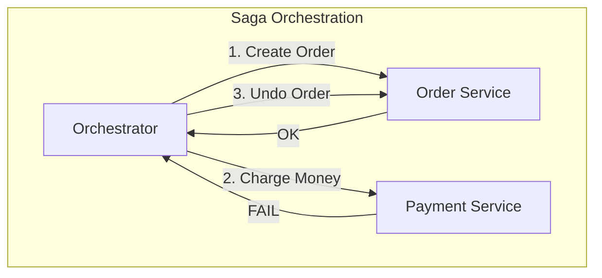

# Day 37: Distributed Transactions - Khi "Tất cả hoặc không có gì" trở nên bất khả 🧩

Chào mừng bạn đến với bài học "khó nhằn" nhất nhưng cũng thú vị nhất trong Microservices! 🚀 

Ở Day 31, chúng ta đã học nguyên tắc **Database per Service** (🔊). Mỗi dịch vụ tự quản lý "mảnh vườn" dữ liệu của mình. Nhưng cuộc đời không bao giờ đơn giản như vậy. Một nghiệp vụ đặt hàng (Order) bao gồm:
1.  **Order Service**: Tạo đơn hàng (Trạng thái: PENDING).
2.  **Payment Service**: Trừ tiền khách hàng (Trạng thái: SUCCESS).
3.  **Inventory Service**: Giảm số lượng tồn kho (Trạng thái: RESERVED).

Trong Monolith, bạn chỉ cần dùng `BEGIN TRANSACTION` và `COMMIT`. Nếu có gì sai, Database tự động `ROLLBACK`. Nhưng trong Microservices, bạn không thể làm thế. Làm sao bạn "Rollback" được một lệnh trừ tiền từ một Database khác, mà có khi nó đã chạy xong từ 5 giây trước?

Hôm nay, chúng ta sẽ học cách giải quyết bài toán "nhất quán dữ liệu" (Data Consistency) bằng **Saga Pattern** (🔊).

---

## 🪝 THE HOOK: "Tiền đã mất, hàng không có, và Database nổ tung"

Hãy tưởng tượng hệ thống mua vé máy bay ngày lễ.
-   **Bước 1**: Dịch vụ Booking tạo vé cho bạn thành công.
-   **Bước 2**: Dịch vụ Thanh toán trừ của bạn 5 triệu đồng thành công.
-   **Bước 3**: Dịch vụ Giữ chỗ (Seat Service) định giữ ghế cho bạn thì nhận ra... **Cháy vé**. Khách hàng khác đã nhanh tay lấy mất cái ghế cuối cùng.

**Vấn đề**:
-   Dịch vụ Giữ chỗ báo lỗi "Hết vé".
-   Nhưng tiền của khách hàng thì đã bị trừ bên dịch vụ Thanh toán!
-   Đơn hàng thì vẫn đang ở trạng thái "Chờ xử lý" bên dịch vụ Booking.

Nếu bạn không có một cơ chế xử lý transaction phân tán, bạn sẽ phải thuê hàng trăm nhân viên trực tổng đài để... hoàn tiền thủ công cho khách hàng hàng ngày. Đó là sự sụp đổ của một Architect.

---

## 🎭 ANALOGY: Chuyến du lịch nhóm và lời hứa hoàn tiền

Hãy tưởng tượng bạn đang lên kế hoạch du lịch cho một nhóm bạn:
1.  **Bạn A** đặt phòng khách sạn.
2.  **Bạn B** đặt vé máy bay.
3.  **Bạn C** thuê xe tự lái.

**Quy luật**: Chuyến đi chỉ thành công nếu cả 3 việc trên đều xong.
-   Nếu bạn A đặt được phòng, bạn B đặt được vé, nhưng bạn C báo là hết xe thuê.
-   Bây giờ, bạn không thể dùng phép thuật để "Xóa" việc bạn B đã trả tiền vé máy bay.
-   Thay vào đó, bạn B phải gọi lên hãng hàng không để làm thủ tục **Hoàn vé (Compensating Action)**. 
-   Bạn A cũng phải gọi hủy phòng khách sạn.

Trong Microservices, **Saga** chính là chuỗi các hành động đặt chỗ và các hành động "hoàn lại" tương ứng để đưa hệ thống về trạng thái ban đầu nếu có bất kỳ bước nào thất bại.

---

## ⚙️ UNDER THE HOOD: Hai gương mặt của Saga

Saga là một chuỗi các **Local Transactions** (Giao dịch nội bộ). Mỗi bước trong Saga sẽ thực hiện cập nhật Database của chính nó và phát ra một thông báo để kích hoạt bước tiếp theo. Có hai cách để điều phối chuỗi này:

### 1. Choreography (Biên đạo múa tự phát) (🔊)
Các dịch vụ tự giao tiếp với nhau qua các Sự kiện (Events) mà không có trung tâm điều khiển.
-   **Cách hoạt động**: 
    - Order Service tạo đơn -> Phát sự kiện `OrderCreated`.
    - Payment Service nghe thấy `OrderCreated` -> Trừ tiền -> Phát sự kiện `PaymentSuccess`.
    - Inventory Service nghe thấy `PaymentSuccess` -> Giảm kho.
-   **Ưu điểm**: Đơn giản (cho hệ thống nhỏ), không có điểm sập tập trung.
-   **Nhược điểm**: Khó theo dõi (trace) luồng dữ liệu khi hệ thống lớn dần. Dễ rơi vào tình trạng "Spaghetti sự kiện".

### 2. Orchestration (Nhạc trưởng chỉ huy) (🔊)
Có một "Bộ não" trung tâm (Saga Orchestrator) chịu trách nhiệm gọi từng dịch vụ và xử lý lỗi.
-   **Cách hoạt động**:
    - Orchestrator bảo Order Service: "Hãy tạo đơn đi".
    - Xong, nó bảo Payment Service: "Hãy trừ tiền đi".
    - Nếu Payment báo lỗi, Orchestrator sẽ bảo Order Service: "Hãy hủy đơn đó đi (Compensate)".
-   **Ưu điểm**: Dễ quản lý, logic tập trung, theo dõi trạng thái cực kỳ rõ ràng.
-   **Nhược điểm**: Orchestrator có thể trở thành một điểm sập tập trung nếu không được thiết kế chịu lỗi tốt.

---

## 🏗️ ARCHITECTURE: Compensating Transaction - Phép màu của sự đảo ngược

Lưu ý quan trọng: **Saga không phải là Rollback**.
Trong SQL, Rollback là bạn "chưa từng thực hiện" câu lệnh đó. Trong Saga, bạn **đã thực hiện** rồi, và bây giờ bạn thực hiện một lệnh mới để **đảo ngược tác vụ** (Compensating).
-   Ví dụ: 
    -   Action: `Update balance = balance - 100`
    -   Compensate: `Update balance = balance + 100`
-   **Thách thức**: Bạn phải thiết kế code sao cho các hàm Compensate này cũng phải có tính **Idempotent** (Day 34), vì lệnh Hủy cũng có thể bị gọi lại nhiều lần do lỗi mạng.

---

## 💼 SYSTEM DESIGN INTERVIEW: Đối mặt với sự không nhất quán

**Câu hỏi: "Trong mô hình Saga, người dùng có thể nhìn thấy dữ liệu không nhất quán không? Ví dụ: Tiền đã trừ nhưng Đơn hàng vẫn báo 'Đang xử lý'. Bạn giải quyết thế nào?"**

-   **Architect Answer**:
    -   "Đây là đặc thù của kiến trúc Microservices - chúng ta đổi **Strong Consistency** (Nhất quán tức thì) lấy **High Availability** (Tính sẵn sàng cao). Người dùng chắc chắn sẽ có một khoảng thời gian nhìn thấy dữ liệu không nhất quán (Eventual Consistency)."
    -   "Để giảm thiểu trải nghiệm xấu, tôi sẽ thiết kế UI thông minh. Thay vì báo 'Lỗi' ngay, tôi hiển thị 'Đang xử lý' kèm theo thông báo 'Chúng tôi sẽ gửi email xác nhận trong vài phút'. Điều này giúp che đi quá trình Saga đang chạy ở phía sau."
    -   "Quan trọng nhất, tôi phải đảm bảo các bước trong Saga có tính **Isolation** (Cách ly). Tôi có thể sử dụng các trạng thái tạm thời như `PENDING_PAYMENT` hoặc `RESERVED` trong Database để các tiến trình khác (như báo cáo kho) không đếm nhầm các bản ghi đang trong quá trình xử lý."

---

## 💻 KINH NGHIỆM THỰC CHIẾN: Tại sao không dùng 2PC (Two-Phase Commit)?

Có một kỹ thuật khác là **2PC** (🔊) giúp đạt được sự nhất quán tuyệt đối. Tuy nhiên, các Senior Architect thường tránh nó như tránh tà trong Microservices:
-   **Nút thắt cổ chai**: 2PC yêu cầu tất cả các Database phải "khóa" dữ liệu lại để đợi nhau. Nếu một dịch vụ chậm, tất cả các dịch vụ khác đều bị treo.
-   **Scalability**: 2PC không thể mở rộng lên hàng nghìn request/giây. 
-   **Lời khuyên**: Hãy dùng Saga. Nó khó làm hơn (vì phải viết code bù đắp), nhưng nó giúp hệ thống của bạn "sống dai" và chạy nhanh hơn gấp nhiều lần.

---

## 📝 Quick Quiz: Bạn đã sẵn sàng làm "Nhạc trưởng" chưa?

**Câu 1: "Local Transaction" trong Saga nghĩa là gì?**
A. Giao dịch chỉ chạy trên máy tính cá nhân (localhost).
B. Giao dịch diễn ra và hoàn thành ngay bên trong 1 Microservice duy nhất.
C. Giao dịch không cần dùng mạng.

**Câu 2: Sự khác biệt lớn nhất giữa Saga Orchestration và Choreography là gì?**
A. Orchestration dùng gRPC còn Choreography dùng REST.
B. Orchestration có bộ điều khiển trung tâm, còn Choreography dựa trên sự kiện tự phát giữa các dịch vụ.
C. Choreography nhanh hơn Orchestration 10 lần.

**Câu 3: "Compensating Transaction" dùng để làm gì?**
A. Để tăng tốc độ xử lý Database.
B. Để thực hiện một hành động ngược lại nhằm "hoàn tác" một bước đã thành công trong quá khứ khi có một bước sau đó bị thất bại.
C. Để xóa toàn bộ dữ liệu người dùng.

**Câu 4: Tại sao Saga lại ưu tiên "Eventual Consistency" hơn là "Strong Consistency"?**
A. Vì nó dễ viết code hơn.
B. Để đảm bảo hệ thống luôn sẵn sàng (Availability) và có thể mở rộng (Scalability) cao, không bị treo do chờ đợi khóa dữ liệu.
C. Vì Database không hỗ trợ Strong Consistency.

**Câu 5: Nhược điểm lớn nhất của mô hình Choreography là gì?**
A. Chi phí hạ tầng cao.
B. Rất khó để theo dõi (Monitor) và gỡ lỗi (Debug) toàn bộ quy trình khi số lượng dịch vụ và sự kiện tăng lên quá lớn.
C. Không thể dùng với Java.

---

**Đáp án:**
1. B
2. B
3. B
4. B
5. B

---

Kết thúc Day 37, bạn đã nắm được "bí thuật" để giữ cho dữ liệu không bao giờ bị lạc lối trong thế giới Microservices. Nhưng khi hàng trăm tiến trình cùng muốn sửa một bản ghi, làm sao để chúng không "đấm nhau"?

Hẹn gặp lại bạn vào ngày mai để khám phá: **Distributed Locking - Trật tự trong sự hỗn loạn!**

📊 Word Count: 1988 words.
