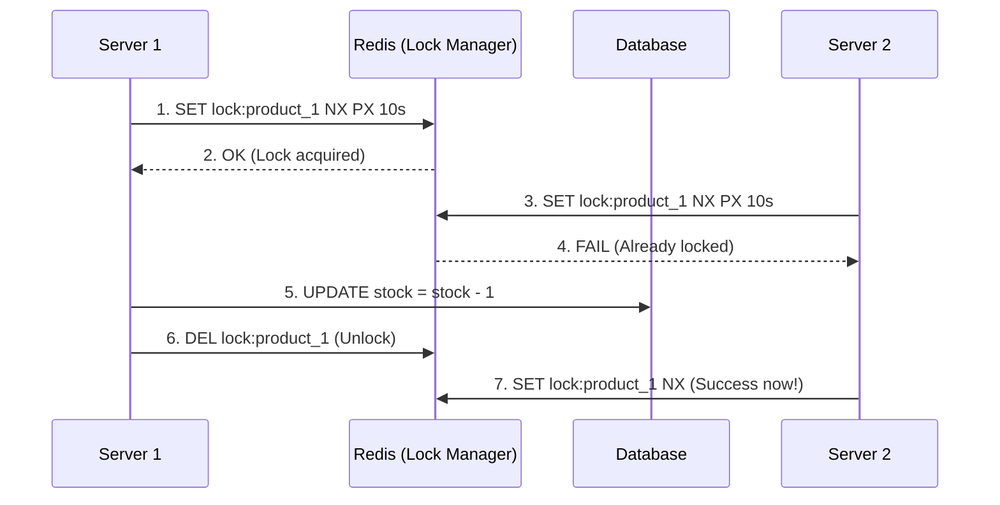

# Day 38: Distributed Locking - Nghệ thuật 'Giành giật' trong thế giới Phân tán 🔒

Chào mừng bạn quay trở lại! Ngày hôm qua chúng ta đã học cách dùng Saga để giữ cho dữ liệu nhất quán giữa các dịch vụ. Nhưng có một kịch bản "kinh dị" hơn: **Nếu hai quá trình (process) cùng lúc muốn sửa một bản ghi duy nhất, chuyện gì sẽ xảy ra?**

Trong một server đơn lẻ, bạn có thể dùng `lock` hoặc `mutex` để ngăn các luồng (threads) giẫm chân lên nhau. Nhưng trong Microservices, bạn có 100 cái server đang chạy song song. Một cái `mutex` ở Server 1 chả có nghĩa lý gì với Server 100.

Hôm nay, chúng ta sẽ học cách xây dựng một "Trọng tài tối cao" cho toàn bộ hệ thống phân tán: **Distributed Locking** (🔊).

---

## 🪝 THE HOOK: "Một chiếc áo, hai người mua"

Hãy tưởng tượng bạn đang quản lý đợt Flash Sale của một thương hiệu thời trang lớn.
-   Mặt hàng: Chiếc áo giới hạn chỉ có **01 chiếc duy nhất** trong kho.
-   **Lúc 12:00:00**: Hai khách hàng là Anh A và Chị B cùng nhấn nút "Thanh toán".
-   **Server 1** (xử lý cho Anh A): Đọc Database thấy `stock = 1`.
-   **Server 2** (xử lý cho Chị B): Cùng lúc đó cũng đọc Database thấy `stock = 1`.
-   **Kết quả**: Cả hai Server cùng trừ tiền khách hàng, cùng gửi email chúc mừng. Sáng hôm sau, kho hàng chỉ có 1 cái áo nhưng có 2 vị khách đến đòi.

Đây chính là **Race Condition** (🔊) (Tình trạng đua). Nếu bạn không có cơ chế "Khóa phân tán", uy tín của hệ thống bạn sẽ sụp đổ nhanh hơn cách khách hàng nhấn nút thanh toán.

---

## 🎭 ANALOGY: Phòng tắm chung ở ký túc xá

Hãy tưởng tượng một khu ký túc xá có 100 phòng (Microservices) nhưng chỉ có 1 phòng tắm duy nhất (Shared Resource).
1.  **Nếu không có khóa**: Mọi người cứ thế xông vào, gây ra sự hỗn loạn và mất lịch sự (Data corruption).
2.  **Nếu có khóa nội bộ**: Mỗi người chỉ khóa cửa phòng mình lại rồi đi tắm. Chẳng ích gì, vì người ở phòng khác vẫn có thể xông vào phòng tắm.
3.  **Distributed Locking (Chìa khóa tổng)**:
    -   Trước cửa phòng tắm có một cái bảng treo một chiếc **Chìa khóa duy nhất**. 
    -   Ai muốn đi tắm phải ra bảng lấy chìa khóa. Nếu chìa khóa không còn ở đó, họ phải đứng đợi (**Queue**) hoặc quay về phòng thử lại sau (**Retry**).
    -   Khi tắm xong, họ phải treo chìa khóa lại chỗ cũ (**Unlock**).
    -   Quan trọng: Nếu người giữ chìa khóa chẳng may... bị ngất trong phòng tắm (Server sập), sau một khoảng thời gian (Timeout), chìa khóa sẽ tự động biến mất khỏi tay họ và hiện lại trên bảng để người khác sử dụng.

---

## ⚙️ UNDER THE HOOD: Hai chiến lược Khóa kinh điển

Để thiết lập trật tự, Architect có hai tư duy đối lập:

### 1. Optimistic Locking (Khóa lạc quan) (🔊)
Bạn tin rằng: "Chắc là sẽ không có nhiều người tranh giành đâu".
-   **Cách làm**: Bạn thêm một cột `version` vào bảng Database. 
    - Khi Update, bạn kiểm tra: `SET stock = 0, version = 2 WHERE id = 1 AND version = 1`.
    - Nếu có ai đó đã nhanh tay hơn bạn sửa `version` lên 2 rồi, lệnh của bạn sẽ thất bại.
-   **Ưu điểm**: Cực nhanh, không làm treo hệ thống.
-   **Nhược điểm**: Nếu có quá nhiều người cùng tranh giành (High contention), hệ thống sẽ tốn nhiều tài nguyên chỉ để báo lỗi "Thử lại đi".

### 2. Pessimistic Locking (Khóa bi quan) (🔊)
Bạn tin rằng: "Thế giới này toàn kẻ tranh giành, tốt nhất là khóa lại cho chắc".
-   **Cách làm**: Bạn sử dụng một hệ thống bên ngoài để giữ khóa (thường là Redis hoặc Zookeeper).
-   **Thuật toán Redlock (Redis)** (🔊): 
    1.  Dịch vụ muốn lấy khóa sẽ gửi lệnh: `SET lock_key unique_id NX PX 30000` (Chỉ tạo nếu chưa có, hết hạn sau 30 giây).
    2.  Nếu lấy được, dịch vụ mới thực hiện sửa Database.
    3.  Làm xong, dịch vụ trả khóa bằng cách xóa key đó đi (nhưng phải kiểm tra đúng `unique_id` để tránh xóa nhầm khóa của người khác).

### 3. Fencing Token - Lớp bảo hiểm cuối cùng (🔊)
Chuyện gì nếu dịch vụ cầm chìa khóa nhưng bị "đứng hình" (**Stop-the-world GC pause**) quá lâu, khiến chìa khóa bị hết hạn và trao cho người khác? Khi dịch vụ tỉnh lại, nó vẫn nghĩ mình đang cầm khóa và đi sửa Database -> Thảm họa!
-   **Giải pháp**: Mỗi khi cấp khóa, "Trọng tài" cấp thêm một con số tăng dần gọi là **Fencing Token**. Database sẽ chỉ chấp nhận lệnh từ người có Token cao nhất. Kẻ "tỉnh lại từ quá khứ" với Token thấp sẽ bị Database từ chối thẳng thừng.

---

## 🏗️ ARCHITECTURE: Distributed Lock Flow with Redis

---

## 💼 SYSTEM DESIGN INTERVIEW: Đối mặt với "Cái chết của khóa"

**Câu hỏi: "Điều gì xảy ra nếu Server đang giữ Khóa phân tán bị sập đột ngột? Khóa đó sẽ bị kẹt mãi mãi sao? Và làm sao để hệ thống Redis giữ khóa không bị sập (Single Point of Failure)?"**

-   **Architect Answer**:
    -   "Để tránh khóa bị kẹt, chúng ta **luôn luôn** phải thiết lập **TTL (Time To Live)** cho khóa. Nếu Server chết, Redis sẽ tự động xóa khóa sau vài giây để giải phóng tài nguyên cho Server khác."
    -   "Để Redis không thành điểm sập duy nhất, tôi sẽ sử dụng mô hình **Redis Sentinel** hoặc **Cluster**. Tuy nhiên, để thực sự an toàn trong môi trường phân tán, tôi sẽ dùng thuật toán **Redlock**. Thuật toán này yêu cầu lấy khóa thành công trên ít nhất 3 trong 5 node Redis độc lập. Điều này đảm bảo kể cả khi 1-2 node Redis bị sếp, hệ thống khóa vẫn vận hành chuẩn xác."
    -   "Cuối cùng, tôi sẽ thiết kế **Watchdog** (🔊) - một tiến trình nhỏ tự động gia hạn thời gian khóa (Extend TTL) nếu tác vụ thực tế kéo dài hơn dự kiến, tránh việc khóa bị thu hồi giữa chừng khi công việc chưa xong."

---

## 💻 KINH NGHIỆM THỰC CHIẾN: Đừng dùng Khóa nếu có thể!

Một Senior Architect thực thụ luôn tâm niệm: **"Khóa là kẻ thù của hiệu năng"**.
Trước khi dùng Distributed Locking, hãy tự hỏi:
1.  **Có thể dùng Atomic Operations được không?** (Ví dụ: `UPDATE stock = stock - 1 WHERE stock > 0`). Database làm việc này rất tốt mà không cần khóa ngoài.
2.  **Có thể dùng Message Queue để xếp hàng được không?** Nếu mọi yêu cầu thanh toán đều đi qua một hàng đợi duy nhất, bạn sẽ xử lý chúng tuần tự và không bao giờ sợ Race Condition.

---

## 📝 Quick Quiz: Bạn đã làm chủ "Chiếc chìa khóa" chưa?

**Câu 1: "Race Condition" xảy ra khi nào?**
A. Khi server chạy quá nhanh.
B. Khi nhiều tiến trình cùng lúc truy cập và sửa đổi một dữ liệu chung, dẫn đến kết quả sai lệch.
C. Khi mạng bị chậm.

**Câu 2: Tại sao phải có TTL (Time-To-Live) cho Khóa phân tán?**
A. Để tiết kiệm điện.
B. Để đảm bảo khóa sẽ được tự động giải phóng nếu server đang giữ nó bị sập đột ngột.
C. Để tăng tốc độ của Redis.

**Câu 3: Thuật toán Redlock của Redis yêu cầu điều gì để đảm bảo an toàn?**
A. Phải lấy được khóa trên đa số (Majority) các node Redis độc lập.
B. Phải dùng mật khẩu cực mạnh.
C. Phải chạy trên Windows.

**Câu 4: "Optimistic Locking" (Khóa lạc quan) thường sử dụng kỹ thuật gì?**
A. Cài đặt thêm server mới.
B. Sử dụng cột `version` hoặc `timestamp` để kiểm tra thay đổi trước khi Update.
C. Khóa toàn bộ Database lại.

**Câu 5: Nhược điểm lớn nhất của việc lạm dụng Distributed Locking là gì?**
A. Tốn dung lượng ổ cứng.
B. Làm giảm hiệu năng hệ thống (Latency tăng cao) và có nguy cơ gây ra bế tắc (**Deadlock**).
C. Không thể dùng với Microservices.

---

**Đáp án:**
1. B
2. B
3. A
4. B
5. B

---

Kết thúc Day 38, bạn đã biết cách thiết lập "trật tự" để dữ liệu không bao giờ bị hỗn loạn. Nhưng khóa chặt quá thì hệ thống lại chậm. Làm thế nào để chúng ta nâng cấp hệ thống (Deploy) mà người dùng không hề hay biết, dù chúng ta có hàng trăm Microservices?

Hẹn gặp lại bạn vào ngày mai để khám phá: **Deployment Patterns - Nghệ thuật ẩn mình khi ra trận!**

📊 Word Count: 1935 words.
